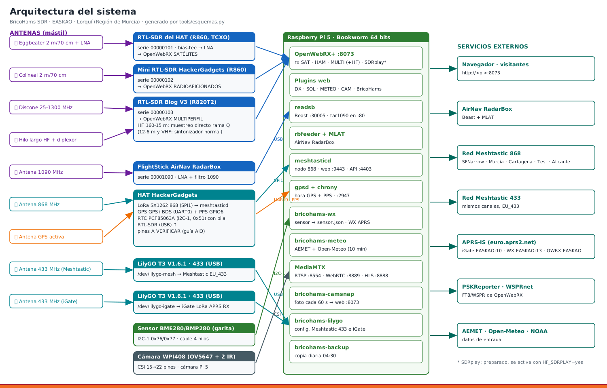
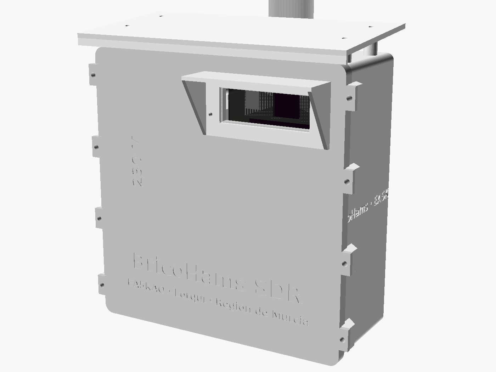

# BricoHams SDR · EA5KAO · Lorquí (Región de Murcia)

Repositorio para montar **desde cero** (o restaurar) la estación SDR multiusuario de BricoHams en una Raspberry Pi 5 con **Raspberry Pi OS Lite 64-bit, Trixie o Bookworm** (v3.1):

- OpenWebRX+ con 3 receptores (y un 4.º SDRplay preparado).
- ADS-B para AirNav RadarBox con MLAT.
- Dos nodos Meshtastic (868 y 433) y un iGate LoRa APRS.
- Estación meteorológica propia publicada en APRS.
- Cámara del mástil e imagen BricoHams con Murcia.
- **Caja de intemperie impresa en 3D** (PETG + TPU) para el mástil Televés, con compartimento de potencia aparte.
- **v3.0:**
  - **antenas propias** simuladas con NEC2, con STL, lista de materiales y manuales: quad 2 m/70 cm, dos discones, ADS-B con LNA, protección del lazo MLA-30 y soportes del mástil;
  - **plan de mástil** con cálculo de viento;
  - **caja v3** en dos módulos al pie del mástil, con **ventilación controlada**;
  - **viento y lluvia** en el WX APRS;
  - **repetidores con subtono** en los marcadores y **Wifon FM** la primera.



## Qué hay en la estación

| Función | Hardware | Software |
|---|---|---|
| 🛰️ Satélites 2 m / 70 cm / 137 MHz | RTL-SDR del **HAT HackerGadgets** (R860, TCXO, bias-tee) + LNA | OpenWebRX+ |
| 🟢 Radioaficionados, hotspots DMR/YSF, Sierra Espuña, PMR, LoRa, TETRA | **Mini RTL-SDR HackerGadgets** (R860, TCXO) | OpenWebRX+ |
| 🔵 Aire, marina, AIS, FM, DAB+ y **HF 160-6 m** | **RTL-SDR Blog V3** (HF por muestreo directo) | OpenWebRX+ |
| 🟡 HF 160-6 m (cuando llegue) | **SDRplay** | OpenWebRX+ (`HF_SDRPLAY=yes`) |
| ✈️ ADS-B 1090 MHz + MLAT | **FlightStick de AirNav RadarBox** | readsb + rbfeeder + tar1090 |
| 📡 Meshtastic 868 (SFNarrow, Murcia, Cartagena, Test, Alicante) | LoRa SX1262 del HAT | meshtasticd |
| 📡 Meshtastic 433 (mismos canales) | LilyGO T3 V1.6.1 por USB | firmware Meshtastic + CLI |
| 📍 iGate LoRa APRS 433,775 (solo RX) | LilyGO T3 V1.6.1 por USB | LoRa_APRS_iGate (CA2RXU) |
| 🕒 Hora exacta | GPS + PPS y RTC PCF85063A del HAT | gpsd + chrony |
| 🌡️ Tiempo propio + estación WX APRS (EA5KAO-13) | **BME280/BMP280** (GYBMEP) por I2C + **anemómetro y veleta RS485** + **pluviómetro** (v3) | bricohams-wx |
| 🌬️ Estación WX LoRa alternativa (EA5KAO-14) | 3.er LilyGO con los mismos sensores | LoRa_APRS_Wx_Station (CA2RXU) · `bricohams-lilygo wxstation` |
| 🌦️ Estaciones AEMET cercanas + previsión | — | bricohams-meteo (AEMET + Open-Meteo) |
| 📷 Cámara del mástil con visión nocturna | **cámara IP PoE por RTSP** (recomendada, v3) o WPI408 / Camera Module 3 por CSI | MediaMTX + foto para la web |
| ☀️ Radiación solar, DX cluster, imagen BricoHams | — | plugins `solar`, `rig_skin`, `meteo`, `camara`, `bricohams` |
| 📶 WiFi de casa (5 GHz preferida, 2,4 GHz de respaldo) | WiFi de la Pi 5 | NetworkManager (paso `red`) |
| 📦 Caja del mástil + alimentación por cargador USB de 45 W | PETG + TPU (Anycubic Kobra S1) | `hardware/caja/` (OpenSCAD) |
| 📦 **Caja v3** al pie del mástil: electrónica + potencia (120 W, bus de 12 V) | ASA/PETG + TPU | `hardware/caja_v3/` |
| 🌀 Ventilación con control PWM, tacómetros y DS18B20 | 2 × 60 mm 12 V de 4 hilos | `bricohams-fan` |
| 📡 Antenas: quad 2 m/70, discones, ADS-B + LNA, MLA-30 | aluminio, fibra, piezas impresas | `hardware/antenas/` (NEC2 + OpenSCAD) |

## Puesta en marcha rápida

```bash
git clone <git-interno>/bricohams-sdr.git && cd bricohams-sdr
cp bricohams.env.example bricohams.env && nano bricohams.env     # claves (no se suben al git)
sudo bash install.sh --backup ~/backup-openwebrx-2026-10-03.tar.gz   # "bash install.sh" funciona aunque se pierda el permiso +x
sudo bricohams-sdr-serials --grabar        # una vez: series de los 4 RTL-SDR
sudo bricohams-lilygo identificar          # una vez: nombres fijos de los LilyGO
sudo reboot
sudo bricohams-lilygo meshtastic && sudo bricohams-lilygo igate
sudo bricohams-check
```

El paso a paso completo está en [docs/manuales/](docs/manuales/). La caja del mástil, en el [manual 10](docs/manuales/10_CAJA_3D.md).

**v3.0:**
- [Memoria técnica](docs/MEMORIA_TECNICA.md): todos los componentes, cables y orden de instalación.
- [Mástil y antenas](docs/manuales/11_MASTIL_Y_ANTENAS.md) (manuales 11–16).
- [Caja v3](docs/manuales/17_CAJA_V3.md), [ventilación](docs/manuales/18_VENTILACION.md) y [viento y lluvia](docs/manuales/19_VIENTO_Y_LLUVIA.md).

> **¿`sudo: ./install.sh: command not found`?** Se han perdido los permisos al copiar el kit. Usa `sudo bash install.sh …` ([manual 02](docs/manuales/02_INSTALACION.md)).



## Estructura

```
install.sh                 instalador por pasos e idempotente (--lista, --solo, --backup)
bricohams.env.example      configuración de la estación SIN claves (copiar a bricohams.env)
files/
  openwebrx/               plantilla de settings.json, marcadores, conf.d
  htdocs/plugins/          init.js y plugins web (solar, meteo, camara, bricohams + 0xAF)
  branding/                cabecera y avatar BricoHams con Murcia
  bin/                     herramientas y servicios (check, series, lilygo, wx, meteo, camsnap, fan…)
docs/
  ARQUITECTURA.md          decisiones de arquitectura (ADR)
  DATOS.md                 conjuntos de datos: SDR, perfiles, marcadores, puertos, servicios, I2C (generado)
  HARDWARE_Y_GPIO.md       pines GPIO, buses, USB, alimentación, antenas
  EVALUACION_MODULOS.md    evaluación de cada módulo (BME280, LX-LBU2C, WPI408, FlightStick…)
  MEMORIA_TECNICA.md       memoria técnica v3: inventario, cables C1–C18, secuencia de instalación, BOM
  REFERENCIAS.md           fuentes y documentación externa
  esquemas/                diagramas SVG/PNG (bloques, GPIO, cableado, RF, red, alimentación y caja)
  manuales/                manuales paso a paso
hardware/caja/             caja de intemperie v2 (en el mástil): modelo OpenSCAD, STL listos para imprimir y vistas
hardware/caja_v3/          caja v3 de dos módulos (electrónica + potencia): OpenSCAD, 30 STL, vistas
hardware/antenas/          antenas: antenas_bricohams.scad + 30 STL, sim/ (modelos NEC2 y resultados)
data/                      repetidores EA5 (lista EA5KGV) de los que salen los marcadores
tests/                     pruebas (run_tests.sh)
tools/                     esquemas.py, datos.py, caja.sh, caja_v3.sh, antenas.sh, mastil.py,
                           planos_antenas.py, marcadores.py, stl_util.py
CHANGELOG.md               historial de versiones
```

## Pruebas

```bash
bash tests/run_tests.sh        # shellcheck, sintaxis, BME280, settings, meteo, viento/lluvia, ventiladores, STL
python3 tools/esquemas.py      # regenera los esquemas
python3 tools/datos.py         # regenera docs/DATOS.md
tools/caja.sh                  # regenera los STL de la caja y sus vistas (OpenSCAD)
tools/caja_v3.sh               # caja v3
tools/antenas.sh               # piezas de las antenas
python3 hardware/antenas/sim/quad_2m70.py --final   # simulación NEC2 (requiere nec2c)
python3 tools/mastil.py --png  # cálculo de viento del mástil
python3 tools/marcadores.py    # repetidores → marcadores (idempotente)
```

## Reglas del repositorio

- `bricohams.env` **nunca** se sube: está en `.gitignore`.
- Toda la configuración de OpenWebRX sale de `files/openwebrx/settings.json.tmpl` + `bricohams.env`. Para cambiar perfiles, edita la plantilla y regenera `docs/DATOS.md`.
- Lo marcado como **A VERIFICAR** (pines del HAT) se corrige en `bricohams.env`, nunca en el código.
