# Guía visual de instalación y módulos

Guía de entrada para personas sin experiencia con este kit. **No ejecutes todos los
cuadros seguidos**: elige el módulo y comprueba su hardware y sus dependencias.
Los comandos son para la terminal **Bash de la Raspberry**, no PowerShell del PC.
Se ejecutan desde la carpeta del kit que contiene install.sh.

Esta guía complementa, no sustituye, los 41 manuales: conserva allí los detalles
de cableado, firmware, formularios y restauración. Cada ficha enlaza su procedimiento.
Los diagramas son ilustraciones de diseño; las dos capturas son recortes reales
de la interfaz. No se presentan maquetas ni salidas inventadas como pruebas.

## 1. Elegir el recorrido

| Situación | Recorrido |
|---|---|
| Tarjeta nueva | Preparación → configuración privada → instalación completa → pruebas |
| Añadir un módulo | Backup y restauración previstos → editar configuración → paso del módulo → verificar |
| Actualizar | Manual 29: simulación → backup verificado → actualización → pruebas |
| Migrar a otra Pi | Manual 31: exportar perfil, verificar, importar; revisar series y hardware del destino |
| Solo consultar | No ejecutar instalador; consultar estado y manual del módulo |

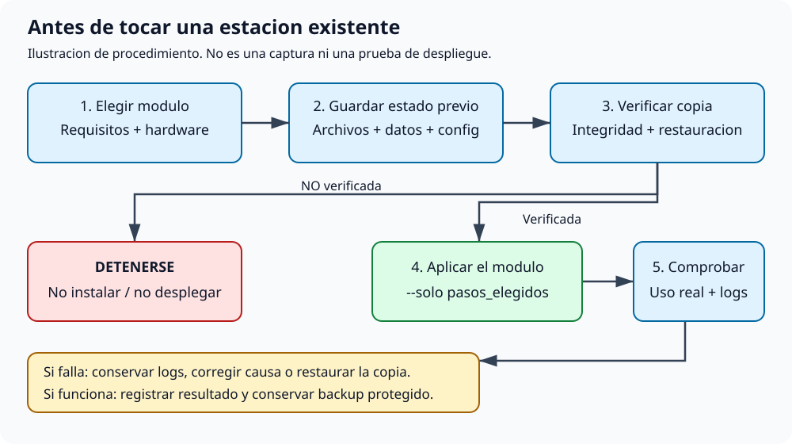

### Preparar la configuración sin sobrescribir la existente

1. Sigue [01_PREPARACION](manuales/01_PREPARACION.md) para grabar el sistema y obtener el repositorio.
2. Entra en la carpeta del kit **en la Pi**. Si ya existe bricohams.env, edítalo:
   no lo sustituyas por la plantilla.
3. Usa indicativo, ubicación y dispositivos propios; N0CALL y coordenadas de
   muestra no son una configuración apta para transmitir.

```bash
pwd
ls install.sh bricohams.env.example
# SOLO si todavia no existe bricohams.env:
cp -n bricohams.env.example bricohams.env
chmod 600 bricohams.env
nano bricohams.env
sudo bash install.sh --lista
```

La plantilla explica las variables. El instalador lee el bricohams.env del kit y
lo copia a /etc/bricohams; no mezcles versiones distintas del fichero. Las claves
se introducen en el editor o panel privado, nunca en comandos compartidos.

### Backup, comprobación y restauración antes de cambiar una estación

En una instalación existente crea una copia externa/imagen de tarjeta y conserva
las configuraciones y datos de todos los servicios afectados. La copia habitual
de configuración **no es una imagen completa**: revisa también volúmenes Docker,
bases de datos TAK/Grafana y archivos externos al kit si los vas a modificar.
Documenta destino, fecha, alcance y procedimiento de restauración. Detalles:
[09_MANTENIMIENTO](manuales/09_MANTENIMIENTO.md) y [31_CLONAR_OPENWEBRX](manuales/31_CLONAR_OPENWEBRX.md).

| Acción | Comando o procedimiento |
|---|---|
| Crear copia habitual, si la herramienta ya está instalada | `sudo bricohams-backup` |
| Comprobar integridad del archivo elegido | Cuadro siguiente; usa la ruta real, no el ejemplo |
| Probar restauración | En tarjeta/equipo de repuesto; manual 09 (configuración) o 31 (perfil) |
| Si no hay herramienta previa | Imagen externa y copia de archivos/datos afectados; no instalar encima para obtener el primer backup |
| Si falla copia o comprobación | **Detenerse: no instalar ni desplegar** |


```bash
# Sustituye la ruta por TU archivo ya creado; no imprime su contenido.
copia=/ruta/backup.tar.gz
sudo gzip -t "$copia" && sudo tar -tzf "$copia" >/dev/null && sudo sha256sum "$copia"
```

Registra el SHA-256 fuera del destino y compáralo tras transferir la copia.
gzip/tar comprueban legibilidad, no que el alcance esté completo ni que una
aplicación pueda restaurarse: prueba la restauración y detén los servicios que
necesiten una copia consistente. No publiques archivos que contengan usuarios,
tokens, certificados o coordenadas. No extraigas un tar desconocido sobre /.

### Instalar, comprobar y volver atrás


```bash
# Instalacion COMPLETA: solo tras revisar todos los perifericos y opciones.
sudo bash install.sh
# Despues, si se instalo el paso herramientas:
sudo bricohams-check
```

Para añadir un módulo utiliza su cuadro de instalación. **--solo no resuelve
automáticamente dependencias omitidas**. En una Pi limpia sigue primero el manual 02.
Un servicio omitido por una opción desactivada no es un éxito funcional.
Si falla algo, conserva el registro, corrige la causa y repite solo lo necesario.
Deshacer cambios exige el backup correspondiente, la configuración anterior y
el procedimiento del módulo; repetir el instalador no revierte versiones de paquetes.

## 2. Capturas reales anonimizadas: cómo usar el mapa

Abre /map desde el portal del receptor. Los archivos publicados excluyen por recorte
la barra del navegador, cabecera, indicativo, localidad, coordenadas, nodos,
aviones y teselas del mapa; no se ocultan datos mediante un rectángulo reversible.
No muestran credenciales ni QR. La captura no prueba recepción RF ni conexión
a proveedores: para eso están las comprobaciones de la ficha ADS-B.

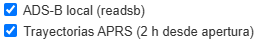

1. Marca **ADS-B local (readsb)** para ver aviones de tu receptor.
2. Pulsa un avión para abrir su ficha. Fotos, matrícula/modelo y ruta requieren
   datos del proveedor; pueden faltar sin que falle la recepción.
3. Las trayectorias APRS se acumulan desde la apertura: dos posiciones distintas
   como mínimo, hasta dos horas; al recargar se pierde ese historial.

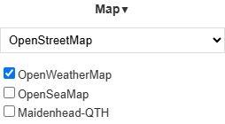

4. Elige cartografía en **Map**. OpenWeatherMap necesita su clave configurada;
   una capa marcada no asegura que el proveedor esté respondiendo.
5. No confundas la capa de aviones locales con el portal RadarBox/map.flights.
   El envío simultáneo se configura y comprueba como sigue:

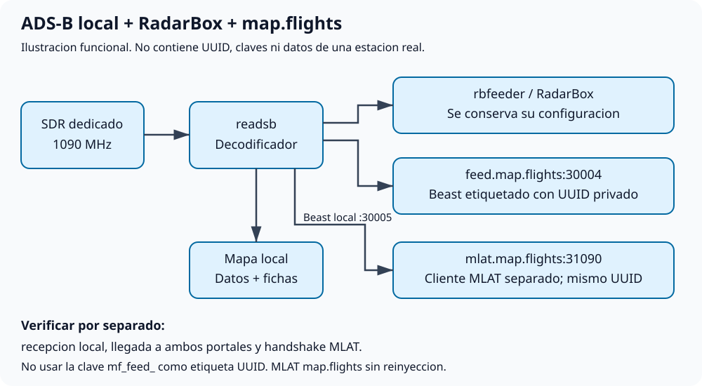

El MLAT de map.flights no reinyecta resultados en readsb. No elimines el feed ni
la configuración de RadarBox para añadir el segundo destino.

## 3. Índice de módulos y cobertura del instalador

| Módulo | Pasos reales de install.sh | Ficha |
|---|---|---|
| Sistema base, red, arranque y HAT | `comprobar`, `base`, `red`, `arranque`, `hat`, `banner` | [Abrir](#sistema) |
| OpenWebRX+, RTL-SDR y SDRplay | `openwebrx`, `rtlsdr`, `sdrplay`, `configuracion` | [Abrir](#receptor) |
| Plugins, registro de oyentes, CTCSS y RepeaterBook | `plugins`, `web` | [Abrir](#plugins) |
| Locator, canales y marcadores de la zona | `configuracion`, `meteo` | [Abrir](#zona) |
| Meshtastic HAT y LilyGO; puente al mapa | `meshtastic`, `lilygo` | [Abrir](#mesh) |
| RAK4631, APRS y GPS | `rak` | [Abrir](#rak) |
| ADS-B local, RadarBox y map.flights simultáneos | `adsb`, `ais` | [Abrir](#adsb) |
| Meteorología, BME280, viento/lluvia y Pico IO | `meteo`, `io`, `sensor`, `ventilacion` | [Abrir](#wx) |
| Cámara y MediaMTX | `camara` | [Abrir](#camara) |
| Satélites, Doppler y FT2 experimental | `satelites`, `ft2` | [Abrir](#satelites) |
| Portal, HTTPS, API y paneles administrativos | `web` | [Abrir](#web) |
| Oyentes, Telegram y avisos | `visitas`, `tareas` | [Abrir](#visitas) |
| TAK local y capas privadas | `tak`, `web` | [Abrir](#tak) |
| Prometheus, exporters y Grafana | `monitorizacion`, `web` | [Abrir](#monitorizacion) |
| Blindaje, bloqueo y copias remotas | `herramientas`, `web` | [Abrir](#seguridad) |
| Tareas, backups, limpieza, actualización y clonado | `herramientas`, `importar`, `tareas` | [Abrir](#mantenimiento) |
| Caja, antenas, filtros, alimentación y anclajes | Montaje manual, sin paso software | [Abrir](#hardware) |

Los **30 pasos** del instalador quedan cubiertos. Los submódulos de
bookmarks/CTCSS, RepeaterBook, locator, Docker, DSP y seguridad tienen además
referencia técnica en [COMPONENTES](COMPONENTES.md). Para puertos, archivos de
configuración y pruebas de regresión consulta ese catálogo; para decisiones,
[ARQUITECTURA](ARQUITECTURA.md). No abras todos los puertos del catálogo al exterior.

## 4. Fichas de módulos

<a id="sistema"></a>

### Sistema base, red, arranque y HAT

**Qué hace.** Preparar Raspberry Pi OS, conectividad, buses y reloj/GPS del HAT. El banner resume el estado al entrar por SSH.

**Antes de empezar.** Pi 5 con Raspberry Pi OS Lite arm64 Bookworm o Trixie, fuente adecuada, Ethernet de rescate y hardware apagado durante el cableado. Revisa HOSTNAME_NEW, WIFI_*, HAT_* y coordenadas propias.

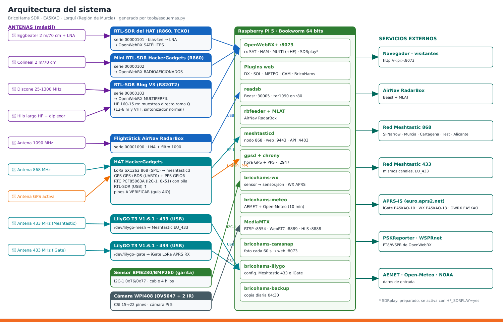

**Instalar o aplicar cambios (con backup verificado).**

```bash
sudo bash install.sh --solo comprobar,base,red,arranque,hat,banner
```

**Configuración.** [Plantilla comentada](../bricohams.env.example).
Variables referenciadas por estos pasos y sus ayudantes indicados (inventario estático, sin
valores privados; las herramientas llamadas pueden leer otras variables):

`HOSTNAME_NEW`, `OWRX_BACKEND`, `OWRX_DOCKER_IMAGE`, `WIFI_COUNTRY`, `WIFI_PASS`, `PI5_USB_MAX_CURRENT`, `HAT_RTC`, `HAT_DISABLE_PI5_RTC`, `HAT_GPS_DEV`, `HAT_GPS_BAUD`, `HAT_PPS_GPIO`, `HAT_LORA_SPI`, `HAT_POWER_GPIOS`, `BANNER_SSH`, `IO_MODE`, `FAN_ENABLE`, `W1_GPIO`.

**Scripts y código.** [Instalador](../install.sh); [bricohams-banner](../files/bin/bricohams-banner).

**Comprobar (solo los servicios/opciones habilitados).**

```bash
uname -m
cat /etc/os-release
ip -brief address
timedatectl
systemctl status gpsd chrony bricohams-hat-power --no-pager
```

**Resultado esperado.** La Pi conserva acceso SSH, fecha correcta y dispositivos previstos. Los cambios de arranque pueden requerir reinicio: no lo hagas hasta revisar el registro y disponer de acceso local.

**Si no funciona.** Sin red: usa consola local o Ethernet y revisa NetworkManager antes de repetir red. Sin GPS/RTC: comprueba pines y alimentación con la Pi apagada. No cambies cableado energizado.

**Restauración.** Guarda el estado previo indicado al principio y sigue el manual
del módulo. Un estado `inactive` en un periférico desactivado es esperable;
`failed` exige revisar el journal. No borres configuraciones para hacer que pase
una prueba. Para cambios de hardware vuelve a intervenir sin tensión.

**Procedimiento detallado:** [01_PREPARACION](manuales/01_PREPARACION.md) · [02_INSTALACION](manuales/02_INSTALACION.md).

<a id="receptor"></a>

### OpenWebRX+, RTL-SDR y SDRplay

**Qué hace.** Instalar el receptor web, drivers y perfiles de radio. El backend puede ser nativo o Docker; los demás módulos siguen en el host.

**Antes de empezar.** Completa sistema base. Revisa SERIAL_*, OWRX_BACKEND y los permisos USB. El FlightStick ADS-B no debe estar asignado también a OpenWebRX+. SDRplay requiere hardware y API compatibles; no actives HF_SDRPLAY sin ellos.


**Instalar o aplicar cambios (con backup verificado).**

```bash
sudo bash install.sh --solo openwebrx,rtlsdr,sdrplay,configuracion
```

**Configuración.** [Plantilla comentada](../bricohams.env.example).
Variables referenciadas por estos pasos y sus ayudantes indicados (inventario estático, sin
valores privados; las herramientas llamadas pueden leer otras variables):

`STATION_LAT`, `STATION_LON`, `LOCATOR_ONLINE`, `LOCATOR_KIT_ZONA_KM`, `OWRX_ADMIN_USER`, `OWRX_BACKEND`, `OWRX_DOCKER_DIR`, `OWRX_DOCKER_CONTAINER`, `OWRX_DOCKER_IMAGE`, `OWRX_DOCKER_RED`, `OWRX_DOCKER_PORT`, `OWRX_DOCKER_PRIVILEGED`, `OWRX_DOCKER_DESPLEGAR`, `AEMET_API_KEY`, `INSTALL_SDRPLAY_API`, `SDRPLAY_API_URL`, `OWRX_SOLO_LOCAL`, `OWRX_PLANTILLA`.

**Scripts y código.** [Instalador](../install.sh); [bricohams-docker-compose.py](../files/bin/bricohams-docker-compose.py), [bricohams-merge-bookmarks.py](../files/bin/bricohams-merge-bookmarks.py), [bricohams-render-settings.py](../files/bin/bricohams-render-settings.py), [bricohams_locator.py](../files/bin/bricohams_locator.py), [bricohams_locator_bookmarks.py](../files/bin/bricohams_locator_bookmarks.py), [bricohams_locator_online.py](../files/bin/bricohams_locator_online.py).

**Comprobar (solo los servicios/opciones habilitados).**

```bash
lsusb
systemctl status openwebrx --no-pager
# Solo para backend Docker, en vez del servicio nativo:
docker ps --format "table {{.Names}}\t{{.Status}}"
```

**Resultado esperado.** El receptor abre, permite seleccionar el SDR correcto y reproduce audio. En Docker usa el nombre configurado en OWRX_DOCKER_CONTAINER: no se espera openwebrx.service.

**Si no funciona.** USB ocupado: verifica series y procesos antes de reiniciar. Sin audio: revisa volumen, modo y permisos del navegador (manual 30). No grabes series EEPROM a ciegas; manual 03.

**Restauración.** Guarda el estado previo indicado al principio y sigue el manual
del módulo. Un estado `inactive` en un periférico desactivado es esperable;
`failed` exige revisar el journal. No borres configuraciones para hacer que pase
una prueba. Para cambios de hardware vuelve a intervenir sin tensión.

**Procedimiento detallado:** [03_SDR_Y_SERIES](manuales/03_SDR_Y_SERIES.md) · [08_SDRPLAY](manuales/08_SDRPLAY.md) · [33_OPENWEBRX_DOCKER](manuales/33_OPENWEBRX_DOCKER.md).

<a id="plugins"></a>

### Plugins, registro de oyentes, CTCSS y RepeaterBook

**Qué hace.** Añadir controles de audio/DSP, fichas de indicativos, registro voluntario de oyentes, identificación obligatoria (callsign_gate de EA5HKX), detector CTCSS (servidor y navegador), marcadores, importación/exportación y repetidores por zona. Son extensiones del receptor, no servicios de radio independientes.

**Antes de empezar.** OpenWebRX+ y configuración funcionales. Para paneles administrativos completa también web. Guarda bookmarks antes de importar; la clave de RepeaterBook se introduce en General Settings, no en una captura.

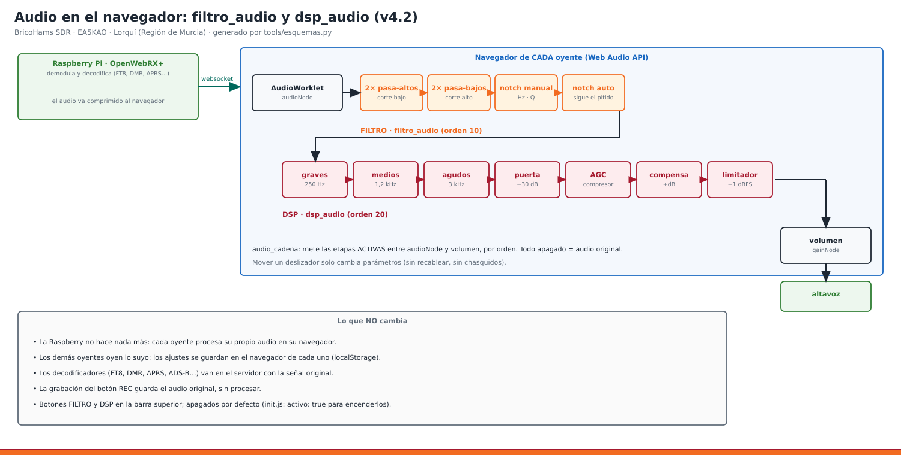

**Instalar o aplicar cambios (con backup verificado).**

```bash
sudo bash install.sh --solo plugins,web
```

**Configuración.** [Plantilla comentada](../bricohams.env.example).
Variables referenciadas por estos pasos y sus ayudantes indicados (inventario estático, sin
valores privados; las herramientas llamadas pueden leer otras variables):

`CALLSIGN`, `STATION_QTH`, `STATION_COUNTRY`, `STATION_LAT`, `STATION_LON`, `ADMIN_EMAIL`, `OWRX_BACKEND`, `OWRX_DOCKER_DIR`, `AIS_ENABLE`, `WX_APRS_CALLSIGN`, `CAM_SNAPSHOT_SECONDS`, `SSL_DOMAIN`, `SSL_EMAIL`, `SSL_MODO`, `RADARBOX_STATION_ID`, `VISITAS_ENABLE`, `CHAT_REGISTRO_OBLIGATORIO`, `OWRX_CTCSS_ENABLE`, `PLUGIN_CALLSIGN_GATE`, `CALLSIGN_GATE_ANUNCIO`, `PLUGIN_TONE_DETECTOR`, `VISITAS_DIAS`, `HAMQTH_USER`, `HAMQTH_PASS`, `QRZ_USER`, `QRZ_PASS`, `LISTENERS_SUPABASE_URL`, `LISTENERS_SUPABASE_KEY`, `LISTENERS_COUNTRY`, `OWRX_PLANTILLA`, `MONITORIZACION`.

**Scripts y código.** [Instalador](../install.sh); [bricohams-api.py](../files/bin/bricohams-api.py), [bricohams-mesh-admin](../files/bin/bricohams-mesh-admin), [bricohams-mesh-url](../files/bin/bricohams-mesh-url), [bricohams-owrx-bookmarks-io](../files/bin/bricohams-owrx-bookmarks-io), [bricohams-owrx-botones](../files/bin/bricohams-owrx-botones), [bricohams-owrx-ctcss](../files/bin/bricohams-owrx-ctcss), [bricohams-owrx-mapflights](../files/bin/bricohams-owrx-mapflights), [bricohams-owrx-rbimport](../files/bin/bricohams-owrx-rbimport), [bricohams-owrx-repeaterbook](../files/bin/bricohams-owrx-repeaterbook), [bricohams-oyentes](../files/bin/bricohams-oyentes), [bricohams-servicios](../files/bin/bricohams-servicios).

**Comprobar (solo los servicios/opciones habilitados).**

```bash
systemctl status openwebrx --no-pager
# Docker: consulta el contenedor configurado, como en la ficha receptor.
```

**Resultado esperado.** Los controles del receptor aparecen tras recargar. En /settings están las herramientas de bookmarks y repetidores. Guarda frecuencia de salida del repetidor y subtono; el SDR no transmite.

**Si no funciona.** Si no aparecen controles, recarga sin caché y revisa la consola del navegador. Si faltan fichas, revisa API y proveedor externo. Si el instalador avisa de que no pudo verificar un plugin de EA5HKX, queda desactivado: revisa el acceso a gitlab.com (manual 41). No publiques logs completos de autenticación.

**Restauración.** Guarda el estado previo indicado al principio y sigue el manual
del módulo. Un estado `inactive` en un periférico desactivado es esperable;
`failed` exige revisar el journal. No borres configuraciones para hacer que pase
una prueba. Para cambios de hardware vuelve a intervenir sin tensión.

**Procedimiento detallado:** [27_PLUGINS_WEB_V4](manuales/27_PLUGINS_WEB_V4.md) · [30_AUDIO_DSP](manuales/30_AUDIO_DSP.md) · [39_REGISTRO_OYENTES](manuales/39_REGISTRO_OYENTES.md) · [41_PLUGINS_EA5HKX](manuales/41_PLUGINS_EA5HKX.md).

<a id="zona"></a>

### Locator, canales y marcadores de la zona

**Qué hace.** Derivar ubicación, emisoras, aeropuertos, NAVTEX y estaciones meteorológicas a partir del locator o coordenadas.

**Antes de empezar.** Usa tu STATION_LOCATOR y catálogo adecuado. Las coordenadas explícitas tienen prioridad. LOCATOR_ONLINE necesita Internet y AEMET necesita su clave. Revisa datos antes de emitir APRS.

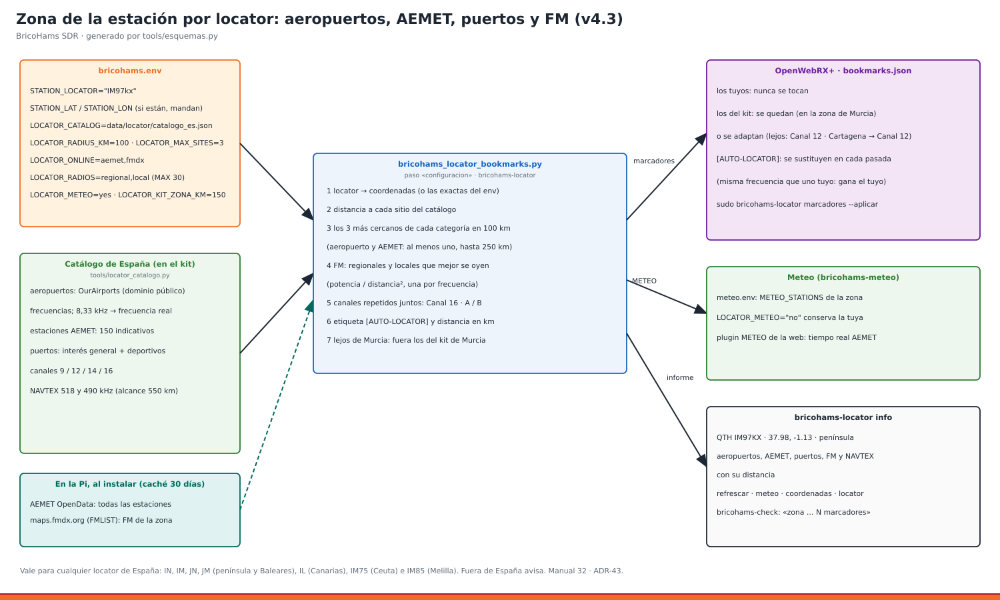

**Instalar o aplicar cambios (con backup verificado).**

```bash
sudo bash install.sh --solo configuracion,meteo
```

**Configuración.** [Plantilla comentada](../bricohams.env.example).
Variables referenciadas por estos pasos y sus ayudantes indicados (inventario estático, sin
valores privados; las herramientas llamadas pueden leer otras variables):

`STATION_LOCATOR`, `STATION_LAT`, `STATION_LON`, `LOCATOR_CATALOG`, `LOCATOR_ONLINE`, `LOCATOR_METEO`, `LOCATOR_KIT_ZONA_KM`, `OWRX_ADMIN_USER`, `OWRX_BACKEND`, `OWRX_DOCKER_DIR`, `OWRX_DOCKER_CONTAINER`, `OWRX_DOCKER_RED`, `AEMET_API_KEY`, `METEO_STATIONS`, `OWRX_SOLO_LOCAL`, `OWRX_PLANTILLA`.

**Scripts y código.** [Instalador](../install.sh) (incluye `zona_locator`); [bricohams-merge-bookmarks.py](../files/bin/bricohams-merge-bookmarks.py), [bricohams-meteo.py](../files/bin/bricohams-meteo.py), [bricohams-render-settings.py](../files/bin/bricohams-render-settings.py), [bricohams_locator.py](../files/bin/bricohams_locator.py), [bricohams_locator_bookmarks.py](../files/bin/bricohams_locator_bookmarks.py), [bricohams_locator_online.py](../files/bin/bricohams_locator_online.py).

**Comprobar (solo los servicios/opciones habilitados).**

```bash
systemctl status bricohams-meteo.timer --no-pager
journalctl -u bricohams-meteo.service -n 30 --no-pager
```

**Resultado esperado.** Los marcadores corresponden a tu región y METEO_STATIONS refleja la selección configurada. No se garantiza cobertura mundial del catálogo español.

**Si no funciona.** Zona equivocada: revisa coordenadas explícitas, locator, radio y catálogo. Sin datos online: comprueba DNS y credenciales sin copiarlas a un informe público.

**Restauración.** Guarda el estado previo indicado al principio y sigue el manual
del módulo. Un estado `inactive` en un periférico desactivado es esperable;
`failed` exige revisar el journal. No borres configuraciones para hacer que pase
una prueba. Para cambios de hardware vuelve a intervenir sin tensión.

**Procedimiento detallado:** [32_ZONA_LOCATOR](manuales/32_ZONA_LOCATOR.md).

<a id="mesh"></a>

### Meshtastic HAT y LilyGO; puente al mapa

**Qué hace.** Configurar nodos 868/433 MHz, MQTT interno y posiciones/mensajes en OpenWebRX+. El firmware y frecuencia de cada radio deben coincidir con el hardware.

**Antes de empezar.** Completa HAT, receptor y web. Identifica cada USB; conecta antena apropiada antes de transmitir. Revisa región regulatoria, canales y PSK en privado. No compartas QR de canales privados.

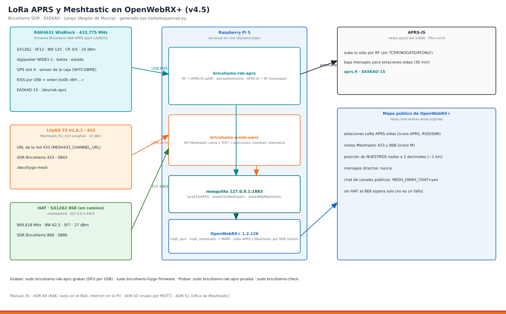

**Instalar o aplicar cambios (con backup verificado).**

```bash
sudo bash install.sh --solo meshtastic,lilygo
```

**Configuración.** [Plantilla comentada](../bricohams.env.example).
Variables referenciadas por estos pasos y sus ayudantes indicados (inventario estático, sin
valores privados; las herramientas llamadas pueden leer otras variables):

`STATION_LAT`, `STATION_LON`, `STATION_ASL`, `HAT_LORA_SPIDEV`, `HAT_LORA_IRQ`, `HAT_LORA_BUSY`, `HAT_LORA_RESET`, `HAT_LORA_TXEN`, `HAT_LORA_RXEN`, `MESH_CHANNEL_URL`, `MESH_REGION`, `MESH868_PRIVATE_NAME`, `MESH868_PRIVATE_PSK`, `MESH_LONG_NAME`, `MESH_SHORT_NAME`, `MESH868_ROLE`, `MESH_WEB`, `OWRX_MAPA_LORA`.

**Scripts y código.** [Instalador](../install.sh); [bricohams-lilygo](../files/bin/bricohams-lilygo), [bricohams-mesh-owrx](../files/bin/bricohams-mesh-owrx), [bricohams-mesh-url](../files/bin/bricohams-mesh-url).

**Comprobar (solo los servicios/opciones habilitados).**

```bash
systemctl status meshtasticd mosquitto bricohams-mesh-owrx --no-pager
journalctl -u bricohams-mesh-owrx -n 30 --no-pager
```

**Resultado esperado.** Los nodos aparecen en el panel administrativo y sus mensajes/posiciones llegan al mapa cuando se reciben. Sin tráfico RF no hay datos nuevos que mostrar.

**Si no funciona.** Sin radio: revisa pines, banda y firmware. Sin mapa: revisa MQTT y que el nodo emita posición. Grabar firmware es un procedimiento separado del instalador; sigue manual 05.

**Restauración.** Guarda el estado previo indicado al principio y sigue el manual
del módulo. Un estado `inactive` en un periférico desactivado es esperable;
`failed` exige revisar el journal. No borres configuraciones para hacer que pase
una prueba. Para cambios de hardware vuelve a intervenir sin tensión.

**Procedimiento detallado:** [05_LILYGO](manuales/05_LILYGO.md) · [35_LORA_APRS_MESHTASTIC](manuales/35_LORA_APRS_MESHTASTIC.md).

<a id="rak"></a>

### RAK4631, APRS y GPS

**Qué hace.** Integrar el RAK por USB, posiciones, chat APRS y sensores disponibles. RF y APRS-IS no equivalen al chat de Meshtastic.

**Antes de empezar.** Identifica el puerto del RAK, carga el firmware indicado y usa indicativo/passcode propios. Comprueba RAK_TX y bandas; mantener recepción no autoriza transmisión.


**Instalar o aplicar cambios (con backup verificado).**

```bash
sudo bash install.sh --solo rak
```

**Configuración.** [Plantilla comentada](../bricohams.env.example).
Variables referenciadas por estos pasos y sus ayudantes indicados (inventario estático, sin
valores privados; las herramientas llamadas pueden leer otras variables):

`APRS_PASSCODE`, `IGATE_CALLSIGN`, `RAK_ENABLE`, `RAK_CALLSIGN`, `OWRX_MAPA_LORA`.

**Scripts y código.** [Instalador](../install.sh); [bricohams-dispositivos](../files/bin/bricohams-dispositivos), [bricohams-mesh-url](../files/bin/bricohams-mesh-url), [bricohams-rak-aprs](../files/bin/bricohams-rak-aprs).

**Comprobar (solo los servicios/opciones habilitados).**

```bash
systemctl status bricohams-rak-aprs --no-pager
journalctl -u bricohams-rak-aprs -n 30 --no-pager
```

**Resultado esperado.** El servicio recibe tramas y el mapa presenta posiciones válidas. Una trayectoria necesita al menos dos posiciones distintas recibidas desde la apertura del mapa.

**Si no funciona.** Sin GPS: espera cielo abierto y revisa antena/firmware. Sin tramas: revisa dispositivo USB y permisos. No actives transmisión como forma de diagnosticar recepción.

**Restauración.** Guarda el estado previo indicado al principio y sigue el manual
del módulo. Un estado `inactive` en un periférico desactivado es esperable;
`failed` exige revisar el journal. No borres configuraciones para hacer que pase
una prueba. Para cambios de hardware vuelve a intervenir sin tensión.

**Procedimiento detallado:** [06_SENSOR_WX](manuales/06_SENSOR_WX.md) · [35_LORA_APRS_MESHTASTIC](manuales/35_LORA_APRS_MESHTASTIC.md).

<a id="adsb"></a>

### ADS-B local, RadarBox y map.flights simultáneos

**Qué hace.** readsb decodifica un receptor 1090 MHz y distribuye sus datos a RadarBox y, opcionalmente, map.flights. Con un SDR propio de 162 MHz, AIS-catcher añade barcos locales al mapa (AIS_ENABLE). El mapa local y el envío externo son verificaciones distintas.

**Antes de empezar.** Receptor/antena 1090 MHz y serie correcta; ADSB_ENABLE=yes. Para añadir map.flights usa MAPFLIGHTS_FEED=yes y el UUID propio en MAPFLIGHTS_UUID. Conserva RADARBOX_KEY; no uses mf_feed_ como UUID. Protege configuración y logs.

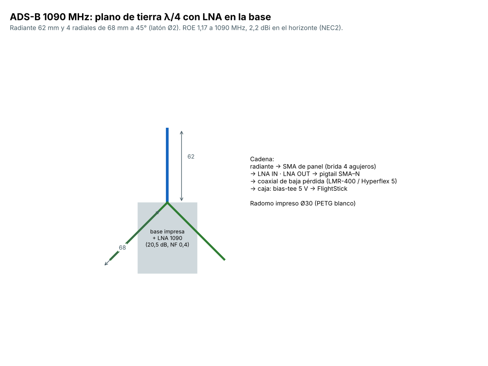

**Instalar o aplicar cambios (con backup verificado).**

```bash
sudo bash install.sh --solo adsb,ais
```

**Configuración.** [Plantilla comentada](../bricohams.env.example).
Variables referenciadas por estos pasos y sus ayudantes indicados (inventario estático, sin
valores privados; las herramientas llamadas pueden leer otras variables):

`STATION_LAT`, `STATION_LON`, `SERIAL_ADSB`, `ADSB_ENABLE`, `ADSB_ANT_ALT`, `ADSB_BIAS_TEE`, `ADSB_GAIN`, `ADSB_TAR1090`, `RADARBOX_KEY`, `AIS_ENABLE`, `AIS_SDR_SERIAL`, `MAPFLIGHTS_FEED`, `MAPFLIGHTS_UUID`, `MAPFLIGHTS_MLAT`, `MAPFLIGHTS_HOST`, `MAPFLIGHTS_PORT`, `MAPFLIGHTS_MLAT_HOST`, `MAPFLIGHTS_MLAT_PORT`.

**Scripts y código.** [Instalador](../install.sh) (incluye `mapflights`); [bricohams-mapflights.py](../files/bin/bricohams-mapflights.py), [bricohams-rbfeeder-ini.py](../files/bin/bricohams-rbfeeder-ini.py).

**Comprobar (solo los servicios/opciones habilitados).**

```bash
systemctl status readsb rbfeeder --no-pager
# Solo con AIS_ENABLE=yes:
systemctl status bricohams-ais --no-pager
# Solo si habilitaste MAPFLIGHTS_MLAT:
systemctl status bricohams-mapflights-mlat --no-pager
ss -tn | grep -E ":(30004|31090)\b"
# Revisar localmente; el journal puede contener el UUID:
journalctl -u bricohams-mapflights-mlat -n 20 --no-pager
```

**Resultado esperado.** readsb y rbfeeder activos; si habilitas MLAT de map.flights, su servicio conecta con su servidor. Confirma recepción en ambos portales, no solo un proceso activo. Reiniciar readsb puede interrumpir brevemente el flujo, sin sustituir RadarBox.

**Si no funciona.** Sin posiciones: comprueba antena, serie y recepción local antes de culpar al feed. Sin MLAT: mismo UUID para Beast y MLAT; destino mlat.map.flights:31090. Una conexión TCP no prueba aceptación de datos. Fotos: activa ADS-B local y pulsa un avión; dependen de datos externos.

**Restauración.** Guarda el estado previo indicado al principio y sigue el manual
del módulo. Un estado `inactive` en un periférico desactivado es esperable;
`failed` exige revisar el journal. No borres configuraciones para hacer que pase
una prueba. Para cambios de hardware vuelve a intervenir sin tensión.

**Procedimiento detallado:** [04_ADSB](manuales/04_ADSB.md) · [14_ADSB_LNA](manuales/14_ADSB_LNA.md) · [36_TAK_MAPA_LOCAL](manuales/36_TAK_MAPA_LOCAL.md) · [38_MAPFLIGHTS_PLUGIN](manuales/38_MAPFLIGHTS_PLUGIN.md) · [40_HTTPS_MAPA_LOCAL_POLITICAS](manuales/40_HTTPS_MAPA_LOCAL_POLITICAS.md).

<a id="wx"></a>

### Meteorología, BME280, viento/lluvia y Pico IO

**Qué hace.** Obtener meteo externa y sensores locales, publicar WX y regular ventiladores. Pico IO separa entradas/pulsos/PWM de la Pi; son fuentes distintas, no lecturas intercambiables.

**Antes de empezar.** Cableado sin tensión, pines/voltajes comprobados. Elige IO_MODE y fuente de sensores. Un bus RS485 tiene un solo maestro: no actives simultáneamente Pi y LilyGO WX como maestros. Firmware Pico y LoRa se graban según sus manuales.

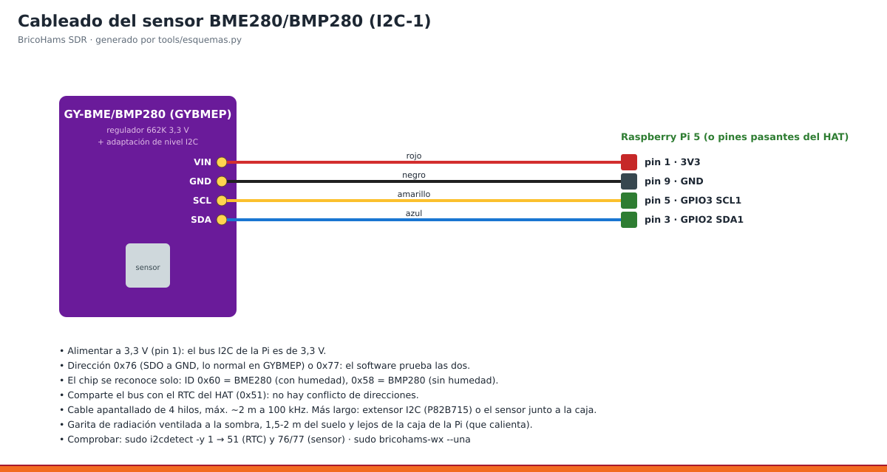

**Instalar o aplicar cambios (con backup verificado).**

```bash
sudo bash install.sh --solo meteo,io,sensor,ventilacion
```

**Configuración.** [Plantilla comentada](../bricohams.env.example).
Variables referenciadas por estos pasos y sus ayudantes indicados (inventario estático, sin
valores privados; las herramientas llamadas pueden leer otras variables):

`STATION_LAT`, `STATION_LON`, `STATION_ASL`, `APRS_PASSCODE`, `WX_ENABLE`, `WX_SENSOR_HEIGHT`, `WX_TEMP_OFFSET`, `WX_FUENTE`, `WX_POS_GPS`, `WX_APRS`, `WX_APRS_CALLSIGN`, `WX_APRS_COMMENT`, `IO_MODE`, `WIND_ENABLE`, `WIND_PORT`, `RS485_VID`, `RS485_PID`, `WIND_BAUD`, `WIND_ADDR_SPEED`, `WIND_ADDR_DIR`, `WIND_DIR_MODE`, `RAIN_ENABLE`, `RAIN_GPIO`, `RAIN_MM`, `FAN_ENABLE`, `FAN_PWM_GPIOS`, `FAN_TACH_GPIOS`, `FAN_PWM_INVERT`, `W1_GPIO`, `FAN_T_CPU_MIN`, `FAN_T_CPU_MAX`, `FAN_T_CAJA_MIN`, `FAN_T_CAJA_MAX`, `FAN_DUTY_MIN`, `FAN_HIST`, `FAN_DS18B20_ID`, `METEO_STATIONS`.

**Scripts y código.** [Instalador](../install.sh); [bricohams-fan.py](../files/bin/bricohams-fan.py), [bricohams-io.py](../files/bin/bricohams-io.py), [bricohams-meteo.py](../files/bin/bricohams-meteo.py), [bricohams-wx.py](../files/bin/bricohams-wx.py).

**Comprobar (solo los servicios/opciones habilitados).**

```bash
systemctl status bricohams-meteo.timer bricohams-wx bricohams-fan --no-pager
# Solo si usas Pico IO:
sudo bricohams-io estado
sudo bricohams-fan --estado
```

**Resultado esperado.** Lecturas con unidades plausibles, timestamps actuales y ventilación funcionando. Para APRS valida indicativo y coordenadas reales antes de habilitar publicación.

**Si no funciona.** Sin sensor: revisa dirección I2C, USB, alimentación y modo elegido. Errores lgpio: revisa directorio de trabajo del servicio según manual 06. No fuerces ventilación apagada con electrónica caliente.

**Restauración.** Guarda el estado previo indicado al principio y sigue el manual
del módulo. Un estado `inactive` en un periférico desactivado es esperable;
`failed` exige revisar el journal. No borres configuraciones para hacer que pase
una prueba. Para cambios de hardware vuelve a intervenir sin tensión.

**Procedimiento detallado:** [06_SENSOR_WX](manuales/06_SENSOR_WX.md) · [18_VENTILACION](manuales/18_VENTILACION.md) · [19_VIENTO_Y_LLUVIA](manuales/19_VIENTO_Y_LLUVIA.md) · [20_PICO_IO](manuales/20_PICO_IO.md) · [22_WX_LORA_FIRMWARE](manuales/22_WX_LORA_FIRMWARE.md).

<a id="camara"></a>

### Cámara y MediaMTX

**Qué hace.** Publicar vídeo y capturas de la cámara mediante MediaMTX y la integración web.

**Antes de empezar.** Conecta CSI con la Pi apagada. Revisa CAM_SOURCE y modelo soportado, orientación y privacidad del encuadre; no expongas interiores, personas ni credenciales.


**Instalar o aplicar cambios (con backup verificado).**

```bash
sudo bash install.sh --solo camara
```

**Configuración.** [Plantilla comentada](../bricohams.env.example).
Variables referenciadas por estos pasos y sus ayudantes indicados (inventario estático, sin
valores privados; las herramientas llamadas pueden leer otras variables):

`CAM_SOURCE`, `CAM_RTSP_URL`, `CAM_WIDTH`, `CAM_HEIGHT`, `CAM_FPS`, `CAM_BITRATE`, `CAM_HFLIP`, `CAM_VFLIP`, `CAM_TUNING`, `CAM_SNAPSHOT_SECONDS`, `CAM_LABEL`.

**Scripts y código.** [Instalador](../install.sh); [bricohams-camsnap.py](../files/bin/bricohams-camsnap.py).

**Comprobar (solo los servicios/opciones habilitados).**

```bash
systemctl status mediamtx bricohams-camsnap --no-pager
journalctl -u mediamtx -u bricohams-camsnap -n 30 --no-pager
```

**Resultado esperado.** Imagen actual en el módulo web y servicios sin reinicios repetidos. RTSP/WebRTC y captura fija tienen rutas/puertos diferentes; manual 07.

**Si no funciona.** Sin imagen: cable CSI, fuente elegida y detección de cámara. Imagen fija pero sin vídeo: comprueba red y puertos WebRTC sin abrir la API de MediaMTX a Internet.

**Restauración.** Guarda el estado previo indicado al principio y sigue el manual
del módulo. Un estado `inactive` en un periférico desactivado es esperable;
`failed` exige revisar el journal. No borres configuraciones para hacer que pase
una prueba. Para cambios de hardware vuelve a intervenir sin tensión.

**Procedimiento detallado:** [07_CAMARA](manuales/07_CAMARA.md).

<a id="satelites"></a>

### Satélites, Doppler y FT2 experimental

**Qué hace.** Calcular pases y facilitar escucha con Doppler; FT2 es integración experimental, no una garantía de decodificación ni función de transmisión.

**Antes de empezar.** Hora y ubicación correctas, receptor de satélites disponible y antena adecuada. Consulta limitaciones de FT2 antes de habilitarlo.


**Instalar o aplicar cambios (con backup verificado).**

```bash
sudo bash install.sh --solo satelites,ft2
```

**Configuración.** [Plantilla comentada](../bricohams.env.example).
Variables referenciadas por estos pasos y sus ayudantes indicados (inventario estático, sin
valores privados; las herramientas llamadas pueden leer otras variables):

`STATION_LAT`, `STATION_LON`, `STATION_ASL`, `OWRX_BACKEND`, `SATDUMP_ENABLE`, `FT2_ENABLE`, `CALLSIGN`,
`SATREC_ENABLE`, `SATREC_MIN_EL`, `SATREC_EXCLUIR`, `SATREC_METEOR`, `SATREC_DIAS`, `SATREC_MAX_MB`, `AMSAT_REPORT`.

**Scripts y código.** [Instalador](../install.sh); [bricohams-ft2](../files/bin/bricohams-ft2), [bricohams-ft2-decode](../files/bin/bricohams-ft2-decode), [bricohams-ft2-patch.py](../files/bin/bricohams-ft2-patch.py), [bricohams-satpass.py](../files/bin/bricohams-satpass.py), [bricohams-satrec.py](../files/bin/bricohams-satrec.py) (v5.0, grabación de pases), [clima.html](../files/web/clima.html).

**Comprobar (solo los servicios/opciones habilitados).**

```bash
systemctl status bricohams-satpass.timer --no-pager
journalctl -u bricohams-satpass.service -n 30 --no-pager
systemctl status bricohams-satrec --no-pager
sudo -u openwebrx bricohams-satrec --plan
sudo bricohams-ft2 estado
```

**Resultado esperado.** Lista de pases coherente y selección de escucha cuando hay receptor disponible. Las efemérides requieren actualización; que no haya pase visible puede ser normal. Tras un pase de más de 20° aparece su MP3 en **Files** y en `/bricohams/clima.html`.

**Si no funciona.** Pases incorrectos: revisa hora, ubicación y datos orbitales. No recibir un satélite fuera del horizonte no es fallo de instalación.

**Restauración.** Guarda el estado previo indicado al principio y sigue el manual
del módulo. Un estado `inactive` en un periférico desactivado es esperable;
`failed` exige revisar el journal. No borres configuraciones para hacer que pase
una prueba. Para cambios de hardware vuelve a intervenir sin tensión.

**Procedimiento detallado:** [26_SATELITES](manuales/26_SATELITES.md) · [28_FT2](manuales/28_FT2.md) · [42_CLIMA_RED_SATELITES_GRABACION](manuales/42_CLIMA_RED_SATELITES_GRABACION.md).

<a id="web"></a>

### Portal, HTTPS, API y paneles administrativos

**Qué hace.** Publicar receptor y servicios solo por HTTPS (443) mediante nginx, con el 8073 limitado a la propia Pi; políticas, cookies, idioma y logo BricoHams; enriquecer fichas y proteger /settings con la sesión del administrador.

**Antes de empezar.** Receptor instalado, SSL_MODO elegido, DNS/dominio propios si usas ACME. Configura claves de proveedores en privado. Conserva acceso SSH antes de cambiar proxy o certificados.

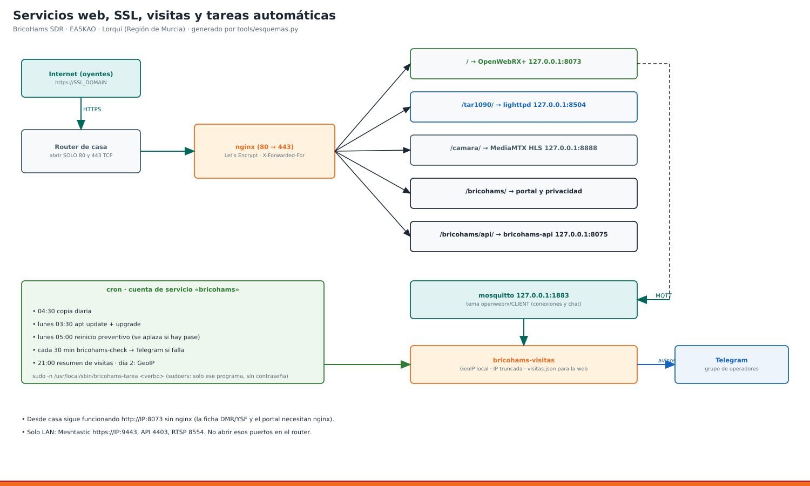

**Instalar o aplicar cambios (con backup verificado).**

```bash
sudo bash install.sh --solo web
```

**Configuración.** [Plantilla comentada](../bricohams.env.example).
Variables referenciadas por estos pasos y sus ayudantes indicados (inventario estático, sin
valores privados; las herramientas llamadas pueden leer otras variables):

`CALLSIGN`, `STATION_QTH`, `ADMIN_EMAIL`, `OWRX_BACKEND`, `OWRX_DOCKER_DIR`, `AIS_ENABLE`, `WX_APRS_CALLSIGN`, `SSL_DOMAIN`, `SSL_EMAIL`, `SSL_MODO`, `RADARBOX_STATION_ID`, `OWRX_CTCSS_ENABLE`, `VISITAS_DIAS`, `HAMQTH_USER`, `HAMQTH_PASS`, `QRZ_USER`, `QRZ_PASS`, `MONITORIZACION`.

**Scripts y código.** [Instalador](../install.sh); [bricohams-api.py](../files/bin/bricohams-api.py), [bricohams-mesh-admin](../files/bin/bricohams-mesh-admin), [bricohams-mesh-url](../files/bin/bricohams-mesh-url), [bricohams-owrx-bookmarks-io](../files/bin/bricohams-owrx-bookmarks-io), [bricohams-owrx-botones](../files/bin/bricohams-owrx-botones), [bricohams-owrx-ctcss](../files/bin/bricohams-owrx-ctcss), [bricohams-owrx-mapflights](../files/bin/bricohams-owrx-mapflights), [bricohams-owrx-rbimport](../files/bin/bricohams-owrx-rbimport), [bricohams-owrx-repeaterbook](../files/bin/bricohams-owrx-repeaterbook), [bricohams-oyentes](../files/bin/bricohams-oyentes), [bricohams-servicios](../files/bin/bricohams-servicios).

**Comprobar (solo los servicios/opciones habilitados).**

```bash
sudo nginx -t
systemctl status nginx bricohams-api bricohams-mesh-admin --no-pager
```

**Resultado esperado.** Portal accesible; /settings pide sesión válida. API y servicios internos no quedan públicos directamente. Certificado autofirmado necesita aceptación consciente del navegador.

**Si no funciona.** 502: comprueba el servicio de destino y el journal de nginx. Login en bucle: revisa HTTPS, sesión y reloj. No elimines auth_request para resolver un problema de acceso.

**Restauración.** Guarda el estado previo indicado al principio y sigue el manual
del módulo. Un estado `inactive` en un periférico desactivado es esperable;
`failed` exige revisar el journal. No borres configuraciones para hacer que pase
una prueba. Para cambios de hardware vuelve a intervenir sin tensión.

**Procedimiento detallado:** [23_WEB_SSL_SERVICIOS](manuales/23_WEB_SSL_SERVICIOS.md) · [27_PLUGINS_WEB_V4](manuales/27_PLUGINS_WEB_V4.md) · [40_HTTPS_MAPA_LOCAL_POLITICAS](manuales/40_HTTPS_MAPA_LOCAL_POLITICAS.md).

<a id="visitas"></a>

### Oyentes, Telegram y avisos

**Qué hace.** Recoger estadísticas de oyentes y programar avisos/moderación cuando están habilitados.

**Antes de empezar.** OpenWebRX+ y MQTT funcionales. Tokens y chat IDs se introducen en configuración privada. Revisa retención y avisos de privacidad antes de publicar estadísticas.


**Instalar o aplicar cambios (con backup verificado).**

```bash
sudo bash install.sh --solo visitas,tareas
```

**Configuración.** [Plantilla comentada](../bricohams.env.example).
Variables referenciadas por estos pasos y sus ayudantes indicados (inventario estático, sin
valores privados; las herramientas llamadas pueden leer otras variables):

`DUCKDNS_DOMAIN`, `DUCKDNS_TOKEN`, `VISITAS_ENABLE`, `TELEGRAM_TOKEN`, `TELEGRAM_CHAT_ID`, `VISITAS_DIAS`, `VISITAS_CHAT`, `VISITAS_AVISAR_LAN`, `VISITAS_AVISAR_DESCONEXION`, `OYENTES_TELEGRAM`, `MESH_TELEGRAM`, `APRS_TELEGRAM`, `CRON_COPIA`, `CRON_ACTUALIZAR`, `CRON_REINICIO`, `CRON_SALUD`, `CRON_RESUMEN`, `CRON_GEOIP`.

**Scripts y código.** [Instalador](../install.sh); [bricohams-tarea](../files/bin/bricohams-tarea), [bricohams-telegram](../files/bin/bricohams-telegram), [bricohams-visitas.py](../files/bin/bricohams-visitas.py).

**Comprobar (solo los servicios/opciones habilitados).**

```bash
systemctl status bricohams-visitas --no-pager
sudo -u openwebrx bricohams-visitas --estado
```

**Resultado esperado.** El panel muestra estado y las tareas están programadas. Telegram solo funciona con bot, permisos y chat configurados; no es obligatorio para usar el receptor.

**Si no funciona.** Sin avisos: revisa permisos del bot, conectividad y calendario. No pegues URLs de Telegram con token en incidencias ni capturas.

**Restauración.** Guarda el estado previo indicado al principio y sigue el manual
del módulo. Un estado `inactive` en un periférico desactivado es esperable;
`failed` exige revisar el journal. No borres configuraciones para hacer que pase
una prueba. Para cambios de hardware vuelve a intervenir sin tensión.

**Procedimiento detallado:** [24_VISITAS_TELEGRAM](manuales/24_VISITAS_TELEGRAM.md) · [25_TAREAS_AUTOMATICAS](manuales/25_TAREAS_AUTOMATICAS.md).

<a id="tak"></a>

### TAK local y capas privadas

**Qué hace.** Instalar OpenTAKServer opcional y acceso administrativo; integrar posiciones privadas en el mapa Leaflet.

**Antes de empezar.** TAK=yes, Pi arm64, capacidad de almacenamiento y copia de datos/certificados previos. Configura clientes mediante el panel; no compartas tak-access.txt ni certificados privados.


**Instalar o aplicar cambios (con backup verificado).**

```bash
sudo bash install.sh --solo tak,web
```

**Configuración.** [Plantilla comentada](../bricohams.env.example).
Variables referenciadas por estos pasos y sus ayudantes indicados (inventario estático, sin
valores privados; las herramientas llamadas pueden leer otras variables):

`CALLSIGN`, `STATION_QTH`, `ADMIN_EMAIL`, `OWRX_BACKEND`, `OWRX_DOCKER_DIR`, `AIS_ENABLE`, `WX_APRS_CALLSIGN`, `SSL_DOMAIN`, `SSL_EMAIL`, `SSL_MODO`, `RADARBOX_STATION_ID`, `OWRX_CTCSS_ENABLE`, `VISITAS_DIAS`, `HAMQTH_USER`, `HAMQTH_PASS`, `QRZ_USER`, `QRZ_PASS`, `TAK`, `MONITORIZACION`.

**Scripts y código.** [Instalador](../install.sh); [bricohams-api.py](../files/bin/bricohams-api.py), [bricohams-mesh-admin](../files/bin/bricohams-mesh-admin), [bricohams-mesh-url](../files/bin/bricohams-mesh-url), [bricohams-owrx-bookmarks-io](../files/bin/bricohams-owrx-bookmarks-io), [bricohams-owrx-botones](../files/bin/bricohams-owrx-botones), [bricohams-owrx-ctcss](../files/bin/bricohams-owrx-ctcss), [bricohams-owrx-mapflights](../files/bin/bricohams-owrx-mapflights), [bricohams-owrx-rbimport](../files/bin/bricohams-owrx-rbimport), [bricohams-owrx-repeaterbook](../files/bin/bricohams-owrx-repeaterbook), [bricohams-oyentes](../files/bin/bricohams-oyentes), [bricohams-servicios](../files/bin/bricohams-servicios).

**Comprobar (solo los servicios/opciones habilitados).**

```bash
sudo bricohams-check
# Ver unidades TAK instaladas, sin asumir un nombre de paquete:
systemctl list-units --all --no-pager | grep -i tak
```

**Resultado esperado.** El panel está disponible con sesión administrativa; la capa TAK solo aparece por HTTPS y no se publica por MQTT.

**Si no funciona.** Sin capa: revisa HTTPS y sesión vigente. No confundir el mapa público ADS-B/APRS con autorización para ver TAK. Revisa errores del instalador externo antes de dar la instalación por buena.

**Restauración.** Guarda el estado previo indicado al principio y sigue el manual
del módulo. Un estado `inactive` en un periférico desactivado es esperable;
`failed` exige revisar el journal. No borres configuraciones para hacer que pase
una prueba. Para cambios de hardware vuelve a intervenir sin tensión.

**Procedimiento detallado:** [36_TAK_MAPA_LOCAL](manuales/36_TAK_MAPA_LOCAL.md).

<a id="monitorizacion"></a>

### Prometheus, exporters y Grafana

**Qué hace.** Recoger métricas locales y presentar paneles privados; puede adoptar instalaciones manuales existentes.

**Antes de empezar.** MONITORIZACION=yes; verifica espacio y copias de configuraciones/datos existentes. Completa web para el acceso autenticado a Grafana.


**Instalar o aplicar cambios (con backup verificado).**

```bash
sudo bash install.sh --solo monitorizacion,web
```

**Configuración.** [Plantilla comentada](../bricohams.env.example).
Variables referenciadas por estos pasos y sus ayudantes indicados (inventario estático, sin
valores privados; las herramientas llamadas pueden leer otras variables):

`CALLSIGN`, `STATION_QTH`, `ADMIN_EMAIL`, `OWRX_BACKEND`, `OWRX_DOCKER_DIR`, `AIS_ENABLE`, `WX_APRS_CALLSIGN`, `SSL_DOMAIN`, `SSL_EMAIL`, `SSL_MODO`, `RADARBOX_STATION_ID`, `OWRX_CTCSS_ENABLE`, `VISITAS_DIAS`, `HAMQTH_USER`, `HAMQTH_PASS`, `QRZ_USER`, `QRZ_PASS`, `MONITORIZACION`, `GRAFANA_ADMIN_PASS`.

**Scripts y código.** [Instalador](../install.sh); [bricohams-api.py](../files/bin/bricohams-api.py), [bricohams-mesh-admin](../files/bin/bricohams-mesh-admin), [bricohams-mesh-url](../files/bin/bricohams-mesh-url), [bricohams-owrx-bookmarks-io](../files/bin/bricohams-owrx-bookmarks-io), [bricohams-owrx-botones](../files/bin/bricohams-owrx-botones), [bricohams-owrx-ctcss](../files/bin/bricohams-owrx-ctcss), [bricohams-owrx-mapflights](../files/bin/bricohams-owrx-mapflights), [bricohams-owrx-rbimport](../files/bin/bricohams-owrx-rbimport), [bricohams-owrx-repeaterbook](../files/bin/bricohams-owrx-repeaterbook), [bricohams-oyentes](../files/bin/bricohams-oyentes), [bricohams-servicios](../files/bin/bricohams-servicios).

**Comprobar (solo los servicios/opciones habilitados).**

```bash
systemctl status prometheus grafana-server --no-pager
systemctl list-units --all --no-pager | grep -E "node.exporter|openwebrx.exporter"
ss -ltn | grep -E ":(3000|9090|9100)\b"
```

**Resultado esperado.** Grafana accesible bajo /settings/bricohams/grafana/ con sesión administrativa. Prometheus/exporters escuchan localmente. No todos los equipos usan el mismo nombre de unidad del exporter.

**Si no funciona.** Panel vacío: comprueba targets y exporter. Fallo de autenticación: revisa proxy/sesión, no abras 3000/9090 a Internet.

**Restauración.** Guarda el estado previo indicado al principio y sigue el manual
del módulo. Un estado `inactive` en un periférico desactivado es esperable;
`failed` exige revisar el journal. No borres configuraciones para hacer que pase
una prueba. Para cambios de hardware vuelve a intervenir sin tensión.

**Procedimiento detallado:** [23_WEB_SSL_SERVICIOS](manuales/23_WEB_SSL_SERVICIOS.md) · [36_TAK_MAPA_LOCAL](manuales/36_TAK_MAPA_LOCAL.md).

<a id="seguridad"></a>

### Blindaje, bloqueo y copias remotas

**Qué hace.** Instalar herramientas de cortafuegos/bloqueo y copias remotas administradas desde los paneles privados.

**Antes de empezar.** Acceso de rescate, backup verificado y conocimiento de tu red. Para SFTP compara huella del servidor antes de confirmar; secretos solo en ficheros protegidos.

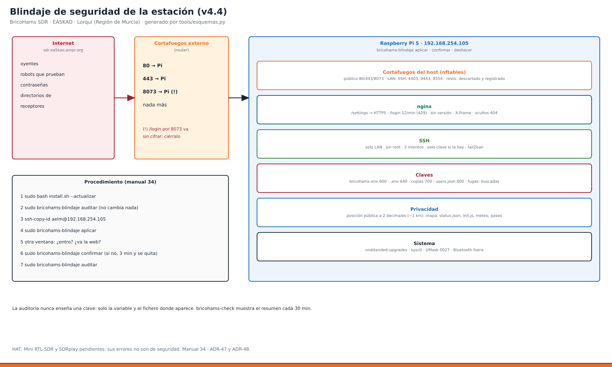

**Instalar o aplicar cambios (con backup verificado).**

```bash
sudo bash install.sh --solo herramientas,web
```

**Configuración.** [Plantilla comentada](../bricohams.env.example).
Variables referenciadas por estos pasos y sus ayudantes indicados (inventario estático, sin
valores privados; las herramientas llamadas pueden leer otras variables):

`CALLSIGN`, `STATION_QTH`, `ADMIN_EMAIL`, `OWRX_BACKEND`, `OWRX_DOCKER_DIR`, `AIS_ENABLE`, `WX_APRS_CALLSIGN`, `SSL_DOMAIN`, `SSL_EMAIL`, `SSL_MODO`, `RADARBOX_STATION_ID`, `OWRX_CTCSS_ENABLE`, `VISITAS_DIAS`, `HAMQTH_USER`, `HAMQTH_PASS`, `QRZ_USER`, `QRZ_PASS`, `MONITORIZACION`.

**Scripts y código.** [Instalador](../install.sh); [bricohams-api.py](../files/bin/bricohams-api.py), [bricohams-backup-limpieza](../files/bin/bricohams-backup-limpieza), [bricohams-backup-remoto](../files/bin/bricohams-backup-remoto), [bricohams-banner](../files/bin/bricohams-banner), [bricohams-blindaje](../files/bin/bricohams-blindaje), [bricohams-bloqueo](../files/bin/bricohams-bloqueo), [bricohams-check](../files/bin/bricohams-check), [bricohams-dispositivos](../files/bin/bricohams-dispositivos), [bricohams-lilygo](../files/bin/bricohams-lilygo), [bricohams-locator](../files/bin/bricohams-locator), [bricohams-login-aviso](../files/bin/bricohams-login-aviso), [bricohams-merge-bookmarks.py](../files/bin/bricohams-merge-bookmarks.py), [bricohams-mesh-admin](../files/bin/bricohams-mesh-admin), [bricohams-mesh-url](../files/bin/bricohams-mesh-url), [bricohams-owrx-bookmarks-io](../files/bin/bricohams-owrx-bookmarks-io), [bricohams-owrx-botones](../files/bin/bricohams-owrx-botones), [bricohams-owrx-ctcss](../files/bin/bricohams-owrx-ctcss), [bricohams-owrx-mapflights](../files/bin/bricohams-owrx-mapflights), [bricohams-owrx-rbimport](../files/bin/bricohams-owrx-rbimport), [bricohams-owrx-repeaterbook](../files/bin/bricohams-owrx-repeaterbook), [bricohams-oyentes](../files/bin/bricohams-oyentes), [bricohams-render-settings.py](../files/bin/bricohams-render-settings.py), [bricohams-sdr-serials](../files/bin/bricohams-sdr-serials), [bricohams-servicios](../files/bin/bricohams-servicios), [bricohams-telegram](../files/bin/bricohams-telegram).

**Comprobar (solo los servicios/opciones habilitados).**

```bash
sudo bricohams-check
sudo bricohams-backup-remoto estado
systemctl status bricohams-bloqueo-arranque --no-pager
```

**Resultado esperado.** Paneles privados y configuración de copias remotas comprobada. Instalar herramientas no equivale a configurar un destino remoto ni a probar su restauración.

**Si no funciona.** Acceso bloqueado: usa consola local y revisa reglas, sin desactivar toda protección indiscriminadamente. Backup remoto fallido: revisa huella/permisos/espacio, no ocultes el error.

**Restauración.** Guarda el estado previo indicado al principio y sigue el manual
del módulo. Un estado `inactive` en un periférico desactivado es esperable;
`failed` exige revisar el journal. No borres configuraciones para hacer que pase
una prueba. Para cambios de hardware vuelve a intervenir sin tensión.

**Procedimiento detallado:** [09_MANTENIMIENTO](manuales/09_MANTENIMIENTO.md) · [34_BLINDAJE_SEGURIDAD](manuales/34_BLINDAJE_SEGURIDAD.md).

<a id="mantenimiento"></a>

### Tareas, backups, limpieza, actualización y clonado

**Qué hace.** Programar mantenimiento, guardar configuración/perfiles, migrar OpenWebRX+ y retirar copias locales antiguas.

**Antes de empezar.** Revisa calendario, espacio y destino externo. Importar requiere un perfil existente y validado: --solo importar no aporta un fichero. Actualizar, importar y restaurar son operaciones distintas.

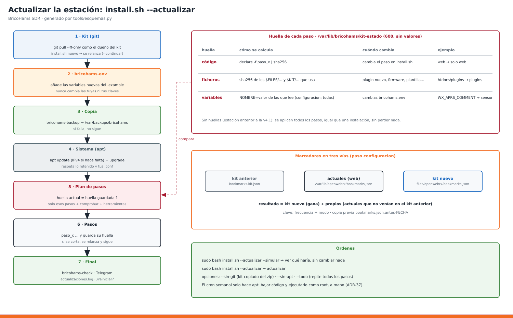

**Instalar o aplicar cambios (con backup verificado).**

```bash
sudo bash install.sh --solo herramientas,tareas
# Importar SOLO un perfil propio, existente y verificado (manual 31):
# sudo bash install.sh --importar /ruta/perfil.owrx.tar.gz
# Inspeccionar una actualizacion sin aplicarla:
sudo bash install.sh --actualizar --simular
```

**Configuración.** [Plantilla comentada](../bricohams.env.example).
Variables referenciadas por estos pasos y sus ayudantes indicados (inventario estático, sin
valores privados; las herramientas llamadas pueden leer otras variables):

`OWRX_ADMIN_USER`, `OWRX_BACKEND`, `OWRX_DOCKER_DIR`, `OWRX_DOCKER_CONTAINER`, `RAK_OWRX_CHAT`, `OWRX_MAPA_LORA`, `DUCKDNS_DOMAIN`, `DUCKDNS_TOKEN`, `VISITAS_ENABLE`, `CRON_COPIA`, `CRON_ACTUALIZAR`, `CRON_REINICIO`, `CRON_SALUD`, `CRON_RESUMEN`, `CRON_GEOIP`, `IMPORTAR_NIVELES`.

**Scripts y código.** [Instalador](../install.sh); [bricohams-backup-limpieza](../files/bin/bricohams-backup-limpieza), [bricohams-backup-remoto](../files/bin/bricohams-backup-remoto), [bricohams-banner](../files/bin/bricohams-banner), [bricohams-blindaje](../files/bin/bricohams-blindaje), [bricohams-bloqueo](../files/bin/bricohams-bloqueo), [bricohams-check](../files/bin/bricohams-check), [bricohams-dispositivos](../files/bin/bricohams-dispositivos), [bricohams-lilygo](../files/bin/bricohams-lilygo), [bricohams-locator](../files/bin/bricohams-locator), [bricohams-login-aviso](../files/bin/bricohams-login-aviso), [bricohams-merge-bookmarks.py](../files/bin/bricohams-merge-bookmarks.py), [bricohams-mesh-url](../files/bin/bricohams-mesh-url), [bricohams-mqtt-settings.py](../files/bin/bricohams-mqtt-settings.py), [bricohams-render-settings.py](../files/bin/bricohams-render-settings.py), [bricohams-sdr-serials](../files/bin/bricohams-sdr-serials), [bricohams-servicios](../files/bin/bricohams-servicios), [bricohams-tarea](../files/bin/bricohams-tarea), [bricohams-telegram](../files/bin/bricohams-telegram).

**Comprobar (solo los servicios/opciones habilitados).**

```bash
sudo bricohams-backup-limpieza --dry-run
systemctl list-timers bricohams-backup-limpieza.timer --all
journalctl -u bricohams-backup-limpieza.service -n 20 --no-pager
```

**Resultado esperado.** Temporizadores/cron previstos y copias verificables. La limpieza diaria a las 06:15 borra archivos elegibles con más de 120 h por mtime; no garantiza una copia mínima ni toca subdirectorios/restauraciones de despliegue.

**Si no funciona.** Antes de limpiar guarda fuera del alcance los archivos que quieras conservar. No hay papelera; parar el timer no recupera archivos. Para deshacer importación usa owrx-clone deshacer según manual 31, no para revertir todo el sistema.

**Restauración.** Guarda el estado previo indicado al principio y sigue el manual
del módulo. Un estado `inactive` en un periférico desactivado es esperable;
`failed` exige revisar el journal. No borres configuraciones para hacer que pase
una prueba. Para cambios de hardware vuelve a intervenir sin tensión.

**Procedimiento detallado:** [09_MANTENIMIENTO](manuales/09_MANTENIMIENTO.md) · [25_TAREAS_AUTOMATICAS](manuales/25_TAREAS_AUTOMATICAS.md) · [29_ACTUALIZAR](manuales/29_ACTUALIZAR.md) · [31_CLONAR_OPENWEBRX](manuales/31_CLONAR_OPENWEBRX.md).

<a id="hardware"></a>

### Caja, antenas, filtros, alimentación y anclajes

**Qué hace.** Construcción mecánica y cadena RF. No existe un paso install.sh que monte o certifique el hardware.

**Antes de empezar.** Lee materiales, dimensiones y comprobaciones de cada manual. Desconecta alimentación antes de cablear. Trabajos de red eléctrica y altura requieren personal cualificado, medios de protección y normativa local.

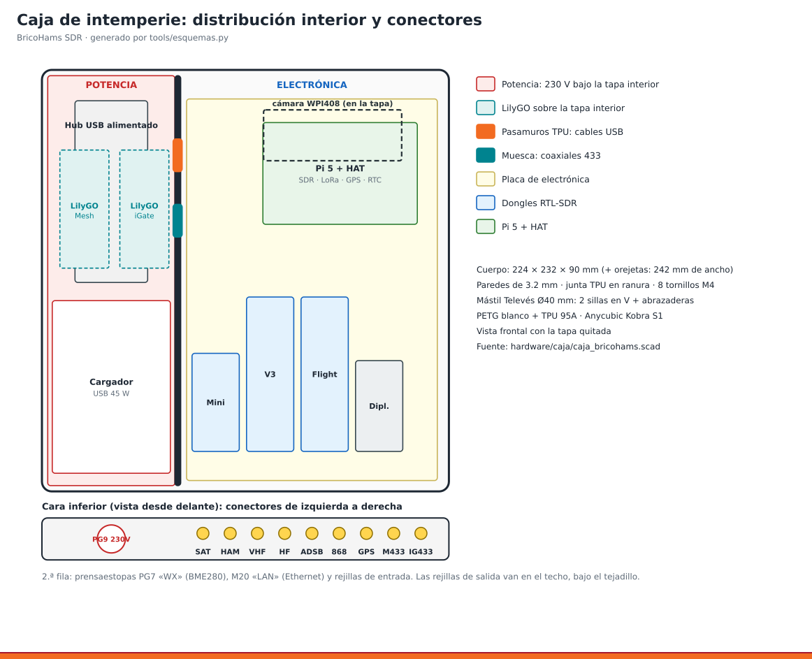

**Instalar o aplicar cambios (con backup verificado).**

No hay script de instalación para este montaje. Sigue los manuales enlazados.

**Configuración.** [Plantilla comentada](../bricohams.env.example).
Variables referenciadas por estos pasos y sus ayudantes indicados (inventario estático, sin
valores privados; las herramientas llamadas pueden leer otras variables):

Consulta los requisitos de la ficha y el manual; no hay variables directas adicionales identificadas.

**Scripts y código.** Manuales de montaje.

**Comprobar (solo los servicios/opciones habilitados).**

```bash
# No hay comando que sustituya inspeccion electrica, RF o mecanica.
# Despues del montaje y encendido seguro, si las herramientas estan instaladas:
sudo bricohams-check
```

**Resultado esperado.** Cableado y fijaciones revisados, puesta a tierra/protección según diseño, estanqueidad y alimentación comprobadas; antenas verificadas con instrumentación antes de izarlas.

**Si no funciona.** No alimentes un LNA o bias-tee sin verificar tensión/corriente y sentido de conexión. No trabajes con 230 V ni en el mástil energizado. Una ilustración no es un plano eléctrico certificado.

**Restauración.** Guarda el estado previo indicado al principio y sigue el manual
del módulo. Un estado `inactive` en un periférico desactivado es esperable;
`failed` exige revisar el journal. No borres configuraciones para hacer que pase
una prueba. Para cambios de hardware vuelve a intervenir sin tensión.

**Procedimiento detallado:** [10_CAJA_3D](manuales/10_CAJA_3D.md) · [11_MASTIL_Y_ANTENAS](manuales/11_MASTIL_Y_ANTENAS.md) · [12_QUAD_2M70](manuales/12_QUAD_2M70.md) · [13_DISCONES](manuales/13_DISCONES.md) · [14_ADSB_LNA](manuales/14_ADSB_LNA.md) · [15_LAZO_MLA30](manuales/15_LAZO_MLA30.md) · [16_FILTROS_Y_PREAMPLIFICADORES](manuales/16_FILTROS_Y_PREAMPLIFICADORES.md) · [17_CAJA_V3](manuales/17_CAJA_V3.md) · [21_ANCLAJES](manuales/21_ANCLAJES.md).

## 5. Matriz de todos los manuales

Cada enlace conduce al procedimiento completo con su cuadro de orientación.
Los manuales mecánicos no se convierten artificialmente en módulos instalables.
El manual 37 explica cambios históricos, no añade un paso de instalación.

| Manual | Recorrido visual |
|---|---|
| [01_PREPARACION](manuales/01_PREPARACION.md) | [Sistema base, red, arranque y HAT](#sistema) |
| [02_INSTALACION](manuales/02_INSTALACION.md) | [Sistema base, red, arranque y HAT](#sistema) |
| [03_SDR_Y_SERIES](manuales/03_SDR_Y_SERIES.md) | [OpenWebRX+, RTL-SDR y SDRplay](#receptor) |
| [04_ADSB](manuales/04_ADSB.md) | [ADS-B local, RadarBox y map.flights simultáneos](#adsb) |
| [05_LILYGO](manuales/05_LILYGO.md) | [Meshtastic HAT y LilyGO; puente al mapa](#mesh) |
| [06_SENSOR_WX](manuales/06_SENSOR_WX.md) | [Meteorología, BME280, viento/lluvia y Pico IO](#wx) |
| [07_CAMARA](manuales/07_CAMARA.md) | [Cámara y MediaMTX](#camara) |
| [08_SDRPLAY](manuales/08_SDRPLAY.md) | [OpenWebRX+, RTL-SDR y SDRplay](#receptor) |
| [09_MANTENIMIENTO](manuales/09_MANTENIMIENTO.md) | [Tareas, backups, limpieza, actualización y clonado](#mantenimiento) |
| [10_CAJA_3D](manuales/10_CAJA_3D.md) | [Caja, antenas, filtros, alimentación y anclajes](#hardware) |
| [11_MASTIL_Y_ANTENAS](manuales/11_MASTIL_Y_ANTENAS.md) | [Caja, antenas, filtros, alimentación y anclajes](#hardware) |
| [12_QUAD_2M70](manuales/12_QUAD_2M70.md) | [Caja, antenas, filtros, alimentación y anclajes](#hardware) |
| [13_DISCONES](manuales/13_DISCONES.md) | [Caja, antenas, filtros, alimentación y anclajes](#hardware) |
| [14_ADSB_LNA](manuales/14_ADSB_LNA.md) | [Caja, antenas, filtros, alimentación y anclajes](#hardware) |
| [15_LAZO_MLA30](manuales/15_LAZO_MLA30.md) | [Caja, antenas, filtros, alimentación y anclajes](#hardware) |
| [16_FILTROS_Y_PREAMPLIFICADORES](manuales/16_FILTROS_Y_PREAMPLIFICADORES.md) | [Caja, antenas, filtros, alimentación y anclajes](#hardware) |
| [17_CAJA_V3](manuales/17_CAJA_V3.md) | [Caja, antenas, filtros, alimentación y anclajes](#hardware) |
| [18_VENTILACION](manuales/18_VENTILACION.md) | [Meteorología, BME280, viento/lluvia y Pico IO](#wx) |
| [19_VIENTO_Y_LLUVIA](manuales/19_VIENTO_Y_LLUVIA.md) | [Meteorología, BME280, viento/lluvia y Pico IO](#wx) |
| [20_PICO_IO](manuales/20_PICO_IO.md) | [Meteorología, BME280, viento/lluvia y Pico IO](#wx) |
| [21_ANCLAJES](manuales/21_ANCLAJES.md) | [Caja, antenas, filtros, alimentación y anclajes](#hardware) |
| [22_WX_LORA_FIRMWARE](manuales/22_WX_LORA_FIRMWARE.md) | [Meteorología, BME280, viento/lluvia y Pico IO](#wx) |
| [23_WEB_SSL_SERVICIOS](manuales/23_WEB_SSL_SERVICIOS.md) | [Portal, HTTPS, API y paneles administrativos](#web) |
| [24_VISITAS_TELEGRAM](manuales/24_VISITAS_TELEGRAM.md) | [Oyentes, Telegram y avisos](#visitas) |
| [25_TAREAS_AUTOMATICAS](manuales/25_TAREAS_AUTOMATICAS.md) | [Tareas, backups, limpieza, actualización y clonado](#mantenimiento) |
| [26_SATELITES](manuales/26_SATELITES.md) | [Satélites, Doppler y FT2 experimental](#satelites) |
| [42_CLIMA_RED_SATELITES_GRABACION](manuales/42_CLIMA_RED_SATELITES_GRABACION.md) | [Satélites, Doppler y FT2 experimental](#satelites) |
| [27_PLUGINS_WEB_V4](manuales/27_PLUGINS_WEB_V4.md) | [Plugins, registro de oyentes, CTCSS y RepeaterBook](#plugins) |
| [28_FT2](manuales/28_FT2.md) | [Satélites, Doppler y FT2 experimental](#satelites) |
| [29_ACTUALIZAR](manuales/29_ACTUALIZAR.md) | [Tareas, backups, limpieza, actualización y clonado](#mantenimiento) |
| [30_AUDIO_DSP](manuales/30_AUDIO_DSP.md) | [Plugins, registro de oyentes, CTCSS y RepeaterBook](#plugins) |
| [31_CLONAR_OPENWEBRX](manuales/31_CLONAR_OPENWEBRX.md) | [Tareas, backups, limpieza, actualización y clonado](#mantenimiento) |
| [32_ZONA_LOCATOR](manuales/32_ZONA_LOCATOR.md) | [Locator, canales y marcadores de la zona](#zona) |
| [33_OPENWEBRX_DOCKER](manuales/33_OPENWEBRX_DOCKER.md) | [OpenWebRX+, RTL-SDR y SDRplay](#receptor) |
| [34_BLINDAJE_SEGURIDAD](manuales/34_BLINDAJE_SEGURIDAD.md) | [Blindaje, bloqueo y copias remotas](#seguridad) |
| [35_LORA_APRS_MESHTASTIC](manuales/35_LORA_APRS_MESHTASTIC.md) | [Meshtastic HAT y LilyGO; puente al mapa](#mesh) |
| [36_TAK_MAPA_LOCAL](manuales/36_TAK_MAPA_LOCAL.md) | [ADS-B local, RadarBox y map.flights simultáneos](#adsb) |
| [37_JUSTIFICACION_CAMBIOS_V4_6](manuales/37_JUSTIFICACION_CAMBIOS_V4_6.md) | [Sistema base, red, arranque y HAT](#sistema) |
| [38_MAPFLIGHTS_PLUGIN](manuales/38_MAPFLIGHTS_PLUGIN.md) | [ADS-B local, RadarBox y map.flights simultáneos](#adsb) |
| [39_REGISTRO_OYENTES](manuales/39_REGISTRO_OYENTES.md) | [Plugins, registro de oyentes, CTCSS y RepeaterBook](#plugins) |
| [40_HTTPS_MAPA_LOCAL_POLITICAS](manuales/40_HTTPS_MAPA_LOCAL_POLITICAS.md) | [Portal, HTTPS, API y paneles administrativos](#web) |
| [41_PLUGINS_EA5HKX](manuales/41_PLUGINS_EA5HKX.md) | [Caja, antenas, filtros, alimentación y anclajes](#hardware) |

## 6. Mantener la guía y publicar capturas

Generada con `node tools/generar-guia-visual.cjs` desde la raíz del repositorio.
Verificar sin escribir: `node tools/generar-guia-visual.cjs --check`.
El generador exige cobertura de todos los pasos y existencia de los diagramas,
manuales, capturas y enlaces locales. No ejecuta ningún comando en la Pi.

Para nuevas capturas: usar cuenta/datos de demostración o recorte sin información
personal **antes de guardar**, revisar visualmente al tamaño original, retirar
metadatos y excluir IP/dominio privado, indicativo, ubicación, UUID, tokens,
claves, canales/QR y usuarios. No publicar fotos de terceros sin derechos.
Los módulos sin captura real disponible usan una ilustración identificada,
no una interfaz ficticia. Las capturas actuales documentan controles del mapa,
no todos los formularios de administración ni estados de servicios.
