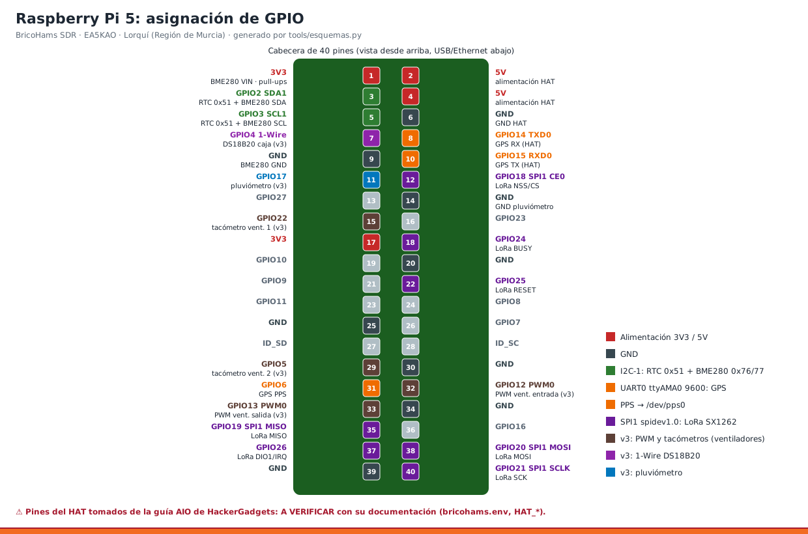
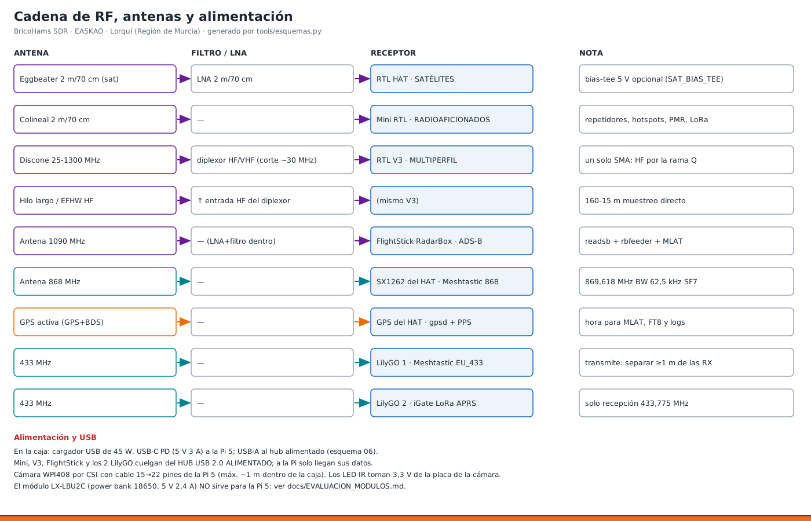
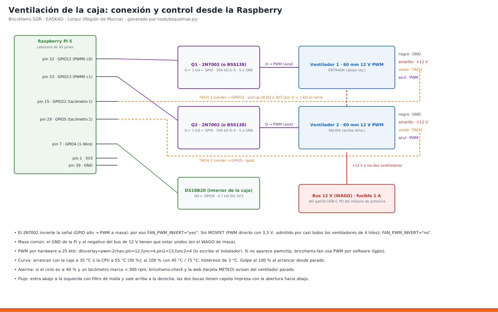

# Hardware, GPIO, buses y alimentación



## 1. Asignación de la cabecera de 40 pines (Raspberry Pi 5)

> ⚠ Los pines del HAT HackerGadgets son los de su guía para la placa AIO (mismos módulos). Están **A VERIFICAR** con la documentación del HAT. Se cambian en `bricohams.env` (variables `HAT_*`), nunca en el código.

| Pin físico | BCM / función | Dispositivo | Señal | Variable / overlay |
|---|---|---|---|---|
| 1 | 3V3 | BME280 | VIN | — |
| 2, 4 | 5V | HAT | alimentación | — |
| 3 | GPIO2 · SDA1 | RTC PCF85063A (0x51) + BME280 (0x76/0x77) | SDA | `dtparam=i2c_arm=on` |
| 5 | GPIO3 · SCL1 | RTC + BME280 | SCL | `dtparam=i2c_arm=on` |
| 6, 9, 14… | GND | HAT, BME280 | masa | — |
| 8 | GPIO14 · TXD0 | GPS del HAT | RX del GPS | `dtparam=uart0=on` → `/dev/ttyAMA0` (`HAT_GPS_DEV`) |
| 10 | GPIO15 · RXD0 | GPS del HAT | TX del GPS | 9600 baudios (`HAT_GPS_BAUD`) |
| 31 | GPIO6 | GPS del HAT | PPS | `dtoverlay=pps-gpio,gpiopin=6` (`HAT_PPS_GPIO`) |
| 12 | GPIO18 · SPI1 CE0 | LoRa SX1262 | NSS/CS | `dtoverlay=spi1-1cs` (`HAT_LORA_SPI`) |
| 35 | GPIO19 · SPI1 MISO | LoRa SX1262 | MISO | `/dev/spidev1.0` (`HAT_LORA_SPIDEV`) |
| 38 | GPIO20 · SPI1 MOSI | LoRa SX1262 | MOSI | — |
| 40 | GPIO21 · SPI1 SCLK | LoRa SX1262 | SCK | — |
| 37 | GPIO26 | LoRa SX1262 | DIO1 / IRQ | `HAT_LORA_IRQ=26` |
| 18 | GPIO24 | LoRa SX1262 | BUSY | `HAT_LORA_BUSY=24` |
| 22 | GPIO25 | LoRa SX1262 | RESET | `HAT_LORA_RESET=25` |
| 7 | GPIO4 · 1-Wire | DS18B20 (aire de la caja) | DQ, 4,7 kΩ a 3V3 | `dtoverlay=w1-gpio,gpiopin=4` (`W1_GPIO`) · v3 |
| 11 | GPIO17 | Pluviómetro (reed) | contacto a GND, 10 kΩ a 3V3 + 100 nF | `RAIN_GPIO=17` · v3 |
| 15 | GPIO22 | Ventilador 1 (entrada) | TACH, 10 kΩ a 3V3 + 1 kΩ serie | `FAN_TACH_GPIOS=22,5` · v3 |
| 29 | GPIO5 | Ventilador 2 (salida) | TACH | ídem · v3 |
| 32 | GPIO12 · PWM0 canal 0 | Ventilador 1 | PWM vía 2N7002 | `dtoverlay=pwm-2chan,pin=12,func=4,pin2=13,func2=4` (`FAN_PWM_GPIOS=12,13`) · v3 |
| 33 | GPIO13 · PWM0 canal 1 | Ventilador 2 | PWM vía 2N7002 | ídem · v3 |
| — | (opcional) | HAT | encendido de módulos | `HAT_POWER_GPIOS` (en la AIO v2: 27 GPS, 16 LoRa, 7 SDR, 23 USB) |

**Libres (v3):** GPIO16, 23 y 27, si el HAT no los usa (en la AIO encienden módulos: **evitarlos**), y los de SPI0 (8–11). GPIO4, 5, 12, 13, 17 y 22 quedan **ocupados** por la ventilación y la estación WX ([esquema 02](esquemas/02_gpio_pi5.png)).

> El anemómetro y la veleta **no** van a la cabecera: van por RS485 con un adaptador USB (`/dev/rs485`). Así no hay 12 V cerca de los GPIO.

Bloque que escribe el instalador en `/boot/firmware/config.txt`:

```ini
# >>> BricoHams
[all]
dtparam=i2c_arm=on
dtoverlay=i2c-rtc,pcf85063a
dtparam=rtc=off
dtparam=uart0=on
dtoverlay=pps-gpio,gpiopin=6
dtparam=spi=on
dtoverlay=spi1-1cs
camera_auto_detect=1
dtoverlay=pwm-2chan,pin=12,func=4,pin2=13,func2=4   ← v3, con FAN_ENABLE="yes"
dtoverlay=w1-gpio,gpiopin=4                          ← v3, con FAN_ENABLE="yes"
# usb_max_current_enable=1   ← solo con PI5_USB_MAX_CURRENT="yes" (fuente oficial de 27 W)
# <<< BricoHams
```

LoRa en `/etc/meshtasticd/config.d/hackergadgets-hat.yaml`:

```yaml
Lora:
  Module: sx1262
  DIO2_AS_RF_SWITCH: true
  DIO3_TCXO_VOLTAGE: true
  IRQ: 26
  Busy: 24
  Reset: 25
  spidev: spidev1.0
```

## 2. Bus I2C-1

| Dirección | Dispositivo | Comprobación |
|---|---|---|
| 0x51 (`UU` si lo usa el kernel) | RTC PCF85063A del HAT | `sudo hwclock -r` |
| 0x76 / 0x77 | BME280 (ID 0x60) o BMP280 (ID 0x58) | `sudo bricohams-wx --una` |

Cableado del sensor: [esquema 03](esquemas/03_cableado_bme280.png) y [manual 06](manuales/06_SENSOR_WX.md).


> Si el HAT tapa la cabecera y no lleva pines pasantes, hay tres opciones: suelda el sensor a las islas de 3V3/SDA/SCL/GND del HAT, pon una cabecera apilable o usa un conector Qwiic/STEMMA si el HAT lo trae.

## 3. CSI (cámara)

| Elemento | Detalle |
|---|---|
| Cámara | Whadda/Velleman **WPI408**: OV5647 de 5 MP, 2592×1944, objetivo de 3,6 mm, 130°, 2 LED IR a 3,3 V |
| Conector de la Pi 5 | CAM/DISP 0 o 1, **22 pines de paso 0,5 mm** |
| Cable | **15 → 22 pines** («cable de cámara para Pi 5»). El de 15 pines de la cámara no entra en la Pi 5 |
| Detección | `camera_auto_detect=1` + `rpicam-hello --list-cameras` → `ov5647` |
| Sin filtro IR (imagen rosada de día) | `CAM_TUNING=/usr/share/libcamera/ipa/rpi/pisp/ov5647_noir.json` |

## 4. USB

| Dispositivo | Consumo aprox. | Dónde conectarlo |
|---|---|---|
| RTL-SDR del HAT | 0,3 A | según cómo lo lleve el HAT (USB a la Pi) |
| Mini RTL-SDR (USB-C) | 0,3 A | hub USB alimentado |
| RTL-SDR Blog V3 | 0,3 A | hub USB alimentado |
| FlightStick RadarBox | 0,35 A (con LNA) | hub USB alimentado |
| LilyGO T3 V1.6.1 ×2 | 0,1 A cada uno (picos de TX) | **hub USB 2.0 alimentado** |
| SDRplay (futuro) | 0,2 A | USB 3.0 de la Pi |
| Adaptador USB-RS485 (v3) | 0,05 A | regleta Vansuny → `/dev/rs485` |
| Bias-tee del LNA 1090 (v3) | 0,05 A | puerto USB de la regleta (solo corriente) |
| Inyector del MLA-30 (v3) | 0,1 A | puerto USB de la regleta (solo corriente) |

- **En la caja v3:** regleta **Vansuny USB 3.0** alimentada a 12 V desde el bus (fusible de 2 A). Su upstream va al puerto azul de la Pi.

- **Por qué el hub:** hay 6–7 dispositivos para 4 puertos.
- **En la caja (v2.2):** la Pi va al cargador de 45 W, sin la fuente oficial, y por eso limita sus USB a 0,6 A en total. Los SDR y los LilyGO se alimentan del **hub** y a la Pi solo llega el cable de datos del hub ([esquema 06](esquemas/06_alimentacion_caja.png)).
- **Con la fuente oficial de 27 W** y `PI5_USB_MAX_CURRENT="yes"`, la Pi da 1,6 A en total por USB.

## 5. Alimentación

| Consumidor | Potencia típica |
|---|---|
| Raspberry Pi 5 con 4 SDR decodificando | 7–10 W |
| 4 RTL-SDR | 5–6 W |
| LilyGO ×2 | 0,5–1 W |
| Cámara + LED IR (de noche) | ~1 W |
| **Total** | **~15–18 W** |

- **Fuente en la caja (v2.2):** cargador USB multitoma de 45 W.
  - USB-C PD de 5 V 3 A → Pi.
  - USB-A → hub alimentado.
  - Usa alrededor del 40 % de su capacidad ([ADR-16](ARQUITECTURA.md)).
- **Caja v3 (recomendada):** cargador de **120 W** en el módulo de potencia ([esquema 15](esquemas/15_alimentacion_v3.png), ADR-22).
  - USB-C 1 PD 5 V 3 A → Pi.
  - USB-C 2 + gatillo PD 12 V → fusible → **bus de 12 V (WAGO)**, del que cuelgan:
    - regleta Vansuny (2 A);
    - ventiladores (1 A);
    - sensores RS485 (1 A).
  - **Consumo:** 16–24 W (~20 %).
- **Fuera de la caja:** fuente oficial de 27 W (5,1 V, 5 A) y hub alimentado aparte.
- **Batería:** para respaldo en el mástil, una LiFePO4 de 12 V con un regulador de 5 V y 5 A, o un SAI para Pi 5. **No** el LX-LBU2C ([evaluación](EVALUACION_MODULOS.md)).

## 6. Antenas y RF



| Antena | Receptor | Nota |
|---|---|---|
| Eggbeater 2 m/70 cm + LNA | RTL del HAT | bias-tee del HAT si el LNA se alimenta por el coaxial (`SAT_BIAS_TEE=yes`) |
| Colineal 2 m/70 cm | Mini RTL-SDR | repetidores, hotspots, PMR, LoRa 433/868, TETRA |
| Discone + hilo largo HF por **diplexor** | RTL-SDR Blog V3 | HF por la rama Q (160–15 m) y VHF/UHF por el sintonizador |
| 1090 MHz | FlightStick | LNA y filtro dentro del FlightStick |
| 868 MHz | SX1262 del HAT | Meshtastic 869,618 MHz |
| GPS activa | GPS del HAT | cielo despejado |
| 433 MHz ×2 | LilyGO | el Meshtastic 433 **transmite**: antena a ≥ 1 m de las de recepción |

**Antenas v3** ([plan del mástil](esquemas/11_plan_mastil.png), [cadena de RF](esquemas/12_cadena_rf.png)):

| Antena v3 | Receptor | Pasamuros | Manual |
|---|---|---|---|
| Quad 2 m/70 cm + diplexor | Mini (HAM) | HAM | [12](manuales/12_QUAD_2M70.md) |
| Discone grande | V3 (VHF/UHF) | VHF | [13](manuales/13_DISCONES.md) |
| Lazo MLA-30 (+ inyector) | V3 (HF) por diplexor / SDRplay A | HF | [15](manuales/15_LAZO_MLA30.md) |
| Plano de tierra de 1090 + LNA (+ bias-tee 5 V) | FlightStick | ADSB | [14](manuales/14_ADSB_LNA.md) |
| Bigsignal 868 | SX1262 del HAT | 868 | [11](manuales/11_MASTIL_Y_ANTENAS.md) |
| Bigsignal 433 + FBP-433s | LilyGO iGate | IG433 | [16](manuales/16_FILTROS_Y_PREAMPLIFICADORES.md) |
| Fibra 433 | LilyGO Meshtastic | M433 | [11](manuales/11_MASTIL_Y_ANTENAS.md) |
| Eggbeater + LNA | RTL del HAT (SAT) | SAT | proyecto eggbeater |
| Discone compacta | bahía de expansión | DISC2 | [13](manuales/13_DISCONES.md) |

## 7. Caja de intemperie (v2.2)


- **Montaje:** PETG + TPU, para el mástil Televés. Paso a paso en el [manual 10](manuales/10_CAJA_3D.md).
- **Conectores de la cara inferior,** de izquierda a derecha: PG9 «230 V» · SAT · HAM · VHF · HF · ADSB · 868 · GPS · M433 · IG433. En la 2.ª fila: PG7 «WX» y M20 «LAN».
- **Alimentación:** [esquema 06](esquemas/06_alimentacion_caja.png).


## 8. Caja v3 (dos módulos al pie del mástil)




- **Módulo de electrónica** (228 × 240 × 112) y **de potencia** (170 × 200 × 112): [manual 17](manuales/17_CAJA_V3.md), ADR-21.
- **Pasamuros N de la cara inferior:**
  - fila delantera: SAT · HAM · VHF · HF · ADSB · 868 · GPS;
  - fila trasera: M433 · IG433 · DISC2 · HF2 · R1 · R2 · R3.
- **Prensaestopas:** M25 «PWR», M20 «LAN» y PG7 «WX», «VIENTO», «LLUVIA» y «RES».
- **Ventilación:** [manual 18](manuales/18_VENTILACION.md).
- **Viento y lluvia:** [manual 19](manuales/19_VIENTO_Y_LLUVIA.md).
- **Lista completa de cables (C1–C18) y componentes:** [MEMORIA_TECNICA](MEMORIA_TECNICA.md).
