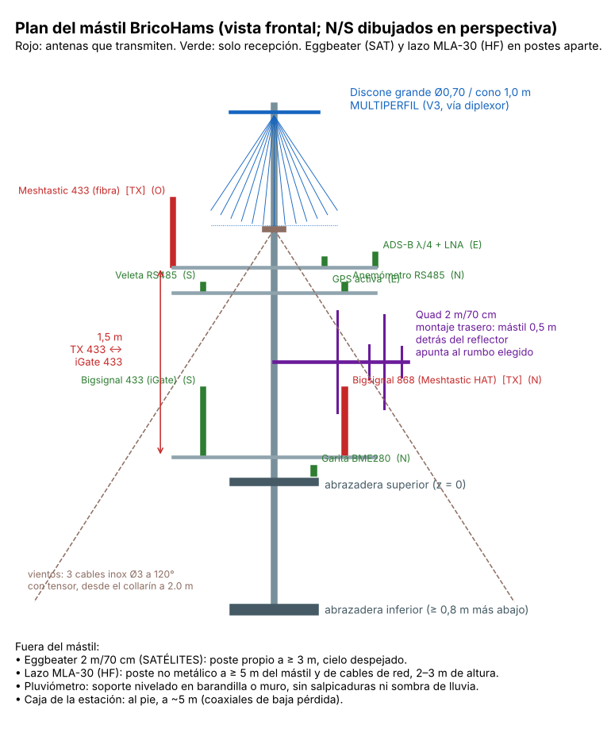

# Memoria técnica · Estación BricoHams SDR · EA5KAO · Lorquí (v3.0)

Aquí está **todo lo que forma la estación**: qué es cada componente, **dónde va**, **a qué se conecta** y con qué cable, y en qué manual y esquema se monta. Las decisiones de diseño están en [ARQUITECTURA.md](ARQUITECTURA.md); los pines, en [HARDWARE_Y_GPIO.md](HARDWARE_Y_GPIO.md).

## 1. Visión general

La estación tiene cinco zonas:

| Zona | Qué hay | Esquema |
|---|---|---|
| **A · Mástil Televés** (Ø40 × 2, con vientos a 2 m) | discone grande, quad 2 m/70 cm, ADS-B + LNA, GPS, Meshtastic 433 (fibra), Bigsignal 868 y 433, anemómetro, veleta, garita del BME280 | [11 plan del mástil](esquemas/11_plan_mastil.png) |
| **B · Postes aparte** | eggbeater de satélites (≥ 3 m del mástil), lazo MLA-30 (≥ 5 m, poste no metálico), pluviómetro (muro o barandilla) | [11](esquemas/11_plan_mastil.png) |
| **C · Módulo de electrónica** (al pie, a ~5 m) | Pi 5 + HAT, 3 RTL-SDR + bahía de expansión, regleta USB, diplexor HF/VHF, filtros, bias-tee, LilyGO ×2, RS485, ventiladores, DS18B20 | [07](esquemas/07_caja_distribucion.png), [12](esquemas/12_cadena_rf.png), [13](esquemas/13_ventiladores.png), [14](esquemas/14_sensores_wx.png) |
| **D · Módulo de potencia** (junto al C) | base Schuko, cargador USB de 120 W, gatillo PD de 12 V, fusibles, WAGO | [15 alimentación v3](esquemas/15_alimentacion_v3.png) |
| **E · Red** | WiFi de casa (5 GHz preferida) o cable por el M20 «LAN»; cámara IP opcional por PoE | [05 red y puertos](esquemas/05_red_puertos.png) |

## 2. Inventario de componentes

**Ubicación:** A = mástil · B = poste aparte · C = módulo de electrónica · D = módulo de potencia.

### 2.1 Receptores y radios
| ID | Componente | Ubicación | Función | Entrada RF | Alimentación / datos | Manual |
|---|---|---|---|---|---|---|
| R1 | RTL-SDR del **HAT HackerGadgets** (serie 00000101) | C, bandeja | SATÉLITES | N «SAT» → eggbeater + LNA (bias-T del HAT) | HAT sobre la Pi | 03 |
| R2 | **Mini RTL-SDR** (00000102) | C, rejilla | RADIOAFICIONADOS | N «HAM» → quad 2 m/70 (diplexor en cabecera) | regleta USB | 03, 12 |
| R3 | **RTL-SDR Blog V3** (00000103) | C, rejilla | MULTIPERFIL + HF | diplexor HF/VHF: N «VHF» (discone grande) + N «HF» (MLA-30) | regleta USB | 03, 13, 15 |
| R4 | **FlightStick** RadarBox (00001090) | C, rejilla | ADS-B + MLAT | N «ADSB» → bias-tee 5 V → LNA 1090 en la antena | regleta USB | 04, 14 |
| R5 | SDRplay RSPdx-R2 (futuro) | C, bahía de expansión | HF multiusuario | MLA-30 (ant. A), N «HF2» (ant. B), N «DISC2» | USB 3.0 de la Pi | 08 |
| L1 | SX1262 del HAT | C, bandeja | Meshtastic 868 | N «868» → Bigsignal 868 | HAT | 05 |
| L2 | **LilyGO T3 V1.6.1** Meshtastic | C, bandeja | Meshtastic EU_433 | N «M433» → fibra 433 | regleta USB (`/dev/lilygo-mesh`) | 05 |
| L3 | **LilyGO T3 V1.6.1** iGate | C, bandeja | iGate LoRa APRS (RX) | N «IG433» → **FBP-433s** → Bigsignal 433 | regleta USB (`/dev/lilygo-igate`) | 05, 16 |
| L4 | LilyGO Wx Station (alternativa) | B, junto a los sensores | WX por LoRa (CA2RXU) | antena 433 propia | 5 V propios | 19 |
| G1 | GPS del HAT | C | hora (PPS) y posición | N «GPS» → antena activa | HAT | 01 |

### 2.2 Antenas y elementos de RF
| ID | Componente | Ubicación | Detalle | Va a | Manual / esquema |
|---|---|---|---|---|---|
| A1 | **Discone grande** (12 + 12 varillas, cono 1,0 m) | A, punta (2,9 m) | ROE ≤ 2,8 de 88 a 1300 MHz | R3 por N «VHF» | 13 · [09](esquemas/09_discones.png) |
| A2 | Discone compacta (cono 0,75 m) | A o B (futuro) | 120–1300 MHz | N «DISC2» | 13 |
| A3 | **Quad doble 2 m/70 cm** | A, 0,95 m, fija | 8,5 / 9,8 dBi, vertical | diplexor 2 m/70 → N «HAM» | 12 · [08](esquemas/08_quad_2m70.png) |
| A4 | **ADS-B λ/4** + LNA 1090 (20,5 dB) | A, brazo E 0,8 m | ROE 1,17 | bias-tee → R4 | 14 · [10](esquemas/10_adsb_gp.png) |
| A5 | GPS activa | A, brazo E 0,4 m | GPS + BDS | N «GPS» | 11 |
| A6 | Fibra 433 (Meshtastic) | A, brazo O 0,8 m · 1,7 m | **transmite** | N «M433» | 11 |
| A7 | Bigsignal 868 | A, brazo N 0,8 m · 0,2 m | **transmite** | N «868» | 11 |
| A8 | Bigsignal 433 | A, brazo S 0,8 m · 0,2 m | solo RX (iGate) | N «IG433» | 11 |
| A9 | Eggbeater 2 m/70 (K5OE) + LNA | B, poste ≥ 3 m | satélites, RHCP | N «SAT» | proyecto «antena_eggbeater» |
| A10 | **Lazo MLA-30** + carcasa impresa | B, poste ≥ 5 m | 0,1–30 MHz activo | inyector → diplexor HF | 15 |
| F1 | Diplexor 2 m/70 cm (proyecto) | A, caja de aluminio de cabecera | une las dos alimentaciones de la quad | N «HAM» | 12 |
| F2 | Diplexor HF/VHF (corte ~30 MHz) | C, rejilla | HF del lazo + VHF de la discone → V3 | R3 | 13, 15 |
| F3 | **NMRF FBP-433s** | C, `clip_filtro` | 430–438 MHz, 1 W | L3 | 16 |
| F4 | NMRF FBP-868s (reserva) | C | SAW 866–870, ~18 dBm | solo RX | 16 |
| F5 | Bias-tee 5 V (SMA) | C, rejilla | alimenta el LNA 1090 por el coaxial | R4 | 14, 16 |
| F6 | Inyector del MLA-30 | C, rejilla | 12 V por el coaxial del lazo | F2 | 15 |

### 2.3 Sensores
| ID | Componente | Ubicación | Conexión | Manual |
|---|---|---|---|---|
| S1 | **BME280** (GYBMEP) en garita de 6 platos | A, brazo N 0,05 m | **v4: Pico GP4/GP5 (I2C0) + 3V3/GND** · PG7 «WX» | 06, 20 |
| S2 | **Anemómetro RS485** (Modbus 1) | A, brazo N 0,8 m · 1,5 m | bus RS485 (A, B) + 12 V · PG7 «VIENTO» | 19 |
| S3 | **Veleta RS485** (Modbus 2) | A, brazo S 0,8 m · 1,5 m | mismo bus RS485 | 19 |
| S4 | **Pluviómetro** Misol WH-SP-RG | poste Ø40 de 1 m con `pluvio_vaso` + `pluvio_plataforma` | **v4: Pico GP15** + GND (10 kΩ, 100 nF) · PG7 «LLUVIA» | 19, 20, 21 |
| S5 | **DS18B20** | C, en el centro, colgando | **v4: Pico GP22** (4,7 kΩ a 3V3) | 18, 20 |
| S6 | **Cámara Waveshare RPi Camera (F)** (OV5647 NoIR + IR) | C, ventana de la tapa (`soporte_camara` + `visera`) | **cable Standard–Mini 15→22 pines** a CAM/DISP 0 | 07 |
| S7 | **Pico «bricohams-io»** + placa de 2 MOSFET | C, `pico_soporte` en la rejilla | USB a la regleta → `/dev/bricohams-io` | 20 |

### 2.4 Alimentación y control
| ID | Componente | Ubicación | Conexión | Manual |
|---|---|---|---|---|
| P1 | Manguera H07RN-F 2 × 1 mm² + diferencial 30 mA | toma de casa → D | PG9 «230 V» | 17 |
| P2 | Base Schuko de superficie | D | P1 | 17 |
| P3 | **Cargador USB de 120 W** | D, enchufado en P2 (`brida_cargador`) | USB-C1 → Pi · USB-C2 → P4 | 17 |
| P4 | Gatillo USB-C PD **12 V** | D | → portafusibles → WAGO 12 V | 17 |
| P5 | Portafusibles de cuchilla ×3 (2 A, 1 A, 1 A) | D | regleta, ventiladores, viento | 17 |
| P6 | WAGO 221 (12 V y GND) | C (`soporte_wago`) | bus de 12 V | 17 |
| P7 | **Regleta USB Vansuny** (12 V, USB 3.0) | C (`soporte_hub`) | upstream al USB 3.0 de la Pi | 17 |
| P8 | Ventiladores 60 mm 12 V PWM ×2 + 2N7002 ×2 | C, paredes izq. (entrada) y dcha. (salida) | **v4: Pico GP16/17 (PWM), GP18/19 (tacómetros)** | 18, 20 |
| P9 | Adaptador USB-RS485 (CH340) | C | regleta USB → `/dev/rs485` | 19 |
| P10 | Alimentador FX24E-120200C | repuesto | 12 V 2 A de la regleta | — |

## 3. Lista de cables

| Cable | Desde | Hasta | Tipo | Longitud | Conectores |
|---|---|---|---|---|---|
| C1 | Discone grande | C · N «VHF» | H155 o LMR-240 | según plan (~7 m) | N macho – N macho |
| C2 | Diplexor de cabecera (quad) | C · N «HAM» | H155 o LMR-240 | ~7 m | N – N |
| C2a, C2b | Quad: alimentación 2 m y 70 cm | diplexor de cabecera | λ/4 RG-59 (2 m: 341 mm) + RG-58 / RG-58 | < 1 m | soldado en `quad_alim_*` – N |
| C3 | Base ADS-B (LNA) | C · N «ADSB» | **LMR-400 o Hyperflex 5** | ~7 m | N – N |
| C4 | GPS activa | C · N «GPS» | el suyo (RG-174, 5 m) + alargo N | ~7 m | SMA – N |
| C5 | Fibra 433 | C · N «M433» | H155 | ~7 m | N – N |
| C6 | Bigsignal 868 | C · N «868» | H155 | ~6 m | N – N |
| C7 | Bigsignal 433 | C · N «IG433» | H155 | ~6 m | N – N |
| C8 | Eggbeater (LNA) | C · N «SAT» | RG-213 o H155 | según poste | N – N |
| C9 | MLA-30 | C · N «HF» | RG-58 del kit (10 m) | 10 m | SMA – N (adaptador) |
| C10 | Pasamuros N (interior) | cada receptor o filtro | latiguillo RG-316 | 20 cm | N macho – SMA macho |
| C11 | BME280 | C · PG7 «WX» | apantallado 4 × 0,25 mm² | ≤ 5 m | bornes – Dupont |
| C12 | Anemómetro + veleta | C · PG7 «VIENTO» | 4 hilos (12 V, GND, A, B), mejor par trenzado | ~7 m | bornes del adaptador RS485 y WAGO |
| C13 | Pluviómetro | C · PG7 «LLUVIA» | 2 hilos (el del pluviómetro + alargo) | según muro | RJ11 del Misol cortado → bornes |
| C14 | Cargador, USB-C1 (D) | Raspberry Pi 5 (C), por el M25 «PWR» | USB-C a USB-C de 3 A | 0,5–1 m | USB-C |
| C15 | Gatillo PD 12 V + fusibles (D) | WAGO 12 V (C), por el M25 «PWR» | 2 × 1 mm² | 0,5–1 m | bornes |
| C16 | 230 V | toma con diferencial | D (PG9) | H07RN-F 2 × 1 | lo necesario | Schuko |
| C17 | Red | router | C (M20 «LAN») | Cat6 FTP de exterior | — | RJ45 |
| C18 | Ventiladores | WAGO 12 V y placa de la Pico | ventiladores | el suyo, 4 hilos | 30 cm | conector de 4 pines |
| C19 | Pico «bricohams-io» | regleta USB | cable micro-USB de datos | 30 cm | USB-A – micro-USB |
| C20 | Cámara Waveshare (F) | Pi 5 CAM/DISP 0 | cinta Standard–Mini 15→22 pines | 300 mm | FFC |

**Regla de oro:** bucle de goteo en cada coaxial antes del pasamuros, conectores exteriores con `funda_n` y cinta autovulcanizante, y coaxiales sujetos al mástil cada 50 cm con `separador_coax` (separados 30 mm del tubo).

## 4. Secuencia de instalación (resumen)

1. **Taller:** imprimir todas las piezas (caja v3, antenas, soportes) → manuales 10/17, 12–15.
2. **Antenas en el banco:** construir y medir con un NanoVNA la quad, las discones y la ADS-B. Comprobar los valores de NEC2 (manuales 12–14).
3. **Caja:** montar los módulos C y D, el cableado interior y los ventiladores (manuales 17–18). **Primero sin 230 V:** probar con la fuente de banco por el USB-C.
4. **Software:** `sudo bash install.sh` con la caja en el banco. `bricohams-check` → 0 fallos (manual 02).
5. **Mástil:** montar los vientos, las abrazaderas, las antenas de arriba abajo, los coaxiales y las fundas (manual 11).
6. **Postes aparte:** eggbeater, lazo MLA-30 y pluviómetro (manuales 15 y 19).
7. **Final:** conectar los coaxiales, comprobar la ROE/recepción por receptor, conectar los 230 V con el diferencial y repasar `bricohams-check` y la temperatura tras un día de sol.

## 5. Lista de compra consolidada (lo que no está impreso)

| Grupo | Artículo | Cant. |
|---|---|---|
| Mástil | Mástil Televés Ø40 × 2 (3 m) + 2 abrazaderas de pared | 1 |
| | Collarín de vientos + 3 cables inox Ø3 + tensores + anclajes | 1 juego |
| | Tubo de aluminio Ø25 × 2 (brazos de 1,6 m) | 3 |
| | **v4: crucetas impresas** en lugar de U: tornillos M6 × 40/50 inox (×24), tuercas M6 (×24), arandelas (×24), autotaladrantes inox 4,8 × 19 (×12), tubos Ø25 de 300 mm (×5) y poste Ø40 de 1 m para el pluviómetro | 1 juego |
| Quad | Tubo de aluminio cuadrado 20 × 20 × 1,5 (1,1 m) · varillas de fibra Ø8 (8 × 0,45 m) y Ø6 (8 × 0,16 m) · hilo de cobre Ø2 mm (8 m) · RG-59 (0,5 m) · insertos M3 | 1 juego |
| Discones | Varilla de aluminio Ø4 (grande: 12 × 1,0 m + 12 × 0,32 m) · bujes de aluminio Ø70 × 12 (×2) · conector N de panel · varilla de latón M4 · tornillería inox | 1 juego por discone |
| ADS-B | SMA de panel con brida de 4 agujeros · latón Ø2 (0,4 m) · LNA 1090 (ya lo tienes) · bias-tee SMA 5 V | 1 |
| Coaxial | H155 o LMR-240 (~45 m) · LMR-400 o Hyperflex 5 (8 m) · conectores N macho (~20) · latiguillos N–SMA RG-316 de 20 cm (×12) | — |
| Caja v3 | Pasamuros N hembra (×14, o los que uses + `tapon_n`) · prensaestopas M25, M20, PG7 ×4, PG9 · insertos M3/M4/M5 · junta TPU (impresa) · malla inox para los filtros de aire | — |
| Potencia | Base Schuko de superficie · gatillo USB-C PD 12 V · portafusibles de cuchilla ×3 · WAGO 221-415 ×3 · H07RN-F 2 × 1 | — |
| Ventilación | Ventiladores de 60 mm 12 V PWM de 4 hilos ×2 (p. ej. Noctua NF-A6x25 PWM) · 2N7002 ×2 · resistencias de 1 kΩ ×4, 10 kΩ ×2, 100 kΩ ×2, 4,7 kΩ ×1 · DS18B20 · placa perforada 5 × 3 cm | — |
| WX | Kit anemómetro + veleta RS485 · pluviómetro Misol WH-SP-RG · adaptador USB-RS485 (CH340) · condensador de 100 nF · resistencia de 10 kΩ | — |
| **v4 · Pico IO** | Raspberry Pi Pico (o Pico W/Pico 2) · cable micro-USB de datos · placa perforada 50 × 70 · 2N7002 ×2 · resistencias 1 kΩ ×4, 10 kΩ ×3, 100 kΩ ×2, 4,7 kΩ ×1 · 100 nF · tornillos M2 × 6 ×8 | 1 juego |
| **v4 · Cámara** | Cable «Raspberry Pi 5 Camera Cable» Standard–Mini 15→22 pines, 300 mm | 1 |
| **v4 · Web** | Dominio propio o DuckDNS (gratis) · bot de Telegram (gratis) · suscripción XML de QRZ (opcional, para fotos) | — |
| Opcional | Cámara IP PoE (p. ej. Reolink RLC-510A) + inyector PoE · SDRplay RSPdx-R2 · 3.er LilyGO T3 (Wx Station LoRa) | — |

## 5 bis. v4: servicios de software
| ID | Servicio | Qué hace | Manual |
|---|---|---|---|
| W1 | nginx + Let's Encrypt | https, portal `/bricohams/`, privacidad, proxy de tar1090, HLS y API | 23 |
| W2 | bricohams-api | ficha de indicativos (RadioID / QRZ) | 27 |
| W3 | mosquitto + bricohams-visitas | oyentes, GeoIP local, Telegram, contador | 24 |
| W4 | bricohams-satpass | próximos pases para la web (SGP4) | 26 |
| W5 | SatDump | imágenes METEOR LRPT (servicio de fondo) | 26 |
| W6 | decodium-rx + parche FT2 | modo FT2 en OpenWebRX+ (experimental) | 28 |
| W7 | bricohams-io | puente USB con la Pico | 20 |
| W8 | cron + cuenta `bricohams` | copias, actualización, reinicio, salud, resumen | 25 |
| W9 | owrx-clone | perfiles de OpenWebRX+ para clonar la estación (y en la copia diaria) | 31 |
| W10 | plugins `filtro_audio` + `dsp_audio` | filtro y DSP de audio en el navegador de cada oyente | 30 |
| W11 | `bricohams-locator` + `data/locator/catalogo_es.json` (v4.3) | marcadores y METEO_STATIONS de la zona según el locator: aeropuertos, AEMET, puertos, NAVTEX y FM | 32 |
| W12 | OpenWebRX+ en Docker (`OWRX_BACKEND="docker"`, v4.3) | contenedor `slechev/openwebrxplus(-softmbe)` con volúmenes en `/opt/owrx-docker`; owrx-clone 1.1 `--docker` | 33 |
| W13 | `bricohams-blindaje` (v4.4) | auditoría y blindaje de seguridad: cortafuegos del host con vuelta atrás, SSH, fail2ban, permisos, fugas de claves, posición pública redondeada | 34 |

## 6. Verificaciones pendientes

Ver «Pendiente / a verificar» en [ARQUITECTURA.md](ARQUITECTURA.md). Lo propio de la v3:
- que el cargador de 120 W ofrezca **12 V** por PD;
- los puertos de la regleta Vansuny;
- el pinout del HAT (para descartar choques con GPIO5/12/13/17/22);
- el ajuste fino de las antenas con NanoVNA;
- la temperatura de la caja en verano.
