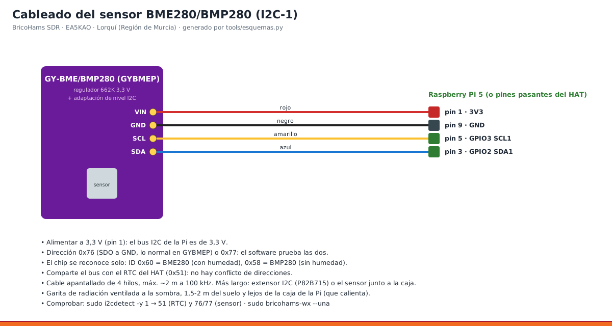

# 06 · Sensor BME280/BMP280 y estación WX APRS

<!-- guia-visual:inicio -->
> **Ruta visual:** [Meteorología, BME280, viento/lluvia y Pico IO](../GUIA_VISUAL_MODULOS.md#wx).
> Consulta allí requisitos, ilustración, cuadro de instalación, comprobaciones y restauración.
> Los comandos de este manual se ejecutan en Bash en la Pi; revisa el backup antes de cambiarla.
<!-- guia-visual:fin -->

> **v4 · Con el HAT puesto la cabecera de 40 pines está ocupada.** El BME280 se conecta ahora a la **Pico «bricohams-io»** por USB: VIN → 3V3(OUT) pin 36 · GND → pin 38 · SDA → GP4 (pin 6) · SCL → GP5 (pin 7) ([manual 20](20_PICO_IO.md), [esquema 16](../esquemas/16_pico_io.png)). Lo de abajo con pines de la Pi solo vale **sin HAT** (`IO_MODE="gpio"`).



## 1. Cableado (con la Pi apagada)

| Módulo GYBMEP | Cable | Raspberry Pi 5 (o pines pasantes del HAT) |
|---|---|---|
| VIN | rojo | pin 1 · 3V3 |
| GND | negro | pin 9 · GND |
| SCL | amarillo | pin 5 · GPIO3 SCL1 |
| SDA | azul | pin 3 · GPIO2 SDA1 |

- **Alimentación:** a **3,3 V**. El módulo admite 5 V, pero el bus de la Pi es de 3,3 V.
- **Cable:** apantallado de 4 hilos, de unos 2 m como máximo. Para más distancia, usa un extensor P82B715 en cada punta.
- **Ubicación:** en una **garita de radiación** a la sombra, a 1,5–2 m del suelo y lejos de la caja de la Pi.

## 2. Comprobar
```bash
sudo i2cdetect -y 1          # deben salir 51 (o UU: RTC) y 76 o 77 (sensor)
sudo bricohams-wx --una      # una lectura y el paquete APRS que mandaría
sudo systemctl restart bricohams-wx
sudo bricohams-check         # sección "Sensor BME280/BMP280"
```
El chip se reconoce solo: **BME280** (ID 0x60) mide humedad y **BMP280** (ID 0x58) no.

## 3. Qué publica
- **Web:** ventana 🌡️ METEO de OpenWebRX. Arriba sale la tarjeta «🏠 BricoHams WX» (nombre por defecto, configurable con `WX_NAME`) con temperatura, humedad, punto de rocío, presión a nivel del mar y en el QTH, y la curva de 24 h. El botón de la barra muestra la temperatura.
- **APRS-IS:** cada 10 min, como **N0CALL-13**:
  ```
  N0CALL-13>APZBHW,TCPIP*:!3759.03N/00107.68W_.../...g...t072h55b10143WX station · BME280
  ```
  Se ve en https://aprs.fi/#!call=N0CALL-13

## 4. Ajustes (`bricohams.env`, después `sudo bash install.sh --solo sensor`)

| Variable | Para qué |
|---|---|
| `WX_SENSOR_HEIGHT` | altura del sensor sobre el suelo, para reducir la presión al nivel del mar |
| `WX_TEMP_OFFSET` | corrección de temperatura si la garita calienta o enfría (con el RAK dentro de la caja, normalmente negativa) |
| `WX_FUENTE` | `auto` (por defecto): usa el sensor del RAK4631 (BME680/BME280/SHTC3) si publica datos recientes; si no, Pico o I2C. También `rak`, `pico` o `i2c` para forzar |
| `WX_POS_GPS` | `auto` (por defecto): la posición del paquete APRS WX sale del GPS del RAK cuando tiene fix válido; si no, `STATION_LAT/LON`. `no` para fijarla |
| `WX_APRS` | `no` para no publicar en APRS |
| `WX_APRS_CALLSIGN` | indicativo de la estación WX |
| `WX_APRS_COMMENT` | comentario del paquete APRS; la plantilla propone `WX station · BME280`, que debes adaptar al sensor real |

`WX_NAME` es el nombre que el proceso lee de su entorno para `sensor.json`; su valor por defecto en este kit es «BricoHams WX».
El instalador actual no traslada `WX_NAME` de `bricohams.env` a `wx.env`: escribirlo solo en `bricohams.env` no cambia el nombre.
No confundirlo con `WX_APRS_COMMENT` (comentario WX en APRS) ni con `RAK_COMMENT` (comentario del iGate).
Cambiar el valor por defecto del programa no reemplaza un nombre ya definido en el entorno del servicio.

### Panel público y diagnóstico

`sensor.json` contiene las medidas locales; `meteo.json` reúne los datos meteorológicos del panel.
Los errores internos de AEMET no se exponen en `meteo.json`: sin clave aparece «Observación no disponible».
El detalle se consulta en la Pi con `journalctl -u bricohams-meteo -n 50 --no-pager`.
Para problemas del sensor local, usar `journalctl -u bricohams-wx -n 50 --no-pager`.

## Sensor y GPS del RAK4631 (sin estación externa)

Si el RAK4631 lleva un módulo ambiental (RAK1906 BME680, BME280 o SHTC3), `bricohams-wx` lee temperatura, humedad y presión de `/run/bricohams-rak/rak-aprs.json` (que escribe `bricohams-rak-aprs` cada 5 s). No hace falta estación externa. El SHTC3 no mide presión: en ese caso se toma de un Pico/BME280 si existe o se omite el campo `b` del paquete APRS.

La posición del objeto WX y de la baliza del RAK sale del GPS cuando tiene fix (`WX_POS_GPS=auto`, `RAK_GPS_BALIZA=yes`); sin fix se usa `STATION_LAT/LON`. En `sensor.json` el campo `pos.fuente` indica `gps-rak` o `fija`.

Como el RAK va dentro de la caja, su temperatura es la de la caja: ajusta `WX_TEMP_OFFSET` comparando con un termómetro exterior.

**`bricohams-wx` no arranca y el journal muestra un error de lgpio** (`can not open … .lgd-nfy`). lgpio crea ficheros de notificación en el directorio de trabajo. La unidad lleva `WorkingDirectory=/var/lib/bricohams` y el programa cambia a ese directorio antes de importar lgpio. Si editaste la unidad a mano, reinstala con `sudo bash install.sh --solo sensor`.
