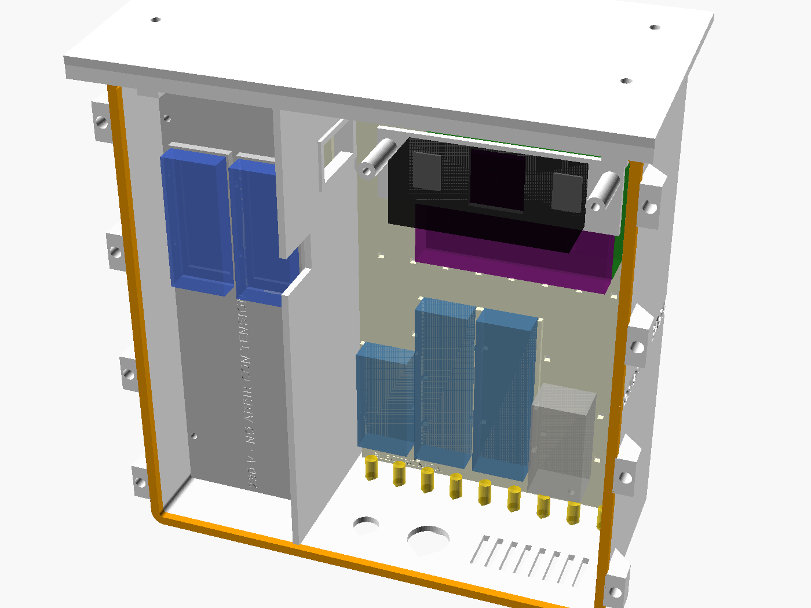
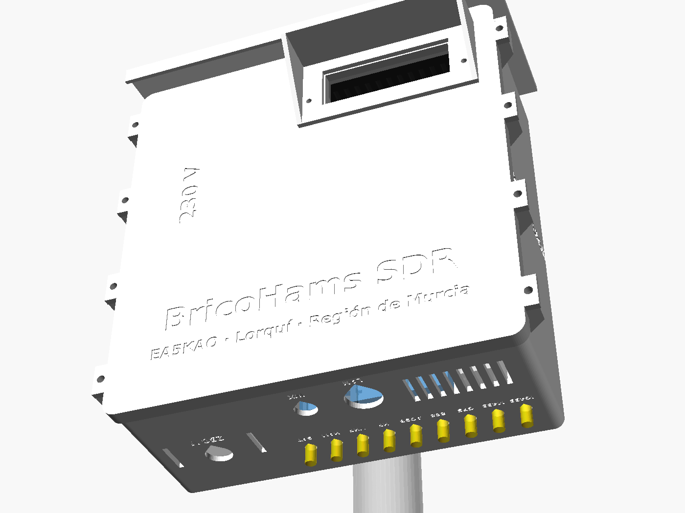
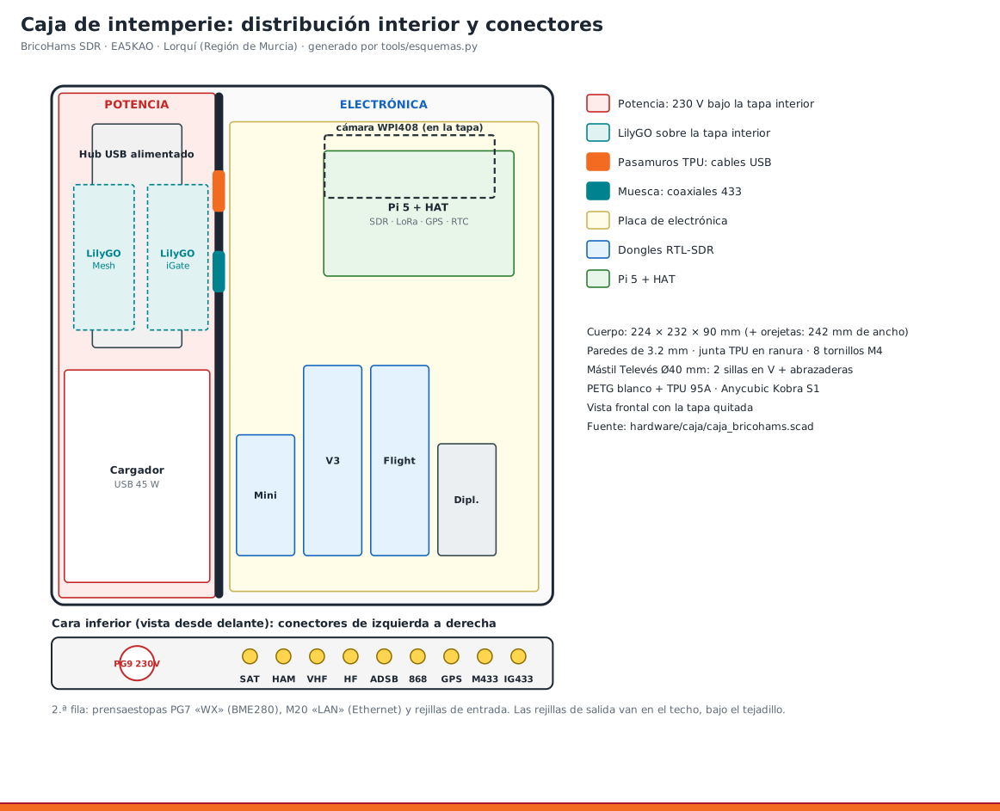
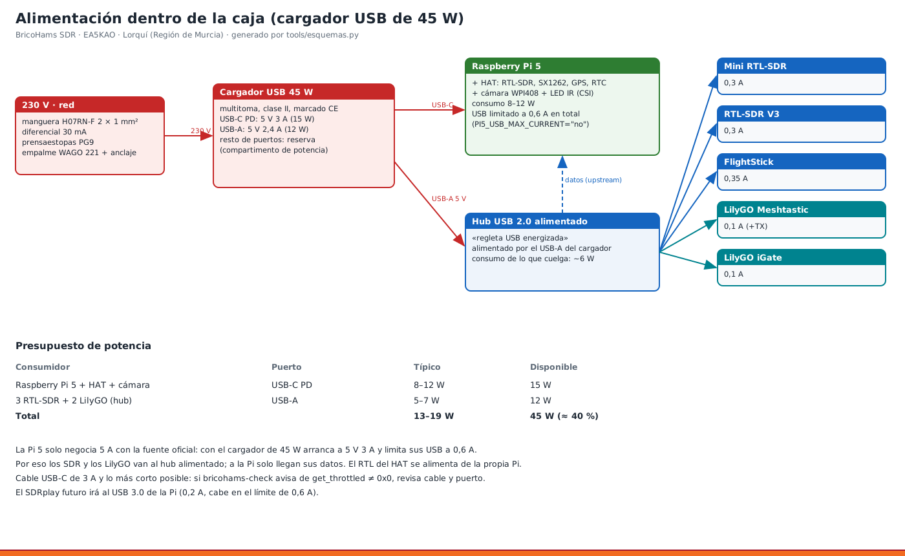

# 10 · Caja de intemperie impresa en 3D (PETG + TPU, Anycubic Kobra S1)

Caja para el mástil Televés con toda la estación dentro. Por dentro tiene dos zonas separadas por un tabique:

| Zona | Qué lleva | Por qué |
|---|---|---|
| **Potencia** (izquierda, 70 mm) | cargador USB multitoma de 45 W, regleta/hub USB alimentado, entrada de 230 V por PG9 | los 230 V quedan encerrados bajo una tapa interior y no se cruzan con la electrónica |
| **Sobre la tapa interior de potencia** | los 2 LilyGO T3 V1.6.1 (Meshtastic 433 e iGate) | solo llevan 5 V del hub; así quedan cerca de él |
| **Electrónica** (derecha) | Pi 5 + HAT, Mini RTL-SDR, RTL-SDR V3, FlightStick, diplexor HF/VHF, cámara WPI408 tras la ventana | — |
| **Cara inferior** | 9 SMA pasamuros, prensaestopas WX (PG7) y LAN (M20), rejillas de entrada | todo mira hacia abajo, así el agua no entra |
| **Fuera** | tejadillo sobre las rejillas de salida, visera de la cámara, garita del BME280 | sol y lluvia |

- **Modelo paramétrico:** `hardware/caja/caja_bricohams.scad` (OpenSCAD). Todas las medidas son variables al principio del fichero, por ejemplo `MAST_D` (diámetro del mástil), `CAM_C` (posición de la ventana de la cámara) o `SMA_LABELS` (conectores).
- **STL listos:** `hardware/caja/stl/`.
- **Para regenerar:** `tools/caja.sh` exporta los STL, comprueba que caben en 250 × 250 × 250 mm y genera las vistas.

> ⚠ **230 V.** La conexión a la red la hace o la revisa alguien cualificado. Nunca se abre la caja con el cable de red enchufado. La línea debe ir por un diferencial de 30 mA y el mástil, a tierra (como en cualquier ICT). El PETG no es autoextinguible: el cargador debe tener marcado CE y su propia carcasa (no se abre ni se quita).

---

## 1. Material

### Piezas impresas

| STL | Material | Cant. | Medidas (mm) | Notas |
|---|---|---|---|---|
| `cuerpo` | PETG blanco | 1 | 242 × 232 × 93 | espalda sobre la cama · borde de 5 mm |
| `tapa` | PETG blanco | 1 | 243 × 236 × 10 | cara exterior sobre la cama · borde de 5 mm |
| `tapa_potencia` | PETG | 1 | 69 × 225 × 7 | lleva grabado «230 V - NO ABRIR CON TENSION» |
| `placa_electronica` | PETG | 1 | 138 × 210 × 9 | separadores de la Pi y guías de los dongles |
| `placa_potencia` | PETG | 1 | 58 × 210 × 3 | rejilla de ranuras para bridas |
| `tejadillo` | PETG blanco | 1 | 240 × 114 × 22 | cara superior sobre la cama |
| `visera` | PETG blanco | 1 | 109 × 50 × 32 | — |
| `soporte_camara` | PETG negro | 1 | 105 × 32 × 28 | — |
| `soporte_mastil` | PETG | **2** | 80 × 50 × 26 | silla en V para la abrazadera |
| `garita_base` | PETG blanco | 1 | 230 × 120 × 26 | plato, cuna del sensor y brazo al mástil |
| `garita_plato` | PETG blanco | **6** | Ø120 × 14 | — |
| `garita_tapa` | PETG blanco | 1 | Ø128 × 14 | — |
| `junta_tapa` | **TPU 95A** | 1 | 225 × 233 × 4 | perfil de 4,4 × 4 |
| `junta_ventana` | TPU 95A | 1 | 86 × 36 × 1,5 | — |
| `separador_ir` | TPU 95A negro | 1 | Ø19 × 6 | aro alrededor del objetivo |
| `pasamuros_usb` | TPU 95A | 1 | 24 × 40 × 8 | tapón partido con 5 pasos de cable |

> Usa **PETG blanco** en el exterior: con el sol de Murcia, una caja oscura puede pasar de 60 °C dentro y el PETG ablanda hacia 75–80 °C.

### Tornillería y montaje

| Artículo | Cant. | Dónde |
|---|---|---|
| Inserto roscado de latón M4 × 8,1 (agujero 5,6) | 20 | 8 orejetas, 8 soportes de mástil, 4 tejadillo |
| Inserto roscado de latón M3 × 5,7 (agujero 4,0) | 16 | 8 placas, 4 tapa interior, 2 visera, 2 soporte de cámara |
| Tornillo inox M4 × 12 + arandela | 8 | cierre de la tapa |
| Tornillo inox M4 × 20 | 8 | soportes de mástil |
| Tornillo inox M4 × 30 / M4 × 25 + arandela de goma | 2 / 2 | tejadillo (pilares traseros / delanteros) |
| Tornillo M3 × 8 | 14 | placas, tapa interior, visera |
| Tornillo M3 × 35 | 2 | soporte de la cámara |
| Tornillo M2.5 × 6 autorroscante (o separadores M2.5) | 4 | Raspberry Pi 5 |
| Tornillo M2 × 8 | 2 | sensor GYBMEP en la garita |
| Varilla roscada inox M4 de 140 mm + 6 tuercas ciegas | 3 | garita |
| Abrazadera sinfín inox de 12 mm, 60–80 mm | 4 | 2 para la caja y 2 para la garita, con mástil de Ø40 (con Ø50: 70–90 mm) |
| SMA hembra pasamuros (rosca 1/4″-36) con junta tórica + latiguillo RG316 a SMA macho de 20 cm | 9 | cara inferior |
| Prensaestopas PG9 (cable de 4–8 mm) | 1 | 230 V |
| Prensaestopas PG7 (3–6,5 mm) | 1 | cable del BME280 |
| Prensaestopas M20 de junta partida para RJ45 | 1 | Ethernet (opcional; si no se usa, tapón M20) |
| Policarbonato (o metacrilato) de 86 × 36 × 2 mm | 1 | ventana de la cámara |
| Malla mosquitera de aluminio | 2 tiras | por dentro de las rejillas (opcional) |
| Bridas de 2,5 mm | 30 | dongles, cargador, hub, LilyGO |
| Espuma adhesiva de 1 mm | — | entre el soporte y la cámara |
| Empalme WAGO 221-412 | 2 | 230 V (opción A, apartado 4) |

### Electrónica de alimentación (ver [ADR-16](../ARQUITECTURA.md))

| Artículo | Requisito |
|---|---|
| **Cargador USB multitoma de 45 W** | Al menos **1 USB-C PD que dé 5 V 3 A** (la Pi) y **1 USB-A de 2,4 A o más** (el hub). Mejor de sobremesa, con **cable de red en «ocho» (C7)**. Cuerpo de 65 × 95 × 30 mm como máximo |
| **Regleta / hub USB 2.0 alimentado** de 4 puertos o más | Alimentado por **USB o 5 V**, no por un transformador de 230 V propio. Cuerpo de 40 × 100 × 22 mm como máximo |
| Cable de red | Manguera de exterior **H07RN-F 2 × 1 mm²** (Ø 7–8 mm) con enchufe Schuko, y diferencial de 30 mA en la toma |
| Cables USB cortos (20–30 cm) | USB-C a USB-C de 3 A (cargador → Pi) · USB-A a la entrada del hub · hub → USB 2.0 de la Pi · uno para cada dongle y cada LilyGO |

---

## 2. Impresión en la Kobra S1

| Ajuste | PETG (estructura) | TPU 95A (juntas) |
|---|---|---|
| Boquilla | 240 °C (primera capa 245 °C) | 225–230 °C |
| Cama | 80 °C, PEI texturizada | 50 °C (con una capa de pegamento de barra) |
| Altura de capa | 0,2 mm | 0,2 mm |
| Perímetros | **8** (paredes de 3,2 mm macizas: estanqueidad) | 3 |
| Capas superiores e inferiores | 6 | 100 % de relleno |
| Relleno | 25 % giroide | 100 % |
| Velocidad | 150 mm/s; exterior a 80 mm/s | **25–40 mm/s** |
| Ventilador de capa | 30–50 % | 50 % |
| Retracción | normal del perfil PETG | corta (0,5–1 mm) y lenta |
| Soportes | **no** (todo se ha diseñado para ir sin ellos) | no |
| Adherencia | borde de 5 mm en `cuerpo` y `tapa` | — |

- **Alimentación del filamento:** el TPU entra por el portabobinas externo, no por el multicolor ACE Pro.
- **Temperatura de la cámara:** con PETG, si pasa de 40 °C, deja la tapa superior o la puerta entornadas para que no se atasque el extrusor.
- **Agujeros del cuerpo:** los SMA y los prensaestopas salen en forma de gota para imprimir sin soporte. Repasa la punta con una lima redonda si el prensaestopas no entra.
- **Comprueba antes de seguir:** que la pared del cuerpo entra en la ranura de la tapa sin forzar, y que la junta de TPU entra a presión en esa ranura.

---

## 3. Preparar las piezas

1. **Insertos:** colócalos con el soldador a 230–245 °C y una punta para insertos, rectos y enrasados:
   - M4 en las 8 orejetas y en los 8 pilares de la espalda (desde fuera).
   - M4 en las 4 columnas del techo.
   - M3 en los pilares de las placas y de la tapa interior.
   - M3 en el marco de la ventana: los 2 de la visera (desde fuera) y los 2 del soporte de la cámara (desde dentro).
2. **Malla (opcional):** pega la malla mosquitera por dentro de las rejillas con un cordón fino de silicona neutra.
3. **SMA pasamuros (cara inferior, de izquierda a derecha según el rótulo grabado):**

   | Rótulo | Conector exterior | Va a |
   |---|---|---|
   | SAT | eggbeater + LNA | RTL del HAT (bias-tee si el LNA va por el coaxial) |
   | HAM | colineal 2 m/70 cm | Mini RTL-SDR |
   | VHF | discone | entrada VHF/UHF del diplexor → RTL-SDR V3 |
   | HF | hilo largo / EFHW | entrada HF del diplexor → RTL-SDR V3 |
   | ADSB | antena de 1090 MHz | FlightStick |
   | 868 | antena de 868 MHz | SX1262 del HAT |
   | GPS | GPS activa | GPS del HAT |
   | M433 | 433 MHz (**transmite**, a ≥ 1 m de las de RX) | LilyGO Meshtastic |
   | IG433 | 433 MHz | LilyGO iGate |

   - La junta tórica va **por fuera** y la tuerca por dentro.
   - Si el HAT o los LilyGO llevan u.FL/IPEX en vez de SMA, usa latiguillos de SMA pasamuros a u.FL.
4. **Prensaestopas:** PG9 en la zona de potencia («230 V»), PG7 en «WX» y M20 en «LAN». Si no usas cable de red, pon un tapón M20.

---

## 4. Compartimento de potencia (sin tensión en todo momento)

1. **Placa de potencia:** atorníllala con 4 M3 × 8. Fija con bridas el **cargador abajo**, junto al PG9, y el **hub encima** (ver [esquema 07](../esquemas/07_caja_distribucion.png)).
2. **Entrada de 230 V:** pasa la manguera H07RN-F por el PG9 y elige una de estas dos opciones.
   - **Opción A (recomendada): cargador de sobremesa con cable en «ocho».**
     1. Corta el cable C7 a unos 15 cm del conector.
     2. Empálmalo a la manguera con dos WAGO 221-412.
     3. Fija la manguera con una brida a la ranura de la placa: el anclaje es lo que evita tirones sobre el empalme.
     4. Aprieta el PG9.
   - **Opción B: cargador de enchufe directo.** Pon en la manguera una base Schuko aérea compacta y fíjala con bridas. Comprueba antes que la base y el cargador caben en los 70 mm de la zona de potencia.
3. **USB desde el cargador:**
   - USB-C (5 V 3 A) → Raspberry Pi 5, por el pasamuros del tabique.
   - USB-A → entrada de alimentación del hub.
4. **Cables del hub:**
   - La salida «upstream» va a un USB 2.0 de la Pi, por el pasamuros.
   - Las salidas van a Mini, V3 y FlightStick (por el pasamuros) y a los dos LilyGO (por la muesca de la tapa interior).
5. **Pasamuros de TPU:**
   1. Pasa los conectores por el hueco de 18 × 34 mm del tabique.
   2. Mete cada cable por la raja del pasamuros, en su paso.
   3. Encaja el tapón en el hueco.
6. **Tapa interior:** atorníllala con 4 M3 × 8. A partir de aquí no queda nada de 230 V a la vista.

## 5. LilyGO sobre la tapa interior
1. Pon cada LilyGO en su cuna, con la OLED hacia la tapa, y sujétalo con 2 bridas.
   - Izquierda: **Meshtastic** (`/dev/lilygo-mesh`).
   - Derecha: **iGate** (`/dev/lilygo-igate`).
2. **USB:** baja los cables por la muesca superior de la tapa interior hasta el hub.
3. **Antenas:** los latiguillos pasan por la **muesca superior del tabique** (y = 140–158) hasta los SMA «M433» e «IG433».
4. Los LilyGO no llevan batería en la caja: el conector de batería queda libre.

## 6. Zona de electrónica
1. **Placa de electrónica:** fíjala con 4 M3 × 8.
2. **Raspberry Pi 5:** atorníllala con 4 M2.5 a los separadores. Pon el HAT encima con sus separadores.
   - **Refrigeración:** la Pi 5 necesita disipador; bajo el HAT cabe uno pasivo de perfil bajo.
3. **Dongles y diplexor:** colócalos de izquierda a derecha entre las guías: Mini, V3, FlightStick y diplexor. Sujeta cada uno con 2 bridas.
4. **Coaxiales:** conecta los latiguillos de los SMA a cada receptor siguiendo la tabla del apartado 3.
5. **Cable del BME280:** entra por el PG7 hasta los pines 1, 3, 5 y 9 ([manual 06](06_SENSOR_WX.md)).

## 7. Cámara
1. En el cajeado interior de la tapa, coloca en este orden: **junta_ventana**, el **policarbonato** y la **cámara**, con el objetivo centrado y el **separador_ir** (aro de TPU) alrededor de él. El aro evita que la luz de los LED IR rebote en el policarbonato y vele la imagen de noche.
2. Atornilla el **soporte_camara** con 2 M3 × 35, con espuma de 1 mm entre los topes y las placas IR.
3. **Cable CSI:** el de 15 a 22 pines va de la cámara al conector CAM/DISP de la Pi. Deja holgura para abrir la tapa.
4. **Visera:** atorníllala por fuera con 2 M3 × 8.

## 8. Cerrar
1. **Junta:** mete la junta de TPU en la ranura de la tapa, empezando por las esquinas. No hace falta pegamento.
2. **Tornillos:** cierra con los 8 M4 × 12 con arandela, apretando en cruz hasta que la tapa **toque las orejetas**. Ese tope deja la junta comprimida un 25 %: no aprietes más.

## 9. Mástil
1. **Sillas:** atornilla los 2 soportes_mastil a la espalda con 8 M4 × 20.
2. **Abrazaderas:** pasa cada una por la ranura de su silla y abrázala al mástil. La caja va con los **conectores hacia abajo**, por debajo de las antenas.
3. **Tejadillo:** atorníllalo con arandela de goma: M4 × 30 en los pilares traseros y M4 × 25 en los delanteros. La pendiente cae hacia la tapa (delante).
4. **Garita:**
   1. Monta en las 3 varillas M4 la base, los 6 platos y la tapa, con tuerca ciega arriba.
   2. Atornilla el sensor GYBMEP a la cuna con 2 M2.
   3. Lleva el cable por el canal del brazo.
   4. Fija la garita al mástil con 2 abrazaderas, a **1 m o más de la caja** y en el lado menos soleado.
5. **Coaxiales:** haz un **bucle de goteo** en cada coaxial antes del SMA.

## 10. Puesta en marcha y comprobación
1. **Tensión:** conecta los 230 V con el diferencial y espera al arranque (2–3 min).
2. **Diagnóstico:** `sudo bricohams-check` debe acabar en **0 fallos**. Mira en especial:
   - `alimentación correcta (sin bajadas de tensión)`: si sale `get_throttled` distinto de 0x0, la Pi no está en el USB-C PD o el cable no es de 3 A.
   - La red WiFi configurada en `bricohams.env` está conectada, si no usas Ethernet.
   - Los 4 SDR por número de serie, los 2 LilyGO y el sensor.
3. **Temperatura:** a pleno sol, mide `vcgencmd measure_temp`. Con más de 75 °C sostenidos:
   - Comprueba que las rejillas de abajo y de arriba no están tapadas.
   - Pon un disipador mayor o un ventilador de 40 mm de 5 V tomado del hub.
4. **Estanqueidad:** tras la primera lluvia, abre y comprueba que no hay agua. Revisa la junta y los SMA.

## 11. Cambiar medidas
| Si… | Cambia en el `.scad` |
|---|---|
| el mástil es de otro diámetro | `MAST_D` (la V se recalcula) |
| el cargador o el hub no caben | `CHARGER`, `HUB` (solo afectan a la vista) y, si hace falta, `PWR_W` (ensancha la zona de potencia; vigila que `W` + 18 ≤ 250) |
| hay más o menos conectores | `SMA_LABELS` y `SMA_PITCH` |
| la cámara o la Pi tropiezan | `CAM_C` y `PI5_POS` |
| la junta queda floja o dura | `GASKET_W` / `GASKET_H` (compresión = `GASKET_H` − `GAP_LID`) |

Luego ejecuta `tools/caja.sh`.
