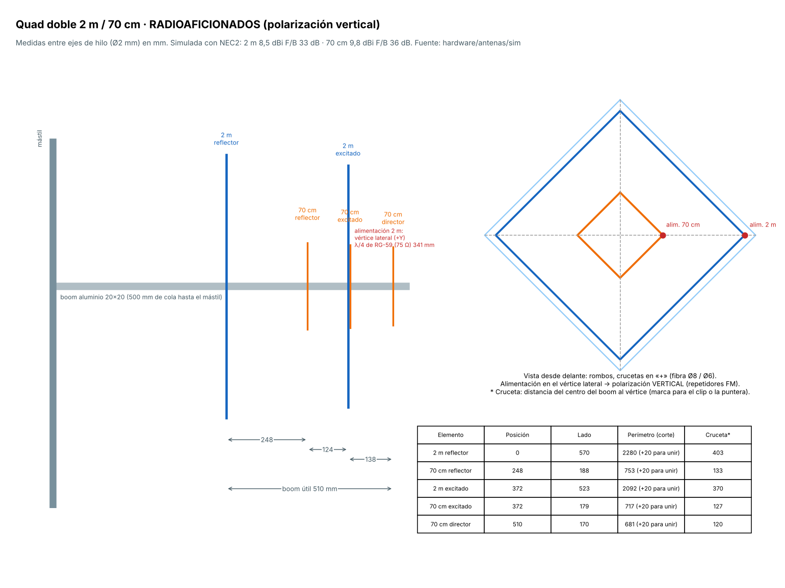
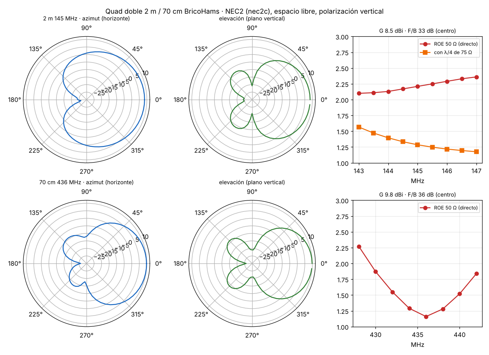

# 12 · Quad de doble resonancia 2 m / 70 cm (RADIOAFICIONADOS)

<!-- guia-visual:inicio -->
> **Ruta visual:** [Caja, antenas, filtros, alimentación y anclajes](../GUIA_VISUAL_MODULOS.md#hardware).
> Consulta allí requisitos, ilustración, cuadro de instalación, comprobaciones y restauración.
> Los comandos de este manual se ejecutan en Bash en la Pi; revisa el backup antes de cambiarla.
<!-- guia-visual:fin -->

**Qué es:** una cúbica de 2 elementos en 2 m y 3 elementos en 70 cm, con los cuadros en **rombo** sobre las mismas crucetas y **polarización vertical** (la de los repetidores FM).
- **Partida:** las reglas CX1DDR del proyecto (perímetro = 306,4 / f).
- **Ajuste:** optimizada con NEC2 (`hardware/antenas/sim/quad_2m70.py`).

| Banda | Ganancia | F/B | ROE 50 Ω | Ancho a −3 dB |
|---|---|---|---|---|
| 2 m (144–146) | 8,7–8,3 dBi | 24–33 dB | 1,3–1,4 con λ/4 de 75 Ω | ~103° |
| 70 cm (432–440) | 9,8 dBi | 22–36 dB | 1,16 a 436, ≤ 1,55 en 432–440 | ~75° |

Cada banda tiene **su propio punto de alimentación**. El **diplexor 2 m/70 cm del proyecto** (`diplexor_2m70cm_v1`) los junta en un solo coaxial, dentro de la **caja de aluminio de cabecera**.
- **En la simulación:** cuando se mide una banda, la alimentación de la otra está abierta, que es lo que ve a través de la rama contraria del diplexor.
- **El acoplo entre bandas está incluido:** el cuadro de 2 m resuena también hacia 435 MHz (3 λ), y aun así se consiguen estas cifras.

## 1. Medidas (entre ejes de hilo, Ø2 mm)

| Elemento | Posición en el boom | Lado | Perímetro (cortar +20 mm para el empalme) | Cruceta: centro → vértice |
|---|---|---|---|---|
| 2 m reflector | 0 | 570 | 2280 | 403 |
| 70 cm reflector | 248 | 188 | 753 | 133 |
| 2 m excitado | 372 | 523 | 2092 | 370 |
| 70 cm excitado | 372 (mismo buje) | 179 | 717 | 127 |
| 70 cm director | 510 | 170 | 681 | 120 |

- **Boom:** útil de 510 mm + 500 mm de cola hasta el mástil (el mástil a 0,5 m detrás del reflector apenas cambia nada: F/B de 24 dB en 2 m y de 40 dB en 70 cm). Tubo cuadrado de aluminio de 20 × 20 × 1,5, de 1,1 m en total.
- **Adaptación de 2 m:** la antena da unos 102 − j25 Ω. Un **λ/4 de RG-59 (75 Ω, VF 0,66) de 341 mm** la lleva a unos 52 + j13 Ω (ROE 1,29) hasta el diplexor.
- **Adaptación de 70 cm:** unos 43 Ω, directo a 50 Ω con RG-58 o RG-316 hasta el diplexor.

## 2. Material

| Artículo | Cant. |
|---|---|
| Tubo de aluminio cuadrado 20 × 20 × 1,5 | 1,1 m |
| Varilla de fibra de vidrio Ø8 | 4 × 378 mm + 4 × 345 mm (crucetas de 2 m) |
| Varilla de fibra de vidrio Ø6 | 4 × 108 mm + 4 × 95 mm (reflector y director de 70 cm) |
| Hilo de cobre Ø2 mm (esmaltado, o de 2,5 mm² pelado) | 7 m |
| RG-59 (75 Ω, PE sólido) | 0,4 m |
| RG-58 o RG-316 | 1 m |
| Insertos de latón M3 + tornillos M3 × 6 de latón | 4 + 4 (bornes) |
| Tornillos M5 prisioneros | 8 |
| Abrazaderas en U M8 (mástil Ø40) y M6 (boom 20 × 20) | 2 + 2 |
| Caja de aluminio de cabecera (la de la foto) + diplexor 2 m/70 | 1 |

**Piezas impresas** (ASA o PETG blanco, 6 perímetros, 50 % de relleno):

| Pieza | Cant. |
|---|---|
| `quad_buje_2m` | 2 (reflector de 2 m y excitados) |
| `quad_buje_70` | 2 (reflector y director de 70 cm) |
| `quad_puntera_8` | 7 |
| `quad_puntera_6` | 8 |
| `quad_alim_2m` | 1 |
| `quad_clip_70` | 3 |
| `quad_alim_70` | 1 |
| `quad_abrazadera` | 1 |

## 3. Montaje paso a paso

1. **Boom:** marca en el tubo las cotas 0, 248, 372 y 510 mm desde el extremo delantero del reflector. Deja 500 mm de cola por detrás de la cota 0.
2. **Bujes:**
   1. Pasa los 4 bujes a sus marcas, con los brazos en «+»: uno vertical y otro horizontal.
   2. Alinéalos mirando a lo largo del boom.
   3. Fíjalos con los prisioneros M5.
3. **Crucetas:**
   1. Corta las varillas a **cruceta − 25 mm**: la varilla hace tope en el buje a 20 mm del centro y la puntera pone el agujero del hilo 5 mm más allá de su punta.
      - Ø8: **378 mm** (reflector de 2 m) y **345 mm** (excitados).
      - Ø6: **108 mm** (reflector de 70 cm) y **95 mm** (director).
   2. Mete cada una en su brazo hasta el fondo y comprueba con el metro que **el agujero del hilo queda a la cota «cruceta»** (403, 370, 133 y 120 mm) desde el centro del boom.
   3. Fíjalas con un tornillo M3 en el brazo.
4. **70 cm excitado:** en las 4 crucetas de Ø8 del buje de excitados, pon los `quad_clip_70` a 127 mm del centro, en los brazos de arriba, abajo y −Y. En el brazo +Y, en lugar del clip, va el `quad_alim_70`.
5. **2 m excitado:** en la punta del brazo +Y va el `quad_alim_2m` en lugar de la puntera normal.
6. **Hilos (reflectores y director):** cuadros cerrados.
   1. Pasa el hilo por las 4 punteras o clips.
   2. Tensa a mano.
   3. Empalma los dos extremos con un manguito de latón soldado. Los 20 mm de más son para ese empalme.
7. **Hilos (excitados):**
   1. El hilo empieza en un borne del alimentador, recorre los 4 vértices y vuelve al otro borne.
   2. Los bornes son los insertos M3 de latón con tornillo, arandela y terminal de ojal soldado al hilo.
   3. La separación entre bornes es de 12 mm, la del modelo.
8. **Bajadas:**
   1. En el `quad_alim_2m`, suelda el λ/4 de RG-59 de 341 mm: malla a un borne y vivo al otro.
   2. En el `quad_alim_70`, suelda RG-58 o RG-316 igual.
   3. Lleva los dos coaxiales por la cruceta +Y y el boom hasta la caja de cabecera, con bridas cada 10 cm.
   4. Aprieta las bridas de alivio del alimentador.
   5. Sella los bornes con barniz o silicona neutra.
9. **Caja de cabecera:** el λ/4 de 2 m va a la entrada «2 m» del diplexor, el de 70 cm a la entrada «70 cm», y la salida común al pasamuros N. De ahí, el coaxial C2 baja a la caja (N «HAM»).
10. **Abrazadera:** la `quad_abrazadera` va en la cola del boom, con una U M6 al boom y una U M8 al mástil. **Rumbo: 205°.**

## 4. Comprobación con NanoVNA (antes de subirla)

- **Sin el diplexor:**
  - **2 m:** mide en la punta del λ/4. ROE ≤ 1,5 en 144–146.
  - **70 cm:** ROE ≤ 1,6 en 432–440.
- **Si el mínimo sale desplazado:**
  - **Más bajo de lo previsto:** acorta el excitado 10 mm (2 m) o 3 mm (70 cm) por empalme y vuelve a medir.
  - **Más alto:** alarga.
- **F/B:** con una baliza o un repetidor lejano, gira la antena 180°. Con el SDR, la señal debe caer unos 20 dB o más.
- **En OpenWebRX:** el S-meter del receptor RADIOAFICIONADOS debe mejorar 6–8 dB respecto de la colineal en los repetidores de la dirección apuntada.
