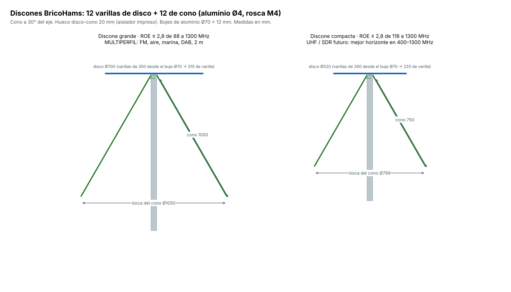
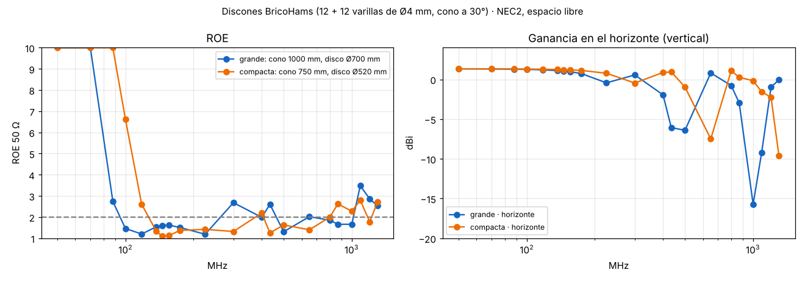

# 13 · Discones de banda ancha (MULTIPERFIL y futuro SDR)

<!-- guia-visual:inicio -->
> **Ruta visual:** [Caja, antenas, filtros, alimentación y anclajes](../GUIA_VISUAL_MODULOS.md#hardware).
> Consulta allí requisitos, ilustración, cuadro de instalación, comprobaciones y restauración.
> Los comandos de este manual se ejecutan en Bash en la Pi; revisa el backup antes de cambiarla.
<!-- guia-visual:fin -->

Son dos tamaños del mismo diseño: **12 varillas de disco + 12 de cono a 30°**, de aluminio de Ø4, simulados con NEC2 (`hardware/antenas/sim/discone.py`).
- **Por qué 12 varillas y no 8:** la ROE queda más lisa.
- **Por qué no se añade un látigo encima del disco** para bajar a 25–70 MHz: lo probé en la simulación y estropea la banda aérea (ROE 23 a 118 MHz). La HF ya la cubre el lazo MLA-30.

| Modelo | Cono | Disco | ROE ≤ 2,8 | Para |
|---|---|---|---|---|
| **Grande** | 12 × 1000 mm | Ø700 (varillas de 315 mm desde el buje) | **88–1300 MHz** (salvo ~1090) | MULTIPERFIL: FM, aire, marina, AIS, DAB, 2 m. Va en la punta del mástil |
| Compacta | 12 × 750 mm | Ø520 (225 mm) | 118–1200 MHz | bahía de expansión (HydraSDR o la VHF del SDRplay). Mejor horizonte en 400–1300 MHz |

- **Ganancia en el horizonte:** +1 dBi en VHF.
- **En UHF la grande baja en el horizonte** (−6 dBi a 435 MHz) porque sus lóbulos se levantan. Es un límite físico de las discones largas, y por eso la HAM de 70 cm la lleva la quad. La compacta sigue en 0 a +1 dBi hasta ~800 MHz.

## 1. Material (una discone grande)

| Artículo | Cant. |
|---|---|
| Varilla de aluminio Ø4 (6063) | 12 × 1010 mm (cono) + 12 × 327 mm (disco). Los 10–12 mm de más son la rosca |
| Buje de aluminio Ø70 × 12 (disco) | 1, con agujero central roscado M4 |
| Buje de aluminio Ø70 × 12 (cono) | 1, con agujero central de Ø16 para el cuerpo del N |
| Conector N hembra de panel (brida cuadrada de 4 agujeros) | 1 |
| Varilla roscada de latón M4 × 40 (une el vivo del N con el buje de disco) | 1 |
| Funda termorretráctil de Ø6 para la varilla de latón | 5 cm |
| Tornillos inox M4 × 10 (aislador) ×6 · M3 × 8 (brida del N) ×4 · M4 × 12 (adaptador) ×4 · M6 pasante (mástil) ×2 | — |
| Insertos M4 de latón | 6 |
| Terraja M4 y broca de 3,3 mm | — |

**Piezas impresas** (ASA o PETG blanco, 100 % de relleno en el aislador):
- `discone_aislador`;
- `discone_plantilla_disco` y `discone_plantilla_cono` (plantillas de taladro);
- `discone_adaptador_mastil`;
- `discone_capuchon`;
- `tapon_varilla` ×12, en las puntas del cono: seguridad.

## 2. Montaje paso a paso

1. **Buje de disco:**
   1. Encaja el buje en la `discone_plantilla_disco` y taladra los 12 agujeros radiales de Ø3,3 por las guías, 15 mm de profundidad.
   2. Rosca M4.
   3. Taladra y rosca el centro de la cara inferior (M4).
2. **Buje de cono:**
   1. En la `discone_plantilla_cono`, taladra los 12 agujeros a 30° del eje en la cara inferior y rosca M4.
   2. Taladra el centro a Ø16 y los 4 agujeros de la brida del N (M3).
3. **Varillas:**
   1. Rosca 12 mm de cada varilla con la terraja M4.
   2. Enrosca las del disco (327 mm) y las del cono (1010 mm) con una gota de fijador de roscas.
   3. Pon un `tapon_varilla` en cada punta del cono.
4. **Alimentación:**
   1. Atornilla el N a la cara inferior del buje de cono (4 × M3). La malla del coaxial queda así unida al cono.
   2. Suelda la varilla de latón M4 al vivo del N, enfúndala y pásala por el centro del `discone_aislador`.
   3. Enróscala en el buje de disco: el vivo queda unido al disco.
5. **Aislador:** une los dos bujes con el `discone_aislador` (3 tornillos M4 arriba al buje de disco y 3 abajo al de cono, en sus insertos). El **hueco entre disco y cono es de 20 mm**, el mismo que en la simulación.
6. **Capuchón:** el `discone_capuchon` va sobre el buje de disco, con silicona neutra en el borde.
7. **Mástil:** el `discone_adaptador_mastil` va bajo el buje de cono (4 × M4) y entra en la punta del mástil Ø40, fijado con 2 pasantes M6. El coaxial sale por dentro o por la ranura lateral.
8. **Comprobación:** con el NanoVNA, ROE ≤ 2,8 en 90–470 MHz (grande). Si en 88–100 MHz sale peor, comprueba que el hueco es de 20 mm y que las 12 varillas del cono hacen buen contacto.

> **Seguridad:** el cono grande mide 1,05 m de diámetro. Con los tapones en las puntas y a la altura de la punta del mástil no molesta, pero no la montes a la altura de la cabeza.
