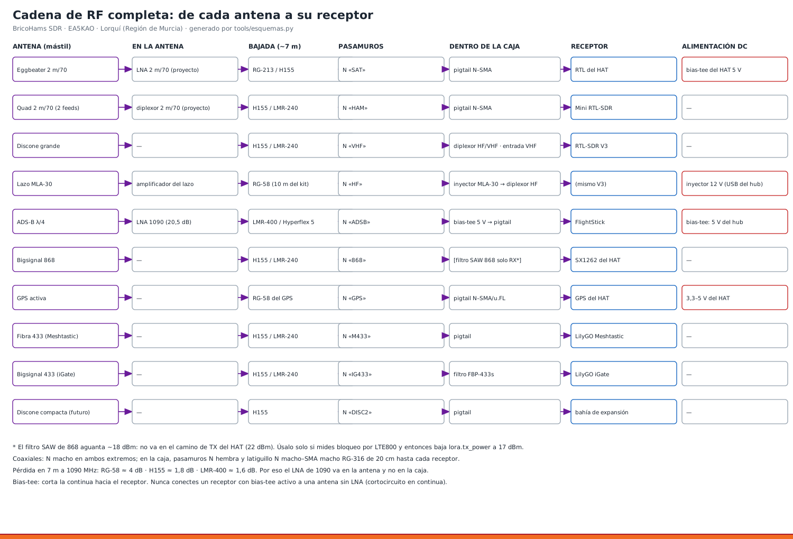

# 16 · Filtros, preamplificadores y bias-tee

<!-- guia-visual:inicio -->
> **Ruta visual:** [Caja, antenas, filtros, alimentación y anclajes](../GUIA_VISUAL_MODULOS.md#hardware).
> Consulta allí requisitos, ilustración, cuadro de instalación, comprobaciones y restauración.
> Los comandos de este manual se ejecutan en Bash en la Pi; revisa el backup antes de cambiarla.
<!-- guia-visual:fin -->

**Medidas de banco:** [laboratorio RF y cualificación](44_LABORATORIO_RF.md),
[manual NanoVNA](45_NANOVNA.md) y [hojas rellenables](../laboratorio-rf/README.md).
El NanoVNA permite caracterizar adaptación y paso RF, no potencia admisible ni
figura de ruido. No conectar bias-tee alimentados ni salida TX a sus puertos.

## 1. Dónde va cada uno
| Elemento | Posición | Por qué |
|---|---|---|
| **FBP-433s** (430–438 MHz, < 2,5 dB, 1 W) | **iGate**: pasamuros N «IG433» → filtro → LilyGO iGate | quita los repetidores de 70 cm de 438,6+ MHz, TETRA, la FM y la TDT, que saturan el SX1278. El iGate solo recibe |
| FBP-868s (SAW 866–870, ~2,8 dB, **~18 dBm máx.**) | reserva | **no** en el nodo 868 del HAT (22 dBm lo dañan). Solo si aparece bloqueo por LTE800, y entonces con `lora.tx_power=17` |
| LNA 1090 (20,5 dB, NF 0,4) | **en la base de la antena ADS-B** | manual 14 |
| LNA 2 m/70 cm (proyecto eggbeater) | en el poste de la eggbeater | lo alimenta el bias-tee del HAT (`SAT_BIAS_TEE=yes`) |
| Bias-tee 5 V (SMA) | en la caja, entre el N «ADSB» y el FlightStick | alimenta el LNA 1090 por el coaxial |
| Inyector MLA-30 | en la caja, entre el N «HF» y el diplexor | 12 V del amplificador del lazo |

## 2. Montaje en la caja
1. **Filtro:** atornilla el FBP-433s **directamente** al lado interior del pasamuros N con un adaptador N macho–SMA hembra. Apoya el cuerpo en un `clip_filtro` atornillado a la rejilla, para que el peso no cuelgue del conector.
2. **LilyGO iGate:** latiguillo SMA de 20 cm del filtro al LilyGO.
3. **Bias-tee:** sujeto con bridas a la rejilla, junto al FlightStick.
   - RF+DC → hacia el pasamuros «ADSB».
   - RF → FlightStick.
   - DC → cable USB a la regleta. Si tu bias-tee pide un jack, usa un cable USB a 5,5 × 2,1 de 5 V.
4. **Inyector del MLA-30:** igual, con su cable USB a la regleta.

## 3. Cómo saber si el filtro sirve (prueba de 1 semana)
1. **3 días sin filtro:** apunta los paquetes recibidos por el iGate al día (su web, o aprs.fi → N0CALL-10 → «Raw packets»).
2. **3 días con el filtro**, en las mismas condiciones.
3. **Decisión:**
   - **Más paquetes con filtro** (o menos paquetes «corruptos» en el log): se queda.
   - **Menos paquetes:** el problema no era el bloqueo sino la sensibilidad. Quítalo, porque son 2,5 dB menos.

## 4. Errores que rompen equipos
- **LNA 1090:** nunca 12 V, solo 5 V como máximo.
- **Bias-tee:** nunca hacia una antena sin LNA (corto en continua).
- **Filtro SAW de 868:** nunca en el camino de transmisión del HAT con 22 dBm.
- **Bias-tee del HAT activo** con la eggbeater sin LNA: también es un corto. `SAT_BIAS_TEE` solo con el LNA puesto.
