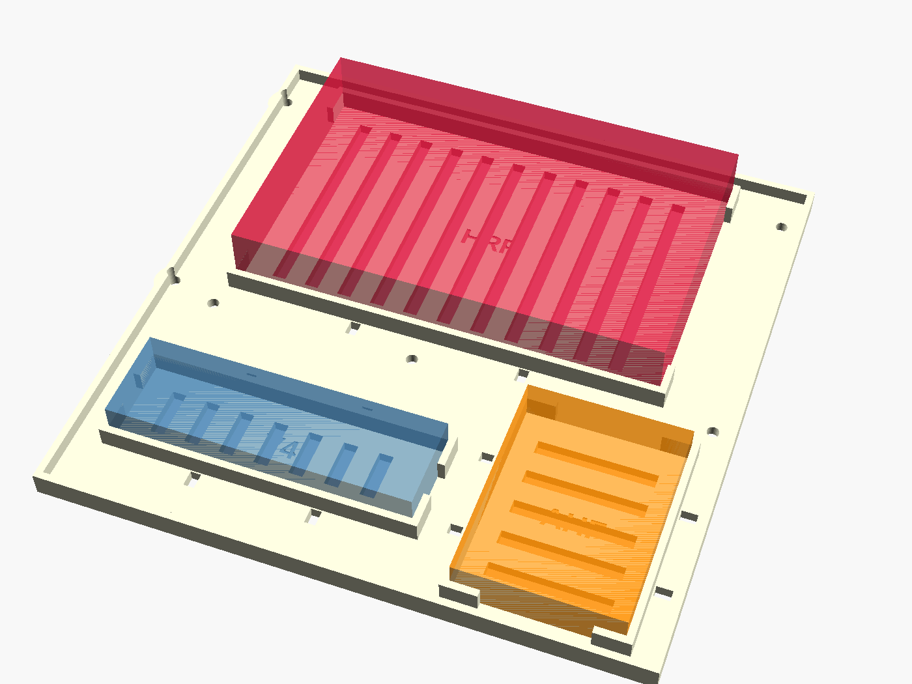
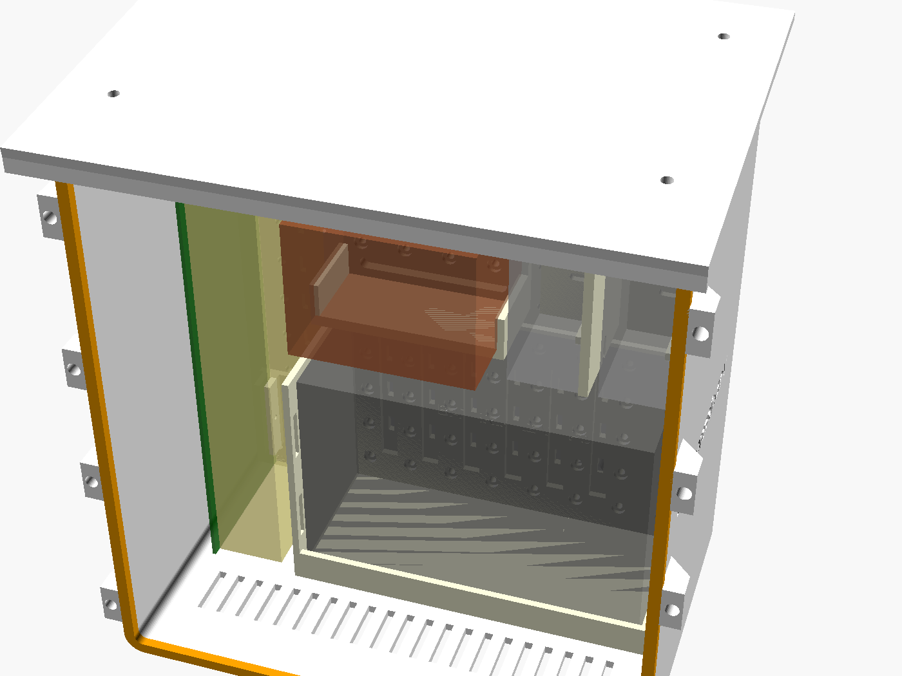

# 17 · Caja v3: dos módulos al pie del mástil

<!-- guia-visual:inicio -->
> **Ruta visual:** [Caja, antenas, filtros, alimentación y anclajes](../GUIA_VISUAL_MODULOS.md#hardware).
> Consulta allí requisitos, ilustración, cuadro de instalación, comprobaciones y restauración.
> Los comandos de este manual se ejecutan en Bash en la Pi; revisa el backup antes de cambiarla.
<!-- guia-visual:fin -->

> **v4:**
> - **Sensores y ventiladores:** la **Pico «bricohams-io»** va en su `pico_soporte` (hardware/anclajes) atornillada a la rejilla, junto a la regleta USB, con la placa perforada de los MOSFET ([manual 20](20_PICO_IO.md)).
> - **Anclajes:** las piezas para fijar antenas y sensores al mástil están en el [manual 21](21_ANCLAJES.md).





**Por qué dos módulos al pie y no una caja en el mástil** (decisión del usuario, ADR-21):
- **Mástil:** con 5 antenas y brazos, el mástil ya trabaja cerca de su límite (ver `tools/mastil.py`). Una caja de 2–3 kg a 2 m de altura sumaría ~0,1 m² de superficie al viento y un momento que no hace falta.
- **A 5 m, al pie:** se abre sin subir, se amplía sin desmontar y no carga el mástil.
- **Cables:** la pérdida que añade la bajada se compensa con coaxial de baja pérdida (LMR-400 en VHF/UHF y el LNA en la antena para ADS-B).

| Módulo | Medidas (an × al × fondo) | Lleva |
|---|---|---|
| **Electrónica** | 228 × 240 × 140 mm | Pi 5 + HAT, 3 SDR + FlightStick, **bandeja de SDR con HackRF One, RTL-SDR V4 y Airspy HF+**, 2 LilyGO, regleta Vansuny, filtro 433, bias-tee, inyector MLA-30, diplexores, RS485, DS18B20, **2 ventiladores de 60 mm**, cámara (opcional) |
| **Potencia** | 170 × 200 × 112 mm | base Schuko de superficie, cargador de 120 W, gatillo USB-C PD a 12 V, portafusibles, WAGO 221 |
| **SAI** (opcional, debajo del de potencia) | 228 × 240 × 140 mm | placa, transformador y batería de plomo 12 V 7–9 Ah de un SAI reaprovechado, **2 filtros EMI** de red, fusible de batería ([§1.2](#12-módulo-sai-reaprovechar-un-sai-con-filtros-emi)) |

> La **caja v2** (`hardware/caja`, manual 10) sigue siendo válida si se quiere todo en el mástil y solo con los SDR actuales. La v3 es la recomendada.

## 1. Piezas (`hardware/caja_v3/stl`, todas ≤ 250 mm, Kobra S1)
| Módulo | Pieza | Material | Relleno |
|---|---|---|---|
| ambos | `cuerpo`, `tapa`, `tejadillo` | **ASA** (o PETG blanco) | 30 % giroide, 6 perímetros |
| ambos | `placa_rejilla` | PETG | 40 % |
| ambos | `junta_tapa` | **TPU 95A** | 100 % |
| ambos | `pletina_pared`, `soporte_mastil` | PETG/ASA | 60 % |
| electrónica | `bandeja`, `poste_bandeja` ×6, `poste_superior` ×4 | PETG | 40 % |
| electrónica | `bandeja_sdr` (HackRF One, RTL-SDR V4, Airspy HF+) | PETG | 40 %, 4 perímetros |
| electrónica | `capota` ×2, `rejilla_ventilador` ×2 | ASA | 30 % |
| electrónica | `soporte_dongle` ×4, `soporte_hub`, `soporte_lilygo` ×2, `soporte_sdrplay`, `soporte_wago` | PETG | 40 % |
| electrónica | `tapon_n` (para los N sin usar), `tapon_pg` | TPU | 100 % |
| electrónica | `visera`, `soporte_camara` | ASA | 30 % |
| potencia | `soporte_schuko`, `brida_cargador` | PETG | 40 % |
| SAI | `soporte_bateria` (cuna con repisa y ventanas de correa) | **PETG** | 60 %, 6 perímetros |
| SAI | `guia_pcb` ×2, `pletina_trafo`, `soporte_filtro` ×2, `soporte_wago`, `tapon_pg` | PETG (`tapon_pg` en TPU) | 50 % |

- **Tiempo:** ~44 h de impresión en total.
- **Material:** ~1,9 kg de ASA/PETG y ~60 g de TPU.
- **Para regenerar:** `tools/caja_v3.sh`.

### 1.1 Bandeja de SDR: 3 receptores más
La `bandeja_sdr` va entre la fila de dongles (y la bahía SDRplay) y la bandeja de la Pi, a 38 mm de la rejilla. Por eso el módulo de electrónica tiene 140 mm de fondo en vez de 112.

| Bahía | SDR | Hueco (largo × ancho × alto) | Dónde |
|---|---|---|---|
| `HRF` | **HackRF One** (con caja) | 124 × 79 × 20 mm | atrás, bajo la Pi; SMA a la izquierda y USB a la derecha |
| `V4` | **RTL-SDR Blog V4** | 85 × 26 × 13 mm | delante a la izquierda |
| `AHF` | **Airspy HF+ Discovery** (45 × 60 × 10) | 45 × 60 × 12 mm | delante a la derecha, conectores hacia delante y atrás |

- **Bahías:** cada una tiene carriles en los lados largos y extremos abiertos para los conectores, con ≥ 12 mm libres para el cable. Debajo lleva rejillas de aire y ranuras para una brida a cada lado.
- **Otro modelo:** cada SDR es una línea de `SDR_DECK` en `caja_v3.scad` (`[nombre, [x, y], [largo, ancho, alto]]`). Si cambias una medida y algo deja de caber, la exportación falla (`assert`) y también `test_v3_hardware.py`.
- **Airspy HF+ Dual Port** (55 × 90 × 12): no cabe en la bahía `AHF`. Si no usas SDRplay, va en la bahía de expansión de la rejilla (100 × 90), sujeto con bridas sobre el `soporte_sdrplay`.
- **Antenas:** la 3.ª fila de pasamuros N (HRF, AHF, V4, R4) es para estos SDR. `R4` queda libre para un 4.º repetidor o para lo que añadas.
- **USB:** suman 3 puertos a la regleta (11 en total). Si no los tiene, pon un segundo hub USB 3.0 alimentado por el bus de 12 V.
  - Para no saturar el USB, el HackRF va con perfiles de ≤ 10 MS/s en OpenWebRX+.
  - Los 3 SDR consumen ~4,5 W a 5 V (HackRF ~0,35 A, V4 ~0,3 A, Airspy ~0,2 A): la regleta pasa de 7–9 W a 12–14 W, dentro de su fusible de 2 A a 12 V.
- **Calor:** ~4,5 W más. Los ventiladores PWM (manual 18) suben de vueltas solos; la bandeja tiene rejillas para que el aire de la diagonal pase por debajo de los SDR.

### 1.2 Módulo SAI: reaprovechar un SAI con filtros EMI
Tercer módulo, **debajo del de potencia**, para un SAI *line-interactive* pequeño (600 VA, placa tipo 16-500014, batería de plomo 12 V 7–9 Ah). Los cuerpos, la tapa, la junta y el tejadillo salen de `caja_v3.scad` con `VARIANTE="sai"` y miden lo mismo que el de electrónica (228 × 240 × 140 mm, cabe en la Kobra S1).



**Esquema (opción A, la que se monta):**
```
230 V casa ─PG9 «RED»─► FILTRO EMI 1 ─► SAI (placa + trafo + batería) ─► FILTRO EMI 2 ─PG9 «SALIDA»─►
   ─► (cable H07RN-F 3G1,5 por fuera) ─► PG9 «230 V» del módulo de potencia ─► Schuko ─► cargador de 120 W ─► 5 V Pi / 12 V bus
                                                            BAT+ ─ fusible ATO 15 A (≤ 10 cm del borne) ─ batería ─ BAT−
```

| Hueco (`SAI_LAYOUT`) | Qué va | Medida reservada | Pieza |
|---|---|---|---|
| `BAT` | batería 12 V 7–9 Ah **de pie, bornes arriba** (151 × 65 × 94 + bornes) | 159 × 106 × 74 | `soporte_bateria` + correa de velcro 20 mm por las ventanas |
| `PCB` | placa del SAI **de canto**, componentes hacia la batería (≈ 210 × 70) | 40 × 216 × 82 | `guia_pcb` ×2 (ranura 2,2 mm + prisionero M3) |
| `TRAFO` | transformador del SAI (≈ 80 × 62 × 65, 1,5–2 kg) | 85 × 70 × 70 | `pletina_trafo` (repisa + colisos M5 para sus patas) |
| `EMI_OUT`, `EMI_IN` | filtros EMI monofásicos de chasis 250 V 6 A (≈ 85 × 50 × 30) | 34 × 86 × 54 | `soporte_filtro` ×2 (escuadra, colisos M4 para las orejas) |
| `DC` | portafusibles ATO + WAGO 221 | 86 × 28 × 25 | `soporte_wago` |

- **Mide tu SAI** antes de imprimir y cambia `SAI_BAT`, `SAI_PCB`, `SAI_TRAFO` y `FILTRO`. Si algo deja de caber, la exportación (`assert`) y `test_v3_hardware.py` fallan.
- **Rejillas:** el cuerpo lleva entrada de aire abajo y salida bajo el tejadillo. El plomo-ácido sellado (VRLA) suelta algo de hidrógeno si se sobrecarga; nunca tapes la salida de arriba.
- **PG7 «DATOS»:** si el SAI tiene USB o serie, pasa el cable a la Pi y vigílalo con NUT (`apt install nut`); así la Pi se apaga sola antes de que se agote la batería.

**Cálculos** (`python3 tools/sai_calculo.py --carga 25 --ah 7`; la estación consume 19–25 W con los 3 SDR nuevos):

| | A) SAI completo (230 V) | B) solo su batería a 12 V |
|---|---|---|
| Cadena | batería → inversor → filtro → cargador 120 W | cargador 13,8 V con función SAI → batería → filtro LC → bus 12 V (+ reductor 5 V 5 A para la Pi) |
| Potencia que sale de la batería | 43 W (3,6 A): inversor ~75 % a poca carga + 4 W de reposo | 27 W (2,3 A) |
| Autonomía, batería usada (80 %) 7 Ah | **≈ 1,1 h** | **≈ 1,9 h** (0,9 h si cortas al 50 %, que alarga la vida de la batería) |
| Autonomía, batería nueva 9 Ah | ≈ 1,8 h | ≈ 3,1 h |
| Fusible en BAT+ | ATO 15 A, cable 1,5 mm² (el original del SAI) | ATO 7,5 A, 1,5 mm² |
| Ruido | el inversor da onda «senoidal modificada»: **solo durante los cortes**; lo frenan el filtro 2 y las ferritas | sin inversor: el más limpio |

Se monta la **A** porque reaprovecha el SAI tal cual y no toca el resto de la caja. La **B** queda como mejora: da un 70 % más de autonomía, pero cambia el cargador y la alimentación de la Pi.

**Filtros EMI:**
- **Filtro 1 (entrada):** frena el ruido de la red de casa, que si no subiría por los 5 m de cable junto a las antenas. Lo mismo hace con el ruido del propio SAI hacia la red.
- **Filtro 2 (salida):** frena los armónicos del inversor y el ruido de conmutación de los relés. Va lo más cerca posible del PG9 «SALIDA».
- **Ambos:** monofásicos de chasis 250 V AC, **6 A** (la estación tira 0,2–0,4 A; el margen cubre el arranque del cargador), dos etapas, con borne de tierra. Ejemplos: Schaffner FN2010-6, Corcom 6EF1, TE 6VK1 o equivalentes.
- **Fuga a tierra:** ≤ 0,5 mA en cada filtro. Así no salta el diferencial de 30 mA de casa.
- **Tierra:** los filtros solo funcionan con el **conductor de protección (PE) conectado** a su borne y continuo hasta el Schuko.
- **Ferritas:** de mezcla 31 (tipo clip, Ø interior ≥ 7 mm), con **4 vueltas** del cable de 230 V a la salida del módulo SAI y otras 4 del cable de 12 V en la entrada del módulo de electrónica. Atenúan el ruido de modo común en HF.
- **Bus de 12 V:** filtro π con 2 × 2200 µF de bajo ESR y 100 nF cerámicos, más una bobina de 10 µH / 5 A en serie. Corta hacia 1 kHz, así que el rizado del cargador queda muy por debajo.
  - Si haces la opción B, pon también un TVS **SMBJ15A**: la tensión de absorción (14,4 V) queda por debajo de su tensión de trabajo de 15 V.

**Seguridad (230 V y batería):**
- **Sin tensión:** trabaja siempre con el SAI **desenchufado y la batería desconectada**. Con la batería puesta, el SAI saca 230 V aunque no esté enchufado.
- **Condensadores:** espera 5 minutos para que se descarguen y comprueba con el polímetro que no queda tensión.
- **La placa, sin tocar:** no modifiques la placa del SAI. Solo se traslada con sus conectores originales: entrada y salida por faston, batería por los cables BAT+ (rojo) y BAT− (negro).
- **Aislamiento:** la placa de canto deja ≥ 6 mm hasta la batería. Separa la parte de 230 V de los cables de 12 V y fija todo con bridas. La tapa cierra con la junta y lleva una etiqueta «230 V».
- **Fusible de batería:** el **fusible en BAT+** no es opcional. Una batería de plomo da cientos de amperios en corto.
- **Temperatura:** por encima de 40 °C la batería envejece el doble de rápido. Pon el módulo a la sombra (el tejadillo ayuda) y, si el cargador lo permite, ajusta la flotación: 13,65 V a 25 °C y 13,38 V a 40 °C.
- **Batería vieja:** cámbiala si tiene más de 3–4 años o si aguanta menos de la mitad de lo calculado. Prueba de capacidad: con la estación funcionando, quita la red y cronometra hasta que pite la batería baja.

## 2. Material
| Artículo | Cant. |
|---|---|
| Insertos M3 × 6 de latón | ~80 (rejilla universal cada 20 mm: pon solo los que uses) |
| Insertos M4 | 16 (tapas) |
| Tornillos inox M4 × 16 (tapas) | 16 |
| Tornillos inox M3 × 8 | 40 |
| Pasamuros N hembra–N hembra de panel | 7 (10 con la bandeja de SDR; los demás se cierran con `tapon_n`) |
| Latiguillos N macho–SMA macho de RG-316, 20–30 cm | 7 (10 con la bandeja de SDR) |
| Espárragos M3 × 14 (unen `poste_bandeja` y `poste_superior` a través de la `bandeja_sdr`) | 4 |
| Prensaestopas M25 ×2, M20 ×1, PG7 ×4, PG9 ×1 | — |
| Ventiladores de 60 mm 12 V **PWM de 4 hilos** (p. ej. Noctua NF-A6x25 PWM o Arctic P6 PWM) | 2 |
| Malla de acero inox de 1 mm (contra insectos, bajo las rejillas) | 2 × 70 × 70 mm |
| Tacos para pared, o 2 `cruceta_mastil_brazo` (manual 21) para fijar el `soporte_mastil` a un poste | 4 / 2 |
| Manguera H07RN-F 4 × 0,75 para 12 V, ≤ 5 m, entre módulos | 1 |
| Cable de red de exterior Cat6 FTP | — |

## 3. Montaje paso a paso
1. **Insertos:**
   1. Con el soldador a 220 °C, pon los insertos M4 del marco de las tapas.
   2. Pon los M3 de la `placa_rejilla` en las posiciones que vayas a usar (plano de `electronica_interior.png`).
2. **Juntas:** pega la `junta_tapa` de TPU en la ranura de la tapa con 4 puntos de cianoacrilato.
3. **Conectores inferiores:**
   1. Monta los pasamuros N con su tuerca y arandela por dentro. Las etiquetas impresas son:
      - fila junto a la pared trasera: SAT HAM VHF HF ADSB 868 GPS;
      - fila central: M433 IG433 DISC2 HF2 R1 R2 R3;
      - fila junto a la tapa (nueva): HRF AHF V4 R4.
   2. Pon el `tapon_n` en los que no uses.
   3. Monta los prensaestopas.
4. **Ventiladores:**
   1. **Entrada** (izquierda, abajo): ventilador **soplando hacia dentro**.
   2. **Salida** (derecha, arriba): soplando hacia fuera.
   3. Por fuera, la `rejilla_ventilador` con la malla inox y la `capota` (abertura hacia abajo).
   4. Los cables entran por los pasacables de la rejilla.
   5. El flujo en diagonal barre toda la caja (manual 18).
5. **Rejilla:** atornilla la `placa_rejilla` sobre los 5 resaltes del fondo. Encima van los soportes:
   - `soporte_dongle` ×4 para los SDR y el FlightStick, con bridas;
   - `soporte_hub` (regleta Vansuny);
   - `soporte_wago`;
   - `soporte_sdrplay` (bahía de expansión);
   - `clip_filtro` (del juego de antenas) para el FBP-433s.
6. **Bandeja de SDR:**
   1. Atornilla 6 `poste_bandeja` (38 mm) a la rejilla: 2 delante, en los nudos (40, 120) y (100, 120) de la rejilla, y 4 en las esquinas de la bandeja de la Pi.
   2. Pon la `bandeja_sdr` encima: M3 × 8 en los 2 postes delanteros y un espárrago M3 × 14 en cada uno de los otros 4.
   3. Coloca el HackRF One, el RTL-SDR V4 y el Airspy HF+ en sus bahías y sujétalos con una brida por las ranuras.
   4. Conecta los latiguillos de la fila de N junto a la tapa antes de poner la bandeja de la Pi.
7. **Bandeja de la Pi:**
   1. Enrosca los 4 `poste_superior` (30 mm) en los espárragos. Sobre ellos va la `bandeja`, 71 mm por encima de la rejilla.
   2. En la bandeja, la Pi 5 + HAT (taladros de 58 × 49) y los 2 `soporte_lilygo`.
   3. La Pi queda arriba, que es donde el ventilador de salida saca el aire caliente.
8. **Cámara (opcional):** el `soporte_camara` va en la tapa detrás de la ventana, con la `visera` por fuera. **Recomendado:** cámara IP en el mástil (ADR-24) y ventana tapada.
9. **Módulo de potencia:**
   1. `soporte_schuko` + base Schuko de superficie.
   2. `brida_cargador` sujetando el cargador de 120 W.
   3. Gatillo USB-C PD a 12 V → portafusibles → WAGO.
   4. Entrada de 230 V por PG9 y salida a electrónica por M25 (manguera 4 × 0,75: +12 V, GND, y dos hilos de reserva).
   - **5 V de la Pi:** **cable USB-C PD directo** del cargador a la Pi, de 1 m, con un pequeño bucle en el M25. Si los módulos van a más de 1,5 m, la Pi se alimenta en su lugar con un reductor 12 → 5,1 V 5 A dentro del módulo de electrónica (ver pendientes en MEMORIA_TECNICA).
10. **Fijación:**
   1. `pletina_pared` + 4 tacos.
   2. O `soporte_mastil` + 2 U M8 a un poste de Ø40–50.
   3. El módulo de potencia, **más bajo** que el de electrónica, para que el agua de condensación no baje por la manguera hacia la electrónica.
   4. Por último, el `tejadillo` sobre cada uno.
11. **Cierre:**
    1. Aprieta las tapas en cruz.
    2. Haz bucles de goteo en todos los cables antes de los prensaestopas.
    3. Pon el `tapon_pg` en los PG7 libres.

## 4. Cableado (resumen; detalle en MEMORIA_TECNICA, cables C1–C18)
- **Coaxiales:** pasamuros N → latiguillo → filtro, bias-tee o inyector → SDR (esquema 12).
- **12 V:** WAGO de electrónica → ventiladores (esquema 13), Vansuny (jack 5,5 × 2,1) y sensores RS485 (esquema 14).
- **Sensores y ventiladores (v4):** Pico «bricohams-io» por USB → DS18B20 (GP22), pluviómetro (GP15), BME280 (GP4/GP5), PWM (GP16/GP17) y tacómetros (GP18/GP19) (esquema 16). La cabecera de 40 pines queda bajo el HAT.
- **Cámara (v4):** Waveshare (F) con cinta Standard–Mini 15→22 pines a CAM/DISP 0; pasa por el lateral del HAT (manual 07).
- **USB:** todo a la regleta Vansuny, cuyo upstream USB 3.0 va a la Pi. Excepciones: el HAT va por PCIe/USB interno y la cámara CSI por su cinta.

## 5. Comprobación
1. **Antes de cerrar:** `sudo bricohams-check`. Todo debe salir en verde: 4 SDR (7 con la bandeja de SDR), 2 LilyGO, `/dev/rs485`, `/dev/bricohams-io` (Pico con BME280, DS18B20 y 2 ventiladores con rpm).
2. **Ventiladores:** `sudo systemctl stop bricohams-fan && sudo bricohams-fan --forzar 100; sudo systemctl start bricohams-fan`. Los dos deben girar y el aire debe entrar abajo y salir arriba.
3. **Estanqueidad:** cierra y riega la caja con manguera, sin presión, 2 minutos. Ábrela: dentro no debe haber agua.
