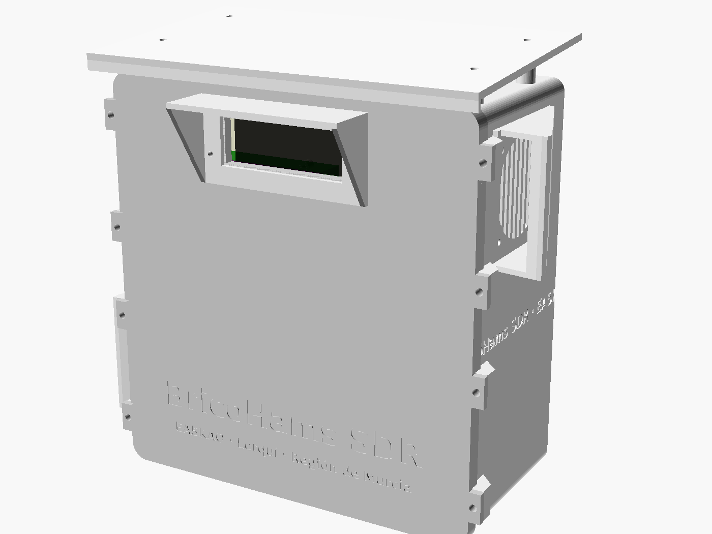
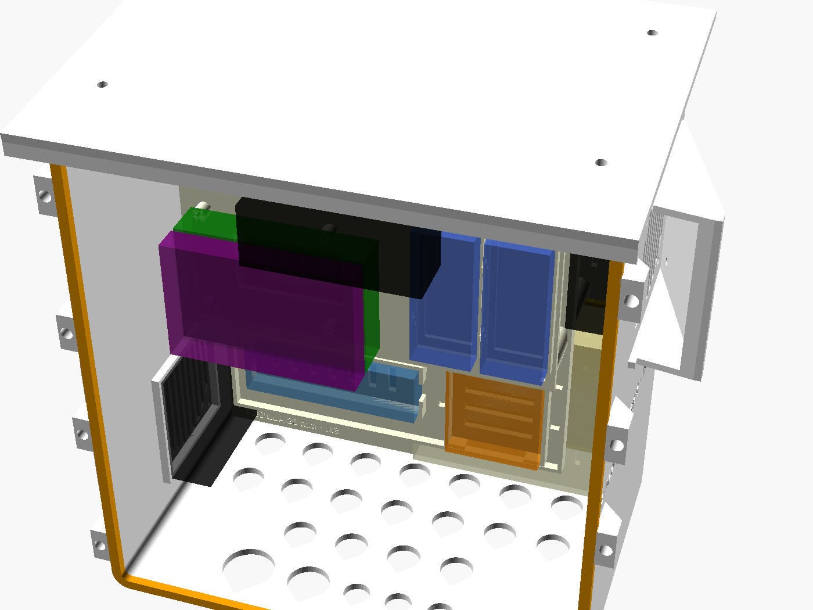
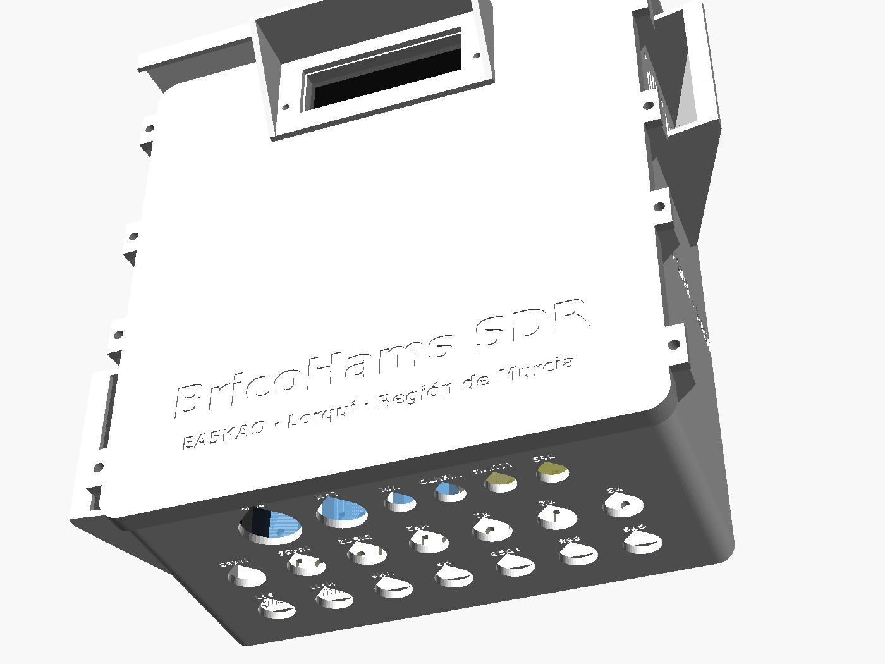
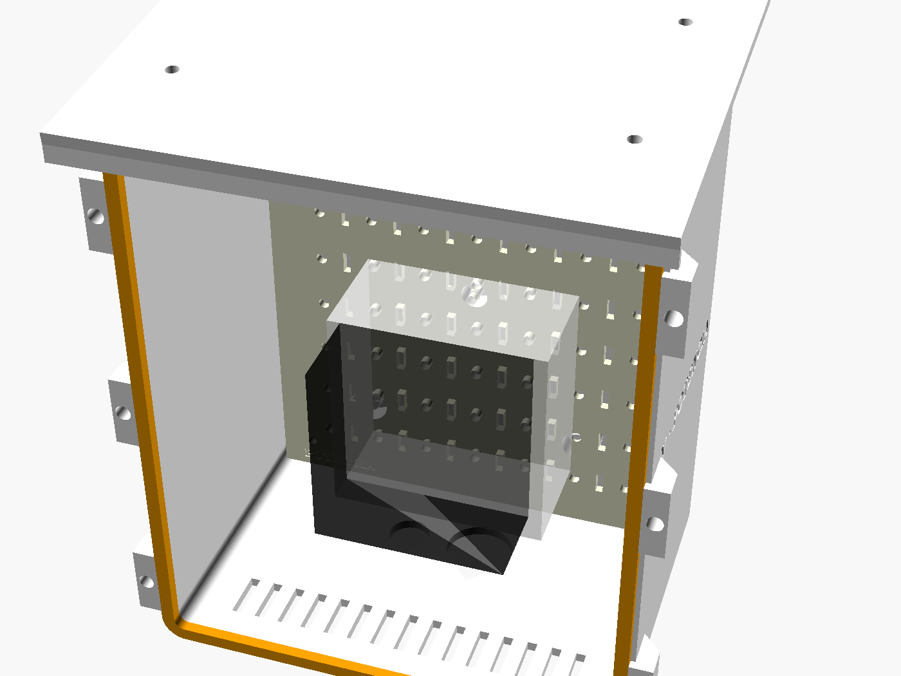
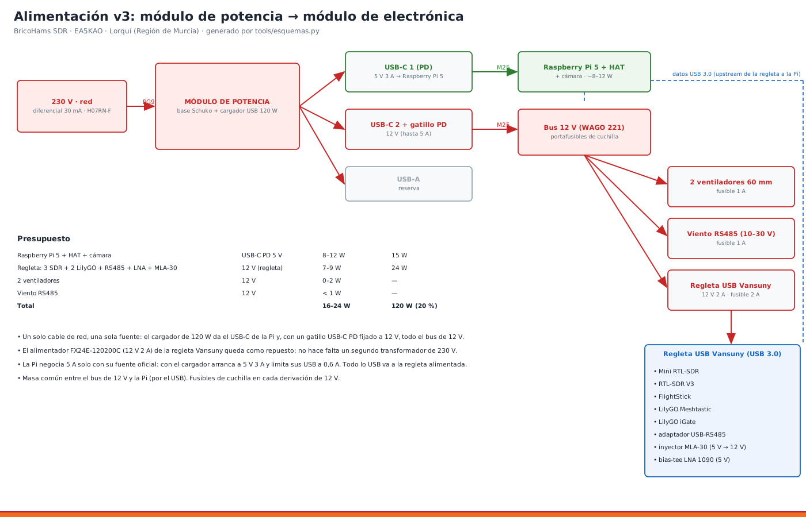

# 17 · Caja v3: dos módulos al pie del mástil

> **v4:**
> - **Sensores y ventiladores:** la **Pico «bricohams-io»** va en su `pico_soporte` (hardware/anclajes) atornillada a la rejilla, junto a la regleta USB, con la placa perforada de los MOSFET ([manual 20](20_PICO_IO.md)).
> - **Anclajes:** las piezas para fijar antenas y sensores al mástil están en el [manual 21](21_ANCLAJES.md).

**Por qué dos módulos al pie y no una caja en el mástil** (decisión del usuario, ADR-21):
- **Mástil:** con 5 antenas y brazos, el mástil ya trabaja cerca de su límite (ver `tools/mastil.py`). Una caja de 2–3 kg a 2 m de altura sumaría ~0,1 m² de superficie al viento y un momento que no hace falta.
- **A 5 m, al pie:** se abre sin subir, se amplía sin desmontar y no carga el mástil.
- **Cables:** la pérdida que añade la bajada se compensa con coaxial de baja pérdida (LMR-400 en VHF/UHF y el LNA en la antena para ADS-B).

| Módulo | Medidas (an × al × fondo) | Lleva |
|---|---|---|
| **Electrónica** | 228 × 240 × 112 mm | Pi 5 + HAT, 3 SDR + FlightStick, 2 LilyGO, regleta Vansuny, filtro 433, bias-tee, inyector MLA-30, diplexores, RS485, DS18B20, **2 ventiladores de 60 mm**, cámara (opcional) |
| **Potencia** | 170 × 200 × 112 mm | base Schuko de superficie, cargador de 120 W, gatillo USB-C PD a 12 V, portafusibles, WAGO 221 |

> La **caja v2** (`hardware/caja`, manual 10) sigue siendo válida si se quiere todo en el mástil y solo con los SDR actuales. La v3 es la recomendada.

## 1. Piezas (`hardware/caja_v3/stl`, todas ≤ 250 mm, Kobra S1)
| Módulo | Pieza | Material | Relleno |
|---|---|---|---|
| ambos | `cuerpo`, `tapa`, `tejadillo` | **ASA** (o PETG blanco) | 30 % giroide, 6 perímetros |
| ambos | `placa_rejilla` | PETG | 40 % |
| ambos | `junta_tapa` | **TPU 95A** | 100 % |
| ambos | `pletina_pared`, `soporte_mastil` | PETG/ASA | 60 % |
| electrónica | `bandeja`, `poste_bandeja` ×4 | PETG | 40 % |
| electrónica | `capota` ×2, `rejilla_ventilador` ×2 | ASA | 30 % |
| electrónica | `soporte_dongle` ×4, `soporte_hub`, `soporte_lilygo` ×2, `soporte_sdrplay`, `soporte_wago` | PETG | 40 % |
| electrónica | `tapon_n` (para los N sin usar), `tapon_pg` | TPU | 100 % |
| electrónica | `visera`, `soporte_camara` | ASA | 30 % |
| potencia | `soporte_schuko`, `brida_cargador` | PETG | 40 % |

- **Tiempo:** ~38 h de impresión en total.
- **Material:** ~1,6 kg de ASA/PETG y ~60 g de TPU.
- **Para regenerar:** `tools/caja_v3.sh`.

## 2. Material
| Artículo | Cant. |
|---|---|
| Insertos M3 × 6 de latón | ~80 (rejilla universal cada 20 mm: pon solo los que uses) |
| Insertos M4 | 16 (tapas) |
| Tornillos inox M4 × 16 (tapas) | 16 |
| Tornillos inox M3 × 8 | 40 |
| Pasamuros N hembra–N hembra de panel | 7 (los demás se cierran con `tapon_n`) |
| Latiguillos N macho–SMA macho de RG-316, 20–30 cm | 7 |
| Prensaestopas M25 ×2, M20 ×1, PG7 ×4, PG9 ×1 | — |
| Ventiladores de 60 mm 12 V **PWM de 4 hilos** (p. ej. Noctua NF-A6x25 PWM o Arctic P6 PWM) | 2 |
| Malla de acero inox de 1 mm (contra insectos, bajo las rejillas) | 2 × 70 × 70 mm |
| Tacos para pared, o 2 `cruceta_mastil_brazo` (manual 21) para fijar el `soporte_mastil` a un poste | 4 / 2 |
| Manguera H07RN-F 4 × 0,75 para 12 V, ≤ 5 m, entre módulos | 1 |
| Cable de red de exterior Cat6 FTP | — |

## 3. Montaje paso a paso
1. **Insertos:**
   1. Con el soldador a 220 °C, pon los insertos M4 del marco de las tapas.
   2. Pon los M3 de la `placa_rejilla` en las posiciones que vayas a usar (plano de `electronica_interior.png`).
2. **Juntas:** pega la `junta_tapa` de TPU en la ranura de la tapa con 4 puntos de cianoacrilato.
3. **Conectores inferiores:**
   1. Monta los pasamuros N con su tuerca y arandela por dentro. Las etiquetas impresas de la fila delantera son SAT HAM VHF HF ADSB 868 GPS; las de la trasera, M433 IG433 DISC2 HF2 R1 R2 R3.
   2. Pon el `tapon_n` en los que no uses.
   3. Monta los prensaestopas.
4. **Ventiladores:**
   1. **Entrada** (izquierda, abajo): ventilador **soplando hacia dentro**.
   2. **Salida** (derecha, arriba): soplando hacia fuera.
   3. Por fuera, la `rejilla_ventilador` con la malla inox y la `capota` (abertura hacia abajo).
   4. Los cables entran por los pasacables de la rejilla.
   5. El flujo en diagonal barre toda la caja (manual 18).
5. **Rejilla:** atornilla la `placa_rejilla` sobre los 5 resaltes del fondo. Encima van los soportes:
   - `soporte_dongle` ×4 para los SDR y el FlightStick, con bridas;
   - `soporte_hub` (regleta Vansuny);
   - `soporte_wago`;
   - `soporte_sdrplay` (bahía de expansión);
   - `clip_filtro` (del juego de antenas) para el FBP-433s.
6. **Bandeja:**
   1. Los 4 `poste_bandeja` llevan la `bandeja` 118 mm por encima.
   2. En la bandeja, la Pi 5 + HAT (taladros de 58 × 49) y los 2 `soporte_lilygo`.
   3. La Pi queda arriba, que es donde el ventilador de salida saca el aire caliente.
7. **Cámara (opcional):** el `soporte_camara` va en la tapa detrás de la ventana, con la `visera` por fuera. **Recomendado:** cámara IP en el mástil (ADR-24) y ventana tapada.
8. **Módulo de potencia:**
   1. `soporte_schuko` + base Schuko de superficie.
   2. `brida_cargador` sujetando el cargador de 120 W.
   3. Gatillo USB-C PD a 12 V → portafusibles → WAGO.
   4. Entrada de 230 V por PG9 y salida a electrónica por M25 (manguera 4 × 0,75: +12 V, GND, y dos hilos de reserva).
   - **5 V de la Pi:** **cable USB-C PD directo** del cargador a la Pi, de 1 m, con un pequeño bucle en el M25. Si los módulos van a más de 1,5 m, la Pi se alimenta en su lugar con un reductor 12 → 5,1 V 5 A dentro del módulo de electrónica (ver pendientes en MEMORIA_TECNICA).
9. **Fijación:**
   1. `pletina_pared` + 4 tacos.
   2. O `soporte_mastil` + 2 U M8 a un poste de Ø40–50.
   3. El módulo de potencia, **más bajo** que el de electrónica, para que el agua de condensación no baje por la manguera hacia la electrónica.
   4. Por último, el `tejadillo` sobre cada uno.
10. **Cierre:**
    1. Aprieta las tapas en cruz.
    2. Haz bucles de goteo en todos los cables antes de los prensaestopas.
    3. Pon el `tapon_pg` en los PG7 libres.

## 4. Cableado (resumen; detalle en MEMORIA_TECNICA, cables C1–C18)
- **Coaxiales:** pasamuros N → latiguillo → filtro, bias-tee o inyector → SDR (esquema 12).
- **12 V:** WAGO de electrónica → ventiladores (esquema 13), Vansuny (jack 5,5 × 2,1) y sensores RS485 (esquema 14).
- **Sensores y ventiladores (v4):** Pico «bricohams-io» por USB → DS18B20 (GP22), pluviómetro (GP15), BME280 (GP4/GP5), PWM (GP16/GP17) y tacómetros (GP18/GP19) (esquema 16). La cabecera de 40 pines queda bajo el HAT.
- **Cámara (v4):** Waveshare (F) con cinta Standard–Mini 15→22 pines a CAM/DISP 0; pasa por el lateral del HAT (manual 07).
- **USB:** todo a la regleta Vansuny, cuyo upstream USB 3.0 va a la Pi. Excepciones: el HAT va por PCIe/USB interno y la cámara CSI por su cinta.

## 5. Comprobación
1. **Antes de cerrar:** `sudo bricohams-check`. Todo debe salir en verde: 4 SDR, 2 LilyGO, `/dev/rs485`, `/dev/bricohams-io` (Pico con BME280, DS18B20 y 2 ventiladores con rpm).
2. **Ventiladores:** `sudo systemctl stop bricohams-fan && sudo bricohams-fan --forzar 100; sudo systemctl start bricohams-fan`. Los dos deben girar y el aire debe entrar abajo y salir arriba.
3. **Estanqueidad:** cierra y riega la caja con manguera, sin presión, 2 minutos. Ábrela: dentro no debe haber agua.
