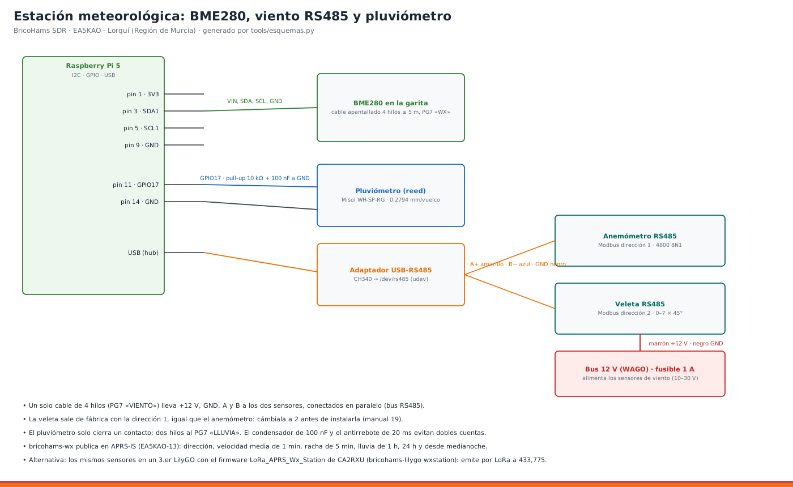

# 19 · Viento y lluvia para el WX APRS

<!-- guia-visual:inicio -->
> **Ruta visual:** [Meteorología, BME280, viento/lluvia y Pico IO](../GUIA_VISUAL_MODULOS.md#wx).
> Consulta allí requisitos, ilustración, cuadro de instalación, comprobaciones y restauración.
> Los comandos de este manual se ejecutan en Bash en la Pi; revisa el backup antes de cambiarla.
<!-- guia-visual:fin -->

> **v4 · Con el HAT puesto la cabecera de 40 pines está ocupada.** El pluviómetro se conecta ahora a la **Pico «bricohams-io»** por USB: GP15 (pin 20) con 10 kΩ a 3V3 y 100 nF a GND; el otro hilo a GND. El viento sigue igual, por el adaptador USB-RS485 ([manual 20](20_PICO_IO.md), [esquema 16](../esquemas/16_pico_io.png)). Lo de abajo con pines de la Pi solo vale **sin HAT** (`IO_MODE="gpio"`).



La estación WX de la Pi, **N0CALL-13** (BME280, manual 06), suma ahora:
- **anemómetro y veleta RS485 Modbus**: el mismo kit que usa la estación de CA2RXU;
- **pluviómetro de cazoleta** (reed).

Los paquetes APRS salen con viento, racha y lluvia (1 h, 24 h y desde medianoche) por APRS-IS, y la tarjeta METEO de OpenWebRX lo muestra.

**Alternativa (decisión del usuario: «Las dos»):** los mismos sensores en un **tercer LilyGO** con el firmware [LoRa_APRS_Wx_Station](https://github.com/richonguzman/LoRa_APRS_Wx_Station) de CA2RXU, como **N0CALL-14**, que emite por LoRa a 433,775 y lo recoge el iGate. Sirve para poner la estación lejos de la caja (solo con batería o panel solar) o como respaldo si la Pi cae.

> El enlace que mandaste (`APRS_WX_REPORT_STATION`) es el antiguo nombre del proyecto. Hoy es LoRa_APRS_Wx_Station y es el que se usa aquí.

## 1. Material
| Artículo | Cant. | Nota |
|---|---|---|
| Anemómetro RS485 Modbus RTU (10–30 V, 4800 8N1) | 1 | tipo «RS-FSJT-N01» |
| Veleta RS485 Modbus RTU (10–30 V, salida de 8 sectores o grados) | 1 | tipo «RS-FXJT-N01» |
| Adaptador USB-RS485 (CH340 o FT232) | 1 | va a la regleta. El instalador lo llama `/dev/rs485` |
| Pluviómetro de cazoleta con reed, Misol WH-SP-RG o similar | 1 | 0,2794 mm por vuelco |
| Cable apantallado de 4 hilos (RS485) y de 2 hilos (pluviómetro) | ≤ 5 m cada uno | entran por los PG7 «VIENTO» y «LLUVIA» |
| Resistencia de 10 kΩ + condensador de 100 nF | 1 + 1 | pull-up y antirrebote del pluviómetro |
| Brazo Ø25 de 1,6 m en el mástil a 1,5 m (impresos: `brazo_mastil` + `tapon_brazo`) | 1 | — |

## 2. Conexión
**Bus RS485** (los dos sensores en paralelo, en cadena):

| Cable del sensor | Va a |
|---|---|
| Marrón | +12 V (WAGO, **fusible de 1 A**) |
| Negro | GND (WAGO) |
| Amarillo | A+ del adaptador |
| Azul | B− del adaptador |

- **Terminación:** resistencia de 120 Ω entre A y B solo en el último sensor, si el cable pasa de 10 m. A 5 m no hace falta.
- **Malla:** a GND solo del lado de la caja.

**Pluviómetro:**
- un hilo a **GPIO17 (pin 11)** y el otro a **GND (pin 14)**;
- en la placa: **10 kΩ de GPIO17 a 3,3 V** y **100 nF de GPIO17 a GND**;
- el programa añade 20 ms de antirrebote.

## 3. Direcciones Modbus (una sola vez, antes de montar)
Los dos sensores vienen de fábrica con la **dirección 1**. Hay que cambiar la de la veleta a la 2:
1. Conecta **solo la veleta** al adaptador.
2. Cambia la dirección:
   ```bash
   sudo bricohams-wx --rs485-buscar             # debe responder «dirección 1»
   sudo bricohams-wx --rs485-direccion 1 2      # escribe 2 en el registro 0x07D0
   ```
3. Desconéctala, vuelve a conectarla y repite `--rs485-buscar`: ahora debe responder «2».
4. Conecta también el anemómetro. `--rs485-buscar` debe ver la 1 y la 2.

Si tu veleta da grados (0–359) en lugar de sectores (0–7), pon `WIND_DIR_MODE="grados"`.

## 4. Configuración (`bricohams.env`)
```
WIND_ENABLE="yes"   WIND_PORT="/dev/rs485"   WIND_BAUD="4800"
WIND_ADDR_SPEED="1" WIND_ADDR_DIR="2"        WIND_DIR_MODE="sector8"
RAIN_ENABLE="yes"   RAIN_MM="0.2794"
IO_MODE="pico"      # v4: el pluviómetro lo cuenta la Pico (GP15); RAIN_GPIO solo con IO_MODE="gpio"
```
Después: `sudo bash install.sh --solo sensor`, o la instalación completa.

**Qué calcula el programa** (norma APRS/WMO):

| Dato | Cómo |
|---|---|
| Viento | media de 1 minuto (lectura cada 3 s) |
| Dirección | media **vectorial** de 2 minutos. Así N-NO-NE no da «S» |
| Racha | máximo de 5 minutos |
| Lluvia | contador persistente en `/var/lib/bricohams/lluvia.json` (sobrevive a reinicios): última hora, 24 h y desde medianoche local |
| Formato | en mph y centésimas de pulgada, como pide APRS. Ejemplo: `_225/011g020t072r004p022P008h55b10143` |

## 5. Montaje en el mástil
- **Sensores de viento:** en el **brazo de 1,6 m a 1,5 m de altura**, cada uno a 0,8 m del mástil: el anemómetro hacia el N y la veleta hacia el S (plan del mástil, esquema 11). Así el mástil no les hace sombra al viento. **Orienta la marca N de la veleta al norte geográfico** (con una brújula, sumando +1° de declinación en Murcia).
- **Pluviómetro:**
  - **no en el mástil**, porque el viento lo hace oscilar y da vuelcos falsos;
  - **en un poste aparte**, a 1 m del suelo, nivelado con su burbuja y lejos de paredes y árboles. **v4:** poste Ø40 de 1 m con la `pluvio_vaso` (abrazadera de poste) y la `pluvio_plataforma` con 3 tornillos de nivelación (manual 21 §3.7);
  - **sensores de viento (v4):** cada uno con su `sensor_viento_brida` sobre un tubo Ø25 de 300 mm y `cruceta_brazo_tubo` (manual 21 §3.6);
  - el cable llega al PG7 «LLUVIA».

## 6. Pruebas
```bash
sudo bricohams-wx --rs485-buscar
sudo bricohams-wx --una                # imprime el paquete APRS sin enviarlo
journalctl -u bricohams-wx -n 20
```
- **Viento:** sopla el anemómetro o gira la veleta, y los valores cambian en la tarjeta METEO.
- **Lluvia:** vierte 10 ml de agua despacio en el pluviómetro. Con la boca de 110 cm² son ~0,9 mm: unos 3 vuelcos.
- **aprs.fi** → N0CALL-13 → «Weather»: aparecen viento y lluvia.

## 7. Alternativa: tercer LilyGO, estación LoRa de CA2RXU
1. Conecta **solo** ese LilyGO por USB y ejecuta:
   ```bash
   sudo bricohams-lilygo wxstation /dev/ttyUSB0
   ```
   El script descarga el firmware y lo configura:
   - indicativo **N0CALL-14**, 433,775 MHz, SF12, 17 dBm, comentario «WX LoRa BricoHams»;
   - activa BME280, viento y lluvia;
   - lo graba.
2. **Variables** en `bricohams.env`: `WXLORA_CALLSIGN`, `WXLORA_POWER`, `WXLORA_BME280`, `WXLORA_WIND`, `WXLORA_RAIN`, `WXLORA_COMMENT`.
3. **Cableado:** igual que arriba, pero al LilyGO: RS485 con un módulo MAX485 a los pines que indica el firmware, y pluviómetro a su GPIO de lluvia. Mira su `README`.
4. **Una sola estación de viento** puede ir a la Pi **o** al LilyGO, no a los dos a la vez:
   - el bus RS485 tiene un único maestro;
   - si eliges el LilyGO, pon `WIND_ENABLE="no"` y `RAIN_ENABLE="no"` en la Pi;
   - N0CALL-13 seguirá enviando temperatura, humedad y presión.
