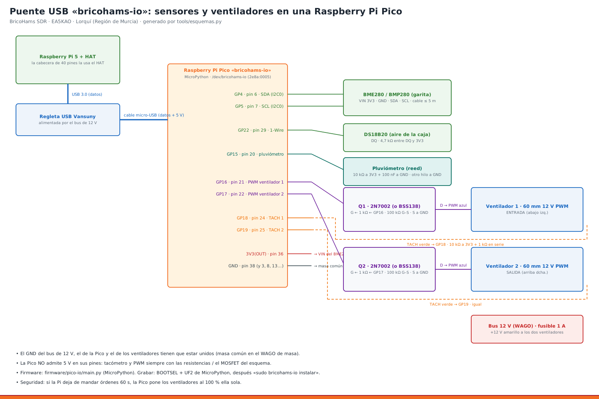

# 20 · Pico «bricohams-io»: sensores y ventiladores por USB



**Por qué (ADR-29):** el HAT de HackerGadgets ocupa la cabecera de 40 pines. Con el HAT puesto no se pueden conectar sensores ni ventiladores a los GPIO de la Pi.

**La solución:** una **Raspberry Pi Pico** (unos 5 €), enchufada por USB a la regleta, hace de puente. Ella lee los sensores, mueve los ventiladores y manda los datos a la Pi cada 2 s.
- **BME280:** temperatura, humedad y presión. Va en la garita.
- **DS18B20:** temperatura del aire de la caja.
- **Pluviómetro:** cuenta los vuelcos.
- **Ventiladores:** los 2 de 60 mm, con PWM a 25 kHz y tacómetro.
- **Lo que no pasa por la Pico:** el viento sigue por el adaptador USB-RS485 (manual 19) y la cámara por su cable CSI (manual 07).

**Servicios en la Pi:**

| Servicio | Qué hace |
|---|---|
| `bricohams-io` | habla con la Pico y deja los datos en `/run/bricohams/io.json` |
| `bricohams-wx` | lee de ahí el BME280 y la lluvia |
| `bricohams-fan` | calcula la curva de los ventiladores y manda las órdenes a la Pico |

**Seguridad:** si la Pi deja de mandar órdenes 60 s, la Pico pone los ventiladores al 100 % ella sola.

## 1. Material
| Artículo | Cant. | Nota |
|---|---|---|
| Raspberry Pi Pico (RP2040; vale la Pico W o la Pico 2) | 1 | con pines soldados o soldar 2 tiras de 20 |
| Cable micro-USB de datos, 30 cm | 1 | a la regleta Vansuny |
| Placa perforada 50 × 70 mm | 1 | MOSFET y resistencias |
| MOSFET 2N7002 (SOT-23 en adaptador) o BSS138 | 2 | uno por ventilador |
| Resistencias 1 kΩ ×4 · 10 kΩ ×3 · 100 kΩ ×2 · 4,7 kΩ ×1 | — | ¼ W |
| Condensador 100 nF | 1 | antirrebote del pluviómetro |
| Tiras de pines hembra y conectores Dupont/JST | — | para poder desmontar |
| Soporte impreso `pico_soporte` (hardware/anclajes) | 1 | va a la rejilla de 20 mm de la caja v3 |

## 2. Conexiones
| Pico (pin físico) | Va a | Detalle |
|---|---|---|
| GP4 (6) · SDA | BME280 SDA | cable apantallado de 4 hilos, como mucho 5 m |
| GP5 (7) · SCL | BME280 SCL | — |
| 3V3(OUT) (36) | BME280 VIN, DS18B20 VDD, todas las pull-ups | — |
| GND (38) | BME280 GND, DS18B20 GND, MOSFET S, **GND del bus de 12 V** | masa común |
| GP22 (29) | DS18B20 DQ | 4,7 kΩ entre DQ y 3V3 |
| GP15 (20) | pluviómetro (el otro hilo a GND) | 10 kΩ a 3V3 y 100 nF a GND |
| GP16 (21) | puerta de Q1 por 1 kΩ | 100 kΩ puerta–fuente; drenador al cable **azul** (PWM) del ventilador 1 |
| GP17 (22) | puerta de Q2 por 1 kΩ | igual, ventilador 2 |
| GP18 (24) | cable **verde** (TACH) del ventilador 1 por 1 kΩ | 10 kΩ de GP18 a 3V3 |
| GP19 (25) | cable verde del ventilador 2 por 1 kΩ | 10 kΩ de GP19 a 3V3 |
| — | ventiladores: amarillo +12 V (WAGO, fusible de 1 A), negro GND | — |

⚠ **Los pines de la Pico NO admiten 5 V ni 12 V.** Por eso el tacómetro (colector abierto con pull-up a 3,3 V) y el PWM llevan el MOSFET. No conectes nunca el cable azul ni el verde directamente.

## 3. Montaje paso a paso
1. **Placa:**
   1. Suelda los 2 MOSFET con sus resistencias de puerta (1 kΩ en serie y 100 kΩ a masa).
   2. Suelda las pull-ups de 10 kΩ de los tacómetros y del pluviómetro, y la de 4,7 kΩ del DS18B20.
   3. Saca una tira de pines para cada cable.
2. **Soporte:**
   1. Atornilla la Pico (4 × M2 × 6) y la placa perforada al `pico_soporte`.
   2. Fija el soporte a la rejilla de la caja con 4 × M3 en los insertos que estén libres cerca de la regleta.
3. **Cables:** conecta los ventiladores, el DS18B20 (colgando en el centro de la caja, lejos de la Pi) y los cables del BME280 y del pluviómetro, que entran por los PG7 «WX» y «LLUVIA».
4. **MicroPython** (una sola vez, desde el PC o desde la Pi):
   1. Descarga el UF2 de MicroPython para tu placa en https://micropython.org/download/RPI_PICO/ (o `RPI_PICO2`, `RPI_PICO_W`).
   2. Con el botón **BOOTSEL** apretado, conecta la Pico por USB. Aparece una unidad llamada `RPI-RP2`.
   3. Copia el `.uf2` a esa unidad. La Pico se reinicia sola con MicroPython.
5. **Firmware de BricoHams:** conecta la Pico a la regleta y lanza en la Pi:
   ```bash
   ls -l /dev/bricohams-io            # nombre fijo que crea el instalador
   sudo bricohams-io instalar         # copia firmware/pico-io/main.py con mpremote
   sudo bricohams-io estado           # en 5 s: BME280, DS18B20, lluvia y rpm
   ```
6. **Configuración:** en `bricohams.env` pon `IO_MODE="pico"` (es el valor por defecto) y lanza `sudo bash install.sh --solo io,sensor,ventilacion`.

## 4. Comprobaciones
```bash
sudo bricohams-io ping                       # «✔ la Pico responde»
sudo bricohams-io estado                     # JSON con bme, ds, rain, fan
sudo systemctl stop bricohams-fan
sudo bricohams-fan --forzar 100              # 30 s a tope: > 2000 rpm
sudo bricohams-fan --forzar 0
sudo systemctl start bricohams-fan
sudo bricohams-wx --una                      # paquete WX con los datos de la Pico
sudo bricohams-check                         # sección «Pico bricohams-io»
```
- **Pluviómetro:** vierte agua despacio. El campo `rain` sube un vuelco por cada 0,2794 mm.

## 5. Problemas típicos
| Síntoma | Causa | Arreglo |
|---|---|---|
| No existe `/dev/bricohams-io` | la Pico no tiene MicroPython o el cable es solo de carga | repite el paso 4 con otro cable |
| `bme: {"error": "sin BME280"}` | SDA/SCL cruzados, falta 3V3 o la dirección no es 0x76/0x77 | revisa el cableado |
| `ds: []` | falta la resistencia de 4,7 kΩ | ponla entre DQ y 3V3 |
| rpm 0 con ventiladores girando | falta el pull-up de 10 kΩ o la masa común | revisa la placa y el WAGO de masa |
| `"auto": true` en `fan` | la Pi no manda órdenes | `systemctl status bricohams-fan bricohams-io` |
