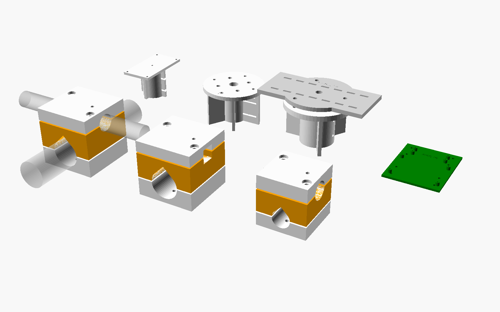

# 21 · Anclajes impresos al mástil, brazos y sensores

**Qué cambia en la v4:** las antenas y los sensores se sujetan con **crucetas impresas de tres piezas** atornilladas. Ya no hacen falta abrazaderas en U.
- **Cómo funciona una cruceta:** une dos tubos perpendiculares, que es el caso de todas las sujeciones de la estación:
  - mástil vertical ↔ brazo horizontal;
  - brazo ↔ antena;
  - brazo ↔ tubo corto vertical.
- **Ficheros:** `hardware/anclajes/anclajes_bricohams.scad`, con los STL en `hardware/anclajes/stl/`. Para regenerarlos, `tools/anclajes.sh`.

## 1. Cómo es una cruceta
| Pieza | Qué hace |
|---|---|
| **cuerpo** (naranja en la vista) | media caña arriba para el tubo A y media caña abajo, girada 90°, para el tubo B |
| **tapa A** y **tapa B** | las otras dos medias cañas. Cada una lleva **2 tornillos M6** inox que roscan en **tuercas cautivas** metidas en el cuerpo |

- **Apriete:** cada media caña es 1 mm menos profunda que el radio del tubo. Al apretar, el plástico abraza el tubo.
- **Antigiro:** un **tornillo autotaladrante inox de 4,8 mm** atraviesa cada tapa (agujero de Ø5,2) y muerde el tubo. Así el brazo no gira con el viento.

## 2. Piezas y tornillería
| Anclaje | STL | Une | Tornillería por anclaje |
|---|---|---|---|
| Mástil ↔ brazo Ø25 (×3 brazos: 1,7 m, 1,5 m y 0,2 m) | `cruceta_mastil_brazo_cuerpo` + `_tapa_brazo` + `_tapa_mastil` | Ø40 ↔ Ø25 | 4 × M6 × 50, 4 tuercas M6, 4 arandelas, 2 autotaladrantes 4,8 × 19 |
| Mástil ↔ boom de la quad | `cruceta_mastil_quad_cuerpo` + `_tapa_boom` + `_tapa_mastil` | Ø40 ↔ 20 × 20 | igual (M6 × 50 en el lado del mástil, M6 × 40 en el boom) |
| Brazo ↔ antena de fibra 433 | `cruceta_brazo_fibra_*` | Ø25 ↔ Ø26 (`FIBRA_D`) | 4 × M6 × 40, 4 tuercas y 4 arandelas |
| Brazo ↔ tubo corto vertical (ADS-B, GPS, Bigsignal, viento) | `cruceta_brazo_tubo_cuerpo` + 2 × `cruceta_brazo_tubo_tapa` | Ø25 ↔ Ø25 | igual |
| Base de la ADS-B sobre tubo Ø25 | `adsb_tapa_tubo` (sustituye a `adsb_tapa`) | tubo vertical Ø25 | 4 × M3 × 12 a la base y 2 prisioneros M5 al tubo |
| Anemómetro / veleta | `sensor_viento_brida` (×2) | tubo vertical Ø25 | 4 × M5 (brida Ø65, agujeros Ø6 en Ø47,1) **o** 4 × M4 (brida Ø80, agujeros Ø4,5 en Ø68), con tuerca cautiva, y 2 prisioneros M5 |
| Pluviómetro | `pluvio_vaso` + `pluvio_plataforma` | poste Ø40 | 3 × M5 × 40 con muelle (nivelación) y 3 × M3 en las ranuras |
| Pico «bricohams-io» | `pico_soporte` | rejilla de la caja v3 | 4 × M3 × 8 y 8 × M2 × 6 |

- **Material de las piezas:** ASA (o PETG con pintura acrílica para el sol), 6 perímetros, 50 % de relleno giroide y las tuercas cautivas encajadas a presión.
- **Material de los tubos:**
  - brazos: aluminio Ø25 × 1,5;
  - tubos cortos verticales: Ø25, de 300 mm;
  - poste del pluviómetro: Ø40, de 1 m.
- **Medidas a comprobar:**
  - el Ø real del tubo de tu antena de fibra (`FIBRA_D`);
  - la brida de tus sensores de viento (hay dos versiones; la pieza vale para las dos).
  - Si alguna no coincide, cambia el valor en el `.scad` y lanza `tools/anclajes.sh`.

## 3. Montaje paso a paso

### 3.1 Brazos en el mástil (antes de subirlo)
1. Mete las 4 tuercas M6 en los alojamientos hexagonales del cuerpo. Si cuesta, caliéntalas con el soldador.
2. Pon el cuerpo sobre el mástil con la `tapa_mastil` por detrás y aprieta un poco los 2 M6. A la altura del plano (esquema 11) todavía debe poder girar.
3. Mete el brazo Ø25 en la media caña de arriba, ponle la `tapa_brazo` y aprieta los 2 M6.
4. Orienta el brazo (rumbos del plan del mástil), aprieta del todo en cruz y taladra los antigiros a través de los agujeros de Ø5,2: un autotaladrante de 4,8 mm en cada tapa.
5. Pon un `tapon_brazo` en cada punta del brazo.

### 3.2 Antena de fibra 433 (Meshtastic)
1. En la punta O del brazo de 1,70 m, a 0,8 m del mástil, pon una `cruceta_brazo_fibra`: el brazo en la media caña de abajo y el tubo de la antena, vertical, en la de arriba.
2. Aprieta y pon el antigiro solo en la tapa del brazo, no en la antena.
3. Conecta el N con una funda `funda_n` y cinta autovulcanizante. Lleva el coaxial por el brazo hasta el mástil con bridas cada 20 cm.

### 3.3 Bigsignal 868 e iGate 433
- **Qué traen las Bigsignal:** sus propias abrazaderas para un tubo de Ø25–50.
- **Montaje:**
  1. En cada punta del brazo de 0,2 m (N y S) pon una `cruceta_brazo_tubo` con un **tubo corto vertical de 300 mm**.
  2. Sujeta la antena a ese tubo con sus abrazaderas.
- **Separación:** queda 1,6 m entre las dos (esquema 11).

### 3.4 Quad 2 m/70 cm
1. La `cruceta_mastil_quad` va a 0,95 m: el mástil en la media caña redonda y el **boom 20 × 20** en la cuadrada, a 500 mm detrás del reflector de 2 m (manual 12).
2. Gira el boom a **205°**, comprobándolo con la brújula del móvil sobre el boom.
3. Aprieta y pon los dos antigiros.

### 3.5 ADS-B 1090
1. En la punta E del brazo de 1,70 m pon una `cruceta_brazo_tubo` con un tubo corto vertical.
2. Monta la antena con el LNA dentro de la base (manual 14), pero usando la **`adsb_tapa_tubo`** en lugar de la `adsb_tapa`.
3. Encaja el vaso de la tapa en el tubo, aprieta los 2 prisioneros M5 y lleva el coaxial por fuera del tubo con bridas.

### 3.6 Anemómetro y veleta
1. En el brazo de 1,50 m, en las puntas N y S, pon una `cruceta_brazo_tubo` con un tubo corto vertical.
2. Encaja la `sensor_viento_brida` y fija el sensor con 4 tornillos, usando los agujeros que coincidan con su brida.
3. Pasa el cable por el agujero central, baja por dentro del tubo y sácalo por abajo.
4. En la **veleta**, gira la brida hasta que la marca **N** impresa mire al norte geográfico. Después aprieta los prisioneros.

### 3.7 Pluviómetro (en un poste aparte, no en el mástil)
1. Clava o fija un poste Ø40 de 1 m lejos de paredes y árboles. Encaja el `pluvio_vaso` y aprieta los 2 prisioneros M5.
2. Pon los 3 insertos M5 en el vaso (con el soldador) y 3 tornillos M5 × 40 con un muelle debajo de la `pluvio_plataforma`.
3. Atornilla el pluviómetro a las ranuras de la plataforma (M3).
4. Nivélalo con la burbuja del propio pluviómetro girando los 3 tornillos. Los muelles mantienen la posición.

## 4. Revisión
- **Cada 6 meses:** aprieta los M6 y mira que no haya grietas junto a las tuercas.
- **Si una pieza está decolorada o quebradiza:** reimprímela en ASA.
- **Vientos del mástil:** son de cable de acero con tensores (esquema 11). **No** se imprimen: soportan cerca de 1 kN.
