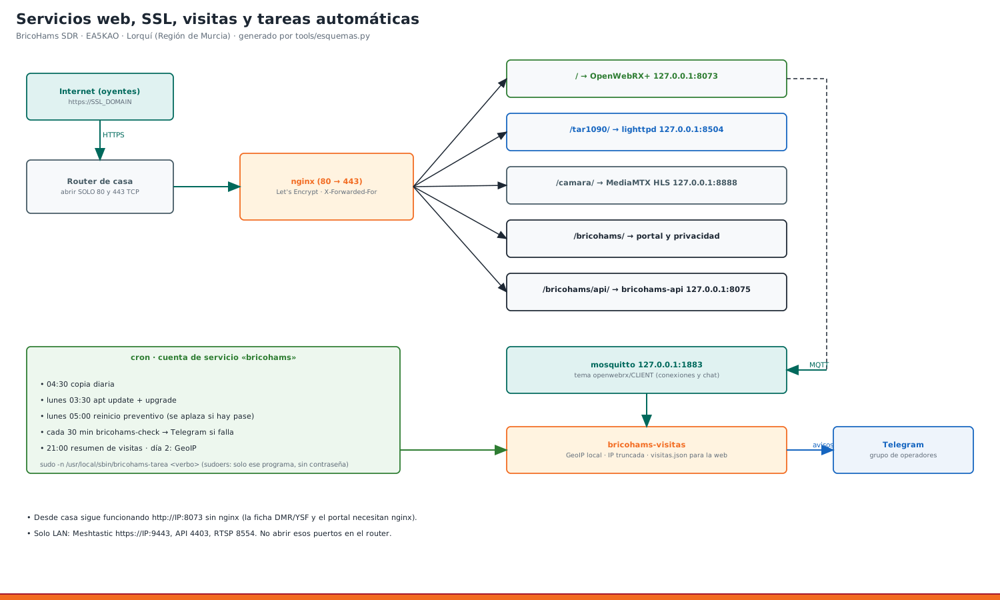

# 23 · Web con SSL, portal de servicios y cómo entrar a cada uno



**Qué cambia en la v4:** la estación se sirve por **https** con **nginx** delante de OpenWebRX+, con un certificado de **Let's Encrypt** que se renueva solo.
- **Dirección pública:** `https://<tu dominio>/`.
- **Desde casa:** `http://<IP>:8073/` sigue funcionando.

## 1. Qué necesitas
1. **Un dominio** que apunte a la IP de tu casa. Vale cualquiera de estos:
   - **uno propio** (por ejemplo `sdr.bricohams.es`), con un registro A hacia tu IP pública;
   - **DuckDNS, gratis:**
     1. Entra en https://www.duckdns.org con tu cuenta y crea por ejemplo `bricohams-sdr`.
     2. Copia el *token*.
     3. En `bricohams.env`, pon `DUCKDNS_DOMAIN="bricohams-sdr"` y `DUCKDNS_TOKEN="…"`. La Pi actualiza la IP cada 5 min.
2. **En el router:** reenvía los puertos **80 y 443 TCP** a la IP de la Pi. **No abras el 8073 ni el 9443.** Lo ideal es darle a la Pi una IP fija en el DHCP del router.
3. **En `bricohams.env`:**
   ```
   SSL_DOMAIN="bricohams-sdr.duckdns.org"    # o tu dominio
   SSL_EMAIL="tu@correo"                      # avisos de caducidad
   ```
4. **Aplica los cambios:**
   ```bash
   sudo bash install.sh --solo web,tareas
   ```

- **Qué hace el paso `web`:**
  - instala nginx y certbot;
  - pasa el mapa de aviones (lighttpd) al puerto 8504 local;
  - crea el portal `/bricohams/` y la página de privacidad;
  - arranca con un certificado autofirmado y pide el de Let's Encrypt.
- **Si Let's Encrypt falla** (el dominio aún no apunta o el puerto 80 está cerrado), se queda con el autofirmado y te avisa. Repite el paso cuando esté listo.

## 2. Direcciones
| Servicio | Desde Internet | Desde casa |
|---|---|---|
| Receptor OpenWebRX+ | `https://DOMINIO/` | `http://IP:8073/` |
| Portal con todos los servicios | `https://DOMINIO/bricohams/` | `https://IP/bricohams/` |
| Mapa de aviones tar1090 | `https://DOMINIO/tar1090/` | igual |
| Cámara del mástil (HLS) | `https://DOMINIO/camara/mastil/` | `http://IP:8888/mastil/` |
| Aviso de privacidad | `https://DOMINIO/bricohams/privacidad.html` | — |
| API de los plugins | `https://DOMINIO/bricohams/api/salud` | — |
| Meshtastic (web del nodo 868) | **no expuesto** | `https://IP:9443/` |
| RTSP de la cámara | no expuesto | `rtsp://IP:8554/mastil` |
| Admin de OpenWebRX+ | `https://DOMINIO/settings` (usuario admin) | igual |

**Para ver todo de un vistazo:**
```bash
bricohams-servicios      # estado y direcciones de cada servicio (no necesita sudo)
```

## 3. Seguridad
- **nginx:**
  - pasa la IP real del oyente a OpenWebRX+ (`X-Forwarded-For`), así funcionan los baneos del admin y las estadísticas;
  - añade HSTS y cabeceras básicas;
  - solo admite TLS 1.2 y 1.3.
- **Lo que solo escucha en `127.0.0.1`:** API, MQTT, tar1090 y HLS. Desde fuera solo se llega a ellos a través de nginx.
- **Renovación:** la hace el temporizador `certbot.timer`. Después recarga nginx (`/etc/letsencrypt/renewal-hooks/deploy/bricohams-nginx.sh`). `bricohams-check` avisa si quedan menos de 14 días.

## 4. Problemas típicos
| Síntoma | Arreglo |
|---|---|
| El navegador avisa de «no seguro» | certificado autofirmado: pon `SSL_DOMAIN` y repite `--solo web` |
| Let's Encrypt «Timeout during connect» | el puerto 80 no llega a la Pi: revisa el reenvío del router y el firewall |
| La web carga pero la cascada no se mueve | nginx sin websockets: `sudo nginx -t`; el bloque `location /` debe tener `Upgrade` |
| tar1090 da 502 | `systemctl status lighttpd`; tiene que escuchar en 127.0.0.1:8504 |
