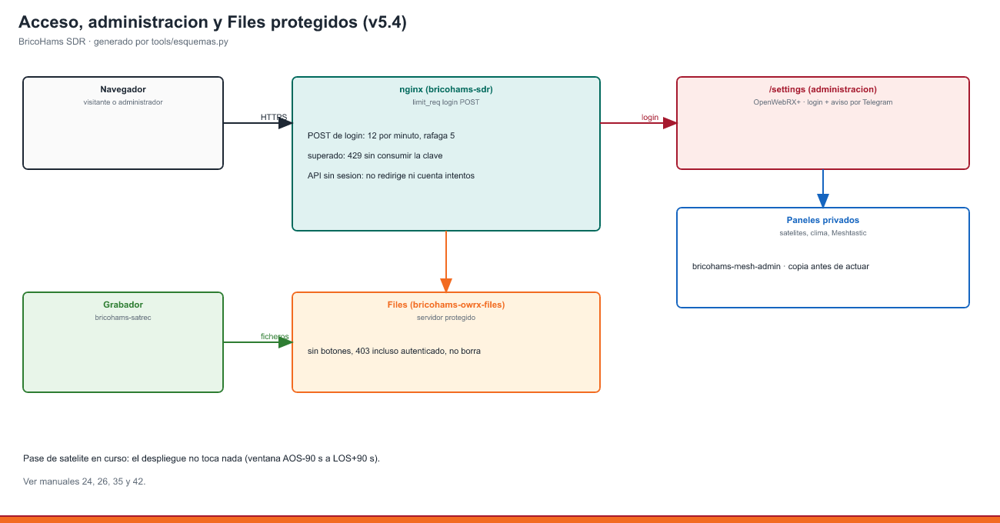

# 24 · Oyentes, estadísticas y avisos por Telegram

<!-- guia-visual:inicio -->
> **Ruta visual:** [Oyentes, Telegram y avisos](../GUIA_VISUAL_MODULOS.md#visitas).
> Consulta allí requisitos, ilustración, cuadro de instalación, comprobaciones y restauración.
> Los comandos de este manual se ejecutan en Bash en la Pi; revisa el backup antes de cambiarla.
<!-- guia-visual:fin -->

**Qué hace:**
- **Aviso por Telegram:** cada vez que alguien se conecta al SDR, el grupo de operadores recibe:
  > 🟢 **Nuevo oyente** 🇮🇹 Roma, Italia · `151.20.x.x` · 3 conectados
- **En la web:**
  - junto al nombre del receptor sale «👥 3 ahora 🇪🇸🇪🇸🇮🇹 · 1.234 visitas»;
  - al pulsarlo, un resumen por países de los últimos 30 días.
- **Identificación voluntaria:** la bienvenida del receptor permite compartir el
  indicativo/nombre con consentimiento explícito. El registro separado de visitas
  y Telegram no recibe esa identificación ni almacena la IP junto a ella; ver
  [manual 39](39_REGISTRO_OYENTES.md).

## 1. Cómo funciona (ADR-33)
1. **OpenWebRX+** publica cada conexión y desconexión, con la IP del oyente, en un **MQTT local** (mosquitto, solo 127.0.0.1). Hace falta `mqtt_enabled`, que el instalador activa con `VISITAS_ENABLE="yes"`.
2. **`bricohams-visitas`** recibe esos avisos:
   - calcula país y ciudad con una **base GeoIP local** (DB-IP City Lite, CC BY 4.0, actualizada cada mes). **La IP no se manda a ningún servicio externo.**
   - guarda en `/var/lib/bricohams/visitas.sqlite` solo la **IP truncada** (`83.45.x.x`), el país y la ciudad. **La IP completa no se escribe en disco.**
   - avisa por Telegram como mucho **una vez por IP cada 10 min**, para que no se repita en cada recarga. No avisa de las conexiones desde casa.
   - reenvía el **chat** de la web a Telegram (`VISITAS_CHAT`).
   - deja `visitas.json` para la web, **sin IPs**.
   - borra las visitas a los **90 días** (`VISITAS_DIAS`) y conserva solo los contadores diarios por país.
3. **Cron** (manual 25):
   - resumen diario a las 21:00;
   - estado del servidor cada seis horas (`CRON_ESTADO`, verbo `estado`);
     `salud` solo notifica fallos nuevos y recuperaciones, no un estado periódico;
   - actualización de la GeoIP el día 2 de cada mes.

## 2. Crear el bot y el grupo de Telegram
1. En Telegram, habla con **@BotFather** → `/newbot` → nombre (por ejemplo «BricoHams SDR») → copia el **token** (`123456:ABC…`).
2. Crea un **grupo privado** de operadores y añade el bot. Si es un canal, hazlo administrador.
3. Escribe cualquier cosa en el grupo y abre en el navegador `https://api.telegram.org/bot<TOKEN>/getUpdates`. Busca `"chat":{"id":-100…}`: ese número es el **chat id**.
4. Ponlos en `bricohams.env`. Ahí son secretos; no van nunca al git:
   ```
   TELEGRAM_TOKEN="123456:ABC…"
   TELEGRAM_CHAT_ID="-1001234567890"
   ```
5. Aplica y prueba:
   ```bash
   sudo bash install.sh --solo visitas,tareas
   bricohams-telegram "prueba desde la estación"
   ```
### Si los mensajes dejan de llegar (HTTP 400)
Si `journalctl -u bricohams-visitas` muestra `Telegram: HTTP Error 400: Bad Request`,
comprueba el motivo sin mostrar el token:

```bash
sudo bricohams-telegram "prueba"; journalctl -u bricohams-visitas -n 20 --no-pager
```

El caso más habitual es **«group chat was upgraded to a supergroup chat»**:
Telegram convierte el grupo en supergrupo (al hacerlo público, añadir
administradores o activar el historial) y le asigna un **chat id nuevo** que
empieza por `-100`. El antiguo deja de funcionar.

1. Haz una copia de `/etc/bricohams/*.env` (`sudo tar czf /var/backups/bricohams/pre-telegram.tar.gz /etc/bricohams/*.env`).
2. Obtén el id nuevo con `getUpdates` (punto 3) o en el campo `migrate_to_chat_id` del error.
3. Sincroniza el destino en el kit instalado, `/etc/bricohams/bricohams.env`,
   `telegram.env`, `visitas.env` y `api.env`. Reinicia `bricohams-visitas`,
   `bricohams-api` y `bricohams-login-aviso`: los procesos activos conservan su
   entorno anterior aunque el archivo ya esté corregido. No es necesario
   reiniciar OpenWebRX para corregir Telegram.
4. Prueba con `sudo bricohams-telegram "prueba"` y
   `sudo bricohams-tarea estado`. El emisor devuelve error si Telegram rechaza
   el mensaje y muestra el motivo sin el token; una cola aceptada no confirma entrega.

Los oyentes LAN no se notifican por defecto: para incluirlos usa
`VISITAS_AVISAR_LAN="yes"` en el kit y en `visitas.env`, y reinicia visitas.
Los avisos de sesión requieren `TG_AVISO_LOGIN="yes"` y un inicio de sesión
correcto nuevo; abrir Settings con una cookie existente no genera un inicio.
Se mantiene el límite de un aviso por IP cada diez minutos.

## 3. Privacidad
- **Por qué hay que avisar:** registrar IPs, aunque sea truncadas, y la localización es tratar datos personales. Por eso la web tiene un **aviso de privacidad** (`/bricohams/privacidad.html`, enlazado en la descripción del receptor y en el contador) que explica qué se guarda, para qué, cuánto tiempo y cómo ejercer los derechos.
- **Contacto:** el de `ADMIN_EMAIL`. Revisa el texto con tu club. Esto no es asesoramiento legal.
- **Si no quieres activar la bienvenida de identificación:** configura
  `VISITAS_ENABLE="no"`; también se desactivan las visitas, el contador y los avisos.
  El detalle del registro voluntario y su retención está en el [manual 39](39_REGISTRO_OYENTES.md).

## 4. Comandos
```bash
sudo -u openwebrx bricohams-visitas --estado     # lo que ve la web (sin IPs)
sudo -u openwebrx bricohams-visitas --resumen    # manda el resumen del día
sudo -u openwebrx bricohams-visitas --geoip      # descarga la base GeoIP del mes
journalctl -u bricohams-visitas -n 50
```

## 5. Bloquear a alguien
En `https://DOMINIO/clients` (OpenWebRX+, con el usuario admin), el admin ve las IPs completas de los conectados en ese momento y puede **banear**. Esa lista es de OpenWebRX+ y no se guarda en disco.

## 6. Moderador automático del chat (v5.1)
`bricohams-visitas` vigila el CHAT común de OpenWebRX+ y puntúa a cada IP:

| Motivo | Puntos |
|---|---|
| Intento de inyección (HTML/JS) | 10 |
| Palabra prohibida (`CHATBOT_PALABRAS`) | 4 |
| Enlace (si `CHATBOT_LINKS=no`) | 3 |
| Avalancha (más de `CHATBOT_MAX_MSG`=6 mensajes en `CHATBOT_VENTANA`=30 s) | 3 |
| Mensaje repetido | 2 |
| Mensaje largo (> `CHATBOT_MAX_LEN`=300) | 2 |

- Los puntos bajan 1 por minuto. Al llegar a `CHATBOT_UMBRAL` (10) la IP se banea 1 h con la jaula fail2ban `bricohams-chat`.
- Variables: `CHATBOT_ENABLE`, `CHATBOT_AVISAR` (aviso por Telegram), `CHATBOT_UMBRAL` y `CHATBOT_PALABRAS` (`a,b,c` o `@/ruta/fichero`).
- Registro en `/var/log/bricohams-chat/moderador.log`. Para ver el estado: `sudo -u openwebrx bricohams-visitas --moderador`.

## 7. Aviso de inicio de sesión
`bricohams-login-aviso` manda por Telegram cada inicio de sesión correcto en `/settings`, con la IP y la hora. No incluye el usuario, porque el registro de nginx no lo lleva. Una misma IP no repite aviso en 10 min. Se activa con `TG_AVISO_LOGIN=yes` en `bricohams.env`. Los intentos fallidos los gestiona fail2ban (ver [manual 34](34_BLINDAJE_SEGURIDAD.md)).

## 8. Registros de oyentes y mensajes de radio (v5.0)
Además de las visitas y el chat, el grupo de Telegram recibe:

| Aviso | Servicio | Clave en `bricohams.env` | Por defecto |
|---|---|---|---|
| 📝 Oyente registrado: indicativo (con enlace QRZ) o nombre | `bricohams-api` ([manual 39](39_REGISTRO_OYENTES.md)) | `OYENTES_TELEGRAM` | `yes` |
| 📻 Mensaje de **canal** Meshtastic 433/868 (canal, remitente, texto, SNR). Los mensajes **directos** nunca se reenvían | `bricohams-mesh-owrx` ([manual 35](35_LORA_APRS_MESHTASTIC.md)) | `MESH_TELEGRAM` | `yes` |
| 📡 Mensaje APRS recibido por LoRa 433 (RAK) o APRS-IS | `bricohams-rak-aprs` | `APRS_TELEGRAM` | `propios` |
| 📡 Mensaje APRS que decodifica OpenWebRX+ (2 m, tema MQTT `openwebrx/APRS`) | `bricohams-visitas` | `APRS_TELEGRAM` | `propios` |

`APRS_TELEGRAM`: `propios` = solo los dirigidos a la estación (`CALLSIGN`, `IGATE_CALLSIGN`, `RAK_CALLSIGN`, con cualquier SSID); `todos` = cualquier mensaje APRS oído (sin acuses ni telemetría); `no` = ninguno. Los mensajes enviados por nuestros propios indicativos no se avisan.

Todos usan el módulo común `bricohams_telegram.py` (`/usr/local/lib/bricohams`): cola con hilo propio, como mucho 20 avisos por minuto y servicio, sin repetidos en 5 minutos, HTML escapado y el token oculto en los errores. Para aplicar cambios:

```bash
sudo nano /etc/bricohams/bricohams.env         # OYENTES_TELEGRAM, MESH_TELEGRAM, APRS_TELEGRAM
sudo bash install.sh --solo web,visitas,lilygo,rak
journalctl -u bricohams-mesh-owrx -u bricohams-rak-aprs | grep telegram
```

## v5.4: agendas, avisos y acceso



sudo tools/desplegar-agenda-telegram.sh <kit-nuevo> <kit-instalado> actualiza agendas, avisos de login y paneles privados con copia previa en /var/backups/bricohams/ y restauración automática si falla; no actúa durante un pase protegido. Prueba: 	ests/test_agendas_admin.py, 	ests/test_login_rate.py (12 intentos/min, ráfaga 5, 429) y 	ests/test_files_protegidos.py (Files sin borrado, 403 incluso autenticado).