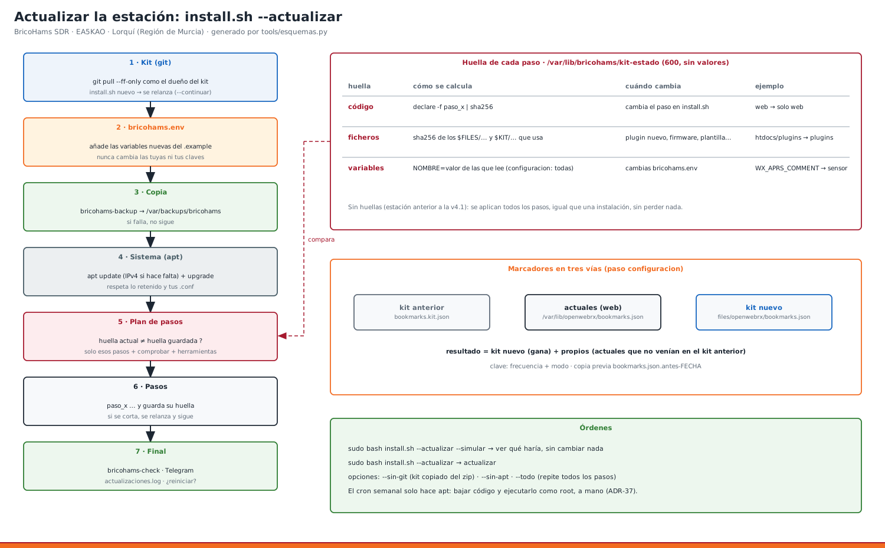

# 29 · Actualizar la estación: `install.sh --actualizar`

**Qué hace:** con una sola orden pone al día el kit (desde el git), el sistema (apt) y **solo** las partes de la estación que han cambiado. No pierdes usuarios, claves, marcadores propios ni datos.

```bash
cd ~/bricohams-sdr
sudo bash install.sh --actualizar --simular    # 1.º: ver qué haría, sin cambiar nada
sudo bash install.sh --actualizar              # 2.º: actualizar
```



## 1. Qué pasa, en orden
| # | Etapa | Detalle |
|---|---|---|
| 1 | **Kit** | `git pull --ff-only` en la carpeta del kit, como su dueño (p. ej. `aelm`), no como root. Enseña los commits nuevos. Si ha llegado un `install.sh` nuevo, **se vuelve a lanzar con él** y sigue (`--continuar`). |
| 2 | **`bricohams.env`** | Añade al final las **variables nuevas** del `bricohams.env.example`, con su valor por defecto y la marca `# >>> añadidas por install.sh --actualizar`. **Nunca cambia** las que ya tienes ni tus claves. |
| 3 | **Copia** | `bricohams-backup` en `/var/backups/bricohams/` antes de tocar nada. Si falla, no sigue. |
| 4 | **Sistema** | `apt update` (con el arreglo de IPv4 de la v3.2) y `apt upgrade`: respeta lo retenido (rtl-sdr-blog en Bookworm) y conserva tus ficheros de configuración. En Trixie mantiene coherente el rtl-sdr de Debian. Si OpenWebRX+ cambia de versión, vuelve a poner plugins y FT2. |
| 5 | **Pasos** | Repite solo los pasos cuya **huella** ha cambiado (ver §2), más `comprobar` y `herramientas`. |
| 6 | **Final** | `bricohams-check`, aviso por Telegram («🔄 Estación actualizada…»), apunte en `/var/lib/bricohams/actualizaciones.log` y aviso si hay que reiniciar. |

## 2. Cómo sabe qué pasos repetir (ADR-37)
Cada vez que un paso termina bien, el instalador guarda en `/var/lib/bricohams/kit-estado` (solo root, 600) tres huellas de ese paso:

| Huella | Cambia cuando… | Ejemplo |
|---|---|---|
| **código** | cambia la función `paso_x` de `install.sh` | se arregla el paso `web` → solo se repite `web` |
| **ficheros** | cambia (o aparece) un fichero del kit que el paso copia: sus rutas `$FILES/…` y `$KIT/…` | nuevo plugin en `files/htdocs/plugins/` → `plugins` |
| **variables** | cambia una variable de `bricohams.env` que el paso lee. `configuracion` las lee todas (settings.json) | cambias `WX_APRS_COMMENT` → `sensor` + `configuracion` |

- En el fichero solo hay huellas (resúmenes SHA-256 cortados), **nunca valores** de las variables.
- No hay que mantener ninguna tabla «fichero → paso»: sale sola del código de cada paso.
- La primera vez (estaciones instaladas antes de la v4.1, como la de EA5KAO con v3.3) no hay huellas: se aplican **todos** los pasos. Es igual que una instalación completa, pero sin perder nada.
- Si se corta a medias (luz, red), vuelve a lanzarlo: los pasos ya hechos tienen su huella y no se repiten.

## 3. Lo que se conserva
| Qué | Cómo |
|---|---|
| Usuarios de OpenWebRX (`users.json`) | no se toca |
| **Marcadores que añadiste desde la web** | unión en tres vías: marcadores del kit nuevo + los tuyos (los que no venían en el kit anterior, guardado en `/var/lib/bricohams/bookmarks.kit.json`; la primera vez, la copia del kit anterior en `/opt/bricohams/kit`). Si el kit corrige un marcador (nombre, tono), gana el kit. Copia previa: `bookmarks.json.antes-FECHA` |
| `settings.json` | sale de la plantilla + `bricohams.env`, como siempre. Lo que cambiaste en `/settings` de la web se pierde: copia previa en `settings.json.antes-FECHA`. **Haz los cambios en `bricohams.env`** |
| Claves, certificados SSL, visitas, lluvia, caché de indicativos | no se tocan |
| Tus cambios en la carpeta del kit | si chocan con el git, para y te dice `git stash` |

## 4. Opciones
| Orden | Para qué |
|---|---|
| `--simular` | Enseña commits pendientes, variables nuevas, paquetes y pasos. No cambia nada (solo refresca la lista de apt) |
| `--sin-git` | Sin red al git, o kit copiado a mano (zip). Usa el kit tal como está |
| `--sin-apt` | No actualiza paquetes del sistema |
| `--todo` | Repite todos los pasos aunque no hayan cambiado |
| `--solo io` (sin `--actualizar`) | Repetir un paso concreto, p. ej. cuando conectas la Pico después de instalar |

## 5. Si el kit no es un clon de git
1. Copia el zip nuevo **encima** de la carpeta del kit (tu `bricohams.env` no viene en el zip y no se pisa).
2. `sudo bash install.sh --actualizar --sin-git`.

Para pasar a git, una vez: `git clone <git-interno>/bricohams-sdr.git` y copia dentro tu `bricohams.env`.

## 6. Ejemplo de salida
```
==> Kit
  ✔ kit: 0f86175 → 3a1c9e2
    3a1c9e2 v4.1: install.sh --actualizar
==> Copia de seguridad
  ✔ copia de seguridad: /var/backups/bricohams/backup-openwebrx-2026-10-05.tar.gz
==> Sistema
  ✔ OpenWebRX+ 1.2.125 → 1.2.126 (se vuelven a aplicar plugins y FT2)
==> Pasos que hay que repetir
    comprobar      siempre
    configuracion  ficheros del kit
    plugins        OpenWebRX+ actualizado
    herramientas   código del paso, ficheros del kit
==> Actualización terminada
  ✔ kit: 0f86175 → 3a1c9e2 · pasos: comprobar configuracion plugins herramientas
```

## 7. ¿Y el cron?
La tarea semanal (`bricohams-tarea actualizar`, [manual 25](25_TAREAS_AUTOMATICAS.md)) **solo** actualiza paquetes. Bajar código del git y ejecutarlo como root se hace **a mano**, con alguien delante (ADR-37).

## 8. Problemas
| Mensaje | Qué hacer |
|---|---|
| `git pull no puede avanzar el kit` | `cd ~/bricohams-sdr && git status`. Si hay cambios tuyos: `git stash`, actualiza y luego `git stash pop` |
| `La rama del kit no sigue a ningún remoto` | `git -C ~/bricohams-sdr branch -u origin/main` |
| `La copia de seguridad ha fallado` | espacio en disco: `df -h /var` |
| Un paso falla | lee el error y `/var/log/bricohams-install.log`; arregla y vuelve a lanzar `--actualizar`: sigue desde ese paso |
