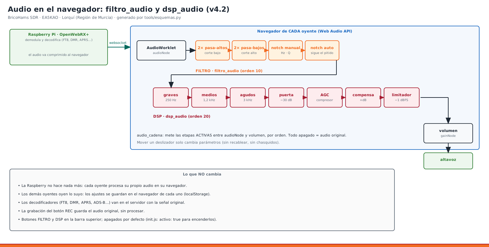

# 30 · Filtro de audio y DSP en el navegador (plugins `filtro_audio` y `dsp_audio`)

<!-- guia-visual:inicio -->
> **Ruta visual:** [Plugins, registro de oyentes, CTCSS y RepeaterBook](../GUIA_VISUAL_MODULOS.md#plugins).
> Consulta allí requisitos, ilustración, cuadro de instalación, comprobaciones y restauración.
> Los comandos de este manual se ejecutan en Bash en la Pi; revisa el backup antes de cambiarla.
<!-- guia-visual:fin -->



Desde la v4.2 hay dos botones nuevos en la barra superior del receptor, **FILTRO** y **DSP**. Los dos procesan el audio **en el navegador de cada oyente** (Web Audio API):
- **no cargan la Raspberry** ni cambian lo que oyen los demás;
- **no tocan los decodificadores** (FT8, DMR, APRS, ADS-B…), que trabajan en el servidor con la señal original;
- la **grabación** (botón REC) sigue guardando el audio original, sin procesar;
- cada oyente los enciende cuando quiere: sus ajustes se guardan en su navegador.

Salen **apagados** por defecto. El punto verde del botón indica que están encendidos.

## 1. Cómo funcionan por dentro
OpenWebRX+ reproduce el audio así: `AudioWorklet → volumen → altavoz`. El plugin **`audio_cadena`** (base común, sin botón) mete las etapas entre los dos, siempre en el mismo orden:

```
AudioWorklet ─► [FILTRO: 2×pasa-altos ─ 2×pasa-bajos ─ notch manual ─ notch automático]
             ─► [DSP: graves ─ medios ─ agudos ─ puerta de ruido ─ compresor/AGC ─ compensación ─ limitador −1 dBFS]
             ─► volumen ─► altavoz
```
- Si apagas una etapa, se quita del camino; con las dos apagadas, el audio es exactamente el original.
- Cambiar un deslizador no recablea nada: solo cambia el filtro, sin chasquidos.

## 2. FILTRO (`filtro_audio`)
| Control | Qué hace |
|---|---|
| **Filtro activo** | lo enciende o lo apaga |
| **Paso banda** | 24 dB/octava. Modos: **Voz SSB** 300–2700 Hz · **AM** 100–4500 · **CW** (tono 300–1500 Hz y ancho 50–1000 Hz) · **Digital** 200–3000 · **FM** 50–6000 · **Libre** (eliges los dos cortes) |
| **Notch automático** | busca el tono más fuerte y **estrecho** (portadora, heterodino, pitido) entre el corte bajo y 4 kHz, y lo quita. Necesita **2 detecciones seguidas** para moverse y lo suelta tras **2 s sin tono**, así no salta con la voz. Indica «quitando 1000 Hz» |
| **Notch manual** | quita un pitido fijo: frecuencia de 100 a 4000 Hz y estrechez Q 3–40 |
| **Espectro** | el audio de 0 a 4 kHz, con la zona que pasa sombreada, el notch manual en naranja y el automático en rojo |

**Probado en Chromium:** un pitido de 1 kHz baja unos **40 dB** (la prueba exige más de 20) y la voz alrededor no cambia (`tests/test_audio_navegador.py`).

## 3. DSP (`dsp_audio`)
| Control | Qué hace |
|---|---|
| **DSP activo** | lo enciende o lo apaga |
| **Preajustes** | **Plano** · **Voz clara** (SSB: menos graves, más presencia, AGC medio, puerta) · **AM radio** · **FM estrecha** · **DX débil** (AGC fuerte y medios realzados) |
| **Ecualizador** | graves 250 Hz, medios 1,2 kHz, agudos 3 kHz, ±12 dB |
| **Puerta de ruido** | baja 30 dB el soplido entre frases. Umbral en dBFS (−80 a −20). Abre en 5 ms y cierra tras 300 ms por debajo, con 3 dB de histéresis |
| **AGC** | sin AGC · suave (−24 dB, 3:1, +4 dB) · medio (−32 dB, 6:1, +8 dB) · fuerte (−42 dB, 12:1, +13 dB) |
| **Medidores** | nivel de entrada en dBFS, estado de la puerta y dB de compresión |
| **Limitador** | siempre al final, a −1 dBFS: el AGC nunca satura el altavoz |

Si mueves un control a mano, el preajuste se desmarca.

## 4. Consejos de uso
- **SSB en HF con pitidos:** FILTRO en *Voz SSB* + notch automático; DSP en *Voz clara*.
- **CW:** FILTRO en *CW*, tono igual al de tu BFO (p. ej. 700 Hz), ancho 200–300 Hz. DSP apagado o *Plano*.
- **AM de onda corta con desvanecimientos:** DSP en *AM radio* o *DX débil*.
- **FM de repetidores:** FILTRO en *FM* (quita zumbido y siseo alto), DSP en *FM estrecha*.
- **Escuchar modos digitales:** no hace falta nada: los decodificadores van en el servidor y no les afecta.

## 5. Configuración de los plugins
La instalación de `audio_cadena`, `filtro_audio` y `dsp_audio` está centralizada
en [manual 27](27_PLUGINS_WEB_V4.md#instalacion-plugins-propios). `init.js`
los carga en este orden:

```js
window.filtro_audio_config = { modo: 'voz', activo: false };   // valores iniciales para quien entra por primera vez
window.dsp_audio_config    = { preajuste: 'voz', activo: false };
// … 'audio_cadena', 'filtro_audio', 'dsp_audio' en la lista de plugins locales
```
- Para que salgan **encendidos** para todo el mundo, pon `activo: true`.
- Cada oyente guarda sus ajustes en su navegador (`localStorage`: `bh_filtro_audio`, `bh_dsp_audio`).
- Para volver a los valores de `init.js`, borra esos datos del sitio en el navegador.

## 6. Problemas
| Síntoma | Causa y arreglo |
|---|---|
| «El audio aún no ha empezado» | el navegador no deja sonar hasta el primer clic: pulsa en la página |
| No hay botones FILTRO/DSP | `Ctrl+F5`. En la consola del navegador (F12) busca `audio_cadena` |
| El notch automático no quita un pitido | el tono está por debajo del corte bajo o por encima de 4 kHz, o no es estrecho (por ejemplo, un zumbido con armónicos): usa el notch manual |
| El volumen sube y baja «respirando» | AGC demasiado fuerte para esa señal: prueba *suave* |
| Corta el principio de las palabras | umbral de la puerta muy alto: bájalo 5–10 dB o quita la puerta |

Decisión de diseño: ADR-41 en [ARQUITECTURA](../ARQUITECTURA.md).
