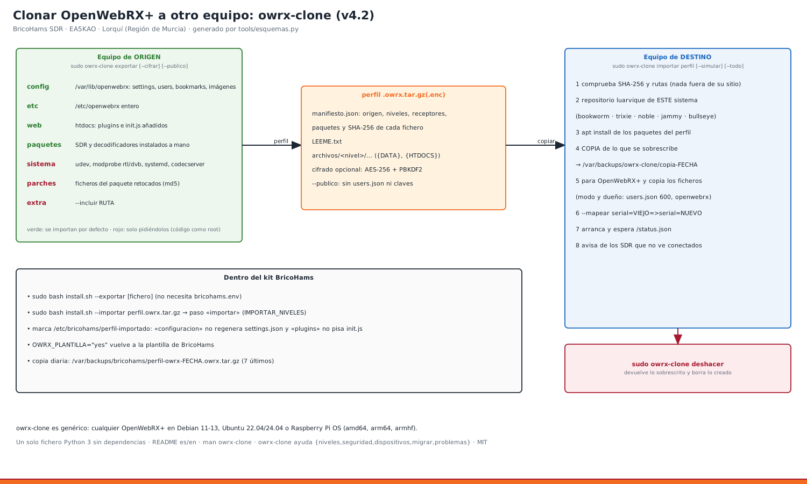

# 31 · Clonar una instalación de OpenWebRX+ a otro equipo (owrx-clone)

<!-- guia-visual:inicio -->
> **Ruta visual:** [Tareas, backups, limpieza, actualización y clonado](../GUIA_VISUAL_MODULOS.md#mantenimiento).
> Consulta allí requisitos, ilustración, cuadro de instalación, comprobaciones y restauración.
> Los comandos de este manual se ejecutan en Bash en la Pi; revisa el backup antes de cambiarla.
<!-- guia-visual:fin -->



**owrx-clone** (carpeta [`owrx-clone/`](../../owrx-clone/README.md) del kit) guarda en un solo fichero, el **perfil**, todo lo que hace única a una estación OpenWebRX+. Luego lo aplica en otro equipo:
- instala OpenWebRX+ si falta y los paquetes de SDR;
- copia cada fichero en su sitio con sus permisos;
- arranca el servicio y comprueba que responde.

Antes de tocar nada guarda una copia, y `owrx-clone deshacer` vuelve atrás.

Es **genérico**: vale para **cualquier OpenWebRX+** en Debian 11/12/13, Ubuntu 22.04/24.04 o Raspberry Pi OS, sea o no de BricoHams. Por eso tiene su propio README (en español y en inglés), página `man`, licencia MIT e instalador: se puede publicar tal cual para la comunidad.

## 1. Qué se copia: los niveles
| Nivel | Contenido | Al importar |
|---|---|---|
| `config` | `settings.json` (receptores, perfiles, nombre, ubicación, decodificadores, mapa…), `users.json`, `bookmarks.json`, imágenes de cabecera y el resto de `/var/lib/openwebrx` (sin las cachés eibi/receivers/repeaters/meshtastic) | por defecto |
| `etc` | `/etc/openwebrx` entero: `openwebrx.conf`, `openwebrx.conf.d`, `bands*.json`, `bookmarks.d`, `markers.d` | por defecto |
| `web` | todo lo **añadido** a la web (no viene en el paquete): `plugins/receiver/init.js`, plugins, temas | por defecto |
| `paquetes` | paquetes de SDR y decodificadores instalados a mano: `soapysdr-module-*`, `rtl-sdr`, `codecserver`, `wsjtx`, `dump1090`… (no los automáticos ni los `-dev`) | por defecto |
| `sistema` | `/etc/udev/rules.d`, los `/etc/modprobe.d` que hablan de rtl/dvb/sdr, `openwebrx.service.d` y `/etc/codecserver` | a petición |
| `parches` | ficheros **del paquete** openwebrx cambiados a mano: se detectan comparando con las sumas MD5 de dpkg. Ejemplo: el parche FT2 de BricoHams en `owrx/modes.py` | a petición, y solo con la **misma versión** |
| `extra` | lo que añadas al exportar con `--incluir RUTA` | solo con `--niveles extra` (no entra con `--todo`) |

«A petición» significa con `--niveles …` o con `--todo`. Esos niveles **ejecutan cosas como root** (reglas udev, código de OpenWebRX+), así que nunca entran sin pedirlo.

**Protecciones** (revisadas con una auditoría de seguridad independiente):
- **Rutas prohibidas:** ningún nivel, ni siquiera `extra`, escribe en `/etc/shadow`, `/etc/sudoers*`, `/root`, `/boot`, `/bin`, cron, systemd, PAM, `/etc/profile.d`, `ld.so` ni `~/.ssh`.
- **Directorio de datos:** solo se acepta el de este equipo o uno nuevo `/var/lib/openwebrx…` o `/srv/openwebrx…` del usuario `openwebrx`. Si no, la importación se para. La carpeta de datos sí puede ser un enlace puesto por el administrador (por ejemplo, a un USB).
- **`--todo`:** incluye `sistema` y `parches`, que ejecutan código como root. Úsalo solo con perfiles tuyos o de confianza.
- **Enlaces simbólicos:** nunca se escribe a través de uno, ni al importar ni al deshacer. Así el usuario `openwebrx` no puede desviar una escritura de root.
- **Copia previa:** se hace **después** de instalar los paquetes, para que guarde también lo que trae el paquete.
- **Si se corta a medias:** apunta lo que llevaba, vuelve a arrancar OpenWebRX+ y `deshacer` lo limpia.

## 2. Procedimiento: migrar una estación (paso a paso)
**En el equipo viejo:**
```bash
sudo owrx-clone exportar --cifrar -o estacion.owrx.tar.gz      # pide una contraseña (mín. 8)
owrx-clone ver estacion.owrx.tar.gz.enc                         # revisa receptores, niveles y avisos
```
Copia el fichero al equipo nuevo (`scp`, pendrive…). **Lleva contraseñas**: no lo dejes en sitios públicos.

**En el equipo nuevo** (sistema recién instalado, con Internet):
```bash
git clone <git-interno>/bricohams-sdr.git && cd bricohams-sdr/owrx-clone   # o copia la carpeta owrx-clone
sudo ./instalar.sh                                                           # /usr/local/bin/owrx-clone + man
sudo owrx-clone importar ~/estacion.owrx.tar.gz.enc --simular               # 1.º mira el plan
sudo owrx-clone importar ~/estacion.owrx.tar.gz.enc --todo                  # 2.º aplícalo
sudo owrx-clone comprobar
```
Abre `http://IP:8073/`: deben salir los mismos receptores, perfiles, marcadores, plugins e imágenes, y entras con **los mismos usuarios** de administración.

**Qué hace `importar`, en orden:**
1. **Verifica el perfil.** Comprueba el SHA-256 de cada fichero y que ninguna entrada salga de su carpeta. Si el perfil está cifrado, pide la contraseña.
2. **Pone el repositorio de luarvique** que corresponde a tu sistema, si falta OpenWebRX+:

   | Sistema | Repositorio |
   |---|---|
   | Debian 13 | `ppa/trixie` |
   | Debian 12 | `ppa/bookworm` |
   | Ubuntu 24.04 | `ppa/noble` |
   | Ubuntu 22.04 | `ppa/ubuntu` + el de OpenWebRX original |
   | Debian 11 | `ppa/debian` + el de OpenWebRX original |

3. **Instala los paquetes.** Los que no existan en tu sistema se avisan y se saltan.
4. **Guarda una copia** de lo que va a sobrescribir en `/var/backups/owrx-clone/copia-FECHA.tar.gz`.
5. **Copia los ficheros:**
   1. para OpenWebRX+;
   2. copia cada fichero con su modo (`users.json` 600) y su dueño (`openwebrx` en los datos);
   3. recarga udev y systemd si toca.
6. **Arranca y comprueba.** Arranca OpenWebRX+, espera a que `/status.json` responda y avisa de los SDR del perfil que no ve conectados.

## 3. Procedimiento: otros SDR en el equipo nuevo
OpenWebRX+ elige cada SDR por su número de serie (`"device": "serial=00000101"`).
```bash
SoapySDRUtil --find            # o rtl_test -t: series de los SDR conectados
sudo owrx-clone importar perfil.owrx.tar.gz --mapear "serial=00000101=>serial=12345678" --mapear "serial=00000102=>serial=87654321"
```
Otra opción: grabar la serie antigua en el SDR nuevo, con `rtl_eeprom -d 0 -s 00000101` (en BricoHams, `sudo bricohams-sdr-serials --grabar`, manual 03).

## 4. Procedimiento: compartir una configuración con la comunidad
```bash
sudo owrx-clone exportar --publico --niveles config,etc,web --nota "Perfiles HF/VHF de N0CALL para RTL-SDR V3" -o bh-publico.owrx.tar.gz
owrx-clone ver bh-publico.owrx.tar.gz          # comprueba «claves: quitados» y la lista de claves en blanco
```
- **Lo que quita `--publico`:** `users.json` entero, y deja en blanco toda clave de `settings.json` cuyo nombre tenga `pass`, `passcode`, `key`, `token` o `secret` (passcode APRS, claves de receiverbook y PSKreporter, magic key…).
- **Coordenadas:** las del receptor siguen dentro. Si no quieres publicarlas, cámbialas antes en Ajustes o edita el perfil.
- **Quien lo recibe** lo importa con `--simular` primero y luego rellena sus claves en Ajustes.

## 5. Procedimiento: volver atrás
```bash
sudo owrx-clone deshacer                     # la última importación
sudo owrx-clone deshacer /var/backups/owrx-clone/copia-20261005-120000.tar.gz   # una concreta
```
- **Qué devuelve:** cada fichero sobrescrito vuelve a como estaba, y borra los que la importación creó.
- **Qué no deshace:** los paquetes instalados se quedan.
- **La copia usada** se renombra a `.usada`.

## 6. Dentro del kit BricoHams
| Orden | Qué hace |
|---|---|
| `sudo bash install.sh --exportar [fichero]` | lo mismo que `owrx-clone exportar`. **No necesita `bricohams.env`**: vale en cualquier Pi con OpenWebRX+ |
| `sudo bash install.sh --importar perfil.owrx.tar.gz` | instala la estación BricoHams entera y, en el paso `importar` (antes de `tareas`), aplica el perfil con los niveles de `IMPORTAR_NIVELES` (por defecto `config,etc,web,paquetes`) |
| `sudo bash install.sh --solo importar --importar perfil.owrx.tar.gz` | solo aplicar el perfil en una estación BricoHams ya instalada |
| Copia diaria (cron, manual 25) | además de la copia de siempre, guarda `/var/backups/bricohams/perfil-owrx-FECHA.owrx.tar.gz` (retención local de cinco días, manual 09) |

**Tras importar, el instalador respeta el perfil.** Deja la marca `/etc/bricohams/perfil-importado`, y desde ese momento:
- **`configuracion`** ya no regenera `settings.json` ni los marcadores desde la plantilla de BricoHams;
- **`plugins`** conserva el `init.js` del perfil: los plugins de BricoHams quedan copiados, pero no se cargan;
- si `VISITAS_ENABLE` está activo, se enciende el informe MQTT en `settings.json`, porque las visitas lo necesitan;
- **`--actualizar`** sigue funcionando sin pisar lo importado.

Para volver a la configuración de BricoHams: `OWRX_PLANTILLA="yes"` en `bricohams.env` y `sudo bash install.sh --solo configuracion,plugins`.

## 6 bis. OpenWebRX+ en Docker (owrx-clone 1.1, v4.3)
Pon `--docker CONTENEDOR` delante de la orden (o `OWRX_CLONE_DOCKER`). En el kit lo hace solo el instalador cuando `OWRX_BACKEND="docker"`: `--exportar`, paso `importar` y copia diaria (manual 33).

```bash
sudo owrx-clone --docker owrx-mbe exportar -o desde-docker.owrx.tar.gz
sudo owrx-clone --docker owrx-mbe importar perfil.owrx.tar.gz --simular
sudo owrx-clone --docker owrx-mbe comprobar
```
| Nivel | En Docker |
|---|---|
| `config` | en la carpeta del equipo montada en `/var/lib/openwebrx` (la localiza `docker inspect`) |
| `etc` | en la montada en `/etc/openwebrx` |
| `web` | solo `htdocs/plugins` (la montada); lo demás de `htdocs` se salta con aviso |
| `paquetes` | no se instala nada: OpenWebRX+ va en la imagen, que queda apuntada en el perfil |
| `parches` | no se aplican (el código va en la imagen) |
| `sistema` | igual que en nativo: udev y modprobe son del equipo |

- **Sin volumen para `/etc/openwebrx` o `/var/lib/openwebrx`:** se para, porque se perdería al recrear el contenedor.
- **Directorio de datos:** tiene que ser `/var/lib/openwebrx` (el volumen).
- **Servicio:** se para y arranca el contenedor. `deshacer` sabe que fue en un contenedor.
- **Nativo ⇄ Docker:** los perfiles valen en los dos sentidos.

## 7. Formato del perfil
Un `tar.gz`, o ese mismo `tar.gz` cifrado con `openssl enc -aes-256-cbc -pbkdf2 -iter 200000` (empieza por `Salted__`). Dentro:

| Entrada | Contenido |
|---|---|
| `manifiesto.json` | formato, herramienta, fecha, origen (equipo, sistema, arquitectura, versión de OpenWebRX+, carpetas), niveles, receptores, paquetes, repositorios, avisos, nota y, por cada fichero: nivel, ruta, `sha256`, tamaño, modo, dueño |
| `LEEME.txt` | resumen para humanos |
| `archivos/<nivel>/…` | los ficheros. `{DATA}` es la carpeta de datos (`core.data_directory`) y `{HTDOCS}` la web del paquete: en el destino pueden estar en otro sitio |

## 8. Ayuda
```bash
owrx-clone --help
owrx-clone ayuda niveles | seguridad | dispositivos | migrar | docker | problemas
man owrx-clone
```
Las órdenes también existen en inglés (`export`, `show`, `import`, `undo`, `check`, `help`).

## 9. Problemas
| Mensaje | Qué hacer |
|---|---|
| `hace falta root` | `sudo owrx-clone …` |
| `sin repositorio de OpenWebRX+` | sistema no soportado: instala `openwebrx` a mano y usa `--niveles config,etc,web` |
| `parche para X y aquí hay Y` | iguala versiones (`apt install openwebrx=X`) o `--forzar-parches` (bajo tu responsabilidad), o deja fuera `parches` |
| `no cuadra con su suma SHA-256` | el fichero se dañó al copiarlo: vuelve a copiarlo |
| `contraseña equivocada` | perfil cifrado: escríbela cuando la pida o `OWRX_CLONE_CLAVE=…` |
| OpenWebRX+ no responde | `journalctl -u openwebrx -n 50` y `sudo owrx-clone comprobar` |
| Un SDR no aparece | desenchufa y enchufa (o reinicia): reglas udev y lista negra de `dvb_usb_rtl28xxu` |

Decisión de diseño: ADR-42 y ADR-45 (Docker) en [ARQUITECTURA](../ARQUITECTURA.md). Pruebas: `tests/test_owrx_clone.py` (exporta e importa estaciones simuladas, incluidos perfiles manipulados y maliciosos), `tests/test_owrx_clone_docker.py` y `tests/test_instalador_perfil.py`.
