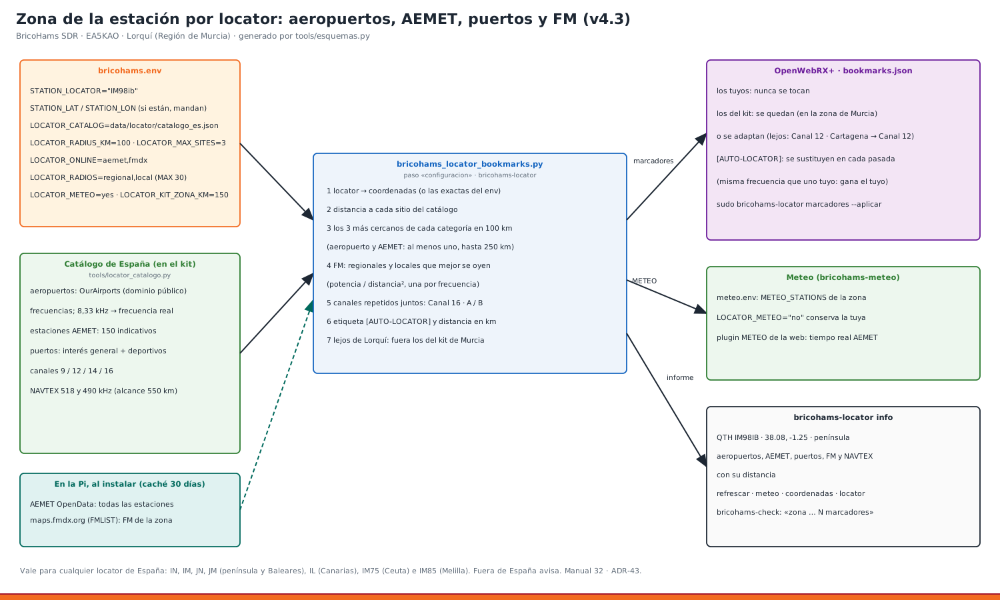

# 32 · Zona de la estación por locator: aeropuertos, AEMET, puertos y FM (v4.3)



El instalador sabe **dónde está la estación** por su locator Maidenhead (`STATION_LOCATOR`) o por sus coordenadas. Con eso elige, de un catálogo de toda España:

| Qué | De dónde | Qué sale |
|---|---|---|
| **Aeropuertos** y sus frecuencias (TWR, APP, GND, ATIS, AFIS, CTAF…) | OurAirports, dominio público. Los canales de 8,33 kHz se convierten a la frecuencia real: el canal 121,330 se escucha en 121,325 MHz | marcadores en AM |
| **Estaciones meteorológicas de AEMET** | 150 estaciones en el kit. Con `AEMET_API_KEY`, la Pi baja al instalar la lista completa (unas 800) con sus coordenadas exactas | `METEO_STATIONS` del plugin METEO |
| **Puertos** (de interés general y deportivos) | 48 puertos de la península, Baleares, Canarias, Ceuta y Melilla | canales VHF 9, 12, 14 y 16 en NFM. Un canal que se repite en varios puertos sale una sola vez: «⚓ Canal 12 · Vigo / Marín / Vilagarcía» |
| **Otras frecuencias de interés** | NAVTEX de A Coruña, Tarifa, Cabo de la Nao y Las Palmas, en 518 y 490 kHz, con 550 km de alcance | marcadores con el decodificador NAVTEX de OpenWebRX+ |
| **Emisoras de FM regionales y locales** | Se bajan en la Pi al instalar, de maps.fmdx.org (datos de FMLIST, el mismo servicio de FM-DX Webserver) | marcadores en WFM: las que mejor se oyen, una por frecuencia |

Todo lo generado lleva **`[AUTO-LOCATOR]`** en la descripción y la distancia en el nombre (`✈️ LEVX TWR · 7 km`). En cada pasada se quita y se vuelve a poner.

**Vale para cualquier locator de España:**

| Campo | Zona |
|---|---|
| `IN`, `IM`, `JN`, `JM` | península y Baleares |
| `IL` | Canarias |
| `IM75` | Ceuta |
| `IM85` | Melilla |

Fuera de España, avisa y sigue.

## 1. Configuración (bricohams.env)
```bash
STATION_LOCATOR="IM98ib"          # 4, 6, 8 o 10 caracteres
STATION_LAT="0.0"                 # si pones las coordenadas exactas, mandan sobre el locator
STATION_LON="0.0"
LOCATOR_CATALOG="data/locator/catalogo_es.json"   # vacío = desactivado
LOCATOR_RADIUS_KM="100"           # radio de búsqueda
LOCATOR_MAX_SITES="3"             # sitios más cercanos por categoría
LOCATOR_ONLINE="aemet,fmdx"       # "no" = solo el catálogo del kit
LOCATOR_RADIOS="regional,local"   # añade «nacional» si también quieres RNE, SER, COPE…
LOCATOR_RADIOS_MAX="30"
LOCATOR_METEO="yes"               # "no" = conserva tu METEO_STATIONS
LOCATOR_KIT_ZONA_KM="150"
```

**Reglas de las coordenadas:**
- Si `STATION_LAT`/`STATION_LON` están a 0, se usa el **centro** de la cuadrícula del locator. Con 6 caracteres es una celda de unos 9 × 5 km.
- Si las pones, **mandan** (son más precisas). Si no caen dentro del locator, el instalador avisa.
- Sin `STATION_LOCATOR` pero con coordenadas, el locator se calcula solo.

## 2. Procedimiento: primera instalación en cualquier sitio de España
1. Busca tu locator en un mapa de locators de QRZ o con `bricohams-locator locator LAT LON` (paso 4), o deja las coordenadas.
2. Edita `bricohams.env`: `STATION_LOCATOR="IN52pf"` (Vigo, por ejemplo) y tu `AEMET_API_KEY`.
3. Instala como siempre: `sudo bash install.sh`. En el paso **configuracion** verás el informe de la zona:
   ```
   QTH IN52PF · 42.22917, -8.70833 · península
   Aeropuertos (7)
        6.7 km  ✈️ LEVX TWR                118.4500 MHz am
   Estaciones meteorológicas (AEMET) (3)
        0.8 km  Vigo-O Castro             1496X
   …
   ```
4. En el paso **meteo**, `METEO_STATIONS` sale de las estaciones AEMET más cercanas.
5. Comprueba: `sudo bricohams-check` → «zona IN52PF: N marcadores de la zona».

## 3. Procedimiento: cambiar de sitio o de radio
```bash
nano bricohams.env                       # nuevo STATION_LOCATOR o LOCATOR_RADIUS_KM
sudo bash install.sh --solo configuracion,meteo
```
O, sin reinstalar nada, con la herramienta:
```bash
bricohams-locator info                   # qué hay cerca (sin sudo lee /etc/bricohams/zona.env, sin claves)
bricohams-locator info IL18qc            # …o de cualquier otro locator
sudo bricohams-locator refrescar         # vuelve a bajar AEMET y FM (caché de 30 días)
bricohams-locator marcadores             # enseña los que pondría
sudo bricohams-locator marcadores --aplicar   # los pone en OpenWebRX+ y lo reinicia (nativo o Docker)
bricohams-locator meteo                  # la METEO_STATIONS que saldría
bricohams-locator coordenadas IM98ib     # 38.062500 -1.291667
bricohams-locator locator 38.0823 -1.2535   # IM98ib
```

## 4. Qué pasa con los marcadores que ya tienes
| Marcadores | Qué se hace |
|---|---|
| **Los tuyos** (añadidos desde la web) | Nunca se tocan. Si uno tiene la misma frecuencia y modo que uno de la zona, gana el tuyo. |
| **Del kit, en la Región de Murcia** (a menos de `LOCATOR_KIT_ZONA_KM` de Lorquí) | Se quedan tal cual. Los de la zona se añaden donde no choquen. |
| **Del kit, lejos de Lorquí** | Se quitan los propios de Murcia: FM y DAB+ de Murcia, aeropuertos de Murcia y Alicante, repetidores y hotspots EA5, Radio Club. Los que solo llevaban el nombre de Murcia vuelven al genérico: «⛵ Canal 12 · Prácticos Cartagena» → «⛵ Canal 12», y «CB 32 · … · Radio Club» → «CB 32». El canal genérico cede su sitio al de los puertos de la zona. |
| **Genéricos** | CB, PMR446, satélites, modos digitales, 121,5, canal 16, AIS: no se tocan. |
| **`[AUTO-LOCATOR]` anteriores** | Se sustituyen. |

## 5. Datos que se bajan en la Pi (LOCATOR_ONLINE)
- **`aemet`:**
  - `GET /opendata/api/observacion/convencional/todas` con tu `AEMET_API_KEY` (la misma de la meteo, nunca va en la línea de órdenes).
  - Guarda indicativo, nombre y coordenadas de las estaciones que dan datos ahora mismo.
  - Sustituye a las 150 del kit.
- **`fmdx`:**
  - `GET https://maps.fmdx.org/api?qth=LAT,LON`: emisores de FM alrededor, de la base de FMLIST.
  - Se quedan los de España (`itu` = `E`) a menos de 150 km.
  - Se clasifican por el nombre:
    - **regional:** À Punt, Onda Regional, Canal Sur, Catalunya Ràdio, Radio Euskadi, Radio Galega, Aragón Radio, CMM, Onda Madrid, Canarias Radio, IB3, RTPA…;
    - **nacional:** RNE, SER, COPE, Onda Cero, Los40, Cadena 100…;
    - **local:** el resto.
  - De cada frecuencia queda la que mejor se oye: potencia / distancia².
- **Caché:** `/var/lib/bricohams/locator/{aemet,fmdx}.json`, 30 días.
  - **Sin red, sin clave o si el servicio cambia:** se avisa y se sigue con la caché o con el catálogo del kit. La instalación **nunca se para** por esto.
  - **Las FM de la caché solo valen si la estación no se ha movido** más de 25 km.

## 6. El catálogo del kit (data/locator)
| Fichero | Contenido |
|---|---|
| `fuentes/ourairports_es_*.csv` | aeropuertos de España con frecuencias (OurAirports) |
| `fuentes/aemet_estaciones.csv` | indicativo, nombre y coordenadas. Indicativos validados con la lista de estaciones convencionales; las coordenadas salen de OurAirports o son aproximadas (centro urbano) |
| `fuentes/puertos_es.csv` | puertos y canales |
| `fuentes/otros_es.csv` | NAVTEX con su alcance |
| `catalogo_es.json` | lo que usa el instalador. Se genera con `python3 tools/locator_catalogo.py` y `--comprobar` lo verifica en `run_tests.sh` |

- **Refrescar los aeropuertos desde OurAirports:** `python3 tools/locator_catalogo.py --bajar-ourairports`.
- **Catálogo propio** (otro país o tus frecuencias): un JSON con `records`. Cada uno lleva `category` (`airport`, `weather`, `port`, `radio`, `other`), `site_id`, `name`, `lat`, `lon` y, salvo `weather`, `frequency_hz` y `modulation`. Además:
  - `weather` lleva `station_id`;
  - `range_km` amplía el alcance de un registro.

  Ponlo en `LOCATOR_CATALOG`.

## 7. Límites (léelos)
- **Frecuencias de aeropuertos:** son las de OurAirports, que mantienen voluntarios. Alguna puede estar desactualizada (las dudosas lo dicen en la descripción). Las que valen son las del AIP de ENAIRE.
- **Canales de puerto:**
  - el 12 y el 14 son los habituales de operaciones portuarias, pero cada puerto publica los suyos;
  - el 16 es socorro y llamada;
  - los boletines de Salvamento Marítimo se anuncian en el 16.
- **FM:** la base de FMLIST la mantiene la comunidad DX. Una emisora pequeña puede faltar o haber cambiado.
- **Comunicaciones privadas:** no se añaden. El catálogo es de servicios de radiodifusión, aeronáuticos y marítimos que se pueden escuchar; escuchar no es divulgar (Ley 11/2022).

Decisiones: ADR-43 (zona por locator) y ADR-46 (datos en línea en la Pi) en [ARQUITECTURA](../ARQUITECTURA.md). Pruebas: `tests/test_locator_es.py` (895 puntos de toda España) y `tests/test_locator_bookmarks.py`.

## 8. Importar y exportar bookmarks (v5.0)
Está en **Ajustes → Bookmarks** (`/settings/bookmarks`). Hace falta sesión de administrador, y la página principal pública no cambia.

| Botón | Qué hace |
|---|---|
| **Importar desde fichero…** | Eliges un `.json` de tu ordenador (5 MB como máximo). Se comprueba en el navegador y te pide confirmación. Después da de alta los bookmarks uno a uno con el mismo formulario de OpenWebRX+ y recarga la página con el resultado. |
| **Exportar todos** | Baja `bookmarks-todos-AAAAMMDD-HHMM.json`. Incluye los del sistema y los de la zona por locator. |
| **Exportar editables** | Baja `bookmarks-editables-AAAAMMDD-HHMM.json`, solo con los tuyos (`/var/lib/openwebrx/bookmarks.json`). Es lo que conviene guardar como copia o llevar a otra estación. |

**Formato del fichero:** vale una lista JSON o un objeto `{"bookmarks": [...]}`. Cada bookmark lleva:
- `name` y `frequency` (en Hz), obligatorios;
- `modulation`, que tiene que ser un modo que exista en tu OpenWebRX+;
- opcionales: `underlying`, `description` y `scannable`.

Otros campos se ignoran.

```json
[{"name": "Repetidor R7", "frequency": 145775000, "modulation": "nfm", "description": "Ejemplo", "scannable": true}]
```

**Qué no se importa** (lo verás en el resumen):
- un bookmark idéntico a uno que ya existe;
- uno en una frecuencia que ya está ocupada. OpenWebRX+ guarda los bookmarks por frecuencia, así que no se pisa ninguno;
- uno con datos inválidos o un modo desconocido.

**Mantenimiento:**
- Lo pone `bricohams-owrx-bookmarks-io` y se repite solo tras cada `apt` (`/etc/apt/apt.conf.d/99bricohams-owrx-bookmarks-io`).
- Para quitarlo: `sudo bricohams-owrx-bookmarks-io --quitar && sudo systemctl restart openwebrx`.
- Prueba: `tests/test_bookmarks_io.py`.

## 9. Clave de la API de RepeaterBook (v5.0)

OpenWebRX+ puede pedir a RepeaterBook.com los repetidores cercanos para crear bookmarks automáticos. Desde marzo de 2026, RepeaterBook solo atiende clientes aprobados con token. El instalador deja el campo para introducir ese token en **Ajustes → General → RepeaterBook**. Esa página solo se abre con la contraseña de administrador; la página principal no cambia.

**Pasos**
1. Pide el token en <https://www.repeaterbook.com/api/token_request.php>, o créalo en tu cuenta → *API apps*. Cópialo nada más crearlo, porque RepeaterBook no vuelve a enseñarlo.
2. En `/settings/general` rellena **Receiver admin** con tu e-mail. RepeaterBook exige un e-mail de contacto dentro del User-Agent.
3. Pega el token en **RepeaterBook API key** y pulsa *Apply and save*.

**Comprobación**
Desde la Pi, cambiando `TOKEN`, `EMAIL` y `UA` por los tuyos:
```bash
curl -s -o /dev/null -w '%{http_code}\n' -H "X-RB-App-Token: TOKEN" \
  -A "UA" "https://www.repeaterbook.com/api/exportROW.php?country=Spain&frequency=145.6"
```
`200` significa que funciona.

**Respuestas habituales**

| Código | Significado | Qué hacer |
|---|---|---|
| `401 auth_missing` | No ha llegado ningún token. | Revisa que esté guardado en Ajustes. |
| `403 ua_mismatch` | El token es válido, pero el User-Agent no coincide con el aprobado para la aplicación del token. | Consulta en RepeaterBook (*API apps*) el patrón aprobado. No reintentes sin corregirlo: RepeaterBook puede bloquear el token. |
| `429` | Límite de peticiones. | Espera. OpenWebRX+ guarda la lista en `/var/lib/openwebrx/repeaters.json` y solo la renueva semanalmente o al cambiar de ubicación. |

OpenWebRX+ 1.2.x envía la cabecera `Authorization: Bearer <token>` y el User-Agent `OpenWebRX/<versión> (https://fms.komkon.org/OWRX/; <Receiver admin>)`. Si tu aplicación aprobada usa otro User-Agent, la petición fallará con `ua_mismatch` hasta que RepeaterBook apruebe ese patrón.

**Quitar el campo:** `sudo bricohams-owrx-repeaterbook --quitar`. La clave guardada en `settings.json` no se borra.

## 10. Subtono CTCSS en los bookmarks (v5.0)

Muchos repetidores FM analógicos solo abren con su subtono CTCSS. Si el receptor no lo filtra, en la misma frecuencia se oye ruido, portadoras o el repetidor vecino. El parche `bricohams-owrx-ctcss` añade el subtono al bookmark y un silenciador por subtono en el demodulador FM de OpenWebRX+.

**Dónde se configura.** Solo en **Ajustes → Bookmarks** (`/settings/bookmarks`), con sesión de administrador.
- Aparece la columna **«Subtono FM»**, con un desplegable de los 50 tonos EIA (67,0 – 254,1 Hz) y la opción «sin subtono».
- El valor se valida en el servidor: solo se aceptan tonos entre 60 y 260 Hz.
- Si la modulación no es FM, el tono se anula.
- El tono se guarda como campo `ctcss` (en Hz) en `/var/lib/openwebrx/bookmarks.json`.

**Qué ve el oyente.** La página principal no gana ningún ajuste nuevo.
- Al sintonizar un bookmark con subtono, el silenciador se activa solo.
- El panel muestra un selector **«Subtono FM»** para escuchar con otro tono. Ese cambio afecta solo a la sesión de ese navegador y no se guarda.
- En toda la interfaz el modo se llama **FM**; internamente OpenWebRX+ lo llama `nfm`.

**Solo frecuencia de salida.** El SDR solo recibe. Por eso el bookmark lleva la frecuencia de **salida** del repetidor (la que tú escuchas) y su subtono. El desplazamiento y la frecuencia de entrada no se guardan en el bookmark; si acaso, se anotan en la descripción.

**Cómo funciona el silenciador** (`owrx/bricohams_ctcss.py`, numpy + scipy). Se inserta en la cadena FM entre la de-énfasis y el AGC, y solo cuando hay tono.
1. Filtra la señal con un paso-banda de 55–280 Hz y la diezma a unos 1200 Hz.
2. Cada 0,1 s analiza una ventana Hann de 1 s y mide la energía en los 50 tonos EIA.
3. Abre si el tono pedido supera el umbral **y** es claramente el más fuerte (×2 sobre cualquier otro tono estándar). Así no abre con un repetidor vecino que usa otro tono.
4. Cierra si la energía cae por debajo del umbral de cierre durante 0,4 s.
5. Con el silenciador abierto aplica un paso-alto de 300 Hz, de modo que el subtono no se oye. Cerrado, emite silencio. La ganancia sube y baja en rampa para evitar chasquidos.

Con tono 0, el módulo se retira de la cadena y OpenWebRX+ queda exactamente como el original.

**Mantenimiento.**
- Modifica cinco ficheros de OpenWebRX+: `bookmarks.py`, el controlador de bookmarks, `BookmarkTable.js`, `index.html` y `dsp.py`.
- Las líneas añadidas llevan la marca `#@BH-CTCSS@` (o `<!--#@BH-CTCSS@-->` en el HTML).
- Se reaplica tras cada `apt` (`/etc/apt/apt.conf.d/99bricohams-owrx-ctcss`).
- Para quitarlo: `sudo bricohams-owrx-ctcss --quitar && sudo systemctl restart openwebrx`. El campo `ctcss` que ya está en `bookmarks.json` no estorba a OpenWebRX+ original.
- Dependencias: `python3-numpy` y `python3-scipy`, que instala `install.sh`. Si faltan, OpenWebRX+ sigue funcionando pero el silenciador no actúa; lo verás en el registro como `bricohams ctcss: no se pudo aplicar el subtono`.
- Prueba: `tests/test_ctcss_patch.py`. Comprueba el parche sobre copias de los ficheros y el detector con tonos sintéticos: abre con el tono correcto, no abre con un tono vecino ni con ruido.

## 11. Importar repetidores de RepeaterBook (v5.0)

En **Ajustes → Bookmarks** aparece el botón **«Importar repetidores (RepeaterBook)…»**. Necesitas la clave de la §9 y sesión de administrador.

**Búsqueda**

| Campo | Significado |
|---|---|
| País | Nombre en inglés tal como lo usa RepeaterBook (`Spain`, `Portugal`, `United States`…). |
| Distrito | En España, el número de distrito del indicativo, EA1 a EA9. Por ejemplo, **5** = Comunidad Valenciana y Murcia. Se traduce a las comunidades autónomas que RepeaterBook escribe en «Region». |
| Bandas | 10 m, 6 m, 4 m, 2 m, 70 cm, 23 cm (por defecto 2 m y 70 cm). |
| Texto | Filtra por indicativo, población o notas. |
| Solo activos | Descarta los marcados como fuera de servicio. |

**Vista previa.** Antes de crear nada aparece una tabla para elegir qué repetidores importar. Cada fila lleva:
- la frecuencia de **salida**, que es lo que se guarda;
- el subtono, tomado de TSQ o, si no hay, de PL;
- una descripción con indicativo, población, entrada y desplazamiento;
- la marca **«ya existe»** si esa frecuencia ya tiene bookmark. OpenWebRX+ guarda un bookmark por frecuencia, así que no se pisa ninguno.

Solo se proponen repetidores FM analógicos. Los DMR, D-STAR, C4FM o NXDN se descartan: OpenWebRX+ los demodula aparte y no usan CTCSS.

**Importar.** Los repetidores marcados se crean uno a uno con la API del propio editor (`POST /settings/bookmarks`), en modo FM y con su subtono.

**Asignar subtonos a bookmarks existentes.** El botón **«Asignar subtonos»** (`POST /settings/bookmarks/repeaterbook/tonos`) recorre tus bookmarks FM y busca en RepeaterBook los repetidores con esa misma frecuencia de salida en el distrito elegido.
- Si todos coinciden en un único tono, lo asigna.
- Si hay varios tonos posibles, usa el indicativo que aparezca en el nombre del bookmark para decidir.
- Si no puede decidir, no toca el bookmark.
- Por defecto no sobrescribe un tono ya puesto.

**Caché y límites.**
- La descarga de cada país se guarda en memoria durante 6 h.
- La casilla «refrescar» fuerza una descarga nueva; úsala poco, porque RepeaterBook limita las peticiones (`429`).
- Los errores `401`, `403 ua_mismatch` y `429` se muestran tal cual; su significado está en la §9.

**Mantenimiento.**
- Es el módulo `owrx/controllers/settings/bricohams_rbimport.py`, copiado desde `/usr/local/share/bricohams-rbimport/`.
- Añade dos rutas a `owrx/http.py`, marcadas con `#@BH-RBI@`.
- Añade un bloque en `htdocs/settings/bookmarks.html`, entre `<!-- bricohams-rbi -->` y `<!-- /bricohams-rbi -->`. Si una versión futura de la plantilla no tiene el punto de anclaje esperado, el bloque se inserta antes de `</body>`.
- Se reaplica tras cada `apt` (`99bricohams-owrx-rbimport`). Para quitarlo: `sudo bricohams-owrx-rbimport --quitar`.
- Prueba: `tests/test_rbimport.py`.