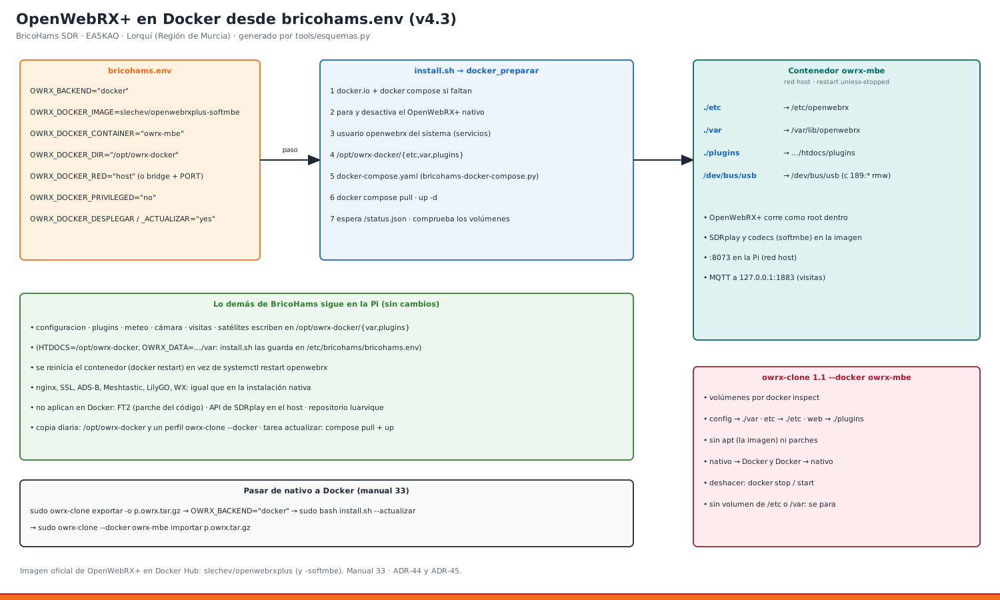

# 33 · OpenWebRX+ en Docker (v4.3)



Con `OWRX_BACKEND="docker"` el instalador **no instala el paquete** de OpenWebRX+: despliega la imagen oficial de Docker Hub, `slechev/openwebrxplus` (o `-softmbe`, con DMR, D-Star, YSF, NXDN…), con un `docker-compose.yaml` que sale de `bricohams.env`. Lo demás de BricoHams se queda en la Pi y trabaja igual, porque las carpetas del contenedor son carpetas de la Pi:

| En la Pi (`OWRX_DOCKER_DIR`) | En el contenedor | Lo usan |
|---|---|---|
| `/opt/owrx-docker/etc` | `/etc/openwebrx` | `configuracion` (`openwebrx.conf.d`), owrx-clone `etc` |
| `/opt/owrx-docker/var` | `/var/lib/openwebrx` | `settings.json`, `users.json`, `bookmarks.json` (y los de la zona, manual 32), imágenes |
| `/opt/owrx-docker/plugins` | `/usr/lib/python3/dist-packages/htdocs/plugins` | plugins de BricoHams y los ficheros que escriben meteo, cámara, visitas, satélites, ventiladores |
| `/dev/bus/usb` | `/dev/bus/usb` | los SDR, con conexión en caliente (regla `c 189:* rmw`) |

**Por qué querrías Docker:**
- probar otra versión de OpenWebRX+ sin tocar el sistema;
- volver atrás cambiando la etiqueta de la imagen;
- usar la imagen con codecs digitales (`softmbe`);
- tener OpenWebRX+ igual en la Pi y en un PC.

**Lo que pierdes:** FT2 (es un parche al código del paquete, manual 28).

## 1. Variables (bricohams.env)
```bash
OWRX_BACKEND="docker"
OWRX_DOCKER_DIR="/opt/owrx-docker"
OWRX_DOCKER_CONTAINER="owrx-mbe"
OWRX_DOCKER_IMAGE="slechev/openwebrxplus-softmbe:latest"   # o slechev/openwebrxplus:latest
OWRX_DOCKER_RED="host"            # host (recomendado) · bridge
OWRX_DOCKER_PORT="8073"           # solo en bridge
OWRX_DOCKER_PRIVILEGED="no"       # yes si un SDR (p. ej. SDRplay) no aparece
OWRX_DOCKER_DESPLEGAR="yes"       # no = usa un contenedor tuyo ya creado
OWRX_DOCKER_ACTUALIZAR="yes"      # docker compose pull al instalar y en la tarea semanal
```
**Sin contraseñas en el compose.** El administrador se crea dentro del contenedor (te lo pide el instalador):
```bash
sudo docker exec -it owrx-mbe openwebrx admin adduser admin
```

## 2. Procedimiento: instalación nueva con Docker
1. Prepara la Pi como siempre (manuales 01 y 02) y pon `OWRX_BACKEND="docker"` en `bricohams.env`.
2. `sudo bash install.sh`. En el paso **openwebrx** el instalador:
   1. instala `docker.io` y `docker-compose` de Debian si faltan;
   2. para y desactiva el OpenWebRX+ nativo si lo hubiera (los dos quieren el 8073 y los SDR);
   3. crea el usuario de sistema `openwebrx`: los servicios de BricoHams en la Pi corren con él;
   4. crea `/opt/owrx-docker/{etc,var,plugins}` y escribe `docker-compose.yaml` (`files/bin/bricohams-docker-compose.py`);
   5. `docker compose pull` y `docker compose up -d`;
   6. espera a que responda `/status.json`;
   7. comprueba que los tres volúmenes apuntan a `OWRX_DOCKER_DIR`. Si no, se para: lo que no está en un volumen se pierde al recrear el contenedor.
3. Los pasos siguientes escriben en esas carpetas y reinician el contenedor (`docker restart`) en vez de `systemctl restart openwebrx`.
4. Comprueba:
   ```bash
   sudo bricohams-check                       # contenedor, imagen, web, admin
   sudo owrx-clone --docker owrx-mbe comprobar   # volúmenes y plugins
   bricohams-servicios                        # «● Docker» en el receptor
   ```

**Pasos que cambian:**

| Paso | Con Docker |
|---|---|
| `comprobar` | no necesita el repositorio de luarvique |
| `sdrplay` | la API va dentro de la imagen (si el RSP no aparece: `OWRX_DOCKER_PRIVILEGED="yes"`) |
| `ft2` | se salta con aviso |
| `rtlsdr` | igual: la lista negra del módulo DVB es del sistema |
| `web`, `adsb`, `meshtastic`, `lilygo`, `visitas`… | igual. Con la red `host` el MQTT de las visitas sigue en 127.0.0.1 |

## 3. Procedimiento: pasar una estación nativa a Docker (sin perder nada)
```bash
sudo owrx-clone exportar -o /root/estacion.owrx.tar.gz          # 1. foto de la nativa
nano bricohams.env                                               # 2. OWRX_BACKEND="docker"
sudo bash install.sh --actualizar                                # 3. contenedor y todos los pasos que escriben en OpenWebRX+
sudo owrx-clone --docker owrx-mbe importar /root/estacion.owrx.tar.gz --simular   # 4. mira el plan
sudo owrx-clone --docker owrx-mbe importar /root/estacion.owrx.tar.gz             # 5. tus receptores, usuarios y marcadores
```
- **Lo que no cabe en Docker:** lo de la web que no esté en `plugins/` y los `parches`. owrx-clone lo dice y lo salta.
- **Por qué `--actualizar` y no solo tres pasos:** meteo, cámara, sensores, ventilación, satélites y visitas también escriben en las carpetas de OpenWebRX+. Su huella incluye `OWRX_BACKEND` y `OWRX_DOCKER_DIR`, así que `--actualizar` los repite solos. Vale también `sudo bash install.sh` entero.
- **Volver a nativo:**
  1. `sudo owrx-clone --docker owrx-mbe exportar -o p.owrx.tar.gz`;
  2. `OWRX_BACKEND="native"`;
  3. `sudo bash install.sh --actualizar`. El paso `openwebrx` para el contenedor y le quita el arranque automático; sus carpetas se quedan;
  4. `sudo owrx-clone importar p.owrx.tar.gz`.

## 4. Procedimiento: usar un contenedor que ya tienes
1. Pon `OWRX_DOCKER_DESPLEGAR="no"` y en `OWRX_DOCKER_CONTAINER` el nombre de tu contenedor.
2. El instalador solo comprueba que está en marcha y que monta `/etc/openwebrx`, `/var/lib/openwebrx` y `…/htdocs/plugins` en `OWRX_DOCKER_DIR/{etc,var,plugins}`.

También vale `OWRX_DOCKER_DESPLEGAR="yes"` sin `docker-compose.yaml` en `OWRX_DOCKER_DIR`: si el contenedor ya existe, se usa tal cual.

## 5. Mantenimiento
| Qué | Cómo |
|---|---|
| Actualizar la imagen | sola, en la tarea semanal (`bricohams-tarea actualizar`: `compose pull` + `up -d`), o a mano: `cd /opt/owrx-docker && sudo docker compose pull && sudo docker compose up -d` |
| Fijar una versión | `OWRX_DOCKER_IMAGE="slechev/openwebrxplus-softmbe:1.2.xxx"` y `sudo bash install.sh --solo openwebrx` |
| Registro | `sudo docker logs -f owrx-mbe` |
| Copia diaria | `/var/backups/bricohams` guarda `docker-compose.yaml` y las tres carpetas; además un perfil `owrx-clone --docker` (7 últimos) |
| Series de los SDR | `sudo bricohams-sdr-serials --grabar` para también el contenedor |
| Cambiar de red | `OWRX_DOCKER_RED="bridge"` + `OWRX_DOCKER_PORT`. Pierdes el MQTT de visitas (127.0.0.1 es el propio contenedor) |

## 6. Problemas
| Síntoma | Qué hacer |
|---|---|
| `Falta el volumen Docker persistente '/etc/openwebrx'` | tu contenedor no lo monta: recréalo con los volúmenes (apartado 1) o deja que lo cree el kit |
| `El mount Docker de … apunta a '…'` | `OWRX_DOCKER_DIR` no es la carpeta de tu compose: corrígela |
| Un SDR no aparece | desenchufa y enchufa. Si sigue: `OWRX_DOCKER_PRIVILEGED="yes"` y `sudo bash install.sh --solo openwebrx` |
| El 8073 está ocupado | queda un OpenWebRX+ nativo: `sudo systemctl disable --now openwebrx` (el instalador ya lo hace) |
| `No pude bajar la imagen` | sin Internet o Docker Hub caído: sigue con la que haya. Si no hay ninguna, repite con red |
| Bookworm: `docker-compose` antiguo | el compose usa el formato 2.4, que entienden `docker-compose` 1.29 y `docker compose` 2.x |

Decisiones: ADR-44 (Docker desde `bricohams.env`) y ADR-45 (owrx-clone con Docker) en [ARQUITECTURA](../ARQUITECTURA.md). Pruebas: `tests/test_instalador_docker.py` (despliegue con un Docker de mentira y `docker compose config`) y `tests/test_owrx_clone_docker.py`.
