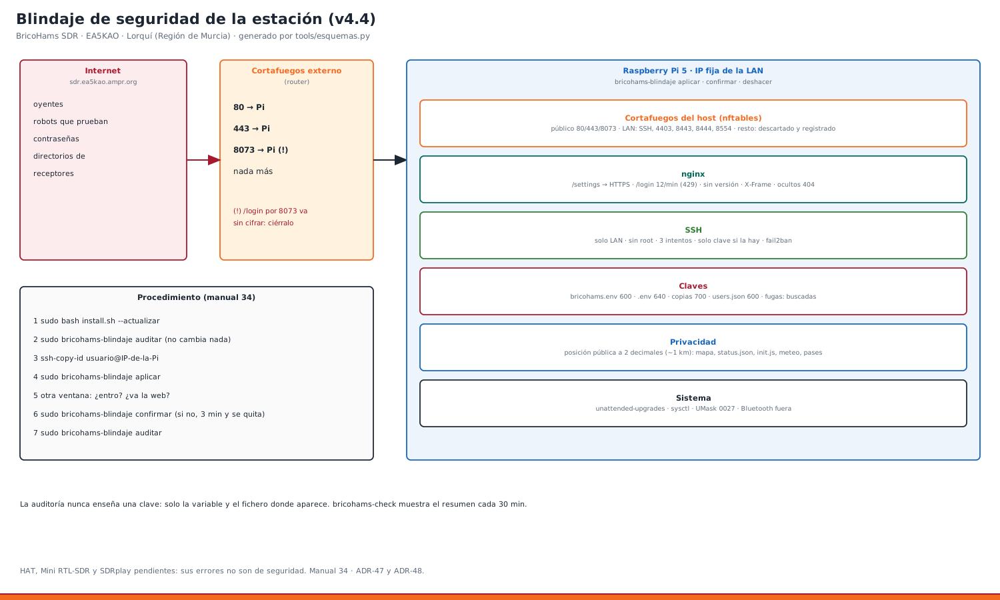

# 34 · Blindaje de seguridad de la estación (v4.4)



La estación está en Internet: `sdr.ea5kao.ampr.org`, con **80, 443 y 8073** abiertos en el cortafuegos externo (el router). `bricohams-blindaje` revisa la Pi y cierra lo que pueda filtrar información o dejar entrar a alguien. Hace dos cosas:

- **`auditar`:** no cambia nada. Dice qué está expuesto y cómo arreglarlo, con una nota de 0 a 100. **Nunca enseña una clave**: solo el nombre de la variable y el fichero donde aparece.
- **`aplicar`:** aplica lo que se puede hacer solo, con copia de lo que cambia y vuelta atrás automática del cortafuegos.

## 1. Qué mira la auditoría
| Apartado | Qué comprueba |
|---|---|
| Sistema | actualizaciones pendientes, actualizaciones de seguridad automáticas, reinicio pendiente |
| Cuentas | cuentas sin contraseña, usuario `pi`, **sudo sin contraseña** (el `010_pi-nopasswd` que pone Raspberry Pi Imager) |
| SSH | root por contraseña, contraseña frente a clave, intentos por conexión, X11 |
| Puertos | qué escucha en la red y si hay cortafuegos en la Pi; MQTT (1883), API (8075) y tar1090 (8504) solo en 127.0.0.1 |
| OpenWebRX+ | **8073 abierto a Internet** (ahí `/login` va sin cifrar); permisos de `settings.json`/`users.json`; **posición exacta publicada** (settings, `init.js`, `meteo.json`, `pases.json`); correo en `/status.json` |
| Web | versión de nginx, límite de intentos en `/login`, que `http://…/settings` redirija a HTTPS, caducidad del certificado |
| Claves | permisos de `bricohams.env` (en `/etc` y en el kit), de los `.env` de servicios, de las copias, de `mediamtx.yml` y `rbfeeder.ini`; **`bricohams.env` dentro del git**; **valores de tus claves en ficheros que lee cualquiera** (web, kit, `/etc`) |
| Servicios | telnet, FTP, Samba, rpcbind, CUPS, VNC, Bluetooth; fail2ban |
| Núcleo | redirecciones ICMP, rp_filter, syncookies, kptr/dmesg, enlaces protegidos |
| Hardware | recuerda que, sin el HAT, el Mini y el SDRplay, los errores de meshtasticd, gpsd y de los receptores SATÉLITES y RADIOAFICIONADOS **no** son de seguridad |

Lo comprobado desde fuera el 11/10/2026: `https://sdr.ea5kao.ampr.org/status.json` publicaba la posición **exacta** (38.082301, -1.253492, unos 10 cm) y el correo de contacto.

## 2. Procedimiento: revisar y blindar (paso a paso)
**Antes:** entra a la Pi por SSH **desde casa** y deja otra ventana de SSH abierta (por si acaso).

1. Pon el kit al día:
   ```bash
   cd ~/bricohams-sdr && git pull
   sudo bash install.sh --actualizar
   ```
   Instala `bricohams-blindaje` y aplica en nginx el límite de `/login`, oculta la versión de nginx y redondea la posición pública.
2. **Mira el informe:**
   ```bash
   sudo bricohams-blindaje auditar
   ```
3. **Clave SSH (recomendado):** así SSH ya no acepta contraseñas. En tu PC (PowerShell o terminal):
   ```bash
   ssh-keygen -t ed25519                         # si no tienes clave
   ssh-copy-id aelm@192.168.254.105              # en Windows: type $env:USERPROFILE\.ssh\id_ed25519.pub | ssh aelm@192.168.254.105 "mkdir -p ~/.ssh; cat >> ~/.ssh/authorized_keys"
   ssh aelm@192.168.254.105                      # comprueba que entra SIN pedir contraseña
   ```
4. **Aplica:**
   ```bash
   sudo bricohams-blindaje aplicar               # añade --sudo-con-clave si quieres que sudo pida tu contraseña
   ```
5. **Comprueba en los 3 minutos siguientes,** desde **otra** ventana, que entras por SSH y que la web va. Entonces:
   ```bash
   sudo bricohams-blindaje confirmar
   ```
   Si no confirmas, el cortafuegos se quita solo: si algo te dejó fuera, espera 3 minutos y vuelve a entrar.
6. **Repite** `sudo bricohams-blindaje auditar`. Lo que quede son decisiones tuyas (apartado 4).

**Volver atrás:** `sudo bricohams-blindaje deshacer` restaura lo de antes del último `aplicar`. Repetido, va más atrás.

## 3. Qué hace «aplicar»
| Medida | Detalle | Fichero |
|---|---|---|
| Cortafuegos del host (nftables) | Solo filtra lo que entra. **Abierto a todos:** 80, 443 y 8073 (si `BLINDAJE_8073="publico"`). **Solo desde la LAN** (`BLINDAJE_LAN`, por defecto la red de la interfaz, p. ej. 192.168.254.0/24): SSH, Meshtastic (4403, 9443) y RTSP (8554). También deja pasar ICMP, DHCP y mDNS de la LAN. Lo demás se descarta y se apunta en el registro. **No toca Docker ni lo que sale** | `/etc/bricohams/cortafuegos.nft`, `bricohams-cortafuegos.service` |
| SSH | `PermitRootLogin no`, 3 intentos, 30 s para entrar, sin X11 ni agente. **Solo con clave** si hay alguna en `authorized_keys` (si no, sigue la contraseña para no dejarte fuera). Se comprueba con `sshd -t` antes de recargar | `/etc/ssh/sshd_config.d/90-bricohams.conf` |
| fail2ban | 5 fallos en 10 min → 1 h fuera; reincidentes → 1 semana | `/etc/fail2ban/jail.d/bricohams.conf` |
| Actualizaciones | unattended-upgrades (seguridad de Debian) | `/etc/apt/apt.conf.d/20auto-upgrades` |
| Permisos | `bricohams.env` 600 (en `/etc` y en el kit); `.env` de servicios sin lectura para otros; copias 700/600; `users.json` 600; `settings.json`, `mediamtx.yml` y `rbfeeder.ini` sin lectura para otros | — |
| OpenWebRX+ nativo | `UMask=0027`: lo que guarda desde `/settings` no sale legible por todos | `openwebrx.service.d/bricohams-umask.conf` |
| Núcleo | sysctl endurecido | `/etc/sysctl.d/90-bricohams.conf` |
| Bluetooth | apagado (la estación no lo usa) | — |
| `--sudo-con-clave` | comenta el `NOPASSWD` del usuario; la cuenta de servicio `bricohams` sigue solo con `bricohams-tarea`. Se valida con `visudo -c` | `/etc/sudoers.d/…` |

## 4. Lo que decides tú
- **El 8073 abierto en el router.** OpenWebRX+ escucha en el 8073 sin cifrar, y ahí `/login` y `/settings` **no pasan por nginx**: la contraseña de administración viajaría en claro. El receptor ya se sirve igual por el 80/443 de nginx. Recomendado:
  1. cerrar el 8073 en el cortafuegos externo;
  2. poner `BLINDAJE_8073="lan"` en `bricohams.env`;
  3. lanzar `sudo bricohams-blindaje aplicar`.

  Si lo necesitas abierto (algún directorio de receptores que use `:8073`), **entra a la administración solo por `https://sdr.ea5kao.ampr.org/settings`**.
- **La posición pública.** Desde la v4.4, `OWRX_GPS_DECIMALES="2"` (por defecto) redondea a unos 1 km lo que ve el público: el mapa de OpenWebRX+, `/status.json`, los directorios de receptores, `init.js`, `meteo.json` y `pases.json`. `STATION_LAT/LON` siguen exactas para la meteo, los satélites y el APRS. Con `"exacta"` vuelve a publicarse sin redondear. El APRS WX (EA5KAO-13) publica su posición en aprs.fi por definición.
- **El correo de contacto** (`ADMIN_EMAIL` → `receiver_admin`) sale en `/status.json`. Déjalo vacío si no lo quieres público.
- **sudo sin contraseña:** `--sudo-con-clave`. Antes, asegúrate de saber tu contraseña.
- **Usuario `pi`:** si existe y no lo usas, `sudo deluser --remove-home pi`.

## 4 bis. Banner SSH (v4.5)
`sudo bricohams-banner instalar` (lo hace `install.sh`, paso `banner`; `BANNER_SSH="no"` lo quita):
- **Antes de entrar** (`/etc/issue.net`, `Banner` de sshd):
  - logo y aviso legal: sistema privado, conexiones registradas, art. 197 bis del Código Penal, nota RGPD;
  - **sin** sistema, versiones, IP ni dominio: no ayuda a quien prueba contraseñas;
  - la auditoría avisa si `issue.net` da pistas.
- **Al entrar** (`/etc/update-motd.d/20-bricohams`, sin red ni apt):
  - sistema (activo, carga, CPU, RAM, disco, IP de la LAN);
  - caja (temperatura y humedad, ventiladores);
  - servicios;
  - equipos (receptores por su serie, RAK, LilyGO, lo que falta o está en camino);
  - LoRa APRS (paquetes, último oído, APRS-IS);
  - seguridad (blindaje sin confirmar, reinicio pendiente, IP bloqueadas, nota de la auditoría);
  - órdenes de ayuda.
- Se ve con `bricohams-banner ver`. El texto de Debian se guarda en `/etc/motd.bricohams-orig` y `quitar` lo devuelve.

## 5. Contraseñas
- Usa claves largas y distintas para la Pi, el admin de OpenWebRX+, la WiFi y las API.
- **Si una contraseña ha salido de la Pi** (pegada en un chat, en un correo, en una captura): cámbiala.
  - De la Pi: `passwd`.
  - Del admin de OpenWebRX+: `sudo openwebrx admin resetpassword USUARIO`; en Docker, `sudo docker exec -it owrx-mbe openwebrx admin resetpassword USUARIO`.
- **Las claves solo van en `bricohams.env`:** nunca en el git, el zip o los documentos. `auditar` avisa si `bricohams.env` entra en el git o si un valor aparece en un fichero público.

## 6. Problemas
| Síntoma | Qué hacer |
|---|---|
| No entro por SSH tras `aplicar` | Espera 3 minutos (se quita solo) o, en la Pi con teclado: `sudo bricohams-blindaje deshacer` |
| Entro desde otra red (VPN, móvil) y SSH no responde | `BLINDAJE_LAN="192.168.254.0/24, 10.8.0.0/24"` (tus redes) y `aplicar` |
| La API de Meshtastic o el RTSP no responden desde otro equipo | Solo valen desde la LAN; añade puertos con `BLINDAJE_PUERTOS_LAN` |
| `sshd no acepta la configuración` | El blindaje se retira solo; mira `sudo sshd -t` |
| Qué ha bloqueado el cortafuegos | `sudo journalctl -k \| grep bricohams-cortafuegos` |
| IPs baneadas | `sudo fail2ban-client status sshd` · desbanear: `sudo fail2ban-client set sshd unbanip IP` |

Decisiones: ADR-47 (blindaje) y ADR-48 (posición pública redondeada) en [ARQUITECTURA](../ARQUITECTURA.md). Pruebas: `tests/test_blindaje.py` (sistema de mentira, sin tocar la máquina) y `tests/test_ssl_admin.py` (nginx real: 429 en `/login`, sin versión, cabeceras, ocultos 404).
