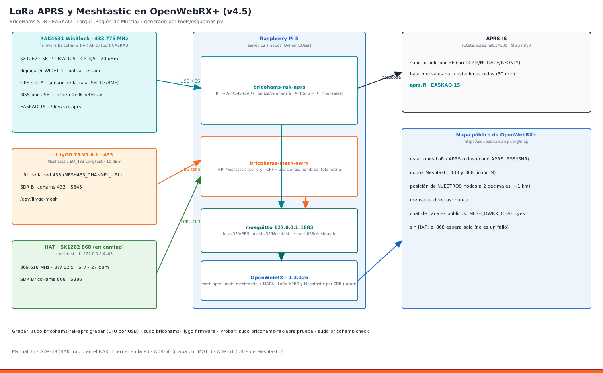

# 35 · iGate LoRa APRS en un RAK4631 y Meshtastic 433/868, dentro de OpenWebRX+ (v4.5)



| Aparato | Qué hace | Cómo se conecta | Nombre fijo |
|---|---|---|---|
| **RAK4631 WisBlock (L, 433 MHz)** en base RAK19007, con GPS (slot A) y sensor de temperatura | iGate y digipeater **LoRa APRS 433,775 MHz** · **EA5KAO-15** · mide la temperatura de la caja | USB a la Pi (KISS) | `/dev/rak-aprs` |
| **LilyGO T3 V1.6.1 433** | nodo **Meshtastic EU_433** de la red (URL 433) · *SDR BricoHams 433* (SB43) | USB a la Pi | `/dev/lilygo-mesh` |
| **HAT SX1262 868** (en camino) | nodo **Meshtastic 868** de la red (URL 868) · *SDR BricoHams 868* (SB86) | SPI (meshtasticd) | 127.0.0.1:4403 |

**Integración directa con OpenWebRX+:** todo lo que oyen los tres aparece en el **mapa** de OpenWebRX+ (`/map`) igual que lo que decodifica él mismo. Además, OpenWebRX+ decodifica LoRa APRS y Meshtastic con sus SDR (marcadores 433,775 y 433,875; manual 2.4).

## 1. Firmware del RAK4631: «BricoHams RAK APRS»
Es un **port de [LoRa_APRS_iGate](https://github.com/richonguzman/LoRa_APRS_iGate) de CA2RXU** (revisión `9314bf1`, 07/10/2026; licencia GPL-3.0) al nRF52840 del RAK4631. El original solo existe para ESP32 y hace la parte de Internet por WiFi; el RAK no tiene WiFi. Por eso (ADR-49):
- **en el RAK** se queda la radio, igual que en el original:
  - cabecera LoRa APRS `<\xff\x01`;
  - SX1262 con TCXO de 1,8 V y DIO2 como conmutador;
  - escucha antes de transmitir (CAD);
  - digipeater con la misma lógica (`digi_utils.cpp`);
  - KISS (`kiss_utils.cpp`, copiado sin cambios);
  - baliza, estado y telemetría;
- **en la Pi** va lo que el original hace por WiFi: subir a APRS-IS, bajar mensajes a RF, la configuración (en vez de su web) y el estado.

| Fichero | De dónde sale |
|---|---|
| `kiss_utils.cpp/.h`, `kiss_protocol.h` | original, sin cambios |
| `lora_utils.cpp` | adaptado: SPI propio (NRF_SPIM2) con los pines internos del RAK4630 |
| `digi_utils.cpp` | adaptado: modos 1-3 y búfer de duplicados de 25 s |
| `configuration.cpp` | nuevo: JSON en la flash interna (LittleFS), escrito por la Pi |
| `aprs_utils.cpp` | nuevo: baliza sin comprimir, estado, ambigüedad, telemetría PARM/UNIT/EQNS/BITS |
| `sensor_utils.cpp` | nuevo: GPS NMEA, RAK1901 SHTC3, RAK1906 BME680, BME280, temperatura interna del nRF52840 y batería |

**Binarios** en `firmware/rak4631-lora-aprs/bin/`, con `SHA256SUMS`:
- `.zip`: DFU por USB;
- `.uf2`: arrastrar y soltar;
- `.hex`: programador SWD.

Compilados con el BSP de RAKwireless 1.3.3 y RadioLib 7.6.0 (`tools/compilar_rak.sh` lo repite en cualquier PC). Ocupan 219 KB de 815 KB.

### Pines (RAK4631 sobre RAK19007)
| Función | Pin del nRF52840 | Nº Arduino |
|---|---|---|
| SX1262 NSS · SCK · MOSI · MISO | P1.10 · P1.11 · P1.12 · P1.13 | 42 · 43 · 44 · 45 |
| SX1262 RESET · BUSY · DIO1 | P1.06 · P1.14 · P1.15 | 38 · 46 · 47 |
| Alimentación del conmutador de antena | P1.05 | 37 |
| 3V3_S (GPS y sensores de los slots) = WB_IO2 | P1.02 | 34 |
| GPS slot A (RAK1910 / RAK12500), NMEA 9600 | P0.15 RX · P0.16 TX (Serial1) | 15 · 16 |
| I2C de los slots | P0.13 SDA · P0.14 SCL | 13 · 14 |
| LED verde (RX) · LED azul (TX) | P1.03 · P1.04 | 35 · 36 |
| Batería (divisor ×1,73) | P0.05 / AIN3 | 5 |

### Protocolo por el USB
| Dirección | Trama | Contenido |
|---|---|---|
| RAK → Pi | KISS 0x00 | cada paquete oído por RF y los propios (baliza, estado, telemetría) |
| Pi → RAK | KISS 0x00 | lo que hay que transmitir (mensajes de APRS-IS), solo con `RAK_TX="yes"` |
| Pi → RAK | KISS 0x06 `BH:…` | `PING`, `GET`, `CONF?`, `CFG {json}`, `BEACON`, `REBOOT`, `DFU`, `UF2` |
| RAK → Pi | KISS 0x06 `BH:…` | `PONG`, `STATUS {json}` (cada 60 s), `CONF {json}`, `CFGOK`, `CFGERR`, `RX {rssi,snr}`, `LOG` |

Cualquier programa KISS (Direwolf, APRX, Xastir) puede usar el RAK: las tramas 0x06 las ignora.

## 2. Configuración clonada del iGate actual (LilyGO de la LAN)
Leída de su `/configuration.json` el 11/10/2026; en `bricohams.env` (personal):

| iGate LilyGO (EA5KAO-10) | RAK4631 | Variable |
|---|---|---|
| callsign EA5KAO-10 | **EA5KAO-15**. «EA5KAO-SDR» no vale: en RF el SSID es un número de 0 a 15 y en APRS-IS caben 9 caracteres | `RAK_CALLSIGN` |
| 433,775 · SF12 · BW 125 · CR 4/5 · 20 dBm · TX y CAD activos | igual | `RAK_TX="yes"`, `RAK_POWER="20"` |
| baliza cada 15 min por RF y APRS-IS, «LoRa APRS igate lorqui», símbolo `L` + `a`, ruta WIDE1-1,WIDE2-1, ambigüedad 1 | igual, + `Caja 23.4C` al final del comentario | `RAK_BEACON_MIN`, `RAK_BEACON_RF`, `RAK_COMMENT`, `RAK_SYMBOL="La"`, `RAK_PATH`, `RAK_AMBIGUEDAD="1"` |
| estado «EA5KAO-Lorqui-IGate» | «EA5KAO-SDR BricoHams iGate» | `RAK_STATUS` |
| digipeater modo 1 (WIDE1-1) | **0 mientras funcione el LilyGO**: dos digis de relleno en el mismo sitio repiten dos veces cada paquete. Cuando apagues el LilyGO, `RAK_DIGI="1"` | `RAK_DIGI` |
| APRS-IS rotate.aprs2.net · filtro m/10 · mensajes a RF | igual (objetos a RF: no) | `RAK_APRSIS_SERVER`, `RAK_APRSIS_FILTRO`, `RAK_MENSAJES_RF` |
| recordar estaciones 30 min | igual | `RAK_RECORDAR_MIN` |
| syslog y MQTT a link9.net | no: el RAK publica en el MQTT **local** para OpenWebRX+ | — |

> **Aviso de seguridad del iGate viejo:** su web no tiene usuario (`webadmin.active=false`). Cualquiera en tu red puede leer en `/configuration.json` la **contraseña de la WiFi** y el passcode APRS. Activa `webadmin` con una contraseña en su web, o apágalo cuando el RAK funcione.

## 3. Procedimiento en la Pi (paso a paso)
**Antes:** por SSH desde casa (`ssh <usuario>@192.168.1.50`); el RAK y el LilyGO enchufados al hub USB; sus antenas puestas. **Nunca transmitas sin antena.**

1. Kit y servicios al día:
   ```bash
   cd ~/bricohams-sdr && git pull
   sudo cp /ruta/a/tu/bricohams.env ./bricohams.env      # el personal (no va en el git)
   sudo bash install.sh --actualizar
   ```
   Esto instala `bricohams-rak-aprs`, `bricohams-mesh-owrx`, `bricohams-dispositivos`, `bricohams-mesh-url`, `bricohams-banner`, mosquitto local, `adafruit-nrfutil`, `esptool` y los decodificadores LoRa de OpenWebRX+. También activa `mqtt_aprs` y `mqtt_meshtastic`.
2. **Qué hay enchufado:**
   ```bash
   sudo bricohams-dispositivos
   ```
   El HAT, el Mini y el SDRplay salen «en camino» (`HARDWARE_PENDIENTE`), no como fallo.
3. **Grabar el RAK4631:**
   ```bash
   sudo bricohams-rak-aprs grabar
   ```
   - Usa DFU por USB y tarda unos 40 s. Solo vale si el RAK tiene el **bootloader WisBlock/Adafruit** (USB `239a:xxxx`, como los que traen Meshtastic o Arduino).
   - `grabar` solo da el trabajo por bueno si `adafruit-nrfutil` dice «Device programmed». Ese programa devuelve 0 aunque falle.
   - **Si falla:** pulsa RESET dos veces; aparece la unidad `RAK4631`. Copia en ella `firmware/rak4631-lora-aprs/bin/bricohams-rak4631-lora-aprs.uf2` (desde la Pi: `sudo mount /dev/sdX /mnt && sudo cp …uf2 /mnt/`).
   - **RAK con RUI3 de fábrica** (USB `1915:521f`, contesta a comandos `AT`). Su bootloader no admite este firmware. `grabar` lo detecta y se para; `bricohams-dispositivos` lo marca como `rak-rui3`. Antes hay que pasarlo a WisBlock **una sola vez** (es lo que se hizo con el de EA5KAO, ver `docs/DESPLIEGUE_EA5KAO_2026-10-11.md`):
     1. Baja de RAK los paquetes `rak4631_factory_bootloader.zip`, `rak4631_factory_softdevice.zip` y `rak4631_factory_application.zip` (downloads.rakwireless.com → RUI/RUI3/Bootloader Upgrade) y guarda su SHA256.
     2. Instala `nrfutil` 6.1.7 de Nordic en un venv. En la Pi (Python 3.13, aarch64) necesita esto:
        - `pip install --ignore-requires-python --no-deps nrfutil==6.1.7`, con sus dependencias a mano;
        - un paquete vacío `pc_ble_driver_py` (`__init__.py` y `exceptions.py` con `NordicSemiException` e `IllegalStateException`). Solo hace falta para BLE y no existe para ARM.
     3. Manda `AT+BOOT` por el puerto (115200). El RAK entra en «DFU». Si tarda, vuelve solo a RUI3 y hay que repetirlo.
     4. `nrfutil dfu usb-serial -pkg rak4631_factory_bootloader.zip -p /dev/ttyACM0`. Pasa a `239a:0029` y aparece la unidad `RAK4631`.
     5. `adafruit-nrfutil --verbose dfu serial --package rak4631_factory_softdevice.zip -p /dev/ttyACM0 -b 115200`.
     6. `sudo bricohams-rak-aprs grabar`, o el `.zip` de la aplicación con `--singlebank`. Queda en `239a:8029`.
4. **Nombres fijos y prueba:**
   ```bash
   sudo bricohams-dispositivos identificar      # /dev/rak-aprs y /dev/lilygo-mesh por VID:PID y serie
   sudo systemctl restart bricohams-rak-aprs
   sudo bricohams-rak-aprs prueba
   ```
   Debe salir:
   - `firmware: BricoHams-RAK-APRS 1.0.1`;
   - `configuración: actualizada (…)` la primera vez y `al día` después;
   - `radio: ok · 433.775 MHz`;
   - la temperatura de la caja y el sensor (`SHTC3 (RAK1901)` o `BME680 (RAK1906)`);
   - el GPS.
5. **LilyGO Meshtastic 433.** Ya tiene Meshtastic (pantalla «lorqui433»). Para ponerlo al último estable conservando la configuración:
   ```bash
   sudo bricohams-lilygo firmware      # baja el oficial (tlora-v2-1-1_6), lo graba con esptool y lo configura
   ```
   O solo la configuración:
   ```bash
   sudo bricohams-lilygo meshtastic
   ```
   Aplica la URL de la red 433 (canales Murcia, Cartagena, Iberia, Alicante, Almería, SOS y el privado) y el nombre *SDR BricoHams 433* / SB43. El servicio del mapa suelta el puerto mientras tanto.
6. **HAT 868 (cuando llegue):**
   ```bash
   sudo bash install.sh --solo hat,meshtastic
   ```
   Aplica la URL 868: SFNarrow, 869,618 MHz, BW 62,5 kHz, SF7, 27 dBm, más el canal EA5RCZ. El nombre es *SDR BricoHams 868* / SB86. Hasta entonces, `bricohams-mesh-owrx` reintenta solo.
7. **Comprobar:**
   - `sudo bricohams-check`: apartados RAK4631, Mapa de OpenWebRX+ y Dispositivos;
   - el mapa en `https://sdr.ea5kao.ampr.org/map`;
   - en APRS: https://aprs.fi/#!call=EA5KAO-15.

### Panel de administración Meshtastic (solo admin)
La configuración de Meshtastic **no está en la web pública**. Para verla:
1. Entra en `https://DOMINIO/settings` con la contraseña de administrador de OpenWebRX+.
2. Pulsa el botón **«Meshtastic 433 / 868»**, que lleva a `/settings/bricohams/meshtastic`, o **«APRS (RAK)»**, que lleva a `/settings/bricohams/aprs`.

Los botones los añade `bricohams-owrx-botones` a la plantilla `settings.html` de OpenWebRX+, así que salen también si entras directo por `http://IP:8073/settings`. En ese caso el enlace te manda a `https://IP/settings/bricohams/…`, porque el panel solo lo sirve nginx; acepta el aviso del certificado si entras por IP. Tras un `apt upgrade` de openwebrx, el gancho `/etc/apt/apt.conf.d/99bricohams-owrx-botones` los vuelve a poner. Para quitarlos: `sudo bricohams-owrx-botones --quitar`.

**APRS (RAK)** enseña:
- el estado del RAK4631: firmware, indicativo, radio y frecuencia, contadores, sensor, batería, GPS, APRS-IS y mapa;
- v5.1: el digipeater (modo, si repite ahora y cuándo se oyó por última vez al otro iGate), la versión del bootloader y el resultado de la última «puesta en marcha»;
- v5.1: los **mensajes APRS** (recibidos y enviados, con «ack» cuando el otro confirma) y las **estaciones oídas con posición**;
- los últimos paquetes oídos.

Desde ahí se puede:
- reiniciar `bricohams-rak-aprs`;
- v5.1: **enviar una baliza ahora**;
- v5.1: **mandar un mensaje APRS** (indicativo y hasta 67 caracteres). Sale por APRS-IS y, con `RAK_TX="yes"`, por RF. Los mensajes que llegan para el indicativo del RAK se contestan con acuse automático.

El passcode, la posición y la baliza siguen en `bricohams.env` y no se enseñan. La página habla con la API local de la pasarela (`127.0.0.1:8077`, `RAK_API_PUERTO`): nunca se ve fuera de la Pi, solo a través del panel con sesión de admin y CSRF.

Qué se puede hacer:
- **Nodo 433 (LilyGO):** leer su estado real y cambiar nombre largo y corto, rol y URL de canales. El panel para y arranca solo `bricohams-mesh-owrx` para liberar el puerto.
- **Nodo 868 (HAT):** lo mismo por la API 127.0.0.1:4403, además del canal privado de `bricohams.env`.
- **Mapa:** elegir qué se publica (`MESH433_OWRX`, `MESH868_OWRX`, `MESH_OWRX_CHAT`).

Los cambios se guardan en `bricohams.env` (el del kit y `/etc/bricohams/`), así que `install.sh --actualizar` no los deshace. Las claves (PSK) nunca se enseñan. Sin sesión de admin te lleva a `/login`. El servicio es `bricohams-mesh-admin` (127.0.0.1:8076).

La web antigua de meshtasticd (`https://IP:9443`) se ha quitado porque no pedía contraseña.

## Cliente web oficial de Meshtastic (:8443, solo admin)
Si se instala con `MESH_WEB="yes"` (por defecto en v4.5):
- `https://IP:8443/` es el cliente web oficial de Meshtastic.
- Solo accesible desde la sesión de `/settings` de OpenWebRX+ (la cookie `owrx-session`).
- meshtasticd sirve su Webserver en `127.0.0.1:9443` sin contraseña, pero un cortafuegos (`bricohams-meshweb-fw`, nftables) lo bloquea desde fuera; nginx lo revierte a `:8443` con autenticación.
- El botón «Meshtastic Web (868)» sale en los **Ajustes** de OpenWebRX+.
- El nodo 868 (HAT) solo funciona una vez que meshtasticd detecta el SX1262; mientras tanto da "No sx1262 radio".
- **No abrir el 8443 en el router,** porque sería internet sin cifrar. Ni el 9443. El 8073 tampoco (manual 34).
- Sin sesión de admin: redirige a `/login?ref=settings`.

## Cliente web de Meshtastic del LilyGO 433 (:8444, solo admin · v5.1)
El LilyGO T3 no tiene WiFi en esta estación: solo habla por USB, y el puerto serie solo lo puede abrir un programa. Con `MESH433_WEB="yes"`:

```
LilyGO 433 ──USB──> bricohams-mesh-puente ──> 127.0.0.1:4404  API de Meshtastic (la de meshtasticd)
                                           │      ├─ bricohams-mesh-owrx (mapa de OpenWebRX+)
                                           │      ├─ bricohams-mesh-admin (panel /settings)
                                           │      └─ meshtastic --host 127.0.0.1:4404
                                           └──> 127.0.0.1:4480  API HTTP ──> nginx :8444 (sesión admin) ──> navegador
```

1. Instalar o actualizar:
   ```bash
   sudo bash install.sh --solo lilygo,web
   ```
   - Instala `bricohams-mesh-puente` (servicio sin root, solo `127.0.0.1`).
   - Baja el cliente web oficial `meshtastic/web` v2.7.2 de GitHub, comprueba su SHA-256 y lo deja en `/usr/share/bricohams-meshweb`.
   - Añade el servidor `:8444` de nginx.
2. Comprobar:
   ```bash
   bricohams-mesh-puente estado
   sudo bricohams-check
   ```
   `estado` debe dar `"radio": true` y 1-2 clientes TCP.
3. En el navegador:
   1. Entra en **Ajustes** de OpenWebRX+ con la contraseña de admin.
   2. Pulsa **«Meshtastic Web (433)»**: abre `https://<estación>:8444/`.
   3. En el cliente, *Nuevo dispositivo → HTTP*, con el host `<estación>:8444` y HTTPS activado.

Qué tener en cuenta:
- Acepta el aviso del certificado si entras por IP.
- Sin sesión de admin, `:8444` manda a `/login`.
- **No abras el 8444 en el router.** `bricohams-blindaje` lo deja solo para la LAN (`BLINDAJE_PUERTOS_LAN`).
- `bricohams-lilygo meshtastic|firmware` para el puente mientras graba o configura, y lo vuelve a arrancar.
- Con `MESH433_WEB="no"` todo vuelve a ser como antes: `bricohams-mesh-owrx` abre el USB directamente.

## Puesta en marcha del RAK de una vez (v5.1)
```bash
sudo bricohams-rak-aprs puesta-en-marcha      # o con minutos de GPS: puesta-en-marcha 20
```
Hace, en orden, y guarda el resumen en `/var/lib/bricohams/rak-puesta.txt` (sale en el panel APRS):
1. **Grabar** si el RAK no contesta o lleva otra versión que la de `firmware/rak4631-lora-aprs/bin/VERSION.json` (1.0.1).
2. **Nombres fijos** `/dev/rak-aprs` y `/dev/lilygo-mesh`.
3. **Prueba:** radio, configuración y sensor.
4. **Bootloader:** `bricohams-rak-aprs bootloader` lleva el RAK al modo UF2, lee `INFO_UF2.TXT`, guarda la versión en `/var/lib/bricohams/rak-bootloader.json` y sale grabando el `.uf2`. Si no aparece la unidad, el bootloader es antiguo, sin UF2. La grabación por DFU serie sigue valiendo.
5. **GPS dentro de la caja:** `bricohams-rak-aprs gps 15` enseña los satélites cada 15 s hasta tener fix. Sin fix en el tiempo dado:
   - pon la antena GPS junto a la tapa o fuera;
   - o deja `RAK_GPS_BALIZA="no"`, y la baliza usa `STATION_LAT/LON`.

El servicio se para mientras tanto y vuelve a arrancar solo.

## Digipeater automático (`RAK_DIGI="auto"`, v5.1)
El RAK solo repite si el otro iGate de la estación (`RAK_DIGI_OTRO`, por defecto `IGATE_CALLSIGN`, el LilyGO) lleva `RAK_DIGI_AUTO_MIN` minutos (60) sin oírse por RF.
- Cuenta como «oído» un paquete suyo o uno que él haya repetido (`indicativo*`).
- Al arrancar espera ese tiempo antes de decidir.
- Cuando el otro vuelve, el RAK deja de repetir. Así no hay duplicados en aprs.fi.
- Necesita `RAK_TX="yes"`.

El panel APRS enseña el modo y si repite ahora. Es lo pedido como «`RAK_DIGI="1"` cuando se apague el LilyGO iGate», pero sin tener que cambiarlo a mano.

## 4. Integración con OpenWebRX+ (ADR-50)
OpenWebRX+ 1.2.122 y posteriores escuchan en su broker MQTT los temas `+/APRS`, `+/Meshtastic` y `+/CLIENT` (`owrx/mqtt.py`, `MqttSubscriber`). Pintan lo recibido en el mapa con su propio código: `AprsParser.updateMap` y `MeshtasticParser.updateMap`. Comprobado contra el código de OpenWebRX+ 1.2.126.

| Tema | Lo publica | Contenido |
|---|---|---|
| `lora433/APRS` | `bricohams-rak-aprs` | estación oída por el RAK: posición (normal, comprimida, objetos, con ambigüedad), símbolo, comentario + «LoRa 433,775 · RSSI · SNR» |
| `mesh433/Meshtastic` · `mesh868/Meshtastic` | `bricohams-mesh-owrx` | nodos con posición: nombre corto y largo, modelo, rol, batería, uso del canal, tiempo. Se republican cada 10 min para que no caduquen |
| `mesh433/CLIENT` | `bricohams-mesh-owrx` | solo con `MESH_OWRX_CHAT="yes"`: mensajes de canales **públicos** al chat de la web. Los directos nunca |

**Privacidad:**
- la posición de **nuestros** nodos va redondeada a `OWRX_GPS_DECIMALES` (manual 34);
- la de los demás va como la emiten ellos (con la precisión de su canal).

**Decodificación por SDR (además):**
- marcadores `📡 LoRa APRS 433,775` (modo *LoRa APRS*), `📶 Meshtastic 433 LongFast` y `📶 Meshtastic 868 SFNarrow`;
- *Meshtastic bandwidth* es un único ajuste global: 62,5 kHz para 868 SFNarrow (el del kit) o 250 kHz para 433/868 LongFast;
- el LoRa APRS siempre se decodifica (BW 125 fijo).

## 5. Problemas
| Síntoma | Qué hacer |
|---|---|
| `prueba`: «El RAK no contesta» | no tiene el firmware BricoHams: `sudo bricohams-rak-aprs grabar` |
| `grabar`: «tiene RUI3» / USB `1915:521f` | conversión a WisBlock (apartado 3, paso 3) |
| `prueba`: «estado ilegible» o `vbat: null` | firmware 1.0.0 sin batería: manda `nan` y la Pi lo convierte en `null`. Corregido en el 1.0.1 (v5.1): `sudo bricohams-rak-aprs puesta-en-marcha` lo graba solo |
| `grabar` no encuentra el puerto | enchufa solo el RAK (un `/dev/ttyACM*`) o usa el `.uf2` |
| `radio: error -2` | el SX1262 no responde: ¿es un RAK4631(**L**) de 433? ¿antena puesta? |
| `CFGERR frecuencia fuera de 410-525 MHz` | el RAK4631 normal es de 868-915: hace falta el (L) |
| Sensor «nRF52840 interno» | no hay RAK1901/RAK1906 en un slot: mide el módulo, no el aire (súmale `RAK_TEMP_OFFSET`) |
| GPS «sin fix» | dentro de la caja puede no ver el cielo: antena GPS activa fuera o `RAK_GPS_BALIZA="no"` (por defecto) |
| LED **rojo** fijo en el RAK | es el LED de carga (CHG) de la base RAK19007, por hardware; el firmware no lo controla. Fijo con USB sin batería o cargando: normal. El firmware solo usa el verde (P1.03, parpadea al recibir) y el azul (P1.04, al transmitir). Compruébalo en Ajustes → «APRS (RAK)» o con `sudo bricohams-rak-aprs prueba` |
| No sale el botón Meshtastic/APRS en Ajustes | `sudo bricohams-owrx-botones` y Ctrl+F5 |
| Nada en el mapa | `systemctl status mosquitto bricohams-rak-aprs bricohams-mesh-owrx` · `sudo bricohams-check` · `mqtt_aprs`/`mqtt_meshtastic` en Ajustes → Integración |
| `mesh868: sin conexión` | normal sin HAT |
| `meshtastic --port /dev/lilygo-mesh` dice «ocupado» | `sudo systemctl stop bricohams-mesh-owrx` (lo hace solo `bricohams-lilygo`) |
| Duplicados en aprs.fi | dos digis: `RAK_DIGI="0"` mientras funcione el LilyGO iGate, o `RAK_DIGI="auto"` (v5.1) |
| Panel APRS: «la pasarela del RAK no contesta» | `systemctl status bricohams-rak-aprs`; la API está en `127.0.0.1:8077` (`RAK_API_PUERTO`) |
| `bootloader`: «No aparece la unidad» | bootloader sin UF2 (antiguo): `grabar` por DFU serie sigue valiendo; RESET para volver |
| `:8444` da 502 | `bricohams-mesh-puente estado` · `journalctl -u bricohams-mesh-puente` (¿`/dev/lilygo-mesh` existe?) |
| `:8444` da 404 | falta el cliente web: `sudo bash install.sh --solo lilygo,web` |

Decisiones: ADR-49 a ADR-52 y ADR-66 a ADR-68 en [ARQUITECTURA](../ARQUITECTURA.md). Pruebas: `tests/test_rak_aprs.py` (firmware compilado en el PC + pasarela + RAK y APRS-IS de mentira), `tests/test_mesh_owrx.py`, `tests/test_v45_dispositivos.py`, `tests/test_v51_aprs_web.py` (API y panel APRS) y `tests/test_v51_mesh_puente.py` (puente, con la librería oficial de Meshtastic si está).
