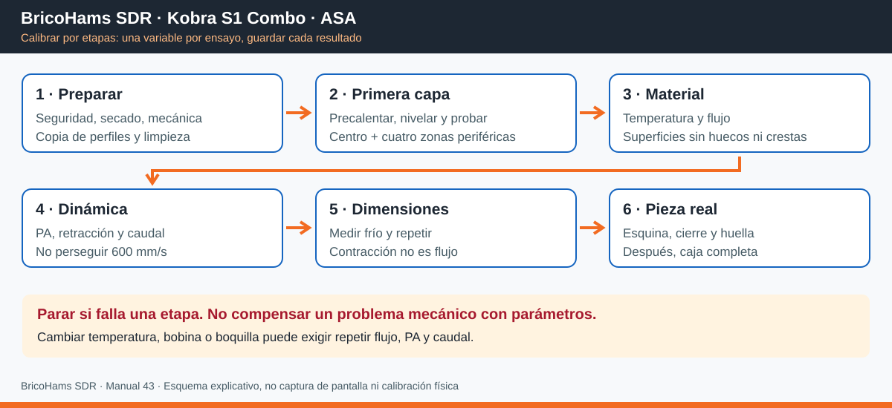
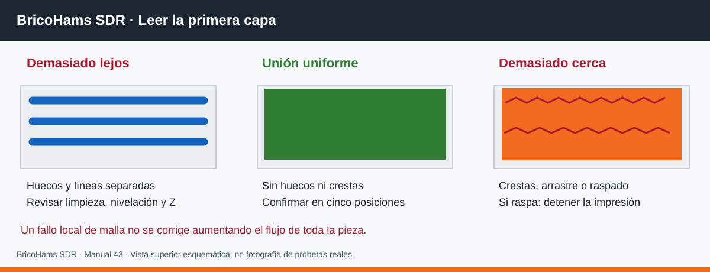
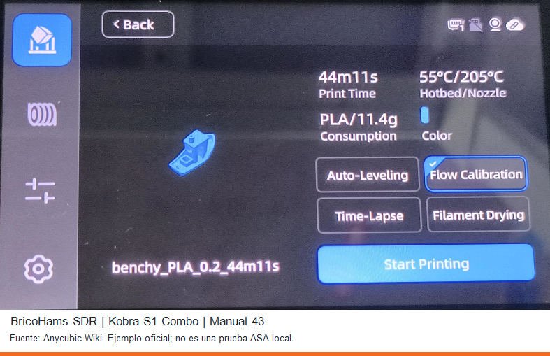
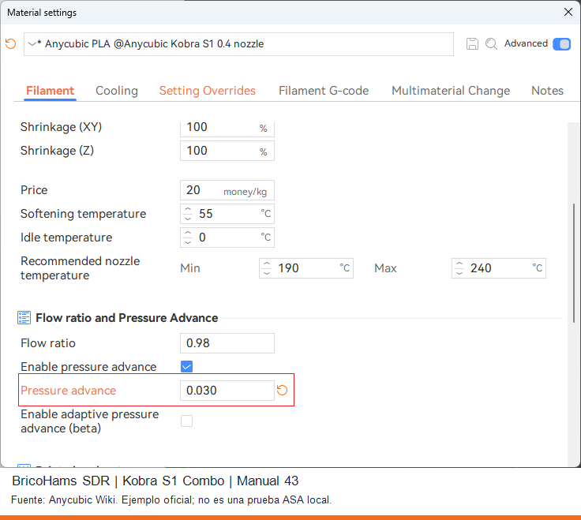
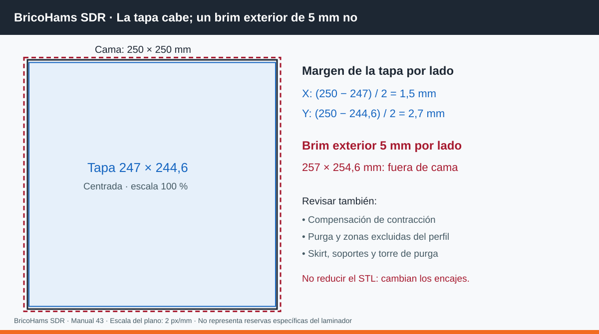
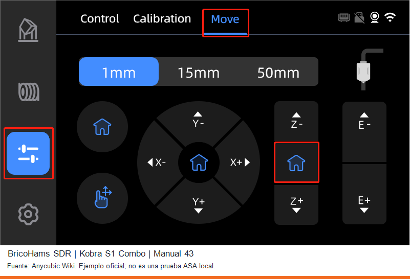

# 43 · BricoHams SDR · Kobra S1 Combo: ASA, calibración y mantenimiento

**Edición: 2026-10-17.** Para **Anycubic Kobra S1 / S1 Combo**, boquilla de
0,4 mm y filamento ASA de 1,75 mm. No es una guía para la Kobra original,
Go, Neo, Kobra 3, Kobra 4 ni S1 Max.

**Objetivo:** construir un perfil propio reproducible antes de imprimir las
[cajas v3](17_CAJA_V3.md). No existe una calibración «perfecta» universal:
marca, color, lote, humedad, boquilla y temperatura ambiente cambian el resultado.
Los valores de partida de este manual **no son un perfil ASA validado físicamente**.
No se ha calibrado tu impresora a distancia ni se entrega G-code listo para ejecutar.

## 1. Referencias y alcance de las capturas

Fuentes consultadas el 2026-10-17:

1. [Ficha oficial Kobra S1 Combo](https://store.anycubic.com/products/kobra-s1-combo):
   volumen **250 × 250 × 250 mm**, hotend hasta 320 °C, cama hasta 120 °C,
   ASA compatible; TPU 95A **no compatible con ACE Pro**.
2. [Índice oficial S1 y manual de usuario](https://wiki.anycubic.com/en/fdm-3d-printer/kobra-s1-combo).
3. [Primera capa S1](https://wiki.anycubic.com/en/fdm-3d-printer/kobra-s1/first-layer):
   limpieza, revisión del hotend y precalentamiento de la cama durante 5–10 minutos.
4. [Flow Calibration / Pressure Advance de Anycubic](https://wiki.anycubic.com/en/home/knowledge-sharing/pressure-advance):
   funcionamiento, prioridad automática/manual y capturas de la interfaz.
5. [Mantenimiento S1](https://wiki.anycubic.com/en/fdm-3d-printer/kobra-s1-combo/maintenance-recommendations):
   **X sin grasa**, revisión mensual de Y y mantenimiento de husillos Z aproximadamente trimestral.
6. [Inicio rápido de Anycubic Slicer Next](https://wiki.anycubic.com/en/software-and-app/new-page-anycubic-slicer-beta(orca-version)/anycubic-slicer-next-slicing-software-quick-start-guide).
7. [Ellis: Print Tuning Guide](https://ellis3dp.com/Print-Tuning-Guide/) y
   [multiplicador de extrusión](https://ellis3dp.com/Print-Tuning-Guide/articles/extrusion_multiplier.html):
   ajuste visual de superficies y separación entre flujo y precisión dimensional.
8. [Teaching Tech](https://teachingtechyt.github.io/calibration.html):
   metodología de pruebas; **no ejecutar su G-code genérico directamente en la S1**.
9. [MPC561: perfiles comunitarios S1 para OrcaSlicer](https://github.com/MPC561/Anycubic-Kobra-S1-Orcaslicer-Profiles):
   referencia avanzada, no configuración oficial ni sustituto de medir tu equipo.
   Su perfil «New Startcode 2.0» exige un limpiador de boquilla modificado.
   No importarlo en una máquina de serie sin cumplir ese requisito.
10. [Ficha de ASA Anycubic](https://store.anycubic.com/products/asa-filament):
    la ficha consultada indica boquilla 255–275 °C, cama 80–100 °C y secado
    70–80 °C durante 8–12 h. No extrapolar estos valores a otra marca/bobina;
    comprobar también la resistencia térmica del carrete antes del secado.

Las tres capturas de pantalla de este manual son **extractos oficiales de Anycubic**,
no capturas de tu impresora ni de una instalación local. Se conserva su contenido
y se añade un pie BricoHams. Las pantallas de ejemplo muestran **PLA**:
sirven para localizar controles, **no para copiar temperaturas ni PA para ASA**.
El artículo de PA identifica firmware S1 2.5.2.3 y Slicer 1.3.5.4 en sus ejemplos.
En otras versiones pueden variar los nombres, posiciones y opciones.
Las ilustraciones SVG son esquemas originales explicativos, no pantallas simuladas.

## 2. Seguridad y material necesario

- Trabajar en un recinto no ocupado con extracción adecuada al exterior.
  ASA emite partículas y compuestos volátiles; la cabina y el filtro de carbón
  de la impresora **no sustituyen una ventilación apropiada**.
- Mantener puerta/tapa según las instrucciones de ASA de Anycubic, sin corrientes
  directas sobre la pieza. No tapar ventiladores de electrónica ni anular protecciones.
  La S1 no debe tratarse como una cámara con calefacción activa regulable:
  **no añadir calentadores ni fijar una temperatura de cámara inventada**.
- No dejar una prueba nueva sin supervisión. Parar ante alarmas térmicas,
  humo, olor eléctrico, golpes, rozamiento de boquilla o pérdida de pasos.
- Preparar calibre, regla recta, galgas si se dispone, paño sin pelusa,
  detergente neutro, agua, herramienta original y grasa recomendada por Anycubic.
- Para limpieza/desmontaje: máquina fría, apagada y desenchufada.
  Para homing/calibración: encendida, cerrada y sin manos ni herramientas dentro.
  No tocar boquilla/cama calientes ni aplicar alcohol sobre superficies calientes.
- Consultar la ficha técnica y de seguridad de **tu bobina**. Secar ASA a la
  temperatura/tiempo prescritos para ella y su carrete. ACE Pro llega a 55 °C
  según la ficha de la S1 Combo: puede conservar seco el material, pero no sustituye
  un secado que requiera más temperatura. No usar un horno de cocina.

## 3. Preparación mecánica y copia de perfiles

1. Anotar firmware, versión de Slicer Next, diámetro/tipo de boquilla,
   placa PEI, marca/color/lote de ASA, fecha de secado y temperatura ambiente.
2. Exportar los perfiles de usuario desde la función de exportación de
   configuraciones de la versión instalada; guardar también el proyecto **3MF**.
   Abrir una copia para confirmar que se recuperan impresora, filamento y proceso.
   **Restauración:** reabrir ese 3MF e importar los perfiles exportados; seleccionar
   los originales y retirar las modificaciones del ensayo. No restablecer firmware.
3. Con la máquina fría/desenchufada, retirar restos bajo la lámina y en la purga;
   comprobar asiento del hotend, limpiador, calcetín y recorrido de PTFE.
   No apretar un hotend caliente ni desmontar sensores para «mejorar» el Z.
4. Lavar la lámina desmontada con agua y detergente, aclarar y secar completamente;
   colocar sin residuos debajo y no tocar el área de impresión con los dedos.
   Usar adhesivo solo si es compatible con ASA y con la lámina.
5. Revisar holguras, correas, poleas y cables visualmente. Si hay juego, saltos
   o ruido anormal, resolver con el procedimiento S1 antes de ajustar flujo.
   **No hay un ajuste de ruedas excéntricas de Kobra Go/Neo que trasladar aquí.**
   No tensar «a oído» con una frecuencia de otro modelo.
6. Desde la pantalla, abrir herramientas (**Tools**) y la pestaña **Calibration**
   disponible en tu firmware. Ejecutar nivelación y compensación de resonancia
   mediante las rutinas oficiales, sin objetos sobre la cama.
   Repetir tras mover la máquina o intervenir en hotend/correas.
7. Para primera capa ASA, precalentar la cama al valor de la bobina,
   esperar **5–10 minutos tras alcanzar la consigna** y volver a comprobar la
   primera capa con nivelación habilitada. Dejar que la rutina gestione el hotend.
   No sustituir sus secuencias por macros descargadas.

**No aplicar automáticamente:** `M500`, `M420 S1`, PID por terminal, cambios de
E-steps/rotation distance, coordenadas de homing o número de puntos de malla.
CoreXY no hace innecesaria la calibración mecánica. La contracción del material
**no reemplaza** la calibración del extrusor: son fenómenos diferentes.

## 4. Crear los tres perfiles en Anycubic Slicer Next

Las rutas siguientes usan los nombres ingleses como referencia. Si un campo no
aparece, activar **Advanced / Expert** o buscar su nombre en los ajustes.
Si sigue sin existir, no inventar comandos para suplirlo: conservar el perfil
oficial y consultar la ayuda de la versión instalada.

| Perfil | Pasos en la interfaz | Nombre sugerido |
|---|---|---|
| Impresora | **Prepare → selector Printer → Anycubic Kobra S1, 0.4 nozzle → editar/lápiz → guardar como perfil de usuario** | `BH_S1_04_BASE` |
| Filamento | **Prepare → Filament → ASA compatible con S1 → editar → guardar como** | `BH_ASA_MARCA_COLOR_LOTE_04` |
| Proceso | **Prepare → Process → 0.20 mm → editar → guardar como** | `BH_ASA_CAJA_020_R1` |

1. Verificar **250 × 250 × 250 mm** y boquilla **0,4 mm**. No elegir S1 Max,
   Kobra X ni Kobra original. Mantener inicio/final y límites oficiales.
2. En **Material settings → Filament**, cambiar temperaturas de boquilla/cama,
   **Flow ratio**, **Max volumetric speed** y, solo tras probarlo, **Pressure advance**.
3. En **Material settings → Cooling**, ajustar refrigeración de pieza.
   No confundirla con el ventilador del hotend, electrónica o extracción.
4. En **Material settings → Setting Overrides**, localizar la retracción
   si está disponible; si no, buscar **Retraction** en el perfil de impresora.
   Evitar dos valores distintos superpuestos.
5. En **Process → Quality**, cambiar altura de capa/primera capa;
   en **Strength**, paredes, capas sólidas y relleno; en **Speed**, velocidades
   y aceleraciones; en **Others**, brim y skirt. La ubicación puede variar.
6. Guardar cada perfil, seleccionar los tres y volver a abrirlos para comprobar
   que no se está usando un preset de sistema ni un override del objeto anterior.
7. Guardar una revisión nueva tras cada prueba, junto con el 3MF y el resultado.
   No actualizar slicer/firmware durante una serie comparativa.

### 4.1 Punto de partida conservador: no copiar sin la ficha de tu ASA

| Parámetro | Arranque propuesto para boquilla 0,4 mm | Cómo decidir el definitivo |
|---|---|---|
| Boquilla | 255 °C **solo si entra en el rango de la bobina** | Torre de temperatura dentro del rango del fabricante |
| Cama | 100 °C **solo si la bobina/lámina lo admiten** | Primera capa + prueba de alabeo; nunca superar 120 °C |
| Capa / primera capa | 0,20 / 0,24 mm | Verificar unión y aspecto; 0,24 no corrige una malla defectuosa |
| Ancho de línea | Preset oficial; 0,42–0,45 mm como referencia | Mantenerlo fijo durante las comparaciones |
| Primera capa / pared exterior | 20 / 40 mm/s | Subir solo tras aprobar superficies y adhesión |
| Pared interior / relleno | 60 / 80 mm/s | Limitados además por el caudal volumétrico |
| Aceleración de impresión | 2.000 mm/s² iniciales, sin superar el preset oficial | Subir gradualmente si no hay ringing ni pérdida dimensional |
| Refrigeración de pieza | 0 % primeras 3 capas; después 0–15 % como ensayo | Mínima que resuelva detalle sin separar capas; puentes aparte |
| Flujo / PA / retracción | Conservar base ASA oficial como inicio | Ensayos específicos; no copiar el PA 0,030 de la captura PLA |
| Caudal máximo | 8 mm³/s iniciales, o menos si lo exige el fabricante | Ensayo de caudal; guardar 80 % del primer fallo reproducible |
| Paredes / relleno | Cuerpos ASA: 6 paredes, 30 % giroide | Ver piezas y cargas en el manual 17; no aplicar a juntas TPU |
| Capas superiores/inferiores | 6 / 6 con capa 0,20 mm como inicio | Inspeccionar cierre y espesor en la vista previa |
| Brim exterior | 5–8 mm **solo en probetas que quepan** | Las tapas/cuerpos grandes actuales no admiten 5 mm; ver §7 |

Son propuestas de ensayo BricoHams, no cifras certificadas por Anycubic.
Los 600 mm/s publicitados no son un objetivo razonable inicial para cajas ASA.
No subir automáticamente 10 °C para ocultar un caudal excesivo.

## 5. Calibración paso a paso y criterios para avanzar

**Orden:** mecánica y secado → primera capa → temperatura → flujo →
PA → retracción → caudal → precisión dimensional → probeta representativa.
Tras modificar temperatura o caudal significativamente, volver a comprobar flujo/PA.
Cambiar **una variable cada vez**, mantener bobina y condiciones y etiquetar probetas.

### 5.1 Primera capa: antes de gastar una bobina

1. En **Prepare**, añadir una primitiva/cubo y dimensionar **30 × 30 × 0,24 mm**;
   duplicar en centro y cuatro posiciones periféricas dejando margen de cama.
   Verificar que el laminado contiene una sola capa y no escala automáticamente.
2. Seleccionar ASA, proceso de ensayo y nivelación. Imprimir a 20 mm/s.
   Comprobar también la purga: no debe invadir el modelo.
3. Observar sin tocar: líneas unidas y uniformes, sin huecos, surcos ni zonas
   transparentes por aplastamiento. Si arrastra o raspa, detener.
4. Si falla una zona, limpiar y repetir nivelación con estabilización térmica.
   Un defecto local no se arregla aumentando el flujo de toda la pieza.
5. Solo si persiste un error **uniforme**, y tu firmware/perfil ofrece Z-offset,
   registrar el valor anterior y variar **0,02 mm por ensayo**.
   Verificar la convención del signo de esa versión antes de acercar la boquilla.
   No introducir de golpe offsets de -0,12 mm ni compensar en pantalla y slicer a la vez.
6. Si no hay ajuste documentado, seguir el diagnóstico oficial S1 de primera capa
   o soporte técnico. Los tornillos de cama no son el primer recurso:
   no girarlos al azar ni copiar ajustes de otra Kobra.

**Aprobación:** cinco parches unidos y adheridos, sin raspado; dejar enfriar,
despegar y comprobar que no se separan en hilos. Guardar foto y valores.

### 5.2 Temperatura

1. Usar el ensayo **Temperature** del menú **Calibration** si tu versión lo ofrece;
   en caso contrario, importar una torre y configurar cambios por altura en el
   laminador. No usar G-code de otra impresora.
2. Elegir, por ejemplo, 255/260/265/270 °C **solo si todos entran en la ficha de ASA**.
   Cama y velocidad constantes; en preview verificar las temperaturas por altura.
3. Escoger la zona con capas cohesionadas, detalle y puentes aceptables, no
   únicamente la más brillante. Comparar flexión de probetas frías con protección
   ocular, sin ensayar roturas con las manos junto a cantos.
4. Guardar la temperatura; repetir primera capa y luego flujo.

### 5.3 Flujo: cantidad de material, no presión

1. Elegir **Calibration → Flow rate** si está disponible. Alternativa Ellis:
   probetas **30 × 30 × 3 mm** con superficies superiores y variaciones de 1–2 %.
2. Comparar el **centro de la cara superior**, no solo esquinas:
   sin huecos ni crestas por sobreextrusión. Refinar con pasos de 0,5–1 %.
3. En ensayo por modificadores porcentuales: `nuevo = anterior × (100 + corrección) / 100`.
   Ejemplo: base 0,98 y parche -2 % → **0,9604**, no 0,96 puntos menos.
   Si la herramienta ya da un factor final, usarlo directamente sin multiplicar otra vez.
4. Guardar en **Material settings → Filament → Flow ratio** y repetir confirmación.

**No deducir el flujo exclusivamente midiendo una pared en modo vaso**:
ancho de línea, solapamiento y generador de paredes pueden falsear ese método.
No reducir flujo para hacer más pequeño un taladro ni para corregir contracción.

### 5.4 Pressure Advance (PA) y «Flow Calibration» de la S1

Anycubic usa **Flow Calibration** para calibrar automáticamente el **PA**;
no equivale al **Flow ratio** del paso anterior.

*Extracto de pantalla de Anycubic, [fuente y explicación](https://wiki.anycubic.com/en/home/knowledge-sharing/pressure-advance).
El Benchy, PLA y sus temperaturas son solo el ejemplo oficial.*

1. Para el uso normal, activar **Auto-Leveling** y **Flow Calibration** al iniciar
   la impresión, si los admite tu firmware/material.
2. Si se quiere medir PA manual, desactivar **solo Flow Calibration** para ese
   ensayo: el PA automático tiene prioridad y ocultaría el manual.
   Mantener la nivelación.
3. Generar el ensayo de PA desde la calibración del laminador compatible;
   conservar el rango recomendado por esa herramienta para la S1.
   Elegir esquinas sin bultos y sin faltas de material; confirmar con otra pieza.
4. Guardar el resultado en **Material settings → Filament → Enable pressure advance
   → Pressure advance**. No introducir comandos de firmware genéricos.

*Captura oficial de [Anycubic](https://wiki.anycubic.com/en/home/knowledge-sharing/pressure-advance).
El 0,98 y el 0,030 pertenecen a su ejemplo PLA, no son resultados ASA.*

El artículo oficial advierte que, en la versión descrita, la calibración automática
puede fallar **sin aviso** y usar el PA manual o el predeterminado. Por ello,
marcar la casilla no acredita éxito: comprobar alimentación, boquilla y resultado.
Registrar si el perfil final usa PA automático o manual.

### 5.5 Retracción e hilos

1. Secar material y comprobar temperatura antes de aumentar retracción.
2. En **Calibration → Retraction test**, si existe, hacer una prueba corta alrededor
   del valor del preset oficial. Mantener velocidad de retracción constante.
   Si no existe, usar dos torres laminadas con diferentes valores entre ensayos.
3. Buscar la mínima retracción que reduzca hilos **sin agujeros en costuras,
   chasquidos ni atascos**. No copiar 5 mm de un Bowden ni fijar 1,2 mm por obligación.
4. Guardar en **Setting Overrides → Retraction** o en el campo equivalente del
   perfil; comprobar que no queda anulado por otra configuración.

### 5.6 Caudal volumétrico y velocidad útil

1. Ejecutar **Calibration → Max volumetric speed** si está disponible, con ASA
   seco y temperatura ya elegida. Empezar cerca del valor conservador del §4.1.
2. Detener al aparecer subextrusión, huecos, cambios fuertes de superficie
   o chasquidos. No continuar hasta atascar el hotend.
3. Repetir para confirmar el primer fallo y guardar como límite aproximadamente
   **el 80 % de ese caudal**, comprobándolo luego en una pieza larga.
   Es un margen de trabajo propuesto, no una capacidad oficial de la S1.
4. Cambiar **Material settings → Filament → Max volumetric speed**.
   Verificar en preview tanto **Speed** como **Volumetric flow rate**.

Estimación: `Q ≈ ancho × altura × velocidad`. Con 0,45 × 0,20 mm,
8 mm³/s permiten aproximadamente **89 mm/s**. A 300 mm/s se pedirían
**27 mm³/s**: no dar por hecho que tu ASA/hotend pueden sostenerlo.
El cálculo es aproximado; prevalece el caudal de la vista previa.

### 5.7 Precisión dimensional y contracción

1. Con flujo y primera capa correctos, imprimir al menos tres probetas de
   **100 mm** de longitud, orientadas en X y Y; medir **frías y tras estabilizarse**
   siempre al mismo intervalo (por ejemplo, al día siguiente).
   Evitar medir la rebaba de primera capa.
2. Si 100 mm resultan 99,4 mm de forma repetible, el factor de **escala directa**
   sería `100 / 99,4 = 1,00604`, es decir **100,604 %**.
3. **No poner automáticamente 100,604 en «Shrinkage (XY)»**:
   algunas versiones piden porcentaje de tamaño retenido (en ese caso **99,4 %**)
   y aplican su inversa internamente. Leer la ayuda del campo y verificar
   una segunda probeta. No aplicar escala y shrinkage simultáneamente.
4. Compensar X/Y solo si el error es proporcional y repetible; no escalar Z
   sin mediciones independientes. Registrar la dimensión efectiva tras compensar.
5. Probar por separado taladros M3/M4, tuercas y encajes con las piezas reales.
   Usar compensación de agujeros/contornos si hace falta, tras medir y en pasos
   pequeños; no alterar pasos de motor para arreglar un único agujero.
6. Usar **Elephant foot compensation** solo para rebaba de primera capa,
   después de corregir adhesión/Z. No esconder alabeo con compensaciones XY.

**Objetivo interno de ensayo:** longitud 100 mm dentro de ±0,3 mm y tres
repeticiones consistentes; encajes sin forzar y sin holgura que impida su función.
No es una tolerancia garantizada por la impresora ni valida piezas estructurales.
Una compensación de contracción puede aumentar la huella y hacer que una tapa
que cabía nominalmente **deje de caber**: volver a comprobar §7.

## 6. Pruebas de aceptación antes de una caja de muchas horas

| Orden | Prueba | Aprobar únicamente si… |
|---|---|---|
| 1 | Cinco parches de primera capa | Todos unidos, adheridos y sin boquilla raspando |
| 2 | Temperatura + flujo + PA | Sin huecos/crestas ni esquinas con exceso/falta; ajustes registrados |
| 3 | Retracción + caudal | Sin vacíos en costura, chasquidos ni subextrusión al límite guardado |
| 4 | Longitud + taladros + tuercas | Mediciones frías repetibles y tornillería encaja |
| 5 | Una pieza pequeña real: soporte/poste | Paredes cohesionadas, taladros y montaje correctos |
| 6 | Recorte representativo de esquina y cierre | Alabeo ≤0,5 mm como criterio interno y unión funcional, sin delaminación |
| 7 | Huella periférica de la pieza grande | No invade purga ni zonas excluidas; todas las esquinas adhieren |
| 8 | Preview completo del STL final | Sin fuera de cama, soportes externos fuera, islas sin apoyo ni escala involuntaria |

Para la prueba 6, **duplicar** el proyecto y usar **Cut / cortar** del laminador
para conservar una esquina con pared, oreja y asiento de tapa; no sobrescribir el STL.
La primera impresión grande sigue siendo de validación: una esquina corta no
reproduce toda la contracción de un cuerpo de 199 mm de altura.
Para la prueba 7, usar una copia con un recorte de la base de unas pocas capas,
conservando la huella real y el perfil; no arrancar el trabajo de varias horas
solo para cancelarlo después. No valida por sí sola la resistencia final.

No usar un Benchy como única autorización para una caja grande ASA.
Un recorte o probeta tampoco certifica estanqueidad, carga o seguridad eléctrica.

## 7. Restricción real de las cajas BricoHams en la Kobra S1

Medidas de los STL actuales, incluidos salientes, **sin compensación de contracción**:

| Pieza | X × Y × Z (mm) | Con brim exterior de 5 mm |
|---|---|---|
| Cuerpo electrónica | 246 × 244,6 × 199 | 256 × 254,6: **no cabe** |
| Tapa electrónica / SAI | 247 × 244,6 × 10,4 | 257 × 254,6: **no cabe** |
| Cuerpo SAI | 246 × 244,6 × 149 | 256 × 254,6: **no cabe** |
| Tejadillo electrónica | 244 × 214,7 × 30,8 | 254 × 224,7: **no cabe** |
| Cuerpo potencia | 188 × 204,6 × 121 | 198 × 214,6: cabe geométricamente |
| Bandejas SDR | 170,4 × 170 × 9 | 180,4 × 180: cabe geométricamente |

- La tapa centrada deja **1,5 mm por lado en X** y 2,7 mm en Y. **No se
  recomienda pasar directamente a ASA grande con brim exterior de 5–8 mm.**
- Para ese brim hace falta rediseñar/dividir la pieza, conservando encajes:
  huella de 240 mm como máximo para brim de 5 mm, mejor menor para reservar margen.
  Una huella de exactamente 240 mm más brim llena los 250 mm y no deja reserva.
  No reducir globalmente el STL: modificaría alojamientos y taladros.
- En las piezas que no requieran brim exterior puede estudiarse adhesión compatible,
  brim interior si el laminador lo admite o geometría revisada. **No se considera
  resuelto el alabeo simplemente desactivando el brim.**
- Importar a escala 100 %, **centrar y apoyar en cama**. El cuerpo se exporta
  abierto hacia arriba y la tapa con exterior hacia abajo; comprobar la primera
  capa real. Revisar puentes, salientes y soportes en la vista por capas.
- Las zonas excluidas, línea de purga, skirt, soportes y torre de purga también
  ocupan espacio. Para las piezas grandes usar ASA de un solo color; no añadir
  torre ni G-code personalizado para saltarse reservas del perfil.
- Guardar el **3MF y G-code final** con los perfiles; la comprobación de STL ≤250 mm
  no sustituye el laminado. No hay aquí tiempo/peso nuevo certificado:
  obtenerlo del laminador después de cerrar el perfil.
- Dejar enfriar con la cabina cerrada antes de retirar; no flexionar la lámina
  caliente ni enfriar la pieza con una corriente para acelerar.

**Resultado actual:** compatibilidad geométrica nominal, no validación física de
ASA ni autorización para imprimir sin revisar. El diseño no se cambia en este manual.

## 8. Plan de mantenimiento preventivo S1 + ACE Pro

Los intervalos «antes de cada trabajo», «semanal» y «cada bobina» son propuestas
conservadoras BricoHams. Los trimestrales de Z, mensuales de Y y revisión de
cortador tras 3–5 bobinas proceden de Anycubic. Acortar por polvo o uso intensivo.
Si el manual de tu revisión establece otro intervalo/producto, prevalece.

| Frecuencia | Acción | Comprobación y registro |
|---|---|---|
| Antes de cada trabajo | PEI limpia y asentada; boquilla/limpiador/purga sin restos; bobina y PTFE libres | Foto primera capa; sin golpes ni obstrucciones |
| Tras cada trabajo | Enfriar; retirar restos y comprobar esquinas/adhesión y estado de lámina | Horas, material, defecto y perfil empleado |
| Semanal o antes de una caja larga | En frío/desenchufada: polvo, ventiladores, cables visibles, PTFE, correas y conectores externos | Sin grietas, desgaste, holgura ni roce; no retensar por calendario |
| Cada bobina/cambio de material | Limpiar zona de alimentación/ACE, revisar PTFE, bobina y desecante si existe en tu unidad | Sin arrastre ni humedad; repetir temperatura/flujo/PA si cambia material |
| Mensual | Revisar y limpiar guías Y; lubricación ligera con grasa indicada por Anycubic si procede | Movimiento suave, sin acumulación de grasa ni ruido |
| Mensual / cuando haya suciedad | Limpiar varillas X con paño sin pelusa y alcohol compatible, en frío; dejar secar | **NO engrasar X:** casquillos autolubricantes de grafeno |
| Aproximadamente cada 3 meses o si hay ruido | Limpiar husillos Z y aplicar poca grasa según procedimiento S1 | Ciclo de movimiento sin herramientas dentro; sin exceso ni ruido anormal |
| Cada 3–5 bobinas | Inspeccionar cortador y limpiador; sustituir si están gastados | Alimentación/corte limpios; usar guía específica S1/ACE |
| Mensual; antes si hay polvo | Revisar ventiladores, cámara y filtro de cabina | Limpiar en frío; no hacer girar ventiladores con aire a presión |
| Filtro/desecante | Revisar según horas de ASA, estado y manual del consumible | Sustituir según fabricante; no confiar en el olor como indicador de seguridad |
| Tras cambiar boquilla/hotend o mover máquina | Verificar montaje, nivelación, resonancia y primera capa | Repetir caudal/PA/flujo cuando corresponda |
| Antes de actualizar firmware/slicer | Exportar perfiles y abrir copia 3MF; leer notas de versión | Después, probetas antes de una caja; no asumir reversión de firmware disponible |

### 8.1 Lubricación: no tratar todos los ejes igual

*Captura oficial del [mantenimiento Anycubic S1](https://wiki.anycubic.com/en/fdm-3d-printer/kobra-s1-combo/maintenance-recommendations).
La fotografía del menú no implica que debas tocar Z mientras se mueve.*

1. Apagar, desenchufar y dejar enfriar. Limpiar con paño sin pelusa las zonas
   indicadas por Anycubic; no mezclar grasas ni usar aceites penetrantes.
2. **X: limpieza, sin grasa. Y y husillos Z: pequeña cantidad de grasa
   apropiada**, solo según la guía de tu revisión. No lubricar correas,
   poleas dentadas, PEI, PTFE ni engranajes de arrastre del filamento.
3. Si hay que cambiar la posición Z, retirar manos/paños, conectar y usar
   **Tools → Move → homing Z** de la pantalla; parar, apagar/desenchufar y
   volver a limpiar/aplicar grasa con el mecanismo inmóvil. No mover ejes
   rápidamente a mano ni girar husillos por separado.
4. Retirar exceso, cerrar la máquina y ejecutar el movimiento de comprobación
   sin herramientas dentro. Ante atascos, no insistir con el motor.
5. Tras una intervención, hacer una primera capa y pieza pequeña antes de producción.
   No abrir fuentes de alimentación ni trabajar en circuitos de red.

### 8.2 Registro reutilizable

Copiar esta tabla por intervención o impresión de validación:

| Fecha / horas | Firmware / slicer | Bobina / secado | Perfil y revisión | Acción / prueba | Medidas / resultado | Próxima revisión |
|---|---|---|---|---|---|---|
| Por completar | Por completar | Por completar | Por completar | Por completar | Aprobado / repetir / detener | Por completar |

## 9. Diagnóstico rápido: cambiar lo mínimo necesario

| Síntoma | Revisar primero | Cambio controlado después |
|---|---|---|
| Esquinas levantadas | Limpieza, secado, estabilidad térmica, huella/brim | Adhesivo compatible, refrigeración menor, diseño/huella revisados |
| Huecos en una zona de primera capa | Suciedad bajo PEI, malla, asiento hotend | Diagnóstico oficial S1; no subir flujo global |
| Toda la primera capa demasiado aplastada | Limpieza boquilla, nivelación y Z | Ajuste documentado pequeño, sin duplicar offset |
| Superficie superior con crestas/huecos | Flujo con temperatura estable | Refinar Flow ratio 0,5–1 % |
| Esquinas abultadas / vacías | PA y prioridad automática/manual | Repetir ensayo PA; no copiar valor PLA |
| Hilos | Humedad, temperatura y trayectoria | Retracción mínima eficaz |
| Chasquidos o subextrusión a alta velocidad | Bobina/PTFE, atasco, caudal | Reducir límite volumétrico y repetir |
| Separación entre capas | Temperatura, corrientes, ventilación de pieza y caudal | Ajustes dentro de ficha; repetir probeta, no usar pieza fallida |
| Piezas pequeñas bien y grandes cortas | Medidas frías, contracción y alabeo | Compensación verificada; volver a medir huella |
| Ringing / capas desplazadas | Base, correas, colisiones, resonancia | Menor aceleración; no ocultar fallos mecánicos con escala |

## 10. Lista final antes de pulsar «Print»

- [ ] Ventilación/extracción adecuada, sin personas expuestas y sin corrientes sobre pieza.
- [ ] ASA seco, boquilla 0,4, placa correcta y tres perfiles S1 seleccionados.
- [ ] Respaldo de perfiles comprobado y 3MF de esta revisión guardado.
- [ ] Primera capa, temperatura, flujo, PA, retracción y caudal aprobados.
- [ ] Encajes y dimensiones verificados fríos; contracción no aplicada dos veces.
- [ ] Huella **ya compensada**, brim/soportes/purga dentro del área del perfil.
- [ ] No se ha copiado G-code de otra Kobra ni modificado homing/firmware.
- [ ] Vistas por capas sin islas/voladizos sin resolver; material/tiempo suficientes.
- [ ] Prueba corta representativa aprobada; primera impresión grande supervisada.
- [ ] Enfriamiento gradual y próxima revisión preventiva previstos.

**Pendiente en tu máquina:** ejecutar ensayos, registrar valores y aprobarlos.
Las imágenes y esta guía no equivalen a un perfil calibrado ni a una prueba física.
