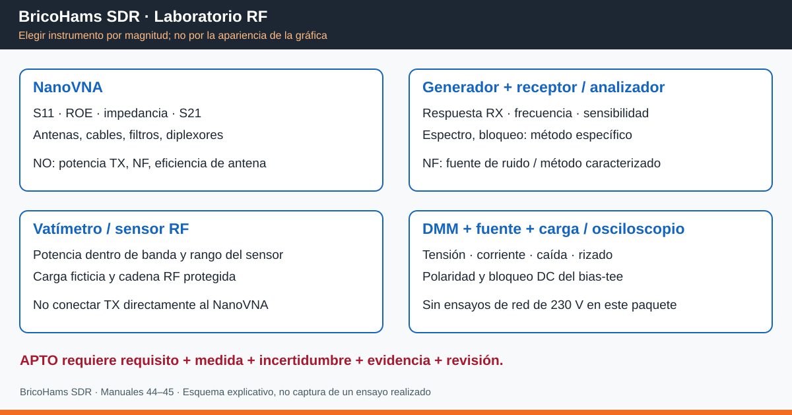

# 44 · BricoHams SDR · Laboratorio RF y cualificación de componentes

**Edición 2026-10-17 · Estado: procedimientos y hojas sin resultados reales.**

Paquete rellenable para antenas, coaxiales, conectores, filtros, diplexores,
bias-tee, LNA y receptores SDR del proyecto. Alimentación y sensores se incluyen
solo como comprobaciones auxiliares de baja tensión. No comprende ensayos de red
de 230 V, seguridad estructural, homologación de transmisores ni certificación EMC.

**Empezar por:** [hojas de laboratorio](../laboratorio-rf/README.md) y
[manual detallado NanoVNA](45_NANOVNA.md). Relacionado con
[antenas](11_MASTIL_Y_ANTENAS.md), [filtros y preamplificadores](16_FILTROS_Y_PREAMPLIFICADORES.md)
y [cajas](17_CAJA_V3.md).



## 1. Qué significa «cualificar»

Cualificar es demostrar que **una unidad identificada** cumple requisitos escritos
para una aplicación concreta, en unas condiciones y con incertidumbre conocidas.
No basta una gráfica bonita, una ROE baja ni recibir más paquetes un día.

Separar:

- **Caracterización:** medir sin decidir aptitud.
- **Verificación:** comparar con un requisito y regla de decisión previos.
- **Ajuste:** modificar el equipo para acercarlo al objetivo.
- **Calibración metrológica:** relacionar indicaciones con referencias e incertidumbre.
  La corrección OSL del NanoVNA no convierte el equipo en instrumento certificado.
- **Certificación/homologación:** fuera del alcance de este paquete.

Resultados permitidos: **APTO**, **NO_APTO**, **INDETERMINADO**, **NO_ENSAYADO**.
Nunca rellenar «APTO» porque no se dispone del instrumento necesario.
Todos los valores/fechas/certificados de las hojas se dejan vacíos a propósito.

## 2. Instrumentos: capacidades y límites

| Magnitud / componente | NanoVNA | Instrumentos adicionales / límites |
|---|---|---|
| Antena: S11, impedancia, ROE, banda adaptada | Sí, en banda verificada | No demuestra ganancia, eficiencia, patrón, polarización ni aislamiento real en el mástil |
| Coaxial: S21, pérdida, fase/retardo | Sí con corrección y conexiones adecuadas | Cable largo puede superar rango dinámico; TDR depende de banda y factor de velocidad |
| Filtro: banda, pérdida de inserción, adaptación | Sí, señal pequeña | Rechazo profundo puede quedar bajo el suelo del montaje; no equivale a potencia admisible |
| Diplexor: cada trayectoria y aislamiento | Sí, por pares | Tercer puerto siempre terminado con carga adecuada; no es medición simultánea de tres puertos |
| Bias-tee pasivo: paso RF | Sí, primero sin alimentación | DMM para DC/continuidad; fuente limitada y bloqueos DC para pruebas alimentadas |
| LNA: ganancia y adaptación de señal pequeña | Condicional, no ensayo inicial | Modelo/límites confirmados, atenuación y bloqueos DC; NF necesita método/fuente de ruido calibrados |
| Potencia RF de transmisor | **No** | Vatímetro/sensor adecuado, carga ficticia, acoplador y atenuación dimensionados |
| Armónicos, espurias y ruido espectral | **No** | Analizador de espectro y cadena de entrada protegida; no homologación automática |
| Sensibilidad, bloqueo, intermodulación, P1dB | **No por sí solo** | Generador(es), atenuadores, combinador y receptor/analizador con método específico |
| Figura de ruido (NF) | **No** | Analizador NF o método Y con fuente ENR caracterizada y correcciones |
| Error de frecuencia/ppm SDR | **No como referencia absoluta** | Fuente/referencia de frecuencia suficientemente estable y trazable |
| Tensión, corriente, consumo, rizado | **No** | DMM, fuente/carga electrónica y osciloscopio con sondaje correcto |
| Temperatura/humedad | **No** | Referencia termométrica/higrométrica e incertidumbre conocidas |

**Un NanoVNA no es un analizador de espectro ni un vatímetro.** Tampoco se obtiene
ganancia de antena solo por S21 entre dos antenas sin controlar geometría, distancia,
reflexiones, polarización y referencias.

## 3. Trazabilidad: antes de conectar

1. Crear una copia de las [plantillas](../laboratorio-rf/README.md), no rellenar
   los originales del repositorio. Trabajar en una carpeta de campaña local.
2. Asignar identificadores: `CMP-001` componente, `INS-001` instrumento,
   `CAL-001` corrección/verificación, `ENS-001` ensayo, `REQ-001` requisito.
3. Registrar modelo, serie o identificación propia si no tiene serie, revisión,
   lote, conectores, fotografías y orientación. No inventar números de serie.
4. Dar ID también a cables de medida, adaptadores, cargas, atenuadores,
   bloqueos DC y patrones OSL/THRU. Anotar qué elementos quedan dentro del plano
   de calibración y cuáles pertenecen al DUT (dispositivo bajo prueba).
5. Documentar requisitos con frecuencia/banda, unidad, límite, fuente
   (ficha técnica exacta/revisión o requisito interno), incertidumbre y decisión.
   No confundir «típico» de catálogo con límite garantizado.
6. Inventariar instrumentos y certificados, intervalo interno y fecha prevista
   de revisión; si no hay certificado, escribir «sin certificado» en observaciones.
7. Guardar configuración inicial, alimentación, entorno, conexión y firmware.
   No actualizar firmware ni modificar un componente entre medidas sin abrir
   revisión nueva.

### 3.1 Expediente de campaña

Estructura sugerida fuera del repositorio:

```text
BH_RF_FECHA/
  hojas/       copias CSV completadas
  originales/  Touchstone, datos de instrumentos y configuraciones sin modificar
  fotos/       montaje, etiquetas, planos de referencia y conexiones
  capturas/    pantallas reales con frecuencia, marcadores y escala
  informe/     decisiones, incertidumbres y acciones pendientes
```

Nombres sugeridos: `ENS-001_CMP-001_CAL-001_S11.s1p`,
`ENS-002_CMP-002_CAL-002_transmision.s2p`, `ENS-002_pantalla.png`.
Conservar originales; una imagen no sustituye datos complejos ni configuración.
El resumen debe indicar si una captura es real, ilustrativa o externa.

## 4. Puerta de seguridad

**No conectar si falta cualquiera de estos datos:**

- Modelo/revisión del instrumento y **límites de RF/DC de cada puerto** obtenidos
  de su manual. No aplicar límites del H/H4 al V2 ni a un clon.
- Puertos y sentido RF identificados; unidades dBm/W/dB distinguidas.
- Transmisores desconectados **físicamente**, no solo con PTT suelto.
  Evitar antenas instaladas junto a transmisores activos.
- Bias-tee del SDR y fuente externa apagados; verificar con DMM ausencia de DC
  antes de conectar instrumentos. La ausencia de DC **no demuestra ausencia de RF**.
- Conectores limpios, sin pin deformado; no confundir SMA con RP-SMA ni forzar
  adaptadores. Usar par recomendado para el conector, no una cifra universal.
- Si se ensaya un dispositivo activo: presupuesto de potencia calculado,
  protecciones caracterizadas, fuente limitada y revisión por persona competente.

**NanoVNA nunca al conector de salida de un transmisor.** Para el laboratorio
inicial limitarse a redes pasivas sin tensión. Para LNA alimentados, seguir §8 y
el manual 45; si falta una especificación, resultado **NO_ENSAYADO**.
No medir durante tormentas ni manipular antenas elevadas/con riesgo de caída.

## 5. Requisitos iniciales por componente

| Componente del proyecto | Ensayo | Requisito previo y condición |
|---|---|---|
| Antenas 2 m / 70 cm | S11 / ROE en ambas bandas por separado | Fijar banda realmente usada y ROE objetivo; 2:1 es solo ejemplo interno, no garantía de eficiencia |
| ADS-B 1090 | S11 cerca de 1090 MHz | Confirmar que la variante NanoVNA tiene prestaciones verificadas a 1090 MHz |
| LoRa/APRS 433 | Antena y paso del filtro en frecuencia de uso | Anotar frecuencia/configuración concreta; no barrer con transmisor conectado |
| LoRa 868 | Antena y filtro de reserva | Confirmar ficha exacta; un filtro de recepción no es automáticamente apto para TX |
| FBP-433s | S21 y S11 en 430–438 MHz y entorno | Contrastar la unidad/ficha; el manual 16 cita <2,5 dB, pendiente de verificar como especificación aplicable |
| FBP-868s | S21 en 866–870 MHz | El manual 16 advierte de ~18 dBm máx.; no validar esa potencia con un NanoVNA |
| Coaxiales/pasamuros | Pérdida a cada frecuencia operativa | Presupuesto según longitud, ficha del cable y conectores, no un límite único en dB/m |
| Diplexores | Cada paso, retorno y aislamiento | Terminar tercer puerto; requisito por banda de cada rama |
| Bias-tee | Pérdida RF, bloqueo DC, caída de tensión | Puerto RF seco; corriente/tensión dentro de ficha |
| LNA 1090 / satélites | Ganancia pequeña señal; NF por separado | Confirmar alimentación de la unidad; no extrapolar los 5 V del LNA 1090 a otro LNA |
| RTL/HAT/Mini/RSPdx/Airspy/HackRF/Hermes-Lite | Recepción/sensibilidad/frecuencia | Solo equipos presentes; los futuros quedan NO_ENSAYADO; transmisores inhibidos |

Los presupuestos de alimentación estimados y las simulaciones de antena del
proyecto **no son certificados de medida** ni resultados de este laboratorio.

## 6. Procedimientos pasivos

### A. Antena: adaptación, no ganancia

1. Definir banda de uso y margen; fotografiar montaje, altura y entorno.
2. Calibrar OSL en el extremo del cable que se conecta a la antena (§4 del manual 45).
3. Conectar antena con transmisores separados; alejar manos/cuerpo.
4. Guardar S11 complejo, ROE e impedancia en marcadores relevantes y extremos de banda.
5. Repetir tres conexiones conservando posición; registrar dispersión.
6. Comparar con requisito **en toda la banda**, no solo en el mínimo.
7. Si se ajusta longitud, guardar ANTES/DESPUÉS como revisiones diferentes.

Una antena con pérdidas, una carga o un coaxial muy atenuante pueden dar buena ROE.
No atribuir a la antena el S11 medido en la base de un cable largo sin corregirlo.

### B. Coaxial y conectores

1. Inspeccionar en frío; si procede medir continuidad con DMM, comprobando que
   el conjunto permite esa interpretación (balunes/antenas pueden tener corto DC).
2. Calibrar con los cables de prueba; insertar el coaxial DUT entre planos.
3. Medir S21, S11 y fase/retardo a las frecuencias de trabajo.
4. Flexionar suavemente solo dentro del radio permitido para detectar intermitencias;
   no retorcer conectores. Repetir reconexión.
5. Comparar pérdida con ficha por longitud más conectores, tolerancia e incertidumbre.
6. TDR opcional con VF conocido: anotar banda, ventana y referencia; distancia
   aproximada, no localización certificada.

### C. Filtro y diplexor

1. Medir primero un THRU de verificación y un atenuador independiente.
2. Insertar filtro sin alimentación; medir banda de paso y luego bandas de rechazo
   con corrección propia para cada barrido.
3. Registrar máximos de pérdida/rizado en banda, f de corte y adaptación.
4. Para diplexor, conectar puerto común y rama; terminar la tercera en 50 Ω.
   Repetir otras ramas/aislamiento con la misma carga identificada.
5. Comparar el rechazo con el suelo medido de aislamiento:
   si no se resuelve, escribir «rechazo ≥ X dB dentro del montaje» y no una
   cifra exacta. Rechazo próximo al suelo → **INDETERMINADO** si el requisito
   exige mayor capacidad.
6. Para estimar S22/S12 con equipo de una dirección, invertir DUT, recalibrar
   el montaje que corresponda y etiquetar como **medida invertida**.
   No presentar el archivo como calibración completa de dos puertos.

### D. Bias-tee

1. Leer esquema/ficha: RF, RF+DC y DC; identificar bloqueo interno.
2. Sin alimentación, medir continuidad/resistencia con DMM donde proceda.
3. Ensayo VNA de paso RF únicamente sin tensión, con bloqueos DC caracterizados
   si el montaje los necesita.
4. Para comprobar inyección, **retirar NanoVNA y SDR**; usar fuente limitada,
   DMM y carga apropiada para DC. Medir tensión/sentido, corriente y caída.
5. Confirmar el bloqueo DC hacia el receptor bajo condiciones previstas.
   Nunca alimentar un puerto VNA para «ver si bloquea».

## 7. Calibración y verificaciones de los otros instrumentos

**Sin modelos confirmados no hay comandos ni secuencias de ajuste internos universales.**
En cada caso adjuntar el procedimiento del fabricante para la revisión concreta.
Las instrucciones siguientes son preparación/verificación de banco, no emisión
de certificados ni sustituto de laboratorio acreditado.

| Instrumento | Preparación y verificación paso a paso | Cuándo parar |
|---|---|---|
| DMM | 1. Inspeccionar fusibles/puntas y categoría. 2. Seleccionar función/rango antes de conectar. 3. Verificar cero/continuidad como chequeo funcional. 4. Comparar con referencia DC/resistencia caracterizada, registrando incertidumbre. 5. Comprobar al final. | Sin referencia, anotar solo chequeo funcional; nunca usar ohmios en circuito energizado ni modo corriente en paralelo |
| Fuente DC | 1. DUT desconectado. 2. Fijar tensión y límite de corriente de ficha. 3. Confirmar salida con DMM independiente. 4. Probar con carga adecuada. 5. Registrar caída y límite. | Sobretensión, inversión, temperatura o limitación inesperada |
| Generador RF | 1. Calentar según manual. 2. Salida OFF. 3. Confirmar referencia interna/externa y estado de lock. 4. Verificar frecuencia con contador/referencia superior. 5. Verificar nivel con sensor/vatímetro y corrección de cable/atenuador en el plano DUT. | Nivel/frecuencia sin verificar: solo comparación relativa, no sensibilidad absoluta |
| Vatímetro/sensor RF | 1. Identificar sensor, banda y potencia. 2. Calentar. 3. Hacer zero/cal exactamente como exige manual, con RF retirada o calibrador interno según fase. 4. Introducir factor de calibración/correcciones. 5. Verificar con fuente independiente de nivel conocido. | Sensor sobrecargado, fuera de banda o corrección desconocida |
| Analizador de espectro | 1. Revisar RF/DC máximos y previos. 2. Calentar y self-align según manual, sin señal cuando se solicite. 3. Verificar frecuencia y amplitud con fuente conocida, RBW/VBW/detector/atenuación documentados. 4. Caracterizar pérdidas antes del DUT. 5. Repetir referencia al final. | Self-align no acredita nivel trazable; saturación/intermodulación del analizador invalidan resultado |
| Osciloscopio | 1. Inspeccionar sondas/tierras. 2. Autocal según manual. 3. Compensar sonda con salida de prueba. 4. Verificar amplitud/tiempo con referencia apropiada. 5. Para rizado DC usar retorno corto y banda documentada. | No conectar masa a red/no flotante sin método y sonda adecuados; fuera de este paquete |
| Referencia temperatura/humedad | 1. Registrar certificado/rango. 2. Estabilizar junto al sensor. 3. Comparar varios puntos seguros. 4. Registrar tiempo/respuesta e incertidumbre. | Baño de hielo no es calibración multipunto ni referencia de humedad |

**Después de calibrar/verificar:** registrar `CAL-ID`, rango, montaje, referencia,
resultado inicial/final, responsable e incertidumbre aplicable. Si falla el chequeo
final, inmovilizar los resultados desde la última comprobación válida y repetir.
No ejecutar ajuste interno, flash ni restablecimiento del instrumento para ocultar un fallo.

## 8. Dispositivos activos y ensayos SDR

### 8.1 LNA: ensayo condicionado

Preferir generador de nivel bajo verificado + analizador/sensor adecuados.
El NanoVNA solo puede medir ganancia pequeña señal si el modelo y el montaje
permiten la potencia, banda y DC; los H antiguos usan armónicos y pueden producir
resultados engañosos con amplificadores.

Antes de autorizar una conexión:

1. Conocer máximo de salida de la fuente/VNA y ganancia **máxima** del LNA.
2. Calcular `P_rx_peor = P_fuente_max + G_max − A_min − L_min` en dBm,
   con tolerancias y posibles transitorios/autooscilación. El resultado debe estar
   bajo el límite del receptor y en su región lineal con margen documentado.
3. Dimensionar atenuadores por frecuencia, potencia y DC; confirmar bloqueos DC
   y nivel con un instrumento apropiado antes de conectar el VNA.
4. Caracterizar la cadena pasiva sin LNA y mantenerla en la corrección; no quitar
   protecciones después de calibrar.
5. Alimentar con tensión/polaridad de ficha y límite de corriente; detener ante
   oscilación, calentamiento, consumo o resultado inesperados.
6. Guardar ganancia con incertidumbre; **no inferir NF, P1dB o IP3**.

Si falta `P_fuente_max`, `G_max`, límite de entrada o verificación del nivel,
**no hacer este ensayo con NanoVNA**.

### 8.2 Receptor SDR y bloqueo

1. Desconectar antena y cualquier salida TX; desactivar bias-tee y AGC para ensayos
   de nivel reproducible, dejando documentada ganancia manual.
2. Generador → atenuación caracterizada → entrada RX, dentro de sus límites.
   Comenzar con RF OFF y nivel bajo verificado. No emitir al aire.
3. Anotar muestra/s, ancho RF, decimación, ganancia, frecuencia, modo,
   demodulación, ancho de ruido y versión de software/driver.
4. Para error de frecuencia: usar fuente estable conocida y registrar incertidumbre.
5. Para sensibilidad: definir antes una métrica, por ejemplo SINAD de audio,
   BER/PER con modulación conocida, o SNR con ancho y detector definidos.
   «Se oye» o el S-meter sin calibrar no son criterios de sensibilidad absoluta.
6. Barrer nivel solo dentro de límites; registrar cada punto y referencia al plano RX.
7. Bloqueo/intermodulación requiere otro generador, combinador/aislamiento
   y método de control. No atribuir espurias al SDR sin descartar las fuentes.
8. Restaurar configuración inicial y comprobar recepción normal.

Potencia TX, espurias, NF y conformidad normativa: marcar NO_ENSAYADO hasta
disponer de montaje/procedimiento adecuados. Hermes-Lite/HackRF se tratan como
receptores en este paquete; no se habilita transmisión.

## 9. Incertidumbre y regla de decisión

Anotar al menos: exactitud de instrumento en esa banda/nivel, patrones,
corrección residual, conectores/reconexión, repetibilidad, deriva y desadaptación.
No confundir resolución de pantalla con exactitud ni multiplicar una
especificación «típica» por un factor sin justificación.

Para contribuciones **independientes, compatibles y justificadas**:
`u_c = sqrt(sum(u_i²))`; expandida `U = k × u_c`.
Convertir antes a incertidumbres estándar y unidades comunes: certificado
expandido `u=U/k`; límite rectangular justificado `u=a/sqrt(3)`.
Para la media de n repeticiones independientes, `u_rep=s/sqrt(n)`; si se informa
una sola lectura, no dividir su dispersión por sqrt(n).
Documentar correlaciones y no sumarlas como independientes por defecto.
`k=2` es una elección habitual, **no garantiza** 95 % sin hipótesis suficientes.

Ejemplo ficticio, no resultado: pérdida `IL=2,20 dB`, `U=0,15 dB`, límite máximo
2,50 dB. Con banda de guarda:

- APTO si `IL + U ≤ 2,50`.
- NO_APTO si `IL − U > 2,50`.
- INDETERMINADO si el intervalo cruza el límite.

Para mínimo de rechazo R: APTO si `R−U ≥ mínimo`; NO_APTO si `R+U < mínimo`.
Para intervalo permitido, debe quedar dentro **todo** `[x−U,x+U]`.
Si faltan especificación o incertidumbre defendible: caracterizar, pero dejar
decisión **INDETERMINADO**. Si ni se midió: **NO_ENSAYADO**.

## 10. Cierre, revisión y mantenimiento de banco

1. Comprobar referencia independiente al principio y final de la campaña.
2. Revisar datos/hojas y correspondencia entre IDs, fotos y archivos.
3. Guardar configuración original y resultados sin sobrescribir; segunda copia
   y comprobación de integridad antes de reutilizar una carpeta.
4. Revisor distinto, si es posible, firma decisión y excepciones; no eliminar fallos.
5. Separar componentes no aptos; etiqueta no significa reparación.
6. Limpiar conectores sin abrasivos, protegerlos con tapas y descargar tracción
   de cables. Revisar patrones/cables antes de cada campaña y tras golpes.
7. Repetir corrección NanoVNA si cambia banda, cableado, adaptador, potencia,
   temperatura significativa o verificación. El intervalo de calibración externa
   de otros instrumentos se fija por fabricante, riesgo e historial, no por calendario universal.

**Pendiente del usuario:** identificar modelo/firmware NanoVNA, kit y referencias,
ejecutar medidas reales y aprobar requisitos. Este paquete no declara ningún
componente cualificado sin evidencia.
