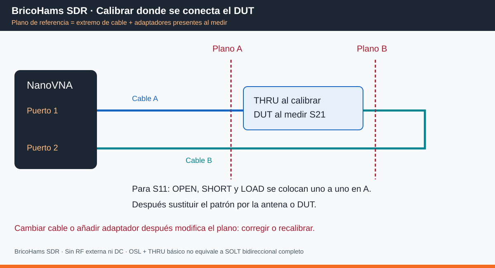
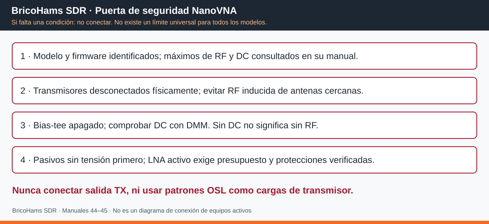

# 45 · BricoHams SDR · NanoVNA: puesta en marcha, calibración y medidas

**Edición 2026-10-17 · Modelo del usuario: POR CONFIRMAR.**

Manual de banco para redes **pasivas, sin tensión y sin transmisores conectados**.
Complementa el [laboratorio RF](44_LABORATORIO_RF.md) y sus
[hojas rellenables](../laboratorio-rf/README.md).
No actualiza firmware ni configura físicamente instrumentos.

## 1. Identificar antes de seguir

Fotografiar frontal, conectores, etiqueta y pantalla de versión. Anotar:
marca real/vendedor, H/H4/V2/S-A-A-2/Plus4 u otra revisión, firmware, software PC,
rango de frecuencia **verificado**, nivel de salida, máximo RF/DC de cada puerto,
resolución/puntos, batería y kit. Si el fabricante no documenta límites:
no conectar señales externas ni dispositivos activos.

| Familia | Consecuencia para este manual |
|---|---|
| NanoVNA original / H / H4 | CH0 suele corresponder a reflexión/estímulo y CH1 a transmisión; confirmar rotulación. Los originales usan armónicos en bandas altas; no extrapolar exactitud a 1090 MHz |
| V2 / S-A-A-2 | El manual NanoRFE describe PORT 1/PORT 2, OSL + THRU y sus menús; no asumir que hay paso ISOLN |
| V2 Plus4 / clones / otros | Menús, puntos, rango y prestaciones cambian. Consultar mapa/manual exactos; una carcasa parecida no garantiza identidad |

No hay un máximo de entrada ni potencia de salida universal «NanoVNA».
La frecuencia más alta que muestra la pantalla no acredita exactitud útil allí.
**No transferir firmware entre familias.**

Fuentes consultadas el 2026-10-17:

- [Inicio oficial NanoVNA](https://nanovna.com/?page_id=60):
  principios, accesorios y funcionamiento del modelo original.
- [Manual NanoRFE V2 / S-A-A-2](https://nanorfe.com/nanovna-v2-user-manual.html):
  menús, OSL/THRU, guardado, trazas y software. Las referencias V2 de este manual
  se basan en ese documento, no identifican tu equipo.
- [NanoVNA-Saver: proyecto y documentación](https://github.com/NanoVNA-Saver/nanovna-saver):
  captura de datos, calibración asistida y Touchstone. Confirmar compatibilidad
  con modelo y versión; para V2, NanoVNA-QT es otra opción descrita por NanoRFE.

## 2. Lo que muestran los puertos y las curvas

El puerto 1 emite y observa reflexión; el puerto 2 recibe transmisión en el
sentido 1→2. El conjunto básico obtiene **S11 y S21**. No supone S22/S12 simultáneos
ni corrección completa bidireccional. Para una medida inversa se invierte el DUT
y se identifica la orientación y la nueva corrección.

Con impedancia de referencia de **50 Ω**:

- `S11_log = 20 log10(|S11|)` en dB, normalmente negativo en un pasivo.
- `RL = −S11_log` (return loss positivo); no confundir -20 dB de S11 con -20 dB de RL.
- `ROE = (1+|S11|)/(1−|S11|)` cuando `|S11|<1`.
- `Z = 50 × (1+S11)/(1−S11)` usando S11 **complejo**.
- `IL = −20 log10(|S21|)` para pérdida positiva de inserción de un pasivo.
  Ganancia pequeña señal se expresa `20 log10(|S21|)`, con las cautelas del manual 44.
- Un mínimo S11 es buena adaptación, **no prueba de eficiencia**.
  S21 cerca del suelo del montaje es un límite de medida, no rechazo infinito.

Ejemplo matemático: S11=-10 dB → RL=10 dB y ROE≈1,925.
S21=-2,5 dB → IL=2,5 dB. No son medidas de tus componentes.

## 3. Accesorios y plano de referencia

Necesario: patrones **OPEN, SHORT, LOAD 50 Ω**, THRU/adaptador apropiado,
dos cables de medida de 50 Ω, adaptadores identificados, carga de verificación
**independiente**, atenuador de verificación caracterizado y soporte para cables.
Un tapón no identificado no es un patrón OPEN caracterizado.
No asumir que las piezas de kits económicos son ideales, especialmente en UHF.

**Plano A/B:** los extremos donde se sustituye el patrón por el DUT. Calibrar
con los cables/adaptadores que se usarán. Si después se añade un adaptador,
queda en la medida; corregirlo o repetir la calibración.
No confundir port extension/electrical delay con eliminación de todas las pérdidas
y desadaptaciones de un cable. No sirve para «mejorar» una antena.

1. Con todo apagado, inspeccionar y conectar los cables al NanoVNA.
2. Descargar estática con práctica ESD adecuada. No manipular antenas durante tormenta.
3. Encender con batería cargada y dejar estabilizar según manual.
   Si no hay tiempo especificado, observar THRU/carga hasta estabilidad y registrar
   cuánto se esperó, sin presentarlo como prescripción del fabricante.
4. Sujetar cables en curvas amplias; evitar tocarlos y moverlos tras calibrar.
5. Confirmar entorno sin TX y sin DC en los extremos. No probar jamás con potencia TX.

## 4. Calibración RF OSL/THRU, paso a paso

### 4.1 Definir el barrido antes de calibrar

En el manual V2 los controles son **STIMULUS → START / STOP**, o
**CENTER / SPAN**. Otros firmwares pueden abreviar o mover estas opciones.

1. Elegir banda del requisito, no 50 kHz–máximo para todo.
   Ejemplos de ensayo: 140–150 MHz, 420–450 MHz, 860–880 MHz y
   1050–1130 MHz **solo si tu modelo está verificado en esa banda**.
2. Introducir unidad correcta (Hz/kHz/MHz/GHz) y revisar números en pantalla.
3. Seleccionar puntos, promediado y nivel de salida disponibles; registrar.
   Separación aproximada: `(stop−start)/(N−1)`.
   En 420–450 MHz con 101 puntos hay 300 kHz por punto:
   insuficiente para resolver algunos detalles estrechos. Estrechar y recalibrar.
4. Para filtros estrechos, definir resolución antes de medir. El interpolado
   de pantalla no crea información ni aumenta rango dinámico.
5. Mantener estos ajustes durante calibración, DUT y verificación final.

### 4.2 OSL: reflexión, en plano A

Secuencia documentada V2:

1. Quitar el DUT. Abrir **CAL → RESET → CALIBRATE**.
2. Colocar **OPEN** en el extremo A; no tocarlo. Pulsar **OPEN** y esperar
   a que se complete/adquiera el patrón y se indique en el menú.
3. Sustituir por **SHORT**, pulsar **SHORT**, esperar final.
4. Sustituir por **LOAD 50 Ω**, pulsar **LOAD**, esperar final.
5. Para solo S11, finalizar con **DONE** y guardar con **SAVE n** según versión.
   Para S21, seguir con THRU antes de finalizar.

OPEN/SHORT/LOAD van **en el plano A**, no directamente en el chasis si el cable
forma parte del montaje. Evitar calentar los patrones con la mano.
En software que admita modelo del kit, introducir datos del fabricante:
retardo, pérdidas y parásitos con unidades exactas. No inventar coeficientes
para «mejorar» el ajuste. Kit sin caracterización → incertidumbre limitada.

### 4.3 THRU: transmisión entre A y B

1. Retirar LOAD de A y conectar A↔B mediante el THRU previsto.
   Sus conectores/género y retardo deben corresponder al modelo de calibración.
2. Pulsar **THRU**, esperar fin; finalizar **DONE → SAVE n**.
3. Registrar ranura, rango, puntos, temperatura, cables, adaptadores y kit.
4. Si tu firmware pide **ISOLN / isolation**, usar **su procedimiento exacto**:
   típicamente puertos terminados por separado con cargas de 50 Ω, no unidos.
   No añadirlo a un V2 que no lo ofrezca ni usar puertos abiertos como sustituto.
5. Guardar corrección RF por el menú CAL. En el manual V2, **CONFIG → SAVE**
   guarda configuración general/táctil, **no sustituye** guardar la corrección RF.

**OSL + THRU de un NanoVNA básico no es una calibración SOLT completa de dos
puertos de laboratorio.** Guardar esa limitación en cada ensayo.

### 4.4 Verificar: no limitarse a mirar los patrones usados

1. Conectar **otra carga de 50 Ω** caracterizada: Smith próximo al centro,
   ROE próxima a 1 y S11 bajo dentro de su especificación e incertidumbre.
   Si se usa la misma LOAD de calibración, es solo autoconsistencia, no validación independiente.
2. Conectar un THRU de verificación y registrar pérdida/fase residual esperada;
   no asumir exactamente 0 dB si incorpora retardo/pérdidas no modelados.
3. Insertar un atenuador independiente de valor conocido, por ejemplo nominal
   10 dB, y comparar con **su ficha/certificado a la frecuencia de ensayo**.
4. Definir tolerancias antes de observar resultados; no inventar ±0,1 dB como
   exactitud universal. Rellenar hoja de calibración con inicial/final.
5. Fallo → no medir DUT, revisar conexiones, kit, banda y corrección. Repetir
   tras corregir. Si falla al final, revisar todos los ensayos afectados.
6. Recalibrar al cambiar cables/adaptadores, rango/puntos/nivel, montaje o
   ante deriva. El V2 documentado borra la calibración al cambiar rango;
   otras versiones interpolan: aquí se exige nueva corrección para cualificar.

## 5. Capturas de referencia: pantallas reales, no datos del proyecto

**Las siguientes imágenes se enlazan desde la documentación original, sin
redistribuir copias locales ni atribuirse sus medidas. Requieren Internet.**
No son capturas de tu NanoVNA. Pueden corresponder a versiones antiguas y no
deben tomarse como identificación del firmware instalado.
Los tres diagramas locales BricoHams sí se pueden consultar sin conexión.

### 5.1 NanoVNA V2: trazas y marcadores

**BricoHams SDR · Referencia externa NanoRFE, manual V2.**
Localizar traza activa, canal, formato y marcador. Los colores y valores de esta
captura son los de su ejemplo, no resultados de la estación.

### 5.2 NanoVNA-Saver: ventana de calibración

**BricoHams SDR · Referencia externa del README de NanoVNA-Saver.**
Localizar adquisición de patrones, asistente, notas y guardado. Comprobar
compatibilidad de la versión con tu modelo; no activar dos correcciones por accidente.
Los coeficientes del kit de esa captura **no pertenecen a tu kit**: no copiarlos.

### 5.3 NanoVNA-Saver: interfaz de adquisición

**BricoHams SDR · Ejemplo histórico 0.1.4, no interfaz actual garantizada.**
Sirve para reconocer conexión, barrido y gráficas. Las rutas de tu versión
pueden diferir. Abrir las fuentes para ampliar y consultar documentación actual.
La interfaz histórica rotula «Return loss» con valores negativos; en las hojas
de este paquete se distingue **S11_LOG negativo** de **RL positivo**, como en §2.

## 6. Configurar pantalla y medir una antena

Rutas de referencia del manual V2:

1. **DISPLAY → TRACE → TRACE n** selecciona/activa una traza.
2. **DISPLAY → CHANNEL → CH0/CH1** o canal rotulado equivalente:
   comprobar que CH0 corresponde a S11 y CH1 a S21 en esa versión.
3. **DISPLAY → FORMAT → LOGMAG / SWR / SMITH** cambia la traza activa.
4. Ajustar escala/referencia para que se vea toda la curva; conservarlos en capturas.
5. **MARKER** permite elegir marcador y buscar mínimo según firmware.
   Poner marcadores también en frecuencia de uso y extremos de banda.

Para antena: traza S11 LOGMAG, otra SWR y otra SMITH. No usar S21 si solo está
conectado el puerto 1. Después de OSL y verificación:

1. Conectar antena en A; mantenerla en posición representativa y sin personas cerca.
2. Leer ROE/impedancia en frecuencias objetivo, no solo en resonancia.
3. Anotar ancho de banda conforme a requisito; conservar el barrido complejo.
4. Repetir tres conexiones. Si manos, USB o posición cambian mucho la curva,
   investigar modo común/entorno antes de ajustar elementos.
5. Para instalación en mástil, registrar plano real; la medida desde abajo
   incluye coaxial y puede mejorar artificialmente la ROE por sus pérdidas.

## 7. Medir filtros, coaxiales y diplexores

1. Calibrar OSL/THRU con dos cables y verificar. Configurar S21 LOGMAG y S11 LOGMAG.
2. Insertar DUT entre A y B sin mover cables. Orientación marcada IN/OUT.
3. Para coaxial, leer IL en varias frecuencias y retardo si se necesita.
4. Para filtro, barrer primero paso; medir máximo de pérdida y rizado; guardar.
5. Medir rechazo con otro barrido calibrado. Documentar suelo medido del montaje.
   Un valor de -80 dB en pantalla no prueba 80 dB de rechazo.
6. Para diplexor, terminar con 50 Ω el puerto no observado y registrar su ID.
7. Medir orientación inversa si procede, etiquetándola; no inventar S22/S12.
8. Guardar datos y chequeo final; comparar con requisitos del manual 44.

### 7.1 TDR opcional: límites

Solo si software/modelo lo ofrece: calibrar, definir banda/ventana y VF real,
conectar coaxial al plano, introducir factor de velocidad documentado y conservar
configuración. En reflexión, distancia estimada `d = VF × c × t / 2`.
No usar esa división adicional si el programa ya muestra distancia.
Ancho de banda limita resolución; ventana, VF y adaptadores desplazan el resultado.
No usar TDR aproximado para certificar aislamiento eléctrico de un cable.

## 8. PC, captura real y exportación reproducible

1. Anotar SO, software y versión. Instalar solo desde proyecto/fabricante;
   verificar compatibilidad y archivo publicado. No instalar ni flashear como
   requisito para una medida que puede hacerse en pantalla.
2. Conectar USB con el DUT retirado; identificar equipo/puerto en el software.
   Si el software toma control y modifica barrido, volver a establecerlo y calibrar.
3. **Elegir una única cadena de corrección documentada**: corrección del equipo
   o flujo de calibración del PC conforme a esa versión.
   Saver puede requerir una calibración razonable en el dispositivo para adquirir;
   seguir su manual para la calibración posterior del PC. No aplicar una corrección
   externa nueva sobre archivos ya corregidos sin conocer el flujo.
4. En NanoVNA-Saver, la documentación describe **Calibration Assistant** y
   adquisición de cada patrón, notas, Save/Load y Apply. Ejecutar §4 en el
   plano real y verificar independientemente **después** de Apply.
5. Guardar Touchstone y configuración. `.s1p` contiene reflexión de un puerto;
   `.s2p` puede contener campos S12/S22 no medidos o supuestos: revisar encabezado
   y semántica del exportador, anotar en hoja **S11/S21 medidos únicamente**.
6. Captura: herramienta de exportación del software si existe, o captura de
   ventana del SO. Para pantalla física usar cámara sin reflejos, con parámetros
   legibles. No modificar curvas, borrar avisos ni reconstruir números.
7. Añadir branding en un **pie externo** sin tapar estado, ejes, marcadores o avisos.
   Conservar original sin editar; si contiene datos privados, exportar una copia
   anonimizada y señalarlo. No incluir series personales en versión pública.
8. Nombre `ENS-ID_CMP-ID_CAL-ID_frecuencias_fecha`. Registrar archivo y SHA-256
   usando una herramienta local si se necesita integridad.
9. Reabrir exportación con el mismo software y verificar número de puntos,
   banda, unidades y curvas. Una captura no basta para reanalizar una medida.

### Lista de capturas que hay que producir en tu banco

| Captura real pendiente | Debe mostrar |
|---|---|
| Identificación | Modelo/revisión/firmware y etiqueta del instrumento |
| Barrido | Start/stop, puntos y configuración relevantes |
| Plano | Cables, adaptadores y punto donde se colocan patrones |
| Corrección | Estado CAL activo y ranura/dataset |
| Verificación | Carga/atenuador independientes, sus IDs y marcador |
| DUT | Curvas S11/S21/ROE pertinentes y escala |
| Final | Verificación posterior y nombre de archivo guardado |

Sin acceso al equipo no se rellenan estas capturas con simulaciones.

## 9. Qué no hacer

- No conectar salida TX, antena próxima a TX activo, bias-tee energizado ni DC.
- No medir LNA activo sin condiciones del [manual 44, §8](44_LABORATORIO_RF.md#8-dispositivos-activos-y-ensayos-sdr).
- No usar máximo de frecuencia anunciado como exactitud de todo el rango.
- No hacer una calibración de 1 MHz a 3 GHz y asumir validez de filtros estrechos.
- No confundir corrección OSL RF, calibración táctil y certificado metrológico.
- No deducir NF, potencia TX, eficiencia o emisiones de una curva S11/S21.
- No usar OPEN/SHORT de calibración como cargas para transmisores.

## 10. Mantenimiento, almacenamiento y repetición

Antes de cada sesión: inspección de SMA, cables, patrones, batería y firmware.
Después: guardar datos y corrección, apagar, tapar conectores y almacenar patrones
secos e identificados. No limpiar pines con abrasivos ni introducir líquidos en puertos.

Tras caída, sobrecarga, DC accidental o deriva: retirar de servicio, identificar
evento y solicitar revisión; una recalibración que «parece buena» no descarta daño.
No cargar baterías hinchadas o dañadas ni dejar patrones sin etiqueta.

**Registro obligatorio:** modelo/firmware, rango, puntos, kit, cableado, plano,
corrección, verificación antes/después y limitaciones. Sin esos datos,
la gráfica es una observación orientativa, no una cualificación reproducible.
